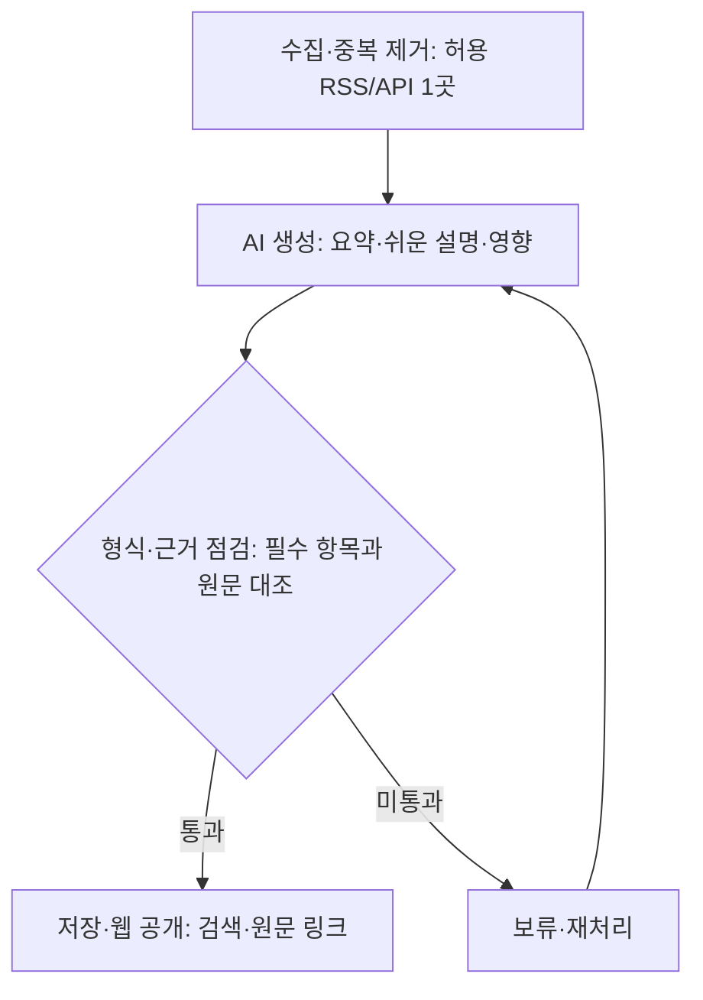

# 다잇(DAIT) 서비스 기획안

> **AI 소식을, 오늘의 실행으로.**  
> Dev + AI + Trend · 나의 AI 데일리 비서

- **작성일:** 2026.11.03
- **서비스 정의:** 흩어진 AI 소식을 한국어로 정리하고, 내게 미치는 영향과 다음에 확인할 자료까지 연결하는 큐레이션 서비스
- **문서 구성:** 기존 3페이지 PDF의 내용을 세 부분으로 구성한 마크다운 버전

---

## 1부. 제품 방향과 핵심 가치

### 1. 왜 필요한가

탐색 → 이해 → 활용 과정에서 발생하는 세 가지 부담을 해결한다.

| 문제 | 사용자가 겪는 어려움 | 제공 가치 |
| --- | --- | --- |
| 흩어진 정보 | 여러 블로그와 뉴스에서 같은 소식을 반복 탐색한다. | 한곳에서 핵심만 |
| 어려운 원문 | 영문과 전문 용어 때문에 변화의 의미를 놓친다. | 쉽게 이해하는 요약 |
| 모호한 활용 | 읽고 끝나 실제 업무와 학습으로 이어지지 않는다. | 영향과 행동까지 |

### 2. 핵심 사용자

**AI를 학습·활용하는 주니어 개발자와 입문 실무자**를 우선 대상으로 한다.

먼저 학습·개발에 필요한 소식을 검증하고, 이후 기획자·현업으로 확장한다.

### 3. 핵심 경험: 이해하고, 판단하고, 움직인다

| 단계 | 핵심 경험 | 제공 내용 |
| --- | --- | --- |
| 01 이해 | 무엇이 달라졌는지 빠르게 파악한다. | 한국어 핵심 3줄, 전문 용어 원문 병기 |
| 02 판단 | 나에게 어떤 의미인지 이해한다. | 개발자 관점과 쉬운 설명, 사실과 AI 해석 구분 |
| 03 실행 | 다음 행동으로 연결한다. | 오늘 확인할 행동 1개, 원문·공식 학습 자료 연결 |

### 4. 첫 출시의 약속

> **필요한 소식만, 근거와 함께, 짧게.**

매일 **3~10건**을 목표로 품질을 우선한다. 읽는 시간은 줄이고, 확인할 근거는 남긴다. 탐색 시간과 실제 도움 여부를 베타에서 측정해 서비스의 가치를 검증한다.

---

## 2부. 사용자 경험과 서비스 구조

### 5. 이용 흐름과 화면 구성

웹에서 요약을 읽고 원문과 학습 자료로 이어지는 짧은 흐름을 설계한다.

| 순서 | 이용 단계 | 주요 기능 |
| --- | --- | --- |
| 1 | 관심 주제 선택 | 태그 기반 간단 설정 |
| 2 | 오늘의 브리핑 | 목록·키워드 검색 |
| 3 | 핵심과 영향 확인 | 요약·쉬운 설명·근거 |
| 4 | 후속 행동 | 원문·학습 링크 열기 |

#### 콘텐츠 카드 예시

> 아래는 콘텐츠 카드의 구성 예시이며, 특정 실제 발표를 요약한 내용은 아니다.

**DAIT DAILY · 에이전트 · 원문 대조 완료**

#### 도구 호출 기능, 무엇을 확인할까?

- **핵심 요약:** 원문에 근거한 변경점·대상·제약을 3줄로 정리한다. 수치와 모델명은 원문과 대조한다.
- **개발자에게 · AI 해석:** 기존 도구 호출 흐름과의 호환성을 먼저 확인한다.
- **오늘의 행동:** 공식 예제 1개 살펴보기
- **연결 기능:** 원문 보기 / 관련 문서 / 도움됨

#### 설계 보완 포인트

| 구분 | 보완 방향 | 구체적인 설계 |
| --- | --- | --- |
| A | 행동으로 연결 | 요약 아래 확인할 행동을 1개로 좁혀 제안한다. |
| B | 확인 상태를 공개 | ‘대조 완료 / 검토 필요’를 구분하고 해석을 표시한다. |
| C | 학습자도 이해 | 전문 용어 풀이와 ‘쉽게 말하면’을 제공한다. |

### 6. 수집부터 발행까지: 품질을 통과한 정보만

#### 운영 원칙과 최소 구현

| 항목 | 원칙 |
| --- | --- |
| 출처 | 주 출처 1곳과 대체 출처 1곳을 사전 점검한다. |
| 검증 | AI 점수만으로 사실 여부를 확정하지 않는다. |
| 표시 | 제목·날짜·출처·자체 요약·원문 링크를 제공한다. |
| 구성 제안 | Python 수집/AI → SQLite → 웹으로 구성한다. |
| 비용 | 원문별 결과를 재사용하고, 1회 최대 15건을 처리한다. |
| 실패 | 최대 2회 재시도하며, 콘텐츠가 부족하면 확보 건수를 공개한다. |

---

## 3부. 실행 계획과 검증 기준

> **작게 완성하고, 근거로 확장한다.**  
> 5인·2주를 가정한 제안안이다. 일정과 수치는 팀의 가용 시간에 맞춰 확정한다.

### 7. 2주 MVP 실행 계획

| 기간 | 단계 | 주요 작업 |
| --- | --- | --- |
| D1~2 | 기반 확정 | 주 출처·대체 출처 점검, 공통 데이터 형식 합의, 요약 샘플·화면 초안 확정 |
| D3~7 | 개발·연결 | 수집·AI·웹 동시 개발, 반복 수집 중복 방지, 수집부터 검색까지 연결 |
| D8~10 | 검증·시연 | 10건 원문 교차 대조, 실패·모바일 화면 점검, 기능 동결·백업 시연 |

#### 역할 제안

| 영역 | 담당 범위 |
| --- | --- |
| 기획·검증 | 사용자 흐름, 원문 대조, 완료 기준 확인 |
| 데이터 수집 | 출처 연동, 수집, 중복 방지 |
| AI 처리 | 요약·쉬운 설명·영향 생성과 결과 점검 |
| 웹 화면 | 목록·검색·콘텐츠 표시 |
| 통합·배포 | 기능 연결과 시연 환경 준비 |

각 영역에 **백업 1인**을 지정한다. **D7까지 연결이 지연되면 상세 화면부터 축소**한다.

### 8. 완료 기준: 만들었다는 것을 어떻게 증명할까

| 평가 항목 | MVP 목표 | 확인 방법 |
| --- | --- | --- |
| 기본 동작 | 10건 이상 수집·3종 요약 확보 | 실행 결과·누락 항목 점검 |
| 중복·실패 | 연속 2회 중복 0건·재시도 가능 | 동일 입력·오류 상황 재현 |
| 내용 품질 | 공개 10건의 근거 없는 핵심 사실 0건 | 2인 원문 대조 후 수정·재검수 |
| 화면·사용성 | 360px 화면 확인·검색 3종 통과 | 일치 / 미일치 / 빈 검색어 |

#### 베타 검증 제안

**10~20명이 1주간 사용**한 뒤 사용 전후 탐색 시간과 ‘도움됨’ 비율을 측정한다.

| 지표 | 목표 가설 |
| --- | --- |
| 탐색 시간 | 중앙값 50% 감소 |
| 도움됨 응답 | 응답 비율 70% 이상 |

위 수치는 검증 전 목표 가설이며, 달성된 성과를 의미하지 않는다.

### 9. 검증 이후의 확장 순서

| 단계 | 목표 | 주요 범위 |
| --- | --- | --- |
| 1. MVP | 핵심 경험 검증 | 회원가입 없이 웹 검증, 수동 실행·검색·원문 확인 |
| 2. 베타 | 반복 사용 검증 | 매일 예약·로그인·관심사, 알림 1채널·하루 1묶음 |
| 3. 확장 | 수익화 검증 | 다중 채널·개인화 추천, 팀 브리핑·유료 수요 조사 |

### 10. 추가 운영 결정

- **콘텐츠 수:** 매일 3~10건은 목표 범위이며, 부족한 날에는 검증된 건수만 표시한다.
- **알림 정책:** 예약·알림 도입 시 빈 브리핑은 보내지 않는다.
- **추천 표기:** 자동 점수에 따른 순서는 ‘DAIT 추천순’으로 명시한다.
- **수익화:** 가격·결제는 사용 데이터로 결정한다.

---

### 참고 자료

- 첨부 기획안 PDF: 다잇기획1.pdf
- 첨부 상세기획서: 다잇기획2.md
- 첨부 서비스 기획 이미지: 13. 다잇(DAIT).png

일정·지표·확장 순서는 참고 자료를 바탕으로 재구성한 제안이다.
