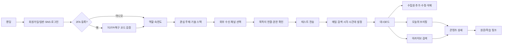
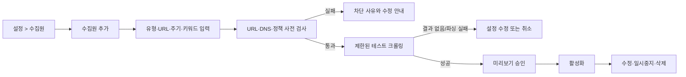
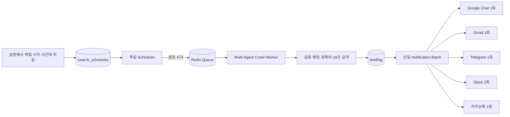
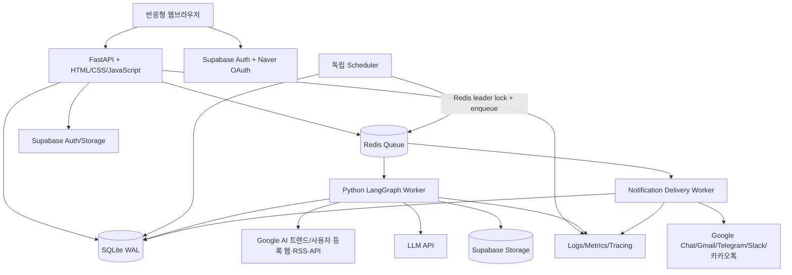
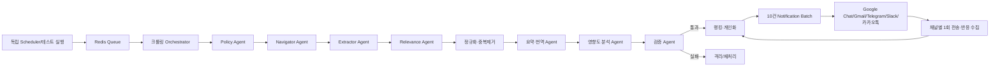

# DAIT(다잇) 서비스 상세기획서 v1.0.0

> Dev + AI + Trend: 최신 AI 생태계 소식을 실무와 학습으로 연결하는 데일리 큐레이션 서비스

- 문서 버전: 1.0.0
- 문서 상태: MVP 단일 배치 알림·5개 전달 채널·2차 구독/결제 분리 요구사항을 반영한 구현 기획안
- 작성일: 2026-11-02
- 근거 자료: 「나의 AI 데일리 비서 다잇(DAIT)」 서비스 기획 이미지
- 변경 요약: 랭킹 뉴스 10건을 하나의 알림 배치로 구성해 Google Chat·Gmail·Telegram·Slack·카카오톡에 채널별 1회 발송, 구독·결제는 2차 개발로 분리

---

## 1. 문서 목적

이 문서는 DAIT MVP를 설계·개발·검수할 수 있도록 제품 범위, 사용자 경험, 기술 구조, 데이터와 에이전트 흐름, Google Chat·Gmail·Telegram·Slack·카카오톡 알림, 보안, 단계별 구현 계획 및 수용 기준을 하나로 정의한다.

이미지에서 확인되지 않은 항목은 사실처럼 단정하지 않고 `MVP 가정` 또는 `결정 필요`로 표시한다.

## 2. 제품 정의

### 2.1 한 줄 소개

DAIT는 Google의 인기 AI 트렌드 상위 10개와 사용자가 직접 등록한 외부 소스를 멀티에이전트로 수집·검증·요약·번역하고, 랭킹 뉴스 10건을 하나의 배치로 만들어 Google Chat·Gmail·Telegram·Slack·카카오톡 및 웹으로 제공하는 맞춤형 큐레이션 서비스다.

### 2.2 해결할 문제

1. AI 트렌드와 기술 변화가 빨라 매일 여러 출처를 탐색하는 비용이 크다.
2. 해외 공식 문서·논문을 빠르게 번역하고 핵심만 파악하기 어렵다.
3. 단순 뉴스 나열만으로는 개발자·실무자에게 미칠 영향과 행동 방향을 알기 어렵다.
4. 수집한 자료가 채팅과 북마크에 흩어져 다시 찾거나 학습으로 연결하기 어렵다.

### 2.3 목표

- 매일 Google의 인기 AI 트렌드 상위 10개를 기본 수집하고, 검증된 핵심 AI 소식 3~10건을 사용자별로 전달한다.
- 각 소식을 3줄 요약, 한국어 번역, 실무 영향도, 출처, 관련 기술 스택으로 제공한다.
- Google Chat·Gmail·Telegram·Slack·카카오톡에서 하나의 알림으로 오늘의 10개 랭킹을 훑고 웹에서 전체 요약을 검색·보관·학습할 수 있게 한다.
- 모바일·태블릿·데스크톱 브라우저에서 동일 기능을 제공하는 모바일 우선 반응형 UI를 구현한다.
- 사용자가 설정한 매일 검색 시각에 웹 접속 여부와 관계없이 서버가 멀티에이전트 검색·크롤링을 자동 실행한다.
- 검증을 통과한 랭킹 뉴스 10건을 하나의 알림 배치로 만들고 활성화된 5개 채널에 채널별 정확히 1회 발송한다.
- 수동 탐색 시간을 기준 대비 90% 이상 줄일 수 있는 사용 경험을 지향한다.

### 2.4 성공 지표

| 구분 | MVP 지표 | 측정 방법 |
|---|---:|---|
| 전달 안정성 | 예약 브리핑 성공률 98% 이상 | 일별 전송 작업 로그 |
| 일정 정확성 | 예약 실행의 95%가 설정 시각 ±1분 안에 큐 등록 | Scheduler 실행 로그 |
| 품질 | 출처 링크 유효율 99% 이상 | 발행 전 자동 검사 |
| 개인화 | 브리핑 항목 중 관심 주제 일치율 80% 이상 | 태그 매칭 및 사용자 평가 |
| 활용 | 외부 수신 채널 링크 클릭률 20% 이상 | 제공자 공통 추적 리디렉션 이벤트 |
| 유지 | 4주차 주간 활성 유지율 30% 이상 | 코호트 분석 |
| 만족 | 항목별 `도움됨` 비율 70% 이상 | 피드백 이벤트 |

### 2.5 비목표 및 안티골

- MVP에서 실시간 속보, 모바일 네이티브 앱, 팀 협업 편집, 구독·결제·플랜 차등은 만들지 않는다.
- 원문 전체를 무단 복제하거나 유료 콘텐츠를 우회하지 않는다.
- LLM이 생성한 내용을 출처 확인 없이 사실처럼 발행하지 않는다.
- 사용자마다 완전히 다른 문서를 생성해 운영 비용을 폭증시키지 않는다. 검증된 공통 콘텐츠에 개인화 랭킹과 영향도 문구를 조합한다.
- 자동화가 실패했을 때 오래된 브리핑이나 빈 메시지를 정상 결과처럼 전송하지 않는다.

## 3. 요구사항 분석과 설계 결정

### 3.1 검토한 구현 접근

| 접근 | 장점 | 단점 | 판단 |
|---|---|---|---|
| A. SPA 프런트엔드와 FastAPI 분리 | 화면 상호작용이 풍부하고 프런트 생태계가 큼 | 별도 프레임워크·빌드 체인과 중복 타입 관리가 필요 | 현재 범위에는 과함 |
| B. FastAPI 중심 HTML/CSS/JavaScript 반응형 웹 | 단일 Python 서비스, 작은 프런트 번들, 빠른 MVP, AI 워커와 운영 통합 용이 | 복잡한 클라이언트 상태가 늘면 JS 모듈 관리 부담 | **권장** |
| C. 완전 서버리스 이벤트 파이프라인 | 자동 확장과 작업별 격리 | SQLite와 장시간 크롤링에 부적합하고 로컬 재현·비용 예측이 어려움 | 트래픽 확대 후 검토 |

### 3.2 선택안

FastAPI가 반응형 HTML 화면, 정적 CSS/JavaScript, JSON API를 제공하고 별도 Python 워커가 수집·요약·번역·검증을 수행한다. SQLite를 MVP 업무 데이터의 단일 기준 저장소로, Redis를 큐·캐시·세션 보조·속도 제한으로 사용한다. Supabase는 Auth와 Storage에 한정하고 Supabase Database는 MVP에서 사용하지 않아 데이터 기준점을 이중화하지 않는다. 원문 전체 대신 메타데이터·인용 가능한 발췌·생성 결과·출처를 저장한다.

### 3.3 MVP 가정

1. 서비스 언어는 한국어이며, 원문은 주로 영어와 한국어다.
2. MVP의 모든 사용자는 동일 기능을 사용하며 자동 검색 1회당 랭킹 뉴스 10건을 하나의 알림으로 받는다.
3. 구독·결제·무료/유료 플랜·사용량 제한은 MVP에 포함하지 않고 2차 개발로 분리한다.
4. 사용자는 Google Chat 스페이스, Gmail 주소, Telegram 채팅, Slack 채널, 카카오톡 수신처 중 하나 이상을 설정할 수 있다.
5. 사용자는 매일 검색 시각과 IANA 시간대를 설정·수정·삭제할 수 있다. 최초 제안값은 `Asia/Seoul` 오전 08:00이며 저장 전에는 활성 일정이 아니다.
6. 기본 소스는 매일 갱신되는 Google 인기 AI 트렌드 상위 10개다. 추가 소스는 사용자가 설정에서 등록하고 테스트 수집과 보안 검사를 통과한 뒤 활성화한다.

### 3.4 결정 필요 항목

- 2차 구독 상품의 가격·무료 체험·사용량 제한
- 2차 결제 사업자, 환불·세금·영수증 정책
- 관리자가 승인해야 발행되는 편집형 운영인지, 품질 임계값을 넘으면 자동 발행하는 완전 자동형인지
- Gmail 발신 계정의 일일 전송 한도와 상용 발송 사업자 전환 시점

본 문서는 MVP를 `품질 임계값 기반 자동 발행 + 관리자 재처리/차단 기능`으로 설계한다.

## 4. 사용자와 권한

### 4.1 주요 사용자

| 사용자 | 핵심 요구 |
|---|---|
| AI 학습자·예비 개발자 | 어려운 원문을 쉬운 한국어 요약으로 이해하고 다음 학습 자료를 찾음 |
| 현직 소프트웨어/AI 엔지니어 | 기술 변화가 현재 스택과 개발 방식에 미치는 영향을 빠르게 판단함 |
| AI 기획자·현업 종사자 | 신규 모델·도구·정책이 업무와 제품 기획에 미칠 영향을 파악함 |
| 운영 관리자 | 기본·사용자 수집원, 크롤링 작업, 콘텐츠 품질, 채널별 전송 실패를 확인하고 재처리하거나 발행을 차단함 |

### 4.2 MVP 권한 매트릭스

| 기능 | 사용자 | Admin |
|---|:---:|:---:|
| 일일 랭킹 뉴스 | 10건 단일 배치 | 테스트 발송 |
| 3줄 요약·번역·출처 | O | O |
| 실무 영향도·관련 링크 | O | O |
| 웹 아카이브 검색 | O | O |
| 검색 일정·관심사 설정 | O | 사용자 지원 |
| 사용자 수집원 관리 | O | 전체 관리 |
| 5개 알림 채널 연결 | O | 테스트·실패 조회 |
| 소스·작업·발행 관리 | - | O |

구독·결제 도입 전까지 모든 승인 사용자는 동일한 MVP 권한을 갖는다.

## 5. 핵심 사용자 스토리

### 5.1 가입과 설정

- 사용자는 카카오톡, 네이버, Google, Apple 또는 Meta 계정으로 가입해 별도 비밀번호 없이 서비스를 시작하고 싶다.
- 사용자는 이메일과 비밀번호로 직접 회원가입하고 이메일 인증 후 로그인하고 싶다.
- 사용자는 계정 보안을 위해 인증 앱 기반 2중 인증을 설정하고 복구 코드를 안전하게 보관하고 싶다.
- 사용자는 자신의 역할, 숙련도, 관심 주제, 기술 스택을 선택해 관련성이 높은 소식을 받고 싶다.
- 사용자는 Google Chat, Gmail, Telegram, Slack 또는 카카오톡을 연결하고 테스트 메시지로 수신 가능 여부를 확인하고 싶다.
- 사용자는 매일 검색 시각과 시간대를 설정하고 5개 알림 채널을 채널별로 켜거나 끄고 싶다.
- 사용자는 매일 검색할 시각을 설정·수정·삭제하고 다음 실행 예정 시각을 확인하고 싶다.
- 사용자는 웹페이지를 닫거나 로그아웃해도 지정 시각에 검색·크롤링이 자동으로 실행되길 원한다.
- 사용자는 기본 Google AI 트렌드 외에 원하는 웹사이트·RSS·공개 API를 추가, 수정, 비활성화 또는 삭제하고 싶다.
- 사용자는 탈퇴 전 데이터 처리 내용을 확인하고 재인증 후 계정을 안전하게 삭제하고 싶다.
- 사용자는 검색 완료 후 10개 랭킹 뉴스가 담긴 동일 배치를 활성화한 5개 채널마다 한 번씩 받고 싶다.

### 5.2 브리핑 소비

- 사용자는 10개 랭킹 뉴스를 채널별 알림 10개가 아닌 하나의 묶음 알림으로 훑고 싶다.
- 사용자는 영어 소식을 자연스러운 한국어로 읽되 모델명·API명·기술 용어는 원문 표기를 유지하고 싶다.
- 사용자는 관련 기술 스택 및 학습 링크를 눌러 바로 후속 학습을 하고 싶다.
- 사용자는 `도움됨/관련 없음` 피드백으로 이후 추천을 개선하고 싶다.

### 5.3 검색과 보관

- 사용자는 날짜, 출처, 주제, 기술 스택으로 과거 소식을 검색하고 싶다.
- 사용자는 원문과 요약, 검증 상태, 관련 리소스를 한 상세 화면에서 확인하고 싶다.

### 5.4 운영

- 관리자는 탐색·크롤링·추출·요약·검증·채널별 발송 단계의 실패 원인을 보고 해당 단계부터 재처리하고 싶다.
- 관리자는 신뢰도가 낮거나 중복인 콘텐츠를 발행 제외하고 기본 및 사용자 등록 소스별 수집 상태를 관리하고 싶다.

## 6. 기능 명세

### 6.1 인증과 온보딩

#### FR-AUTH-01 이메일 회원가입

- 이메일, 비밀번호, 비밀번호 확인, 필수 약관 동의를 입력받는다.
- 비밀번호는 10자 이상이며 영문·숫자·특수문자 중 2종 이상을 요구하고, 유출·취약 비밀번호 목록과 대조한다.
- Supabase Auth가 비밀번호 해시와 이메일 인증을 담당하며 애플리케이션 DB에는 비밀번호를 저장하지 않는다.
- 인증 메일의 링크는 1회 사용·만료 시간을 적용하고 인증 전 계정은 브리핑과 외부 채널 연결을 사용할 수 없다.

#### FR-AUTH-02 일반 로그인과 세션

- 이메일·비밀번호 로그인을 제공하고 성공 시 Supabase JWT를 FastAPI가 검증한다.
- 브라우저 세션은 Secure·HttpOnly·SameSite 쿠키로 유지하며 access/refresh token을 localStorage에 저장하지 않는다.
- Redis로 IP·계정별 로그인 실패 횟수와 속도 제한을 관리한다. 반복 실패 시 지연과 임시 잠금을 적용한다.
- 로그아웃 시 현재 세션을 폐기하고 `모든 기기에서 로그아웃`은 전체 refresh token을 취소한다.
- 비밀번호 재설정은 이메일의 일회성 만료 링크와 신규 비밀번호 정책을 사용한다.

#### FR-AUTH-03 SNS 로그인

- 카카오톡(카카오), Google, Apple, Meta(Facebook)는 Supabase Auth OAuth 공급자를 우선 사용한다.
- 네이버는 FastAPI의 서버 측 Authorization Code 흐름으로 연동하고 검증한 provider identity를 내부 사용자에 연결한다.
- 최초 로그인 시 사용자 레코드를 생성하고 이용약관·개인정보 처리방침 동의를 기록한다.
- 제공자별 고유 식별자와 검증된 이메일을 저장한다. 이메일이 같더라도 제공자가 다르면 자동 병합하지 않고, 로그인된 사용자의 명시적 계정 연결 절차를 거친다.
- Apple의 비공개 이메일 릴레이와 카카오·네이버의 선택 동의 항목을 고려하여 이메일 없이도 제공자 식별자로 계정을 유지할 수 있게 한다.

#### FR-AUTH-04 2중 인증(2FA)

- Supabase Auth MFA의 TOTP를 사용하며 Google Authenticator, Microsoft Authenticator 등 표준 인증 앱을 지원한다.
- 활성화 시 QR 코드와 수동 입력 키를 보여주고 첫 6자리 코드를 검증한 뒤에만 등록을 완료한다.
- 등록 완료 시 일회용 복구 코드 10개를 생성해 한 번만 보여주고 서버에는 해시만 저장한다.
- 2FA 사용자는 1차 로그인 후 `aal2` 확인 전까지 브리핑 조회 등 보호 화면에 접근할 수 없다.
- 이메일·비밀번호 변경, SNS 계정 연결 해제, 전체 로그아웃, 회원탈퇴, 관리자 기능은 최근 10분 이내 `aal2` 재인증을 요구한다.
- 복구 코드는 사용할 때 원자적으로 폐기하며 남은 개수만 표시한다. 모든 수단을 잃은 경우 본인 확인 기반 운영 절차를 사용한다.

#### FR-AUTH-05 회원탈퇴

- 탈퇴 화면에 삭제 대상, 법적 보존 대상, 연결 해제되는 외부 채널, 취소 가능 기간을 표시한다.
- 비밀번호 사용자는 비밀번호와 2FA, SNS 전용 사용자는 해당 공급자 재인증과 2FA로 본인을 확인한다.
- 확인 즉시 계정을 `deletion_pending`으로 전환하고 로그인·수집·브리핑·전송을 중지한다.
- 7일 안에는 이메일의 일회성 링크로 취소할 수 있으며, 이후 Supabase Auth 사용자·연결 비밀·개인 설정을 삭제하고 콘텐츠 이력은 보존 정책에 따라 비식별화한다.
- 법적·운영상 보존 의무가 없는 개인 데이터는 요청 후 30일 안에 삭제한다.

#### FR-ONB-01 프로필 설정

- 역할: 학습자, 소프트웨어 엔지니어, AI 엔지니어, 기획/현업, 기타
- 숙련도: 입문, 중급, 고급
- 관심 주제: LLM, 에이전트, RAG, 멀티모달, 오픈소스, MLOps, AI 정책 등 복수 선택
- 기술 스택: 자유 검색 후 표준 태그 선택
- 최소 하나의 관심 주제를 선택해야 완료된다.

### 6.2 외부 수신 채널 연결

#### FR-CHN-01 공통 연결 정책

- 사용자는 Google Chat, Gmail, Telegram, Slack, 카카오톡 중 하나 이상을 연결할 수 있다.
- 모든 연결은 `pending → testing → active | action_required | revoked` 상태를 사용한다.
- 연결 시 테스트 메시지를 전송하고 성공한 목적지만 활성화한다.
- 연결 비밀과 webhook URL은 KMS로 필드 암호화하고 화면·로그·분석 이벤트에 노출하지 않는다.

#### FR-CHN-02 Google Chat

- MVP는 사용자가 Google Chat 스페이스에서 생성한 Incoming Webhook URL을 등록하는 방식으로 연결한다.
- URL 형식과 Google Chat 도메인을 검사한 뒤 테스트 카드 메시지를 보낸다.
- 향후 사용자 수요가 확인되면 Google Chat 앱 설치 방식으로 전환한다.

#### FR-CHN-03 Gmail

- 사용자는 Gmail 수신 주소를 등록하고 6자리 이메일 인증 코드로 소유권을 확인한다.
- 서비스 발신 전용 Google 계정의 Gmail API OAuth2 credential을 사용하며 사용자의 Gmail 읽기·쓰기 권한은 요청하지 않는다.
- 인증된 주소에만 테스트 메일과 정기 랭킹 배치를 발송한다.

#### FR-CHN-04 Telegram

- 중앙 DAIT Bot의 deep link로 연결을 시작하고, 사용자가 `/start <one-time-token>`을 보내면 `chat_id`를 연결한다.
- 그룹 연결은 관리자인지 확인하고, 개인 채팅 연결은 해당 사용자의 일회성 토큰 소유를 확인한다.
- Bot Token은 서비스 비밀로 한 번만 관리하며 사용자별로 저장하지 않는다.

#### FR-CHN-05 Slack

- Slack OAuth v2 설치로 워크스페이스와 채널을 연결한다.
- 최소 bot scope(`chat:write`, 채널 조회에 필요한 읽기 scope)만 요청한다.
- 사용자가 접근 가능한 채널 중 앱이 메시지를 보낼 수 있는 채널만 선택하게 한다.

#### FR-CHN-06 카카오톡

- 카카오톡 채널 기반 알림톡 또는 승인된 비즈메시지 제공자를 사용한다.
- 사용자는 카카오 계정·전화번호 등 제공자가 요구하는 수신 식별자를 검증하고 채널 수신 동의를 완료한다.
- 랭킹 뉴스 10건용 단일 템플릿을 사전 승인받고 템플릿 버전과 승인 상태를 저장한다.
- 템플릿 승인, 발신 프로필, 야간 발송·광고성 정보 규정을 출시 전 필수 조건으로 둔다.

#### FR-CHN-07 단일 배치 전송

- 실행당 랭킹 뉴스 10건을 포함하는 하나의 `notification_batch`를 생성한다.
- 채널별 글자 수·카드·링크 제한에 맞춰 같은 배치를 각 채널 렌더러가 변환하며 항목별 전송 작업을 만들지 않는다.
- Gmail에는 10건의 제목·3줄 요약·영향도·출처를 모두 넣는다.
- Google Chat·Telegram·Slack·카카오톡에는 하나의 메시지/카드에 1~10위 제목·한 줄 요약을 넣고 전체 3줄 요약을 보는 웹 링크를 제공한다.
- 중복 발송 방지를 위해 `notification_batch_id + channel + destination_id`를 멱등 키로 사용한다.
- 429 응답은 제공자의 재시도 지시를 존중하고, 인증·권한 상실은 재시도하지 않고 연결을 `action_required`로 전환한다.

### 6.3 콘텐츠 수집 및 사용자 수집원

#### FR-COL-01 Google 인기 AI 트렌드 기본 수집

- 매일 Google에서 관측되는 인기 검색·뉴스 신호 중 AI 관련 주제를 분류하여 상위 10개를 생성한다.
- 동일 시점·지역·언어 조건에서 재현할 수 있도록 수집 시각, 지역(`KR` 기본), 언어, 쿼리, 순위와 근거 URL을 저장한다.
- 공식적으로 사용 가능한 API·피드가 있으면 우선 사용하고, 그렇지 않으면 이용약관과 robots.txt가 허용하는 공개 페이지 범위에서만 수집한다.
- 10개 미만이면 확보된 항목만 처리하며 임의의 비AI 항목으로 채우지 않는다.
- 트렌드의 사실과 배경을 보강할 때 OpenAI, Google DeepMind, Anthropic 공식 News/Research, xAI 공식 Blog를 시스템 참고 사이트로 조회한다.
- 참고 사이트의 글은 Google 상위 10개 순위를 임의로 바꾸지 않고 출처 검증·관련 리소스·기술 태그 보강에 사용한다.

#### FR-COL-02 사용자 수집원 관리

- 사용자는 설정에서 RSS/Atom URL, 공개 웹페이지 URL, 허용된 공개 API endpoint를 추가·수정·비활성화·삭제할 수 있다.
- 등록 필드: 이름, 유형, 기준 URL, 수집 경로 또는 피드 URL, 주기, 언어, 포함/제외 키워드, 최대 수집 건수.
- 저장 전 URL 정규화, DNS/IP 검사, HTTPS, robots.txt/이용정책 확인, 테스트 수집을 수행한다.
- 사설망·localhost·메타데이터 주소, 인증정보가 포함된 URL, 파일 URL, 무제한 재귀 크롤링은 거부한다.
- 삭제 시 이후 수집만 중단하고 기존 브리핑의 출처 이력은 보존한다. 별도 삭제 요청 시 보존 정책에 따라 산출물을 처리한다.

#### FR-COL-03 소스 레지스트리

- 시스템 기본 소스와 사용자 소스를 동일 레지스트리에서 관리하되 `owner_type`, `owner_id`, `source_kind`, `status`로 격리한다.
- 소스별 이름, 유형, 기준 URL, 허용 정책, 언어, 수집 주기, 신뢰도 등급, 활성 상태를 관리한다.
- 사용자 소스는 소유자만 조회·변경할 수 있고 운영자는 보안·정책 위반 소스를 중지할 수 있다.

#### FR-COL-04 정규화와 중복 제거

- 제목, 원문 URL, 게시 시각, 저자, 본문 발췌, 소스 정보를 공통 스키마로 변환한다.
- canonical URL과 콘텐츠 지문으로 정확 중복을 제거한다.
- 임베딩 유사도와 제목 유사도로 동일 사건의 유사 문서를 군집화하고 대표 문서를 선정한다.

#### FR-COL-05 수집 실패 처리

- 일시 오류는 지수 백오프로 최대 3회 재시도한다.
- 파서 오류는 원문 스냅샷 위치와 오류를 기록하고 해당 소스만 격리한다.
- 한 소스의 실패가 전체 일일 브리핑을 중단시키지 않는다.

#### FR-COL-06 멀티에이전트 웹 크롤링

- Orchestrator가 소스별 크롤링 작업을 계획하고 URL Frontier를 생성한다.
- Policy Agent는 robots.txt, 도메인 허용 여부, 속도 제한, 최대 깊이·페이지 수를 검사한다.
- Navigator Agent는 허용된 링크만 탐색하고 중복 URL과 순환 경로를 제거한다.
- Extractor Agent는 제목·게시일·작성자·본문·원문 URL을 구조화한다.
- Relevance Agent는 AI 관련성과 사용자 키워드를 판정한다.
- Validation Agent는 필드 완전성, 출처 일치, 악성/프롬프트 인젝션 콘텐츠를 검사한다.
- 각 Agent는 직접 네트워크 권한을 공유하지 않고 Orchestrator가 승인한 fetch 도구만 사용한다.
- 도메인별 동시성, 최소 요청 간격, 최대 깊이 2, 실행당 최대 50페이지를 기본 한도로 한다.

### 6.4 자동 검색 일정과 백그라운드 실행

#### FR-SCH-01 일정 생성

- 사용자는 설정에서 매일 검색 시각(`HH:MM`)과 IANA 시간대를 저장할 수 있다.
- MVP는 사용자당 하나의 일일 검색 일정만 허용한다. 일정이 없으면 자동 검색을 실행하지 않는다.
- 저장 전 사용자의 현지 시각과 UTC 환산 시각, 다음 실행 예정 시각을 함께 보여준다.
- 일정 저장 즉시 서버가 다음 실행 시각을 계산하고 Scheduler가 읽을 수 있는 활성 레코드로 만든다.

#### FR-SCH-02 일정 수정

- 사용자는 검색 시각과 시간대를 수정할 수 있다.
- 수정 트랜잭션은 기존 `next_run_at`을 새 값으로 원자적으로 교체하고 이미 시작된 실행에는 영향을 주지 않는다.
- 수정 완료 후 이전 예정 작업이 큐에 남아 있더라도 스케줄 버전과 멱등 키가 다르면 Worker가 폐기한다.

#### FR-SCH-03 일정 삭제

- 삭제 확인 후 일정을 비활성화하고 `next_run_at`을 제거한다.
- 이미 실행 중인 검색은 중단하지 않고 결과만 저장하되 Gmail·푸시 발송 여부를 사용자에게 확인받은 삭제 정책에 따른다. MVP 기본은 실행 중 작업까지 완료하고 발송한다.
- 삭제 후에는 사용자가 다시 일정을 생성하기 전까지 자동 실행하지 않는다.

#### FR-SCH-04 웹 비접속 자동 실행

- 브라우저의 `setTimeout`, 열린 탭, 사용자 세션에 의존하지 않는다.
- 독립 Scheduler 프로세스가 SQLite의 활성 일정 중 `next_run_at <= now`인 항목을 매분 조회한다.
- Scheduler는 Redis 분산 잠금을 획득한 단일 leader만 enqueue하도록 하고 `user_id + local_date + schedule_version`을 멱등 키로 사용한다.
- Redis 큐에 등록된 작업은 독립 Worker가 Multi-Agent 파이프라인을 실행한다. 웹 서버 재시작이나 사용자 로그아웃은 실행에 영향을 주지 않는다.
- enqueue 성공 시 다음 현지 실행 시각을 계산해 저장한다. DST로 시각이 존재하지 않으면 다음 유효 시각, 시각이 두 번이면 첫 번째 시각에 한 번만 실행한다.
- 서비스 중단으로 실행 시각을 놓친 경우 복구 후 6시간 이내 작업은 한 번 보충 실행하고 그보다 오래된 작업은 건너뛰어 중복·폭주를 막는다.

#### FR-SCH-05 실행 결과

- 멀티에이전트가 Google 인기 AI 트렌드와 사용자 소스를 탐색하고 검증을 통과한 관련 콘텐츠를 점수순 정확히 10건 선정한다.
- 10건 미만이면 참고·사용자 소스를 추가 탐색하고 30분 뒤 한 번 재시도한다. 그래도 10건을 확보하지 못하면 부분 배치를 발송하지 않는다.
- 실행 상태는 `scheduled → queued → crawling → summarizing → delivering → completed | partial_failed | failed`로 기록한다.

### 6.5 요약·번역·영향도

#### FR-AI-01 3줄 요약

- 각 줄은 `무엇이 바뀌었는가`, `왜 중요한가`, `누가 무엇을 해야 하는가`를 담당한다.
- 숫자·날짜·모델명·벤치마크 값은 원문 근거와 함께 구조화한다.
- 근거가 없는 추론은 요약에 포함하지 않는다.

#### FR-AI-02 번역

- 한국어 번역을 기본으로 생성한다.
- 제품명, 모델명, API, 코드 식별자는 원문을 유지한다.
- 중요한 전문 용어는 첫 등장 시 `한국어(English)` 병기를 허용한다.

#### FR-AI-03 실무 영향도

- 역할별 한 줄 영향도를 생성하되 `즉시 적용`, `검토 필요`, `참고` 중 하나의 행동 등급을 부여한다.
- 영향도에는 근거가 되는 변경점 또는 기능을 연결한다.

#### FR-AI-04 기술 스택 리소스

- MCP, Docker, LangGraph 등 추출된 기술 태그에 대해 공식 문서, 개념 설명, 활용법, 하이브리드 링크를 연결한다.
- 공식 문서를 최우선으로 랭킹한다.

### 6.6 검증과 랭킹

#### FR-VAL-01 팩트 체크

- 주장 단위로 출처 문장을 매핑한다.
- 원문-요약 간 숫자, 고유명사, 날짜, 인용을 교차 확인한다.
- 공식 1차 출처가 있으면 가장 높은 신뢰 가중치를 부여한다.
- 핵심 주장 중 하나라도 근거를 찾지 못하면 자동 발행 대상에서 제외한다.

#### FR-RANK-01 기본 점수

`최종 점수 = 최신성 25% + 출처 신뢰도 25% + 사용자 관심사 25% + 실무 영향도 15% + 대중 반응 10% - 중복 패널티`

- 대중 반응은 웹 조회/클릭과 외부 채널의 이모지·버튼 반응을 사용한다.
- 이미지에 제시된 웹 조회·클릭 가중치 7, 외부 채널 반응 가중치 3의 비율을 초기값으로 사용한다.
- 개인화 데이터가 부족하면 역할·관심 태그 기반으로만 랭킹한다.

### 6.7 브리핑과 아카이브

#### FR-BRF-01 일일 브리핑 생성

- 사용자별 시간대와 매일 검색 시각에 맞춰 자동 검색이 완료될 때 한 번 생성한다.
- 모든 MVP 사용자에게 검증 점수순 10건을 선택한다.
- 동일 군집에서 최대 1건만 포함한다.
- 검증 통과 콘텐츠가 10건보다 적으면 품질 기준을 낮추거나 부분 배치를 보내지 않고 `insufficient_content`로 처리한다.

#### FR-ARC-01 웹 아카이브

- 날짜, 키워드, 출처, 주제, 기술 스택 필터를 제공한다.
- 목록에는 제목, 요약 첫 줄, 발행일, 출처, 태그, 신뢰도를 표시한다.
- 상세에는 전체 3줄 요약, 번역, 영향도, 검증 근거, 관련 리소스, 원문 링크를 표시한다.

#### FR-FBK-01 피드백

- `도움됨`, `관련 없음`, 외부 채널 이모지·버튼 반응, 링크 클릭을 기록한다.
- `관련 없음`은 즉시 해당 항목을 숨기지 않고 이후 랭킹 신호로만 사용한다.

### 6.8 랭킹 뉴스 10건 단일 알림 배치

#### FR-NTF-01 배치 생성 조건

- 자동 검색 결과에서 검증·중복 제거·랭킹을 통과한 1~10위 뉴스 정확히 10건을 하나의 `notification_batch`로 확정한다.
- 10건 미만이면 허용된 참고·사용자 소스를 실행 예산 안에서 추가 탐색한다. 그래도 부족하면 `insufficient_content`로 기록하고 30분 뒤 한 번 재시도하며 저품질 항목으로 채우지 않는다.
- 동일 실행에서 항목별 notification 또는 delivery 레코드를 생성하지 않는다.
- 배치는 날짜, 사용자, 브리핑 ID, 10개 항목 순위, 렌더링 버전, 생성 시각을 가진다.

#### FR-NTF-02 채널별 하나의 알림

- Google Chat은 하나의 Card, Gmail은 하나의 HTML/plain-text 메일, Telegram은 하나의 메시지, Slack은 하나의 Block Kit 메시지, 카카오톡은 하나의 승인 템플릿 메시지로 보낸다.
- 각 채널 메시지에는 1위부터 10위까지 순서가 보존되어야 한다.
- Gmail은 10건의 3줄 요약·영향도·출처를 포함한다.
- 나머지 채널은 크기 제한 안에서 10개 제목·한 줄 요약을 포함하고 하나의 웹 상세 링크로 전체 내용을 제공한다.
- 메시지 길이 제한을 초과하면 문장을 더 짧게 렌더링하되 두 번째 메시지로 분할하지 않는다.

#### FR-NTF-03 발송 오케스트레이션

- 배치 확정 후 사용자가 활성화한 목적지마다 전달 작업을 하나씩 Redis 큐에 등록한다. 5개 채널이 모두 활성화되면 총 5개 작업이며 뉴스 10건으로 인해 작업 수가 늘지 않는다.
- 멱등 키는 `notification_batch_id + channel + destination_id`이며 동일 목적지에는 한 번만 성공 처리한다.
- 한 채널 실패가 다른 채널의 성공을 롤백하거나 이미 성공한 채널을 재발송하게 하지 않는다.
- 일시 오류는 지수 백오프로 최대 3회, 영구 인증·주소·권한 오류는 재시도하지 않고 `action_required`로 기록한다.
- 모든 채널의 상세 링크는 같은 `briefing_id`를 가리켜 웹에서 동일한 10건 전체 요약을 연다.

### 6.9 운영 관리

- 소스 활성화/비활성화 및 마지막 수집 결과 확인
- Scheduler heartbeat, due/missed 일정, 큐 적체, 중복 차단 상태 확인
- 파이프라인 실행 목록과 단계별 상태·소요 시간·오류 확인
- 콘텐츠 미리보기, 발행 제외, 재처리
- 외부 수신 채널별 연결 상태와 최근 전송 결과 확인
- Google Chat·Gmail·Telegram·Slack·카카오톡의 연결·quota·반송·오류·최근 전송 결과 확인
- 사용자 지원을 위한 계정 상태·관리자 권한 변경과 채널 연결 초기화(감사 로그 필수)

## 7. 화면 정보 구조와 흐름

### 7.1 화면 목록

| ID | 화면 | 핵심 구성 |
|---|---|---|
| S01 | 랜딩 | 가치 제안, 샘플 브리핑, 로그인 CTA |
| S02 | 로그인 | 이메일·비밀번호, 카카오톡·네이버·Google·Apple·Meta 로그인, 비밀번호 찾기 |
| S02-A | 회원가입 | 이메일·비밀번호, 약관 동의, 인증 메일 안내 |
| S02-B | 2중 인증 | TOTP 코드, 복구 코드, 신뢰 기기 정책 안내 |
| S03 | 온보딩 1: 프로필 | 역할, 숙련도 |
| S04 | 온보딩 2: 관심사 | 주제·기술 스택 선택 |
| S05 | 온보딩 3: 수신 채널 | Google Chat·Gmail·Telegram·Slack·카카오톡 연결, 목적지 선택, 테스트 전송 |
| S06 | 온보딩 4: 자동 검색 일정 | 매일 검색 시각, 시간대, 다음 실행 시각, 기본 Google 트렌드 수집 확인 |
| S07 | 대시보드 | 오늘의 브리핑, 최근 항목, 연결 상태 |
| S08 | 아카이브 | 검색, 필터, 페이지네이션 |
| S09 | 콘텐츠 상세 | 요약, 번역, 영향도, 검증, 리소스 |
| S10 | 설정 | 프로필, 관심사, 자동 검색 일정 생성·수정·삭제, 외부 수신 채널 |
| S10-A | 계정·보안 | 비밀번호, SNS 계정 연결, 2FA·복구 코드, 세션, 회원탈퇴 |
| S11 | 수집원 설정 | 사용자 소스 목록, 추가·수정·테스트·비활성화·삭제 |
| S12 | 알림 설정 | Google Chat·Gmail·Telegram·Slack·카카오톡 연결·테스트·활성화·삭제 |
| A01 | 관리자 작업 | 실행 이력, 실패 단계, 재처리 |
| A02 | 관리자 콘텐츠 | 검증 상태, 미리보기, 발행 차단 |
| A03 | 관리자 소스 | Google 기본 소스와 사용자 소스의 수집기·주기·신뢰 등급·정책 상태 관리 |
| A04 | 관리자 일정·알림 | Scheduler heartbeat, due/missed 작업, 5개 채널 연결·quota·오류·전송 상태 |

### 7.2 주요 화면 흐름



### 7.3 예외 흐름

- OAuth 취소: 로그인 또는 외부 채널 연결 화면으로 복귀하며 기존 설정은 유지한다.
- 이메일 인증 링크 만료: 새 인증 메일을 요청할 수 있으며 기존 비밀번호를 다시 노출하거나 변경하지 않는다.
- 2FA 실패: 남은 시도 횟수를 노출하지 않고 속도 제한을 적용하며 복구 코드 또는 계정 복구 경로를 제공한다.
- 탈퇴 대기: 로그인 시 탈퇴 취소 화면만 허용하고 브리핑·수집원·외부 채널 기능은 차단한다.
- 권한 부족: 제공자별 부족 권한과 해결 링크를 표시하고 테스트 전송을 막는다.
- 봇 추방·채널 삭제·webhook 폐기: 연결 상태를 `조치 필요`로 표시하고 웹 알림을 노출한다.
- 사용자 수집원 검사 실패: 저장은 `검사 실패` 상태로 남기고 실패 원인과 수정 방법을 표시하며 크롤링은 시작하지 않는다.
- 일정 삭제: 다음 실행 표시를 제거하고 자동 검색 중지 상태를 명확히 보여준다.
- Gmail 인증 실패: 수신 주소를 활성화하지 않고 코드 재전송과 주소 변경을 제공한다.
- 푸시 권한 거부: 반복 팝업을 띄우지 않고 OS·브라우저별 설정 방법을 안내한다.
- 10건 미확보: 뉴스 채널 알림은 보내지 않고 웹 대시보드에 `검증된 뉴스 10건을 확보하지 못했습니다` 상태와 재시도 결과를 표시한다.
- 파이프라인 지연: 마지막 성공 브리핑을 재전송하지 않으며 운영자에게 알림을 보낸다.

### 7.4 사용자 수집원 설정 흐름



- 목록에는 이름, 유형, 상태, 마지막 성공, 다음 실행, 최근 수집 건수, 오류를 표시한다.
- 수정 시 새 설정으로 테스트 수집이 성공하기 전까지 기존 활성 설정을 유지한다.
- 삭제는 확인 대화상자를 거치며 기존 브리핑과 출처 이력에 미치는 영향을 안내한다.
- Google 인기 AI 트렌드 기본 소스는 목록 상단에 `시스템 기본`으로 표시하고 삭제·URL 변경을 막는다.

### 7.5 외부 수신 채널 설정 흐름

- 제공자 카드는 연결 상태, 목적지, 최근 성공 시각, 최근 오류, `테스트`, `재연결`, `연결 해제` 동작을 제공한다.
- Google Chat은 webhook URL 입력 직후 마스킹하고 이후 전체 값을 다시 보여주지 않는다.
- Telegram은 일회성 연결 링크와 만료 카운트다운을 표시한다.
- 하나의 제공자 연결에 실패해도 다른 활성 연결과 브리핑 일정은 유지한다.

### 7.6 자동 검색과 알림 흐름



- 설정 화면은 활성 여부, 현지 검색 시각, 시간대, 다음 실행, 마지막 실행 상태를 표시한다.
- `수정`은 기존 값이 채워진 폼에서 저장하며 성공 후 다음 실행 시각을 즉시 갱신한다.
- `삭제`는 자동 검색과 알림이 중단된다는 확인 후 수행하고 복구하려면 새 일정을 생성한다.
- `지금 테스트`는 정기 일정과 별도 멱등 키로 샘플 검색을 실행하며 다음 예약 시각을 변경하지 않는다.

### 7.7 반응형 UI 규칙

| 구간 | 기준 폭 | 주요 레이아웃 |
|---|---:|---|
| Mobile | 0~767px | 상단 앱바, 하단 탐색, 카드 1열, 상세 전체 화면 |
| Tablet | 768~1199px | 접이식 좌측 탐색, 카드 2열, 목록/상세 전환 |
| Desktop | 1200px 이상 | 고정 사이드바, 목록, 상세의 3단 레이아웃 |

- 모바일 우선 CSS를 사용하고 `min-width` media query로 확장한다.
- CSS Custom Properties로 색상·간격·글꼴·모서리·그림자 토큰을 정의하고 Grid/Flexbox로 배치한다.
- JavaScript는 ES Modules과 Fetch API를 사용하며 인증·MFA·수집원·브리핑·설정 단위로 모듈을 분리한다.
- 로그인, 회원가입, 2FA, 탈퇴 확인은 JavaScript 실패 시에도 서버 오류와 다음 행동을 이해할 수 있게 한다.
- 입력 요소의 최소 터치 영역은 44×44px, 본문 대비는 WCAG 2.1 AA, 키보드 포커스와 오류 요약을 제공한다.
- `prefers-reduced-motion`, 다크 모드, 200% 확대, 긴 한국어·영문 제목을 지원한다.
- 표는 모바일에서 카드 또는 가로 스크롤로 전환하고 핵심 동작을 화면 밖에 고정하지 않는다.

## 8. 시스템 아키텍처

### 8.1 권장 기술 스택

| 영역 | 기술 | 책임 |
|---|---|---|
| Web UI | HTML5, CSS3, JavaScript ES Modules | 모바일 우선 반응형 화면, 접근성, Fetch API 기반 상호작용 |
| Web/API | FastAPI, Python | HTML·정적 파일 제공, JSON API, 인증 쿠키, 관리자 API |
| 인증 | Supabase Auth + FastAPI OAuth | 이메일/비밀번호, 카카오·Google·Apple·Meta, Naver, TOTP 2FA |
| AI/Crawl Worker | Python, LangGraph | 멀티에이전트 탐색·크롤링·추출·정규화·요약·번역·영향도·검증 |
| 주 데이터 | SQLite WAL | 사용자 프로필, 설정, 콘텐츠, 브리핑, 실행·감사 로그 |
| 큐·캐시 | Redis | 작업 큐, 예약 실행, 캐시, 로그인 속도 제한, 멱등 키 |
| Scheduler | 독립 Python 프로세스 | SQLite 일정 조회, Redis leader lock, 정시 enqueue, 다음 실행 계산 |
| 객체 저장 | Supabase Storage | 허용된 원문 스냅샷, 내보내기 파일, 디버그 산출물 |
| 전달 | Google Chat Webhook, Gmail API, Telegram Bot, Slack API, 카카오 비즈메시지 | 동일 랭킹 배치의 채널별 1회 전송 |
| 관찰성 | OpenTelemetry + CloudWatch/Sentry | 로그, 트레이스, 오류·지표 |
| 배포 | Docker, 단일 FastAPI/Worker 호스트, 관리형 Redis·Supabase | SQLite 단일 writer를 보장하는 MVP 운영 환경 |

### 8.2 구성도



### 8.3 경계와 책임

- FastAPI는 반응형 HTML·정적 자산, 사용자 입력 검증, 인증 쿠키, 권한 확인, 조회 API와 OAuth 콜백을 담당한다.
- AI 워커는 사용자 세션을 알지 않으며 ID와 정책 설정만 입력받는다.
- 수신 채널의 봇 토큰·OAuth 토큰·webhook URL은 서버 측 비밀 저장소와 암호화 필드에만 보관한다.
- 콘텐츠 생성물은 구조화된 스키마로 교환하고 자유 형식 텍스트를 서비스 간 계약으로 사용하지 않는다.
- SQLite는 WAL, foreign key, busy timeout을 활성화하고 쓰기는 단일 서비스 경로로 직렬화한다. 다중 웹 인스턴스가 필요해지는 시점에는 Supabase Postgres로 마이그레이션한다.
- Supabase Database는 MVP 업무 데이터에 사용하지 않으며 Auth 사용자 ID와 Storage object key만 SQLite가 참조한다.
- Scheduler와 Worker는 FastAPI 웹 프로세스와 별개로 상시 실행하고 컨테이너 재시작 정책과 health check를 적용한다. 브라우저 접속·세션·탭 상태는 예약 실행 조건에 포함하지 않는다.

### 8.4 핵심 API

| Method | Path | 용도 |
|---|---|---|
| POST | `/api/auth/signup` | 이메일 회원가입과 인증 메일 요청 |
| POST | `/api/auth/login` | 이메일·비밀번호 로그인 |
| POST | `/api/auth/logout` | 현재 세션 로그아웃 |
| POST | `/api/auth/logout-all` | 재인증 후 전체 세션 폐기 |
| POST | `/api/auth/password/forgot` | 비밀번호 재설정 메일 요청 |
| POST | `/api/auth/oauth/{provider}` | SNS 로그인 시작 |
| GET | `/api/auth/oauth/{provider}/callback` | SNS OAuth 콜백 검증 |
| POST | `/api/auth/mfa/enroll` | TOTP 등록과 QR 발급 |
| POST | `/api/auth/mfa/verify` | TOTP 또는 복구 코드 검증 |
| DELETE | `/api/auth/mfa/{factor_id}` | 최근 aal2 재인증 후 2FA 해제 |
| POST | `/api/account/delete` | 재인증 후 회원탈퇴 예약 |
| POST | `/api/account/delete/cancel` | 탈퇴 유예 기간 안에 취소 |
| GET/POST | `/api/settings/search-schedule` | 자동 검색 일정 조회·생성 |
| PUT/DELETE | `/api/settings/search-schedule` | 검색 시각·시간대 수정 또는 일정 삭제 |
| POST | `/api/settings/search-schedule/test` | 다음 예약에 영향 없는 테스트 검색 |
| GET/POST | `/api/settings/gmail` | Gmail 수신 주소 조회·등록·인증 코드 요청 |
| POST | `/api/settings/gmail/verify` | Gmail 주소 인증 코드 확인 |
| DELETE | `/api/settings/gmail` | Gmail 수신 해제 |
| GET | `/api/me` | 현재 사용자·MVP 권한·온보딩 상태 |
| PUT | `/api/me/preferences` | 역할·관심사·발송 설정 저장 |
| POST | `/api/integrations/{provider}/connect` | 제공자별 설치·연결 시작 |
| GET | `/api/integrations/{provider}/callback` | OAuth 제공자 콜백 처리 |
| GET | `/api/integrations/{provider}/destinations` | 전송 가능한 채널·스페이스·채팅 조회 |
| POST | `/api/integrations/{provider}/test` | 테스트 메시지 전송 |
| DELETE | `/api/integrations/{id}` | 외부 수신 채널 연결 해제 |
| GET/POST | `/api/sources` | 사용자 수집원 목록·추가 |
| PUT/DELETE | `/api/sources/{id}` | 사용자 수집원 수정·삭제 |
| POST | `/api/sources/{id}/test` | 보안·정책 검사와 테스트 수집 |
| GET | `/api/briefings` | 브리핑 목록 |
| GET | `/api/briefings/{id}` | 브리핑 상세 |
| GET | `/api/content` | 아카이브 검색 |
| POST | `/api/content/{id}/feedback` | 도움됨/관련 없음 기록 |
| POST | `/api/admin/runs/{id}/retry` | 실패 단계부터 재처리 |

API는 세션 인증, CSRF 방어, 입력 스키마 검증, 사용자/관리자 권한 검사를 공통 적용한다.

## 9. 데이터 모델

### 9.1 핵심 엔터티

#### `users`

| 필드 | 타입 | 설명 |
|---|---|---|
| id | TEXT PK | 애플리케이션 UUID 문자열 |
| supabase_auth_id | TEXT UNIQUE NULL | Supabase Auth 사용자 ID |
| email | TEXT COLLATE NOCASE UNIQUE NULL | 검증된 이메일; Apple 비공개 릴레이 또는 미제공 허용 |
| display_name | TEXT | 표시 이름 |
| role | TEXT CHECK | 학습자/개발자/AI 엔지니어/기획·현업/기타 |
| skill_level | TEXT CHECK | beginner/intermediate/advanced |
| is_admin | INTEGER CHECK | 0/1 관리자 권한; 결제 플랜과 무관 |
| timezone | TEXT | IANA 시간대 |
| status | TEXT CHECK | active/paused/deletion_pending/deleted |
| deletion_scheduled_at | TEXT NULL | UTC ISO 8601 영구 삭제 예정 시각 |
| consented_at | TEXT | UTC ISO 8601 약관 동의 시각 |
| created_at, updated_at | TEXT | UTC ISO 8601 생성·수정 시각 |

#### `topics`, `tech_stacks`, `user_topics`, `user_tech_stacks`

- 주제·기술 스택을 표준 태그로 관리한다.
- 연결 테이블에 선호도 가중치와 선택 출처를 저장한다.

#### `search_schedules`

| 필드 | 타입 | 설명 |
|---|---|---|
| id | TEXT PK | 일정 UUID 문자열 |
| user_id | TEXT FK UNIQUE | MVP 사용자당 하나의 일정 |
| local_time | TEXT | `HH:MM` 매일 검색 시각 |
| timezone | TEXT | IANA 시간대 |
| enabled | INTEGER | 0/1 활성 상태 |
| version | INTEGER | 수정 시 증가하는 stale job 차단 버전 |
| next_run_at | TEXT NULL | UTC ISO 8601 다음 실행 시각 |
| last_enqueued_at | TEXT NULL | 마지막 큐 등록 시각 |
| created_at, updated_at | TEXT | UTC ISO 8601 생성·수정 시각 |

- `(user_id)` 유니크 제약으로 중복 일정을 막고 `enabled, next_run_at` 복합 인덱스로 Scheduler 조회를 제한한다.
- 삭제는 행을 제거하고 감사 로그에 이전 값을 기록한다. 이미 생성된 `pipeline_runs`는 이력으로 유지한다.

#### `gmail_destinations`

- `id`, `user_id UNIQUE`, `email`, `verified_at`, `enabled`, `verification_code_hash`, `verification_expires_at`, `last_success_at`, `last_error_code`, `created_at`, `updated_at`
- 인증 코드는 해시로 저장하고 10분 만료·5회 시도 제한을 적용한다.

#### `notification_batches`, `notification_batch_items`

- `notification_batches`: `id`, `user_id`, `briefing_id UNIQUE`, `item_count CHECK(item_count = 10)`, `render_version`, `status`, `created_at`
- `notification_batch_items`: `batch_id`, `briefing_item_id`, `rank CHECK(rank BETWEEN 1 AND 10)`
- `(batch_id, rank)`와 `(batch_id, briefing_item_id)` 유니크 제약으로 한 배치에 정확히 10개 순위와 중복 없는 뉴스를 보장한다.
- 채널 렌더러는 동일 batch를 읽으며 채널별 콘텐츠를 새로 생성하지 않는다.

#### `auth_identities`

- `id`, `user_id`, `provider(password/kakao/naver/google/apple/meta)`, `provider_subject`, `provider_email`, `email_verified`, `created_at`, `last_login_at`
- `(provider, provider_subject)`에 유니크 제약을 두고 OAuth access token은 지속 사용이 필요한 경우에만 암호화 저장한다.

#### `mfa_recovery_codes`, `auth_events`

- `mfa_recovery_codes`: `id`, `user_id`, `code_hash`, `used_at`, `created_at`; 원문 복구 코드는 저장하지 않는다.
- `auth_events`: `id`, `user_id`, `event_type`, `provider`, `ip_hash`, `user_agent_hash`, `success`, `reason_code`, `created_at`
- Supabase의 factor ID와 AAL은 인증 시스템의 기준값으로 사용하고, SQLite에는 화면·감사에 필요한 최소 메타데이터만 저장한다.

#### `channel_connections`

| 필드 | 타입 | 설명 |
|---|---|---|
| id | TEXT PK | 연결 UUID 문자열 |
| user_id | TEXT FK | 소유 사용자 |
| provider | TEXT CHECK | google_chat/gmail/telegram/slack/kakao |
| external_workspace_id | TEXT NULL | 길드·워크스페이스·스페이스 식별자 |
| destination_id | TEXT | 채널·스페이스·chat 식별자 |
| destination_name | TEXT | 사용자 표시용 이름 |
| encrypted_credential | BLOB NULL | webhook/OAuth credential 암호문 |
| status | TEXT CHECK | pending/active/action_required/revoked |
| permissions | TEXT(JSON) | 제공자별 scope·권한 스냅샷 |
| last_verified_at | TEXT | UTC ISO 8601 마지막 권한 확인 |
| created_at, updated_at | TEXT | UTC ISO 8601 생성·수정 시각 |

`(user_id, provider, destination_id)`에 유니크 인덱스를 둔다. 공용 Bot Token은 행마다 저장하지 않는다.

#### `sources`

- `id`, `owner_type(system/user)`, `owner_id`, `name`, `type(google_trend/rss/web/api)`, `base_url`, `config`, `trust_tier`, `language`, `crawl_interval`, `policy_status`, `status`, `last_tested_at`, `last_success_at`
- 시스템 Google 소스는 삭제할 수 없고, 사용자 소스는 `(owner_id, normalized_base_url)`로 중복 등록을 막는다.

#### `trend_snapshots`

- `id`, `source_id`, `snapshot_date`, `region`, `language`, `rank`, `query`, `evidence_urls`, `score`, `collected_at`
- `(snapshot_date, region, language, rank)` 유니크 제약으로 동일 일자의 상위 10개를 재현한다.

#### `crawl_jobs`, `crawl_pages`, `agent_runs`

- `crawl_jobs`: 소스, 실행 한도, URL frontier, 상태, 시작·종료 시각
- `crawl_pages`: 요청 URL, canonical URL, HTTP 상태, 정책 판정, 콘텐츠 지문, 추출 결과 참조
- `agent_runs`: job, agent 역할, 입력·출력 참조, 상태, 시도 횟수, 토큰·비용, 오류 코드
- 사용자 간 크롤링 결과는 동일 공개 URL의 원문 캐시만 공유할 수 있고, 사용자 키워드·필터·개인화 결과는 격리한다.

#### `source_items`

- `id`, `source_id`, `canonical_url`, `title`, `author`, `published_at`, `language`, `excerpt`, `content_hash`, `snapshot_key`, `ingested_at`
- `canonical_url`, `content_hash`에 인덱스/유니크 제약을 둔다.

#### `content_clusters`

- `id`, `representative_item_id`, `cluster_key`, `topic_ids`, `tech_stack_ids`, `novelty_score`, `created_at`

#### `content_artifacts`

| 필드 | 설명 |
|---|---|
| cluster_id | 대상 콘텐츠 군집 |
| version | 재생성 버전 |
| summary_lines | 3개 문자열 배열 |
| translated_title | 한국어 제목 |
| impact_by_role | 역할별 영향도와 행동 등급 JSON |
| claims | 주장·근거·출처 위치 JSON |
| confidence_score | 0~1 검증 신뢰도 |
| validation_status | pending/passed/failed/review_required |
| model_info | 모델·프롬프트 버전·비용 정보 |
| created_at | 생성 시각 |

#### `briefings`, `briefing_items`

- `briefings`: `id`, `user_id`, `briefing_date`, `status`, `scheduled_at`, `generated_at`
- `briefing_items`: `briefing_id`, `cluster_id`, `artifact_id`, `rank`, `score`, `reason`
- `(user_id, briefing_date)` 유니크 제약으로 하루 한 브리핑을 보장한다.

#### `deliveries`

- `id`, `notification_batch_id`, `connection_id`, `destination_type(google_chat/gmail/telegram/slack/kakao)`, `destination_id`, `status`, `attempt_count`, `provider_message_id`, `sent_at`, `error_code`
- `(notification_batch_id, destination_type, destination_id)` 유니크 제약으로 채널 목적지별 1회 성공을 보장한다.

#### `feedback_events`, `pipeline_runs`, `pipeline_steps`, `audit_logs`

- 피드백은 사용자·콘텐츠·종류·시각을 이벤트로 저장한다.
- 파이프라인 실행과 각 단계의 입력 참조, 상태, 시도 횟수, 소요 시간, 비용, 오류 코드를 저장한다.
- 관리자 변경은 행위자, 대상, 이전/이후 값, IP, 시각을 감사 로그에 남긴다.

### 9.2 보존 정책

- 계정·환경설정: 탈퇴 후 30일 내 삭제 또는 비식별화
- OAuth 임시 상태: 10분 후 삭제
- Gmail 인증 코드: 10분 후 삭제, 검증 완료 시 즉시 폐기
- 채널 연결 credential: 사용자 연결 해제·권한 철회·탈퇴 시 즉시 폐기
- 원문 스냅샷: 정책상 허용된 자료만 30일 보관
- 생성물·브리핑: MVP 공통 90일 보관 후 정책에 따라 삭제 또는 집계 비식별화
- 실행 로그: 90일, 감사 로그: 1년
- LLM 요청 로그에는 사용자 토큰, 이메일, 외부 채널 식별자 원문을 남기지 않는다.

## 10. Multi-Agent 파이프라인

### 10.1 전체 흐름



### 10.2 상태 머신

`scheduled → policy_checked → crawling → extracted → relevance_checked → normalized → enriched → analyzed → validating → approved|rejected|review_required → ranked → published`

- 각 상태 전이는 트랜잭션으로 기록한다.
- 실패한 단계의 입력과 이전 성공 산출물은 불변 버전으로 유지한다.
- 재처리는 실패 단계부터 새 버전을 생성하고 기존 결과를 덮어쓰지 않는다.
- 같은 사용자·현지 날짜·일정 버전의 정기 실행은 하나만 만들고 테스트 실행은 별도 실행 유형으로 구분한다.

### 10.3 Agent 계약

#### Crawling Orchestrator

- 입력: `source_id`, 수집 시간 범위, cursor, 페이지·깊이·시간 예산
- 출력: `CrawlPlan`, 승인된 URL frontier, Agent별 작업
- 책임: Google 상위 10개 기본 작업과 사용자 소스 작업을 분리하고, 전체 예산·중단·재시도를 통제한다.

#### Policy Agent

- 입력: 소스 설정과 후보 URL
- 출력: `allow | deny | review`, 요청 속도·깊이 한도와 판단 근거
- 검사: 스킴, DNS/IP, 리디렉션, robots.txt, 이용정책 메타데이터, 사용자 소유권

#### Navigator Agent

- 입력: 승인된 시작 URL과 frontier
- 출력: 방문 URL, 발견 URL, 탐색 근거
- 책임: 동일 도메인·승인 경로 안에서만 이동하고 canonical URL, 중복, 순환 링크를 제거한다.

#### Extractor Agent

- 입력: fetch 도구가 반환한 페이지
- 출력: 정규화 전 `RawSourceItem[]`
- 책임: 제목, 저자, 게시일, 본문, 원문 URL을 구조화하고 출처 위치를 남긴다.

#### Relevance Agent

- 입력: 추출 결과, AI 분류 기준, 사용자 포함/제외 키워드
- 출력: AI 관련성 점수, 포함/제외 판단, 주제 태그
- 책임: Google 트렌드 후보에서 AI 관련 상위 10개를 확정하고 사용자 소스의 불필요한 페이지를 제외한다.

#### 정규화·중복 제거

- 입력: `RawSourceItem[]`
- 출력: `NormalizedItem[]`, `ClusterAssignment[]`
- 규칙: canonical URL → content hash → 의미 유사도 순으로 판정

#### 요약·번역 Agent

- 입력: 대표 원문과 허용된 보조 원문
- 출력: JSON Schema를 만족하는 제목, 3줄 요약, 번역, 용어, 핵심 주장
- 실패 조건: 3줄 초과/미만, 근거 없는 수치, 필수 필드 누락, 스키마 불일치

#### 영향도 분석 Agent

- 입력: 검증 전 요약, 기술 태그, 대상 역할
- 출력: 역할별 `impact`, `action_level`, `rationale`, 관련 리소스 후보
- 제한: 원문 근거로 설명할 수 없는 영향은 `참고`로 낮추거나 제외

#### 검증 Agent(Fact-Checker)

- 입력: 원문, 주장 목록, 번역, 영향도
- 출력: 주장별 `supported/contradicted/insufficient`, 근거 위치, 최종 신뢰도
- 통과 조건: 핵심 주장 전부 `supported`, 신뢰도 0.80 이상, 출처 URL 유효

#### 랭킹·개인화

- 입력: 승인된 군집, 사용자 선호, 최근 노출, 행동 신호
- 출력: 사용자별 순위와 선택 이유
- 제약: 같은 군집 1건, 같은 소스 최대 40%, 최근 7일 재노출 금지

### 10.4 모델 사용 원칙

- 파이프라인 단계별 프롬프트·모델·스키마 버전을 기록한다.
- 구조화 출력과 서버 측 스키마 검증을 강제한다.
- 비용 상한을 실행 단위로 설정하고 초과 시 작업을 중단한다.
- 프롬프트 인젝션을 막기 위해 원문은 `신뢰할 수 없는 데이터`로 구분하며, 원문 안의 지시를 실행하지 않는다.
- 원문 URL을 모델이 새로 만들게 하지 않고 수집기가 확보한 URL만 사용한다.

## 11. 외부 수신 및 알림 채널 연동 상세

### 11.1 공통 연결 순서

1. 사용자가 설정에서 제공자를 선택한다.
2. OAuth 제공자는 난수 `state`, PKCE verifier/challenge, 만료 시각을 생성하고 동의 화면으로 이동한다.
3. webhook 제공자는 서버가 허용 도메인과 URL 형식을 확인한 후 즉시 암호화한다.
4. 콜백 또는 봇 명령에서 일회성 토큰, 만료, redirect URI, 사용자 소유권을 검증한다.
5. 제공자가 허용한 목적지 목록을 조회하거나 사용자가 목적지를 선택한다.
6. 최소 권한과 전송 가능 여부를 확인한다.
7. 채널별 테스트 메시지를 전송한다.
8. 성공 시 연결을 `active`, 실패 시 `action_required`로 저장한다.

### 11.2 제공자별 방식

| 제공자 | 연결 방식 | 목적지 | 최소 권한/검사 | 메시지 형식 |
|---|---|---|---|---|
| Google Chat | Incoming Webhook | Chat 스페이스 | Google Chat webhook 도메인, 테스트 전송 | Card 또는 text |
| Gmail | 서비스 발신 계정 Gmail API OAuth2 | 인증된 Gmail 주소 | 주소 인증 코드, 발신 quota | 반응형 HTML + plain text |
| Telegram | Bot deep link + `/start` | 개인/그룹 chat | 일회성 토큰, 그룹 관리자 확인 | HTML/MarkdownV2 text |
| Slack | OAuth v2 앱 설치 | 워크스페이스 채널 | chat:write와 채널 조회 최소 scope | Block Kit |
| 카카오톡 | 채널/알림톡 비즈메시지 | 동의한 카카오 수신자 | 발신 프로필·수신 동의·승인 템플릿 | 10개 랭킹 단일 템플릿 |

### 11.3 토큰·권한·이벤트

- Telegram Bot Token과 카카오 비즈메시지 API key는 Secrets Manager에서 주입하고 사용자 연결 행에 복제하지 않는다.
- Slack access token과 Google Chat webhook URL은 KMS로 암호화하며 복호화는 전송 Worker만 할 수 있다.
- Gmail 발신 OAuth refresh token과 카카오 발신 프로필 credential은 Secrets Manager에만 저장하고 사용자별 행에 복제하지 않는다.
- 사용하지 않는 Privileged Intent와 광범위한 OAuth scope는 요청하지 않는다.
- 반응·버튼 이벤트는 서명과 timestamp를 검증하고 5분이 지난 재전송 요청을 거부한다.
- 연결 해제 시 사용자 credential을 즉시 폐기하고, 공용 봇의 목적지 매핑만 삭제한다.

### 11.4 채널 렌더링과 전송

- 하나의 `notification_batch`를 Google Chat Card, Gmail HTML/plain text, Telegram text, Slack Block Kit, 카카오 승인 템플릿으로 각각 변환한다.
- 헤더: `DAIT Daily · 2026-11-02 · 오늘의 랭킹 뉴스 10건`
- 각 항목: 순위, 제목, 3줄 요약, `실무 영향`, `신뢰도`, 태그, 원문·상세 링크
- Footer: 설정 변경, 알림 중지, 데이터 출처와 AI 생성 고지
- 채널 제한을 넘으면 10개 제목·한 줄 요약을 더 짧게 줄이되 두 번째 메시지로 분할하지 않는다.
- 제공자 응답의 message ID를 저장해 중복 여부와 피드백 이벤트를 추적한다.

## 12. 수집·요약·번역·검증 정책

### 12.1 출처 우선순위

1. 공식 제품·연구 기관 블로그와 공식 문서(OpenAI, Google DeepMind, Anthropic News/Research, xAI Blog 포함)
2. 원 논문과 공식 저장소/릴리스
3. 신뢰 가능한 전문 매체
4. 커뮤니티 반응은 인기도 신호로만 사용하며 사실 근거로 사용하지 않음

시스템 참고 사이트는 운영자가 canonical 도메인, 수집 방식, robots.txt, 이용약관, 활성 상태를 검토한 뒤 등록한다. 유사 도메인과 사용자 생성 미러는 공식 출처로 인정하지 않는다.

### 12.2 저작권과 인용

- 원문 전체 저장·재배포 대신 메타데이터, 짧은 근거 발췌, 자체 요약을 저장한다.
- 출처명과 원문 링크를 항상 표시한다.
- 원문 삭제 요청 또는 접근 제한이 확인되면 스냅샷을 삭제하고 링크 상태를 갱신한다.

### 12.3 품질 게이트

| 게이트 | 통과 조건 | 실패 처리 |
|---|---|---|
| 수집 | 허용 소스, 정상 URL, 최소 본문 | 제외/소스 오류 기록 |
| 정규화 | 필수 필드와 날짜 유효 | 파서 격리 |
| 중복 | 대표 군집 결정 가능 | 관리자 검토 |
| 생성 | JSON 스키마, 정확히 3줄 | 동일 단계 최대 2회 재생성 |
| 검증 | 핵심 주장 전부 근거 있음, 신뢰도 ≥0.80 | 자동 발행 제외 |
| 전달 | 채널 권한과 메시지 길이 유효 | 길이 분할 또는 연결 조치 필요 |

## 13. 보안·개인정보·운영 안정성

### 13.1 인증과 권한

- OAuth Authorization Code + PKCE, `state`, nonce, 정확한 redirect URI 검증
- Secure, HttpOnly, SameSite 쿠키와 세션 회전
- FastAPI는 Supabase JWT의 서명, issuer, audience, 만료, 사용자 상태를 매 요청 검증
- 이메일·비밀번호 해시는 Supabase Auth만 처리하고 FastAPI·SQLite·로그에 평문 또는 해시를 복제하지 않음
- 2FA 등록 사용자는 JWT의 `aal2`를 보호 API에서 강제하고 민감 작업은 최근 재인증 시각까지 확인
- TOTP seed는 Supabase Auth에 위임하고 복구 코드는 강한 단방향 해시와 개별 사용 상태로 저장
- Redis 기반 로그인·인증메일·비밀번호 재설정·TOTP 시도 속도 제한과 계정 열거 방지 메시지
- 사용자 리소스에는 소유권 검사, 관리자 API에는 역할 기반 접근 제어 적용
- 위험한 관리자 작업은 재인증 및 감사 로그 기록

### 13.2 데이터 보호

- 전송 구간 TLS, SQLite 파일·백업 볼륨·Supabase Storage 암호화
- OAuth 토큰이 필요하면 KMS로 필드 암호화하고 최소 scope·최소 기간만 보관
- 비밀은 Secrets Manager에서 관리하고 환경별로 분리
- Gmail·Google Chat·Telegram·Slack·카카오톡 credential은 Scheduler·웹 프로세스가 아니라 전용 Delivery Worker에만 주입
- 로그에서 이메일, 토큰, webhook URL, 외부 제공자 사용자·채널 ID, 원문 내 개인정보를 마스킹
- 탈퇴, 7일 내 취소, 데이터 내보내기, 동의 철회, 30일 내 개인 데이터 삭제 경로 제공

### 13.3 애플리케이션 보안

- 입력 스키마 검증, 출력 인코딩, CSRF 방어, CSP와 보안 헤더
- 사용자 수집원 SSRF 방지를 위해 URL 등록 시와 매 요청 시 DNS를 재검증하고 사설·loopback·link-local·클라우드 메타데이터 IP를 차단하며 리디렉션 횟수와 대상도 다시 검사
- 파일/본문 크기 제한과 압축 폭탄 방어
- 사용자·IP·OAuth 콜백·관리자 API별 속도 제한
- 일정 CRUD는 소유권과 CSRF를 검사하고, 동일 사용자의 정기 작업 enqueue는 멱등 키와 Redis lock으로 보호
- 채널 메시지에는 비공개 소스 URL과 개인 설정을 넣지 않고 서명된 웹 상세 링크만 제공
- 의존성/컨테이너 이미지 취약점 검사와 정기 키 회전

### 13.4 AI 보안

- 원문과 사용자 입력을 시스템 지시와 분리하고 도구 호출 권한을 주지 않는다.
- LLM 출력은 명령이 아니라 데이터로 취급하고 JSON Schema로 검증한다.
- 검증 Agent도 단독 진실 판정자로 취급하지 않고 원문 근거 매핑을 필수화한다.
- 민감 정보와 비공개 사용자 데이터는 외부 모델에 보내지 않는다.

### 13.5 관찰성과 장애 대응

- 지표: Scheduler heartbeat, 정시 enqueue 지연, missed job, Google 상위 10개 생성률, Agent별 지연·실패율, LLM 비용, 5개 채널별 전송 성공률과 429/401/403 비율
- 경보: Scheduler heartbeat 2분 누락, 설정 시각 5분 초과 미실행, 성공률 95% 미만, Gmail quota 80% 도달, 카카오 템플릿 거절, 채널 401/403 급증, 비용 상한 초과
- 모든 실행에 correlation ID를 부여한다.
- DB 일일 백업과 복구 훈련, 큐 적체 시 동시성 제한, 장애 시 중복 없는 재실행 절차를 둔다.

## 14. MVP 범위

### 14.1 포함

- 이메일 회원가입·인증·비밀번호 로그인·재설정
- 카카오톡·네이버·Google·Apple·Meta SNS 로그인과 명시적 계정 연결
- TOTP 2중 인증, 복구 코드, 전체 로그아웃, 7일 유예 회원탈퇴
- HTML/CSS/JavaScript 모바일 우선 반응형 웹 UI
- FastAPI·SQLite WAL·Redis·Supabase Auth/Storage 운영 구성
- 매일 검색 시각·시간대 설정, 수정, 삭제와 다음 실행 표시
- 독립 Scheduler·Redis 큐·Worker 기반 웹 비접속 자동 실행
- 랭킹 뉴스 10건의 Gmail 단일 반응형 메일 발송
- Google Chat·Gmail·Telegram·Slack·카카오톡 연결과 테스트 발송
- 랭킹 뉴스 10건의 단일 notification batch와 채널별 1회 발송
- 역할·숙련도·관심 주제·기술 스택 설정
- Google Chat·Gmail·Telegram·Slack·카카오톡 연결, 목적지 선택, 테스트 전송
- 매일 Google 인기 AI 트렌드 상위 10개 기본 수집
- OpenAI·Google DeepMind·Anthropic·xAI 공식 사이트 참고 수집
- 사용자 수집원 추가·수정·비활성화·삭제와 테스트 수집
- Policy·Navigator·Extractor·Relevance·Validation Agent 기반 웹 크롤링
- 정규화·중복 제거·3줄 요약·한국어 번역·역할별 영향도·팩트 체크
- 모든 사용자에게 검증된 랭킹 뉴스 10건 브리핑
- 웹 대시보드, 아카이브 검색, 콘텐츠 상세
- 도움됨/관련 없음 및 클릭 이벤트
- 최소 관리자 화면과 재처리
- 모니터링·감사 로그·탈퇴/알림 중지

### 14.2 제외

- 자동 결제·환불·세금계산
- 네이티브 모바일 앱과 APNs/FCM 기반 네이티브 푸시, Google Chat 앱 마켓 정식 배포
- 팀 워크스페이스와 공유 북마크
- 로그인 제공자 계정 간 자동 병합
- 완전한 추천 ML 모델과 장기 학습 경로 생성
- 네이티브 모바일 앱, 다국어 UI, 실시간 속보

### 14.3 2차 개발: 구독 및 결제

구독과 결제는 MVP 출시·검증 이후 별도 기획, 데이터 마이그레이션, 보안 검토, 수용 테스트를 거쳐 개발한다. MVP 코드에는 사용하지 않는 결제 SDK, 임시 가격 분기, 가짜 paywall을 넣지 않는다.

#### 2차 목표

- 무료·유료 상품, 가격, 청구 주기, 체험 기간, 제공 기능을 운영자가 관리한다.
- Checkout, 정기 결제, 갱신, 업그레이드·다운그레이드, 해지, 결제 실패 복구, 환불을 제공한다.
- 사용 권한은 결제 상태에서 직접 추론하지 않고 별도 entitlement로 계산한다.
- 웹훅 중복·순서 역전·재시도에도 결제와 권한이 일관되게 유지된다.

#### 2차 기능 범위

1. `plans`, `prices`, `subscriptions`, `payments`, `invoices`, `refunds`, `entitlements`, `billing_events` 데이터 모델
2. 결제 사업자 Checkout과 Customer Portal
3. 서명된 webhook 검증, event ID 멱등 처리, 원본 이벤트 감사 보관
4. 월간·연간 구독, 즉시/다음 결제일 플랜 변경, 기간 말 해지
5. 결제 실패 재시도, 유예 기간, 제한 전환, 사용자 알림
6. 환불·부분 환불·영수증·세금 및 통화 정책
7. 관리자 구독 조회·권한 조정·환불과 모든 변경의 감사 로그
8. 가격·상품 A/B 테스트는 별도 승인 후 추가

#### 2차 권한 후보

| 기능 | 기본 | 유료 후보 |
|---|---|---|
| 일일 랭킹 배치 | 10건 1회 | 실행 횟수·추가 일정 확대 검토 |
| 사용자 수집원 | 기본 한도 | 추가 등록 수 확대 |
| 아카이브 | 기본 기간 | 장기 보관·내보내기 |
| 채널 | 기본 채널 수 | 다중 목적지·팀 채널 |
| 분석 | 기본 상태 | 고급 통계·개인화 |

실제 구분과 가격은 MVP 사용 데이터로 결정하며 이 문서에서 확정하지 않는다.

### 14.4 3차 이후 후보

- 인기 랭킹 가중치 고도화, 기술 스택 지식 베이스, 개인화 추천
- 네이티브 앱과 APNs/FCM 푸시
- 팀 워크스페이스, 공유 아카이브, 추가 전달 채널

## 15. 구현 파일/모듈 책임안

실제 저장소가 아직 정해지지 않았으므로 아래는 FastAPI 중심 단일 저장소 기준 권장 구조다. 기존 저장소가 있다면 동일 책임을 기존 관례에 맞춰 배치한다.

```text
app/
  main.py              # FastAPI 앱 생성, middleware, 정적 파일·router 연결
  routers/             # auth, account, sources, briefings, integrations, admin API
  services/            # Supabase Auth/Storage, OAuth, Redis, 외부 채널 연동
  repositories/        # SQLite 쿼리와 트랜잭션 경계
  models/              # 요청·응답 스키마와 도메인 모델
  templates/           # HTML 화면과 공통 레이아웃
  static/
    css/                # 토큰, 기본, 컴포넌트, 반응형 레이아웃
    js/                 # ES modules: auth, MFA, schedule, channel connections, briefings
scheduler/
  main.py               # due 일정 조회, Redis leader lock, enqueue, heartbeat
worker/
  jobs/                 # crawl, summarize, notification batch, 5개 채널 전송과 재시도
  agents/               # Policy, Navigator, Extractor, Relevance, Validation
  pipelines/            # 수집→요약→검증→전송 오케스트레이션
data/
  migrations/           # SQLite 순차 마이그레이션
  seeds/                # 시스템 소스와 개발용 시드
tests/
  unit/                 # 인증 정책, 점수, 상태 전이, repository
  contract/             # FastAPI·Supabase·외부 제공자 계약 테스트
  e2e/                  # 가입→2FA→수집원→외부 채널→브리핑→탈퇴 흐름
infra/
  docker/               # FastAPI, Worker, Redis 로컬·배포 구성
```

## 16. 단계별 개발 계획

> 각 작업은 실패 테스트 또는 재현 조건 → 최소 구현 → 자동 검사 → 실제 화면/API 확인 순으로 완료한다.

### Phase 0. 제품·기술 기준선

**목표:** 개발자가 같은 계약과 품질 기준으로 병렬 작업할 수 있는 실행 환경을 만든다.

- [ ] FastAPI/Worker 프로젝트, 환경 변수 예시, 로컬 SQLite/Redis/Supabase 연결 구성
- [ ] SQLite WAL·foreign key·busy timeout과 마이그레이션 도구
- [ ] CI의 Python lint/type check, JavaScript lint, unit/contract test, secret scan
- [ ] 반응형 CSS 토큰과 모바일·태블릿·데스크톱 기본 레이아웃
- [ ] 핵심 JSON Schema와 오류 코드 계약
- [ ] 관찰성 correlation ID와 구조화 로그

**완료 조건:** 새 환경에서 문서의 단일 명령으로 웹·워커·DB·Redis가 기동되고 건강 상태가 확인된다.

### Phase 1. 인증·온보딩·데이터 기반

**목표:** 사용자가 이메일 또는 SNS로 가입·로그인하고 2FA와 계정 수명주기를 안전하게 관리한다.

- [ ] 사용자·환경설정·태그·동의 데이터 모델과 마이그레이션
- [ ] Supabase 이메일 회원가입·인증·비밀번호 로그인·재설정
- [ ] Supabase 기반 카카오톡·Google·Apple·Meta 로그인과 FastAPI 기반 네이버 OAuth
- [ ] Secure HttpOnly 쿠키, JWT 검증, Redis 속도 제한, 전체 세션 폐기
- [ ] TOTP 등록·aal2 challenge·복구 코드·민감 작업 재인증
- [ ] 역할·숙련도·관심사·기술 스택 온보딩 UI/API
- [ ] 설정 조회·수정, 알림 일시 중지, 7일 유예 회원탈퇴와 30일 내 삭제

**검증:** 회원가입·이메일 인증·일반/SNS 로그인·2FA·복구 코드·비밀번호 재설정·전체 로그아웃·탈퇴/취소·만료 세션·타 사용자 접근을 자동 테스트하고 실제 모바일·태블릿·데스크톱 브라우저에서 확인한다.

### Phase 2. 자동 검색 일정과 단일 알림 배치

**목표:** 사용자가 매일 검색 시각을 관리하고 웹을 닫아도 서버가 실행해 10개 랭킹의 단일 알림 배치를 생성한다.

- [ ] `search_schedules` 마이그레이션, 일정 생성·조회·수정·삭제 API와 설정 UI
- [ ] IANA 시간대·DST·next run 계산과 일정 version·멱등 키
- [ ] 독립 Scheduler의 due 조회, Redis leader lock, enqueue, missed job, heartbeat
- [ ] 정확히 10개 순위의 `notification_batches`·items 모델과 렌더링 계약
- [ ] 채널별 알림 1건을 강제하는 delivery 멱등 키와 재시도·영구 오류 처리

**검증:** 브라우저와 사용자 세션을 종료한 상태에서 설정 시각에 작업이 ±1분 내 enqueue되고 fixture 10건이 하나의 배치로만 생성되는지 확인한다.

### Phase 3. 외부 수신 채널 연결과 전송

**목표:** 사용자가 Google Chat·Gmail·Telegram·Slack·카카오톡 목적지를 연결하고 단일 배치 테스트 메시지를 받는다.

- [ ] Google Chat webhook 암호화와 Gmail 주소 인증·Gmail API 발송
- [ ] Telegram 일회성 deep link와 Slack PKCE/state 기반 OAuth 연결
- [ ] 카카오톡 채널·알림톡 발신 프로필, 수신 동의, 10개 랭킹 템플릿 승인
- [ ] 제공자별 목적지 조회·소유권·최소 권한 검사
- [ ] 하나의 notification batch를 사용하는 5개 제공자 렌더러
- [ ] 멱등 전송, 429 재시도, 401/403 조치 필요 상태

**검증:** 5개 제공자의 테스트 목적지에서 연결→테스트→10개 랭킹 단일 알림→토큰·webhook·권한 폐기 오류까지 확인한다.

### Phase 4. Google 트렌드·사용자 소스·멀티에이전트 크롤링

**목표:** Google 인기 AI 트렌드 상위 10개와 허용된 사용자 소스의 콘텐츠를 멀티에이전트로 수집해 공통 스키마와 군집으로 저장한다.

- [ ] 소스 레지스트리와 운영 API
- [ ] Google 인기 AI 트렌드 후보 수집·AI 분류·상위 10개 스냅샷
- [ ] OpenAI·Google DeepMind·Anthropic·xAI 공식 도메인 참고 소스 어댑터와 시드
- [ ] 사용자 수집원 CRUD, 소유권 검사, 테스트 수집 UI/API
- [ ] Policy·Navigator·Extractor·Relevance·Validation Agent와 Orchestrator
- [ ] RSS/Atom·공개 웹페이지·허용 API 어댑터와 안전한 fetch 도구
- [ ] canonical URL, 콘텐츠 지문, 의미 유사도 군집화
- [ ] 소스별 격리, 재시도, cursor와 증분 수집

**검증:** 고정 fixture로 Google 10개 순위, 사용자 소스 CRUD, SSRF·robots 차단, 신규/중복/순환 링크/깨진 문서/시간 초과를 재현하고 동일 입력 재실행 시 행 수가 늘지 않는지 확인한다.

### Phase 5. 요약·번역·영향도·검증

**목표:** 원문에 근거한 발행 가능 콘텐츠 산출물을 만든다.

- [ ] LangGraph 상태와 단계별 구조화 입출력
- [ ] 정확히 3줄 요약과 기술 용어 보존 번역
- [ ] 역할별 영향도·행동 등급과 리소스 연결
- [ ] 주장 추출, 근거 매핑, 숫자·날짜·고유명사 검증
- [ ] 프롬프트/모델 버전, 비용, 신뢰도 저장과 재처리

**검증:** 정답 fixture에서 지원/모순/근거 부족을 구분하고 근거 없는 핵심 주장은 발행 상태로 전환되지 않음을 확인한다.

### Phase 6. 랭킹·브리핑·아카이브

**목표:** 사용자별 일일 브리핑을 생성하고 선택한 외부 채널과 웹에서 소비하게 한다.

- [ ] 점수 계산과 다양성·재노출 제한
- [ ] 사용자별 정확히 10건 단일 배치 정책과 일일 멱등 생성
- [ ] Scheduler 정기 실행과 Google Chat·Gmail·Telegram·Slack·카카오톡 채널별 1회 전달, 제공자별 실패 재처리
- [ ] 대시보드, 검색/필터, 콘텐츠 상세
- [ ] 도움됨/관련 없음/클릭 이벤트

**검증:** 같은 날짜 재실행 시 브리핑·메시지가 중복되지 않고, 정확히 10건·순위 1~10·군집/소스 다양성·검색 필터가 정확한지 확인한다.

### Phase 7. 관리자·보안·출시 준비

**목표:** 운영자가 실패와 품질을 통제하고 제한된 사용자에게 안전하게 출시한다.

- [ ] 소스·실행·콘텐츠·전송 관리자 화면
- [ ] 단계별 재처리, 발행 차단, 감사 로그
- [ ] 속도 제한, SSRF/CSRF/CSP, 비밀·PII 마스킹 검증
- [ ] 대시보드·경보·백업/복구 및 장애 런북
- [ ] 10~30명 비공개 베타와 품질/비용 기준 조정

**검증:** 보안 체크리스트, 실제 장애 시나리오, 접근성·반응형 UI, 베타 사용자 1주 브리핑 성공률을 검토한 뒤 출시 여부를 결정한다.

### 2차 개발 트랙: 구독·결제(MVP 완료 후 별도 착수)

**착수 조건:** MVP의 사용자 유지율, 일일 실행 비용, 채널 사용률, 수집원 사용량 데이터가 최소 4주 축적되고 상품·가격 정책이 승인되어야 한다.

- [ ] 결제 사업자·판매 국가·통화·세금·환불 정책 확정
- [ ] plan/price/subscription/payment/invoice/refund/entitlement 모델과 마이그레이션
- [ ] Checkout·Customer Portal·서명 webhook·event 멱등 처리
- [ ] 구독 생성·갱신·변경·해지·실패·유예·환불 상태 머신
- [ ] entitlement 기반 기능 제한과 기존 MVP 사용자 기본 권한 마이그레이션
- [ ] 사용자 결제 화면, 관리자 구독·환불 화면, 감사 로그
- [ ] 샌드박스 결제 E2E, 중복·순서 역전 webhook, 환불·실패 복구 테스트

**완료 조건:** 샌드박스와 제한된 실제 결제에서 금액·구독 상태·권한·영수증이 일치하고 중복 청구·권한 누락이 없다.

## 17. 수용 기준

### 17.1 제품 수용 기준

1. **가입**: 신규 사용자가 이메일 회원가입·이메일 인증 또는 지원 SNS 로그인을 완료하면 약관 동의 후 온보딩으로 이동하고, 재로그인 시 기존 설정이 유지된다.
2. **개인화**: 역할과 최소 1개 관심 주제를 선택해야 온보딩을 완료할 수 있으며 선택 값이 다음 브리핑 순위에 반영된다.
3. **외부 채널 연결**: Google Chat·Gmail·Telegram·Slack·카카오톡에서 사용자가 소유하거나 관리할 수 있는 목적지만 연결할 수 있고 테스트 메시지가 성공해야 연결이 활성화된다.
4. **권한 오류**: 봇 권한, OAuth token 또는 webhook이 제거·폐기되면 전송을 무한 재시도하지 않고 `조치 필요` 상태와 제공자별 해결 안내를 표시한다.
5. **수집**: 동일 문서를 반복 수집해도 중복 레코드가 생성되지 않고 한 소스 실패가 다른 소스 수집을 막지 않는다.
6. **요약**: 모든 발행 항목은 정확히 3줄이며 핵심 수치·날짜·모델명이 근거와 일치한다.
7. **번역**: 제품명·모델명·API·코드 식별자가 훼손되지 않고 한국어 번역과 원문 링크를 함께 제공한다.
8. **검증**: 근거가 없거나 원문과 모순되는 핵심 주장이 있는 콘텐츠는 자동 발행되지 않는다.
9. **브리핑**: 모든 사용자는 검증된 랭킹 뉴스 정확히 10건을 하나의 배치로 받고 동일 일정 실행에서 뉴스별 개별 메시지나 중복 메시지를 받지 않는다.
10. **품질 우선**: 검증 통과 항목이 부족하면 개수를 채우기 위해 낮은 신뢰도 콘텐츠를 포함하지 않는다.
11. **아카이브**: 사용자는 권한 범위 내에서 날짜·키워드·출처·주제·기술 스택으로 콘텐츠를 찾고 상세와 원문을 열 수 있다.
12. **피드백**: 도움됨/관련 없음과 클릭 이벤트가 한 번의 사용자 행동당 한 이벤트로 기록되고 다음 랭킹 입력에 사용된다.
13. **운영**: 관리자는 실패 단계를 식별해 그 단계부터 재처리하고 이전 버전과 변경 이력을 확인할 수 있다.
14. **탈퇴**: 사용자는 설정에서 탈퇴를 요청할 수 있고 정책에 따라 개인 데이터가 삭제 또는 비식별화된다.
15. **일반·소셜 로그인**: 이메일·비밀번호와 카카오톡·네이버·Google·Apple·Meta의 신규 로그인·재로그인이 동작하며, 동일 이메일의 다른 제공자 계정은 사용자 동의 없이 자동 병합되지 않는다.
16. **Google 기본 수집**: 매일 지역·언어·시각이 기록된 AI 관련 인기 트렌드가 최대 10개 순위로 저장되고, 10개 미만일 때 비AI 항목으로 채우지 않는다.
17. **사용자 수집원 CRUD**: 사용자는 자신이 등록한 소스만 조회·추가·수정·비활성화·삭제할 수 있고 다른 사용자의 소스에는 접근할 수 없다.
18. **수집원 안전성**: 사설 IP·localhost·메타데이터 주소·금지된 robots 경로는 저장 또는 fetch되지 않으며 리디렉션 후 대상도 동일하게 검사한다.
19. **멀티에이전트 크롤링**: 모든 웹 수집 실행에서 Policy 승인 후 Navigator→Extractor→Relevance→Validation 순서와 각 단계 결과가 추적된다.
20. **다중 채널 멱등성**: 동일 브리핑을 재실행해도 연결된 각 목적지에는 최대 한 번만 전송되고 다른 목적지의 실패가 성공 목적지의 재전송을 유발하지 않는다.
21. **2중 인증**: TOTP 등록 사용자는 1차 로그인 뒤 올바른 TOTP 또는 미사용 복구 코드를 제출해야 보호 화면에 접근하고, 사용한 복구 코드는 다시 사용할 수 없다.
22. **회원탈퇴**: 재인증한 사용자만 탈퇴를 예약할 수 있고 즉시 기능이 중지되며 7일 내 취소 또는 30일 내 개인 데이터 삭제가 정책대로 실행된다.
23. **반응형 UI**: 360px 모바일, 768px 태블릿, 1440px 데스크톱에서 가로 잘림 없이 핵심 흐름을 완료하고 키보드만으로 로그인·2FA·설정·탈퇴가 가능하다.
24. **참고 사이트**: Anthropic과 xAI 공식 도메인의 글이 출처 검증 후보로 수집되고 유사·미러 도메인은 공식 출처로 표시되지 않는다.
25. **저장소 역할**: 업무 데이터는 SQLite, 큐·캐시·속도 제한은 Redis, 인증·MFA·파일은 Supabase를 사용하며 동일 업무 레코드를 SQLite와 Supabase Database에 중복 저장하지 않는다.
26. **검색 일정 CRUD**: 사용자는 유효한 시각·시간대로 매일 일정을 생성·수정·삭제할 수 있고 화면에서 다음 실행을 현지 시각으로 확인한다.
27. **웹 비접속 실행**: 브라우저를 닫고 로그아웃한 상태에서도 독립 Scheduler가 설정 시각 ±1분 이내 작업을 Redis에 한 번만 등록한다.
28. **정확히 10건 요약**: 자동 실행은 검증·중복 제거를 통과한 관련 콘텐츠를 점수순 정확히 10건으로 저장한다. 부족하면 추가 탐색·1회 재시도 후 실패 처리하며 저품질 항목이나 부분 배치를 발송하지 않는다.
29. **Gmail 발송**: 인증된 Gmail 주소에 HTML과 plain-text 본문으로 동일 브리핑이 한 번 발송되고 주소 삭제 후에는 추가 메일이 생성되지 않는다.
30. **단일 배치 5채널 전달**: 10개 랭킹이 하나의 notification batch로 확정되고 활성화된 Google Chat·Gmail·Telegram·Slack·카카오톡 목적지마다 정확히 한 메시지씩 도착한다.

### 17.2 비기능 수용 기준

| 영역 | 기준 |
|---|---|
| 성능 | 일반 API p95 500ms 이하(외부 API 제외), 아카이브 검색 p95 1초 이하 |
| 웹 UI | 360/768/1440px 대표 화면에서 레이아웃 오류 0건, 초기 화면의 불필요한 JavaScript 최소화 |
| 일정 | 예약 작업의 95%가 설정 시각 ±1분 내 시작되고 99%가 작업별 실행 한도 안에 완료 |
| 자동 실행 | 예약 작업의 95%가 설정 시각 ±1분 내 enqueue, 브라우저 비접속 상태 성공률 98% 이상 |
| 안정성 | 월간 웹 가용성 99.5%, 일일 브리핑 성공률 98% 이상 |
| 확장성 | 사용자 1,000명·일 10,000개 개인화 항목에서 큐 적체 없이 마감 시간 충족 |
| 접근성 | 핵심 웹 흐름 WCAG 2.1 AA, 키보드 탐색과 오류 메시지 제공 |
| 보안 | 권한 우회·CSRF·SSRF·토큰 노출 고위험 이슈 0건 |
| 관찰성 | 모든 브리핑을 사용자→수집원→Agent 실행→선택 항목→제공자별 메시지까지 추적 가능 |
| 비용 | 사용자당 월 AI/인프라 비용 상한을 설정하고 80% 도달 시 경보 |

### 17.3 출시 게이트

- 자동·계약·E2E 테스트 통과
- Google Chat·Gmail·Telegram·Slack·카카오톡 테스트 목적지에서 연결과 단일 배치 발송 7일 연속 성공
- Google 인기 AI 트렌드 상위 10개 생성 및 사용자 수집원 CRUD·보안 검사 시나리오 통과
- 이메일·SNS 로그인, TOTP·복구 코드, 전체 로그아웃, 회원탈퇴·취소 시나리오 통과
- 모바일·태블릿·데스크톱 대표 브라우저에서 WCAG 2.1 AA 핵심 흐름 확인
- 실제 브라우저를 닫은 상태로 7일 연속 자동 실행하고 뉴스별 개별 알림 0건, 채널별 중복 0건, 5개 채널 성공률 98% 이상 확인
- 샘플 100건의 핵심 주장 수동 검토 정확도 95% 이상
- P0/P1 보안 이슈와 데이터 손실 위험 0건
- 개인정보 처리방침, 이용약관, 저작권/출처 고지 공개
- 운영자 장애 대응·재처리·비밀 회전·복구 절차 리허설 완료

## 18. 테스트 전략

- 단위 테스트: 인증 정책, 일정 CRUD·DST·next run·stale version, 복구 코드, 점수 계산, 정확히 10건, 단일 배치, URL 정규화
- 계약 테스트: FastAPI↔Scheduler↔Worker, Google Chat·Gmail·Telegram·Slack·카카오 API mock, Supabase, Google 트렌드·Anthropic·xAI·사용자 소스 fixture
- 통합 테스트: SQLite/Redis/Supabase test project를 포함한 인증→수집→검증→브리핑 생성
- E2E 테스트: 인증, 자동 검색 일정 CRUD, 웹 비접속 실행, 10건 단일 배치, 5개 채널 연결·테스트·1회 발송, 수집원 CRUD, 탈퇴·취소
- 반응형 테스트: 360×800, 768×1024, 1440×900 viewport와 키보드·스크린리더 핵심 흐름
- 품질 평가: 고정 평가셋의 사실 일치, 번역 용어 보존, 영향도 관련성
- 보안 테스트: OAuth state 재사용, JWT issuer/audience 변조, aal1의 보호 API 접근, 복구 코드 재사용, 계정 열거, 권한 우회, SSRF, XSS, 속도 제한
- 장애 테스트: Scheduler 중복 기동·heartbeat 중단, SQLite 잠금, Redis 재시작, Gmail quota, 카카오 템플릿 거절, 채널 401/403/429, Supabase 장애, LLM 시간 초과, DNS rebinding

## 19. 주요 리스크와 대응

| 리스크 | 영향 | 대응 |
|---|---|---|
| LLM 환각 | 잘못된 정보 발행 | 주장별 근거 매핑, 0.80 품질 게이트, 샘플 수동 검수 |
| 소스 구조·정책 변경 | 수집 중단 또는 법적 위험 | 소스 어댑터 격리, 정책 메타데이터, 상태 경보 |
| 외부 채널 권한/제한 | 발송 실패 | 제공자별 최소 권한 사전 검사, 멱등성, 429 준수, 재연결 안내 |
| 사용자 URL의 SSRF·무한 탐색 | 내부망 노출·비용 폭증 | 등록/요청 시 IP 재검사, fetch 격리, 깊이·페이지·시간 예산 |
| Google 트렌드 공급 방식 변경 | 기본 수집 중단 | 공급 인터페이스 격리, 정책 모니터링, 부족 항목 비강제 원칙 |
| 개인화 콜드스타트 | 낮은 관련성 | 온보딩 태그 + 역할 기본값, 피드백으로 점진 개선 |
| AI 비용 증가 | 수익성 저하 | 군집 단위 공통 생성, 캐시, 모델 단계화, 실행별 상한 |
| 과도한 기술 범위 | MVP 지연 | 전달 채널·소스·언어·결제 범위를 명시적으로 제한 |
| SQLite 동시 쓰기·단일 호스트 장애 | 지연·데이터 손상 | WAL, 단일 writer, 짧은 트랜잭션, 온라인 백업, 다중 인스턴스 전 Supabase Postgres 마이그레이션 |
| Supabase Auth/Storage 장애 | 로그인·파일 접근 중단 | 상태 감시, 명확한 장애 화면, 재시도 가능한 작업 분리, 복구 절차 |
| 2FA 기기·복구 코드 분실 | 계정 잠김 | 일회용 복구 코드, 최근 세션 확인, 엄격한 운영자 복구 절차와 감사 로그 |
| Scheduler 중단·중복 기동 | 예약 누락 또는 중복 비용 | heartbeat 경보, Redis leader lock, 일정 version과 사용자·날짜 멱등 키, 6시간 보충 실행 |
| Gmail API quota·발신 평판 | 메일 지연·스팸 분류 | quota 지표·백오프·인증된 발신 도메인, 성장 시 전문 메일 사업자 전환 |
| 카카오 비즈메시지 승인·템플릿 제한 | MVP 채널 미출시 | 발신 프로필·템플릿 조기 심사, 길이 제한형 단일 메시지 사전 검증 |

## 20. 완료 정의(Definition of Done)

기능은 다음을 모두 만족해야 완료다.

- 기능 명세와 수용 기준에 연결된 테스트가 통과한다.
- 오류·빈 상태·권한 부족·재시도 흐름이 구현되어 있다.
- 보안·개인정보·접근성 기준을 충족한다.
- 로그·메트릭·감사 이벤트로 운영자가 결과를 추적할 수 있다.
- 실제 브라우저와 5개 외부 채널의 테스트 목적지에서 핵심 사용자 흐름을 관찰했다.
- 운영 문서와 환경 변수, 마이그레이션, 롤백 절차가 최신 상태다.

---

## 부록 A. 샘플 브리핑 구조

```text
DAIT Daily · 2026-11-02 · 오늘의 랭킹 뉴스 10건

1. [제목]
• 무엇이 바뀌었는가
• 왜 중요한가
• 누가 무엇을 해야 하는가

실무 영향: 검토 필요 · 기존 에이전트 워크플로의 도구 호출 정책을 확인하세요.
신뢰도: 높음(0.92) · #LangGraph #Agent
[원문] [상세 보기] [관련 학습]

2~10위: 동일 알림 안에 순서대로 연속 표시하며 항목별 알림을 만들지 않음

설정 변경 · 알림 중지 · AI 생성/출처 고지
```

## 부록 B. 구현 전 확인 체크리스트

- [ ] 실제 코드 저장소와 기존 기술 스택 확인
- [ ] MVP 5개 알림 채널의 연결·단일 배치 템플릿·테스트 계정 확정
- [ ] 자동 발행 품질 임계값과 관리자 승인 정책 확정
- [ ] Pro 가격·결제 도입 시점 확정
- [ ] 초기 수집 소스별 이용약관·robots.txt 검토
- [ ] LLM 제공자·데이터 보존·국외 이전 조건 검토
- [ ] 베타 대상과 성공 지표의 기준값 수집
