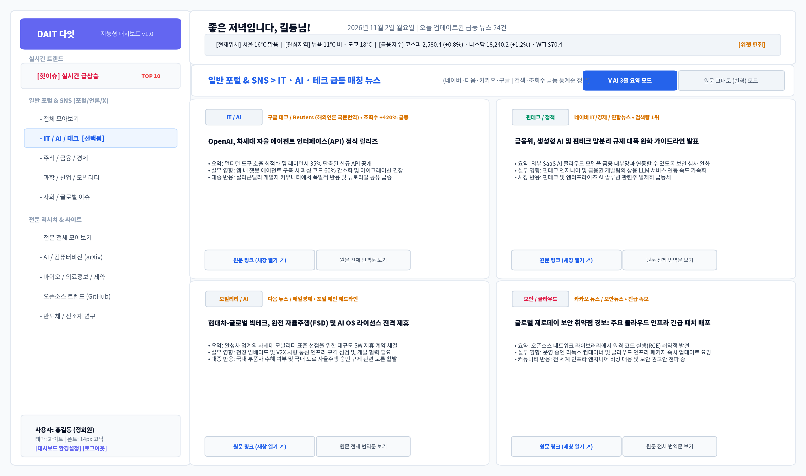
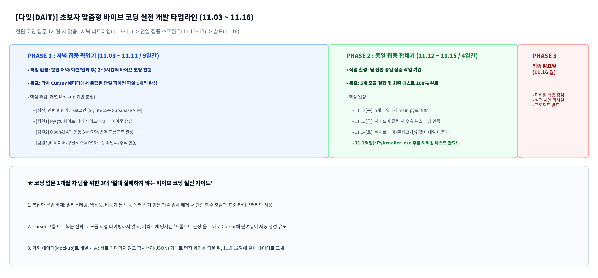

# 다잇(DAIT) 맞춤형 AI 지능형 뉴스 & 리서치 대시보드 — 마스터 설계서 (Master Architecture Specification)

문서 버전: v1.0 (Master Architecture Blueprint)  |  작성일자: 2026-11-02  |  유형: LLM/AI Context-Optimized Master Technical Blueprint
적용 대상: 프로젝트 총괄, 5인 전담 개발팀(Cursor Vibe-Coding), AI 어시스턴트(Codex/Gemini)

| 프로젝트 공식 명칭 | 다잇 (DAIT : Dynamic AI Intelligence & Trend Tracker) |
| --- | --- |
| 구축 목표 및 목적 | 초보자 5인 팀이 바이브 코딩으로 11.15까지 단일 .exe 실행 파일 구축 완료, 11.16 발표 |
| 시스템 토폴로지 | Python PyQt6 기반 네이티브 데스크톱 GUI + 클라우드 OpenAI API + 경량 SQLite DB |
| UI 아키텍처 | 좌측 사이드바 트리 LNB(핫이슈/일반포털/전문사이트) + 우측 3줄 요약/원문 동적 매칭 뷰 |

## 0. 설계 총론 및 아키텍처 원칙 (Architecture Principles)

본 문서는 안전보건 통합 SaaS 마스터 설계서의 엔지니어링 표준 폼에 입각하여, 파편화된 기술·뉴스 트렌드를 단일 창구에서 모니터링할 수 있도록 **다잇(DAIT)** 시스템의 전체 아키텍처, 6대 시스템 레이어, 3대 핵심 큐레이션 파이프라인, SQLite 정밀 스키마, 5인 분업 체계 및 3단계 개발 로드맵을 체계화한 **단일 진실 공급원(Single Source of Truth) 기술 규격서**이다.

### 0.1. 4대 핵심 아키텍처 원칙

1. No-Local-LLM & Cloud-First Rule: 팀원 PC의 하드웨어 편차(GPU 메모리 부족) 및 로컬 환경 에러를 원천 차단하기 위해 로컬 AI는 일체 구축하지 않으며, OpenAI GPT-4o-mini 경량 클라우드 API를 온디맨드로 단일 호출한다.

2. Python-Unified Monolithic GUI Rule: 웹 풀스택 분리로 인한 네트워크 에러를 방지하고 초보자 바이브 코딩 성공률을 극대화하기 위해, 크롤링, AI 요약, 날씨/금융 지수, GUI 프론트엔드를 **순수 Python(PyQt6)** 단일 패키지로 통일한다.

3. 2-Panel Dynamic Matching Rule: 좌측 트리형 사이드바(LNB)에서 핫이슈, 일반 포털 카테고리, 전문 사이트 카테고리를 선택하면, 우측 메인 영역에 해당 뉴스가 즉시 동적 렌더링되는 2-Panel 구조를 엄격히 준수한다.

4. Loose Coupling via Mockup Rule: 11.3~11.11 저녁 파트타임 기간 동안 타 팀원 코드를 기다리지 않고 가짜 딕셔너리(JSON Mockup)로 독립 개발 후 11.12에 병합한다.

## PART 1. 플랫폼 아키텍처 및 시스템 토폴로지

### 1.1. 6대 시스템 레이어 토폴로지 (System Layer Topology)

```text

                           [클라이언트 데스크톱 GUI 계층]
                  PyQt6 Native Window (White Modern Theme)
         ┌────────────────────────────────────────────────────────┐
         │ • 상단 라이브 인포 바: 실시간 시각, 위치 날씨, 글로벌 금융 지수  │
         │ • 좌측 LNB: [핫이슈] / [일반 포털] / [전문 사이트] 트리 메뉴 │
         │ • 우측 메인 뷰: 카드형 뉴스 피드 (3줄 요약 / 원문 번역 토글) │
         └───────────────────────────┬────────────────────────────┘
                                     │
           ========================================================
                       Core Event Dispatcher & Bus (main.py)
           ========================================================
                                     │
         ┌───────────────────────────┼────────────────────────────┐
         │                           │                            │
   [인증/보안 모듈]           [AI 처리 파이프라인]        [데이터 수집/크롤러]
  (auth_service.py)           (ai_processor.py)           (crawlers & info)
  • SQLite 기반 회원 관리     • OpenAI GPT-4o-mini API     • 네이버/다음 RSS 크롤러
  • ID(8~30) / PW(8~50) 검증 • 3줄 요약 & 국문 전문 번역 • arXiv / GitHub 크롤러
  • 이메일 6자리 OTP 인증      • 개발자 1줄 실무 영향도 도출 • OpenWeather / yfinance
         │                           │                            │
         └───────────────────────────┼────────────────────────────┘
                                     │
                   ========================================
                        Persistence & External Gateway
                   ========================================
                     ┌──────────────────┬─────────────────┐
                     │                  │                 │
              [Local Database]     [Cloud APIs]      [Web Sources]
              SQLite (dait.db)    OpenAI API Gateway RSS Feeds & REST
              • Users & Presets   • GPT-4o-mini      • Naver, arXiv, Yahoo

```

### 1.2. 기술 구성 스택 (Technology Stack Matrix)

| 구분 | 선정 기술 | 도입 목적 및 초보자 맞춤 선정 사유 |
| --- | --- | --- |
| GUI 클라이언트 | Python 3.11 + PyQt6 | Cursor 에디터가 코드를 가장 완벽하게 생성하며, 단일 실행 파일(.exe) 추출 지원 |
| AI 엔진 | OpenAI GPT-4o-mini API | 로컬 LLM 설치 완전 배제, 저비용·초고속 3줄 요약, 번역, 1줄 실무 영향도 도출 |
| 데이터베이스 | SQLite (dait.db) | 별도 DB 서버 없이 단일 파일로 동작하여 팀원 PC 환경 충돌 방지 |
| 데이터 수집 | feedparser, requests, yfinance | 안정적인 RSS 피드 및 공식 오픈 API 우선 수집으로 크롤링 블록 방지 |
| 빌드 & 배포 | PyInstaller (`-F -w`) | 명령어 1줄로 윈도우 단일 실행 파일(.exe) 생성하여 11.15 최종 테스트 완료 |
| 개발 도구 | Cursor Editor + ChatGPT Codex | 자연어 프롬프트 중심의 바이브 코딩(Vibe-Coding) 100% 최적화 |

## PART 2. 전체 개발 마스터 로드맵 (Master Roadmap)

프로젝트의 전체 개발 주기는 11.03부터 11.16 발표까지 5단계 마일스톤으로 확정하며, 11월 15일에 무결점 테스트 완료를 보장한다.

| 차수 | 단계 명칭 | 핵심 구현 스펙 및 산출물 | 추진 일정 |
| --- | --- | --- | --- |
| 1차 마일스톤 | 초간편 계정 인증 및 DB 구축 | SQLite 스키마, ID(8~30)/PW(8~50) 정규식 검증, 6자리 OTP 이메일 도용 방지 | 11.03 ~ 11.06 (저녁) |
| 2차 마일스톤 | 2-Track 크롤러 & 통계 엔진 | 네이버/다음 IT·주식·과학 RSS, arXiv/GitHub 릴리즈, 급등 핫이슈 TOP10 알고리즘 | 11.05 ~ 11.09 (저녁) |
| 3차 마일스톤 | 클라우드 AI 3줄 요약 파이프라인 | OpenAI GPT-4o-mini 연동, 3줄 요약 + 실무 영향도 1줄, 원문 영한 번역 모듈 | 11.07 ~ 11.11 (저녁) |
| 4차 마일스톤 | 사이드바 LNB GUI & 동적 매칭 | PyQt6 화이트 테마 2-Panel UI, 사이드 메뉴 클릭 시 우측 피드 즉각 전환, 새 창 열기 | 11.08 ~ 11.13 (집중) |
| 5차 마일스톤 | 전체 통합, .exe 빌드 & 최종 테스트 | 5개 모듈 main.py 통합, PyInstaller .exe 추출, 팀 전원 PC 테스트 100% 완료 | 11.14 ~ 11.15 (종일) |

## PART 3. 3대 핵심 큐레이션 파이프라인 상세 기술 명세

### 3.1. [핫이슈 엔진] 통계량 기반 급상승 핫이슈 큐레이션

- 수집 메커니즘: 사용자의 개별 관심분야 설정과 무관하게, 포털(네이버, 다음, 구글) 실시간 검색어 및 주요 언론사 종합 랭킹 뉴스 중 전일 대비 조회수/언급량 증가율(+200% 이상) 상위 10건 자동 선별.
- 뷰 모드 처리: 사용자 설정에 따라 '헤드라인 모드' 또는 'AI 3줄 핵심 요약 모드'로 컴팩트하게 노출.

### 3.2. [Track 1] 일반 포털 & SNS 뉴스 (네이버·다음·구글·카카오)

- 4대 하부 카테고리 트리: [전체 모아보기] / [IT · AI · 테크] / [주식 · 금융 · 경제] / [과학 · 산업 · 모빌리티] / [사회 · 글로벌 이슈]
- 동적 매칭 동작: 좌측 트리 메뉴에서 카테고리를 클릭하면 우측 메인 영역에 해당 분류의 급등 뉴스 카드 4개가 즉시 동적 렌더링됨.
- 뷰 모드 토글: `✓ AI 3줄 요약 모드`(요약문 3줄 + 실무 영향도 1줄)와 `원문 그대로 모드`(기사 본문 전체 출력, 해외 기사는 국문 번역문 출력) 간 원클릭 스위칭 지원.
- 새 창 열기 (Link Out): 카드 하단의 '원문 링크 (새창 열기 ↗)' 클릭 시 PC 기본 웹브라우저 새 창(`QDesktopServices.openUrl`)으로 즉각 오픈.

### 3.3. [Track 2] 전문 사이트 (arXiv 논문, GitHub Trending, 의료정보)

- 4대 하부 카테고리 트리: [전문 전체 모아보기] / [AI · 컴퓨터비전 (arXiv)] / [바이오 · 의료정보 · 제약] / [오픈소스 트렌드 (GitHub)] / [반도체 · 신소재 연구]
- 큐레이션 기준: arXiv 논문 초록 피인용 급등 건, GitHub Trending 일간 스타(★) 급증 리포지토리 릴리즈 노트 자동 수집.
- 개발자 실무 영향도: 단순 번역을 넘어 '개발자가 오늘 당장 라이브러리를 도입하거나 주의할 점 1줄'을 추출하여 하이라이트 박스 표시.



[그림 1] DAIT 좌측 사이드바 트리 LNB 및 우측 동적 매칭 뷰 구조도

## PART 4. 데이터베이스 상세 명세서 (SQLite Schema)

초보자가 단 하루 만에 테이블을 생성하고 오류 없이 연동할 수 있도록 정규화된 3대 핵심 테이블 스키마이다.

| 테이블명 | 컬럼명 (Field) | 데이터 타입 | 제약 조건 | 설명 및 검증 규칙 |
| --- | --- | --- | --- | --- |
| users<br>(사용자) | user_id<br>username<br>password_hash<br>email<br>tier | INTEGER<br>VARCHAR(30)<br>VARCHAR(128)<br>VARCHAR(100)<br>VARCHAR(20) | PK AUTOINCREMENT<br>UNIQUE NOT NULL<br>NOT NULL<br>UNIQUE NOT NULL<br>DEFAULT 'ASSOCIATE' | 8~30자 영문/숫자/특수문자<br>bcrypt 단방향 암호화<br>이메일 도용 방지 OTP 대상<br>ASSOCIATE(준회원)/REGULAR(정회원) |
| news_cache<br>(수집 뉴스 캐시) | news_id<br>track_type<br>category<br>title<br>link<br>summary_3lines<br>impact_1line | INTEGER<br>VARCHAR(20)<br>VARCHAR(50)<br>VARCHAR(255)<br>TEXT<br>TEXT<br>TEXT | PK AUTOINCREMENT<br>NOT NULL<br>NOT NULL<br>NOT NULL<br>UNIQUE NOT NULL<br>NULL<br>NULL | HOT / PORTAL / TECH<br>IT, 주식, 과학, arXiv 등<br>기사/논문 원천 제목<br>원문 새 창 링크 URL<br>GPT-4o-mini 생성 3줄 요약<br>개발자 관점 실무 영향도 1줄 |
| user_settings<br>(환경설정) | setting_id<br>user_id<br>theme<br>font_size<br>selected_tickers | INTEGER<br>INTEGER<br>VARCHAR(20)<br>INTEGER<br>TEXT | PK AUTOINCREMENT<br>FK (users.user_id)<br>DEFAULT 'WHITE'<br>DEFAULT 14<br>DEFAULT 'KOSPI,NASDAQ' | 화이트(WHITE) / 다크(DARK)<br>14px / 16px / 18px 슬라이더<br>상단 롤링 금융 지수 목록 (JSON) |

## PART 5. 5인 팀 전담 업무 분장 및 Cursor 바이브 코딩 프롬프트

팀원들이 코드를 직접 짜지 않고 Cursor 채팅창에 그대로 입력할 수 있도록 작성된 5인 전담 과업 명세이다.

| 담당자 / 역할 | 담당 모듈 파일 | Cursor 에디터 입력용 실전 프롬프트 (바이브 코딩용) |
| --- | --- | --- |
| 팀장 (총괄 겸 개발) | auth_service.py<br>(간편 인증) | "Python sqlite3로 로그인/회원가입 모듈 만들어줘. 아이디는 영문/숫자/특수문자 8~30자, 비밀번호는 8~50자로 정규식 검증하고, 이메일로 6자리 난수 인증코드 발송/대조하여 통과 시 '정회원'으로 등록하는 login(id, pw), register(id, pw, email, otp) 함수 작성해줘." |
| 팀원 1 (GUI 전담) | gui_dashboard.py<br>(사이드바 UI) | "PyQt6로 화이트 테마 윈도우 창 만들어줘. 왼쪽에는 [핫이슈], [일반포털-IT,주식,과학], [전문사이트-arXiv,의료,GitHub] 트리 메뉴를 넣고, 메뉴를 누르면 오른쪽 QStackedWidget에서 뉴스 카드 4개가 바뀌어 나오게 해줘. 위쪽엔 날씨/주식 바와 환영 문구 배치해줘." |
| 팀원 2 (AI 파이프라인) | ai_processor.py<br>(클라우드 요약) | "OpenAI 라이브러리를 써서 뉴스 텍스트를 넣으면 GPT-4o-mini로 핵심 3줄 요약하고 개발자 영향도 1줄 도출하는 summarize_news(text) 함수 만들어줘. 영어 텍스트면 한글 번역 후 요약해줘. 에러 안 나게 try-except 예외처리도 간단히 넣어줘." |
| 팀원 3 (크롤러 A) | portal_crawler.py<br>(포털/핫이슈) | "feedparser와 requests로 네이버/다음 뉴스 IT, 경제, 사회 RSS 피드를 읽어와 제목, 링크, 요약글을 딕셔너리 리스트로 반환하는 get_portal_news(cat) 함수 만들어줘. 또 조회수 급등 뉴스 10개를 뽑아 핫이슈로 반환하는 get_hot_news()도 만들어줘." |
| 팀원 4 (크롤러 B & 인포) | info_service.py<br>(전문사이트/날씨) | "requests로 무료 날씨 API에서 서울 날씨/기온 가져오고, yfinance로 코스피, 나스닥 지수 가져오는 get_live_ticker() 만들어줘. 그리고 arXiv의 최신 AI 논문 RSS에서 제목과 링크 가져오는 get_arxiv_news()도 만들어줘." |

## PART 6. 실전 개발 타임라인 및 11.15 무결점 테스트 완료 로드맵



[그림 2] 3단계 실전 타임라인 (11.3~11 저녁 -> 11.12~15 종일 집중 및 테스트 완료 -> 11.16 발표)

- Phase 1 (11.03 ~ 11.11, 저녁 파트타임): 평일 저녁 2~3시간 동안 각자 독립된 .py 파일을 Cursor로 완성하여 단독 실행 검증.
- Phase 2 (11.12 ~ 11.15, 전일 집중 스프린트): 11.12에 5개 파일을 main.py로 합치고, 11.13 사이드바 매칭 연동, 11.14 화이트 테마 조정, **11.15(일) PyInstaller로 .exe 추출 및 최종 테스트 100% 완료**.
- Phase 3 (11.16 월요일, 최종 발표일): 코드 수정 없이 오전 미비점 점검 및 Q&A 준비 후, 오후 완성된 .exe 프로그램으로 안정적인 시연 발표 진행.
