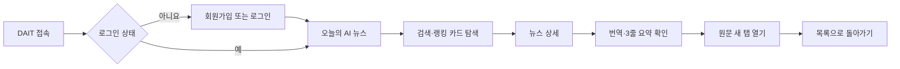
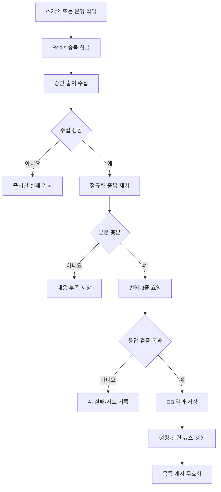

# DAIT 기본기획서

| 항목 | 값 |
|---|---|
| 문서 버전 | 1.0.0 |
| 기준일 | 2026-11-04 |
| 제품명 | DAIT |
| 제품 유형 | AI 뉴스 큐레이션 반응형 웹 서비스 |
| 1차 시연 | 2026-11-16 |

## 1. 기획 배경

AI 기술 뉴스는 공식 기업 블로그, 연구 사이트, 개발 플랫폼과 언론에 흩어져 있다. 사용자는
매일 여러 사이트를 방문하고 긴 해외 원문을 읽어야 하며, 출처가 불명확한 2차 요약만 보면
중요한 수치나 고유명사가 변형될 위험이 있다.

DAIT는 승인된 출처에서 뉴스를 수집해 한국어 번역과 근거 기반 3줄 요약을 미리 생성한다.
사용자는 한 화면에서 주요 AI 뉴스를 빠르게 파악하고 원문으로 이동해 사실을 확인한다.

## 2. 제품 한 줄 정의

> 신뢰할 수 있는 AI 뉴스의 수집·번역·요약·검색·원문 검증을 하나의 반응형 화면에서 제공하는 서비스

## 3. 제품 목표

1. 사용자가 매일 확인할 AI 뉴스의 탐색 시간을 줄인다.
2. 해외 원문의 언어 장벽을 낮추되 원문의 수치·고유명사를 보존한다.
3. 모든 결과에 출처와 원문 링크를 제공해 검증 가능하게 한다.
4. 수집·AI 처리 실패를 숨기지 않고 정상·부족·실패 상태를 구분한다.
5. 같은 기사를 반복 처리하지 않아 응답 시간과 AI 비용을 줄인다.
6. 개인정보·비밀값·저작권·외부 URL 안전을 처음부터 보장한다.

## 4. 핵심 사용자

| 사용자 | 주요 요구 | DAIT의 제공 가치 |
|---|---|---|
| AI 동향을 확인하는 일반 사용자 | 오늘의 핵심 뉴스 빠른 확인 | 랭킹 카드와 3줄 요약 |
| 개발자·기획자 | 기술명·수치가 보존된 정보 | 번역·요약과 원문 대조 |
| 발표·리서치 담당자 | 출처가 명확한 자료 | 출처·발행 시각·원문 URL |
| 운영 담당자 | 실패 원인과 처리 상태 | 단계별 상태·재처리 정보 |

## 5. 핵심 가치

- 빠름: 저장된 목록과 상세을 일반 개발 환경에서 1초 안에 표시하는 것을 목표로 한다.
- 정확함: 추측하지 않고 본문이 부족하면 `내용 부족`으로 표시한다.
- 투명함: 출처, 처리 상태, 랭킹 기준과 관련 뉴스 근거를 설명한다.
- 안전함: 사용자 임의 URL 수집, 비밀값 노출, 원문 무단 재배포를 금지한다.
- 단순함: 현재 단계에 필요한 기능만 구현하고 미래 확장을 미리 만들지 않는다.

## 6. 제품 범위

### 6.1 MVP

- 이메일 회원가입, 로그인, 로그아웃, 회원탈퇴
- AI 단일 카테고리의 뉴스 수집
- 해외 원문의 한국어 번역과 핵심 3줄 요약
- 최대 10개의 랭킹 카드
- 제목·요약 검색과 검색 초기화
- 뉴스 상세, 관련 뉴스, 원문 새 탭 열기와 링크 복사
- 로딩·빈 결과·부분 실패·전체 오류 상태
- 저장 결과 재사용, 캐시, 중복 작업 방지와 실패 기록
- 데스크톱·모바일 반응형 UI

### 6.2 단계 2

- Google·Kakao·Apple 소셜 로그인
- 이메일 2차 인증, 비밀번호 변경·재설정
- 예약 수집, 관심 키워드·출처·카테고리 설정
- 기본 노출 수, 인앱·메일 알림

### 6.3 단계 3

- WEATHER, ECONOMY, POLITICS 등 카테고리 확장
- 검색·랭킹·관련 뉴스 고도화
- 개인화 추천
- 처리량·실패율·비용 모니터링
- 승인된 외부 알림 채널

## 7. 제외 범위

- PyQt6 데스크톱 앱
- 원문 전체의 서비스 내 재배포
- 사용자 입력 URL의 즉시 서버 수집
- 실제 데이터가 없는 조회수·급등률·진행률 생성
- MVP의 다중 카테고리, 결제, Web Push, 외부 메신저
- 사용자 요청 중 동기 LLM 호출

## 8. 대표 사용자 여정

## 9. 핵심 기능 목록

| 영역 | 기능 ID | 기능 | 단계 |
|---|---|---|---|
| 인증 | FR-AUTH-01 | 이메일 회원가입 | MVP |
| 인증 | FR-AUTH-02 | 소셜 회원가입·로그인 | 단계 2 |
| 인증 | FR-AUTH-03 | 로그인·로그아웃 | MVP |
| 인증 | FR-AUTH-04 | 회원탈퇴 | MVP |
| 탐색 | FR-HOME-01 | 랭킹 카드 | MVP |
| 탐색 | FR-SEARCH-01 | 검색·초기화 | MVP |
| 탐색 | FR-HOME-02 | 로딩·빈·오류 상태 | MVP |
| 상세 | FR-DETAIL-01 | 뉴스 상세 콘텐츠 | MVP |
| 상세 | FR-DETAIL-02 | 원문 열기·링크 복사 | MVP |
| 설정 | FR-SET-01 | 예약 | 단계 2 |
| 설정 | FR-SET-02 | 검색·관심 설정 | 단계 2 |
| 설정 | FR-SET-03 | 노출·알림·정책 | 단계 2 |
| 처리 | FR-PIPE-01 | 뉴스 수집 | MVP |
| 처리 | FR-PIPE-02 | 번역·요약 | MVP |
| 처리 | FR-PIPE-03 | 랭킹·관련 뉴스 | MVP |
| 처리 | FR-PIPE-04 | 캐시·재처리 | MVP |

## 10. 화면 구성

### 10.1 데스크톱

- 헤더: DAIT 로고, 서비스명, 계정·설정 진입점
- 좌측 탐색: 현재 제공하는 오늘의 AI 뉴스와 AI 카테고리
- 본문 상단: 화면 제목, 설명, 검색, 정렬
- 본문: 순위·제목·출처·시각·요약·상태·행동이 포함된 카드
- 상세: 원본 정보, 요약, 번역, 관련 뉴스, 원문 행동

### 10.2 모바일

- 헤더: 로고와 계정 진입점
- 본문: 검색, 현재 카테고리, 세로형 카드
- 하단 탐색: 실제 제공하는 메뉴만 표시
- 주요 행동 버튼은 터치 영역을 충분히 확보한다.

첨부 UI의 밝은 배경, 파란 강조색, 둥근 카드, 넓은 여백을 시각 기준으로 사용한다. 단계 2·3
기능을 동작하는 것처럼 미리 표시하지 않는다.

## 11. 콘텐츠 운영 원칙

1. 공식 RSS·API·공식 사이트를 우선한다.
2. robots.txt와 이용약관을 검토한 승인 출처만 수집한다.
3. 제목, 출처, 발행 시각, URL과 필요한 최소 텍스트만 저장한다.
4. 원문 전체는 원 사이트에서 읽게 한다.
5. 요약은 원문 근거의 정확히 3개 문장으로 구성한다.
6. 수치·날짜·모델명·기관명을 원문과 대조한다.
7. 내용이 부족하면 생성하지 않고 부족 상태를 표시한다.

## 12. 서비스 운영 흐름

## 13. 기술 기준

- Python 3.12+, FastAPI, Pydantic v2
- Supabase PostgreSQL 운영, SQLite 로컬·테스트, Alembic 마이그레이션
- Redis 캐시·큐·속도 제한·분산 잠금·임시 인증 상태
- JavaScript 반응형 웹
- Docker·Docker Compose, 환경변수 기반 12-factor
- ruff, pyright strict, pytest, pip-audit, pre-commit, gitleaks

## 14. 성공 기준

| 지표 | 목표 |
|---|---|
| 필수 기능 합격 기준 | 100% |
| 발표 기사 10건의 중대한 사실 오류 | 0건 |
| 잘못된 원문 링크 | 0건 |
| 저장된 목록·상세 응답 | 개발 환경 p95 1초 이내 목표 |
| 같은 기사 재열람 시 AI 재호출 | 0회 |
| 비밀값·토큰·비밀번호 평문 노출 | 0건 |
| 키보드 주요 흐름 | 완료 가능 |

## 15. MVP 완료 조건

- 가입→로그인→목록→검색→상세→원문→로그아웃이 한 배포본에서 연결된다.
- 정상·로딩·빈·부분 실패·오류 상태를 실제 화면에서 확인한다.
- 발표 기사 10건의 출처·번역·요약을 원문 대조한다.
- 외부 출처 또는 LLM 장애에도 저장된 뉴스를 볼 수 있다.
- release 모드에서 docs, 상세 오류, SQL echo와 민감 로그가 비활성화된다.
- ruff, format, pyright, pytest, gitleaks와 필요한 pip-audit가 통과한다.
