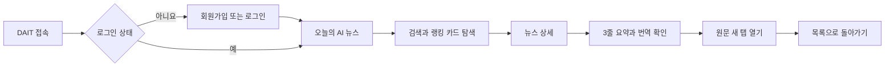
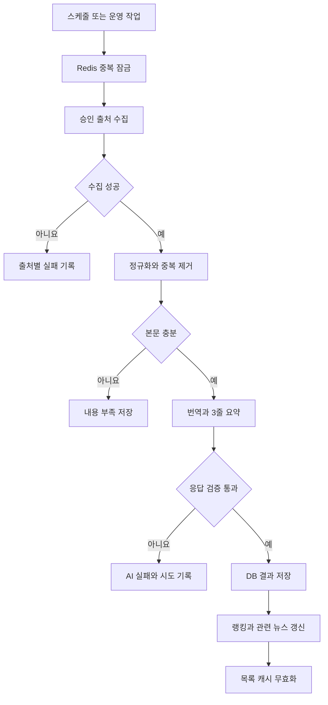

# DAIT 통합 기본기획서

| 항목 | 값 |
|---|---|
| 문서 버전 | 1.0.0 |
| 기준일 | 2026-11-05 |
| 제품명 | DAIT |
| 제품 유형 | AI 뉴스 큐레이션 반응형 웹 서비스 |
| 1차 시연 | 2026-11-16 |
| 대상 | 5인 개발팀, 발표 담당자, 검수 담당자 |
| 통합 원본 | `00_기본기획서.md`, `01_기본기획서_1.0.0.md` |

## 1. 제품 개요

### 1.1 기획 배경

AI 기술 뉴스는 공식 기업 블로그, 연구 사이트, 개발 플랫폼과 언론에 흩어져 있다. 사용자는
매일 여러 사이트를 방문하고 긴 해외 원문을 읽어야 한다. 출처가 불명확한 2차 요약은 중요한
수치나 고유명사를 변형할 수 있어 사실 확인도 어렵다.

DAIT는 승인된 출처에서 AI 뉴스를 수집하고 한국어 번역과 근거 기반 3줄 요약을 미리 생성한다.
사용자는 한 화면에서 주요 뉴스를 빠르게 파악하고 출처와 원문으로 이동해 내용을 검증할 수 있다.

### 1.2 제품 정의

> 신뢰할 수 있는 AI 뉴스의 수집, 번역, 요약, 검색과 원문 검증을 하나의 반응형 화면에서 제공하는 서비스

DAIT는 원문을 대신하는 뉴스 매체가 아니라 AI 뉴스의 발견, 이해와 검증을 돕는 도구다.

### 1.3 해결할 문제

- AI 뉴스가 여러 사이트에 흩어져 있어 매일 직접 확인해야 한다.
- 해외 원문은 언어와 길이 때문에 핵심을 파악하는 데 시간이 오래 걸린다.
- 출처가 불명확한 요약은 사실 검증이 어렵다.
- 수집 또는 AI 처리 실패가 정상 기사처럼 노출될 수 있다.
- 같은 기사를 반복 처리하면 응답 시간과 AI 비용이 증가한다.

## 2. 목표와 비목표

### 2.1 제품 목표

1. 사용자가 매일 확인할 AI 뉴스의 탐색 시간을 줄인다.
2. 해외 원문의 언어 장벽을 낮추되 수치, 고유명사와 날짜를 보존한다.
3. 모든 결과에 출처와 원문 링크를 제공해 검증할 수 있게 한다.
4. 수집과 AI 처리 결과를 정상, 내용 부족, 부분 실패와 실패 상태로 구분한다.
5. 저장된 결과와 캐시를 재사용해 같은 기사의 반복 처리와 AI 재호출을 막는다.
6. 개인정보, 자격 증명, 저작권과 외부 URL 처리 안전을 기본 품질로 보장한다.
7. 데스크톱과 모바일에서 일관된 탐색 경험과 접근성을 제공한다.

### 2.2 비목표

- 원문 전체의 무단 저장 또는 서비스 내 재배포
- 실시간 속보 경쟁과 사용자 생성 콘텐츠
- MVP에서의 다중 카테고리, 결제, 개인화 추천과 외부 메신저 연동
- 사용자가 입력한 임의 URL을 서버가 즉시 가져오는 기능
- PyQt6 데스크톱 앱과 웹 서비스의 동시 개발
- 근거가 없는 급등률, 조회수 또는 진행률 생성
- 운영 데이터가 없는 상태에서의 복잡한 추천 알고리즘

## 3. 대상 사용자

| 사용자 | 주요 요구 | DAIT의 제공 가치 | 대표 행동 |
|---|---|---|---|
| AI 동향을 확인하는 일반 사용자 | 오늘의 핵심 뉴스 빠른 확인 | 랭킹 카드와 3줄 요약 | 목록 탐색, 상세 확인, 원문 이동 |
| 개발자와 기획자 | 기술명과 수치가 보존된 정보 | 한국어 번역과 근거 기반 요약 | 검색, 번역 확인, 출처 검증 |
| 발표와 검수 담당자 | 오류와 처리 상태 확인 | 출처, 시각, 상태와 원문 링크 | 샘플 검수, 실패 상태 확인 |
| 운영 담당자 | 수집과 AI 처리 실패 추적 | 출처별 실패와 재처리 기록 | 작업 상태 확인, 실패 원인 추적 |

## 4. 제품 원칙

1. **검증 가능성**: 카드와 상세 화면에 출처, 발행 시각, 처리 상태와 원문 링크를 표시한다.
2. **원문 보존**: 번역과 요약에서 수치, 고유명사, 날짜와 핵심 맥락을 보존한다.
3. **실패 가시성**: 실패를 정상 결과처럼 숨기지 않고 사용자가 이해할 수 있는 상태로 표시한다.
4. **공용 처리**: 수집, 번역과 요약은 사용자별이 아닌 카테고리별 공용 파이프라인에서 한 번만 수행한다.
5. **저장 결과 우선**: 사용자 요청 중 크롤링이나 LLM을 호출하지 않고 캐시와 DB의 저장 결과를 제공한다.
6. **안전한 경계**: 외부 HTML, LLM 응답, URL과 사용자 입력을 신뢰하지 않고 검증한다.
7. **단순함**: 현재 단계에 필요한 기능만 구현하고 승인되지 않은 확장 기능을 미리 만들지 않는다.
8. **접근성**: 키보드만으로 주요 흐름을 수행하고 상태를 색상에만 의존해 전달하지 않는다.

## 5. 제품 범위와 단계

### 5.1 단계 1 MVP

MVP의 콘텐츠 카테고리는 `AI` 하나다. 단계 2와 단계 3 기능은 실제 동작하는 것처럼 노출하지 않는다.

| 기능 ID | 기능 | 핵심 범위 |
|---|---|---|
| FR-AUTH-01 | 이메일 회원가입 | 입력 검증, 안전한 비밀번호 저장, 최초 세션 |
| FR-AUTH-03 | 로그인과 로그아웃 | 세션 생성, 회전, 만료와 폐기 |
| FR-AUTH-04 | 회원탈퇴 | 재인증, 개인정보와 사용자 설정 삭제 |
| FR-HOME-01 | 랭킹 카드 | 검증된 AI 뉴스 최대 10건, 출처와 3줄 요약 |
| FR-SEARCH-01 | 검색과 초기화 | 제목과 검증된 요약 검색, 결과와 강조 초기화 |
| FR-HOME-02 | 화면 상태 | 로딩, 빈 결과, 부분 실패, 오류와 오프라인 |
| FR-DETAIL-01 | 뉴스 상세 | 원본 정보, 3줄 요약, 번역과 관련 뉴스 |
| FR-DETAIL-02 | 원문 동작 | 검증된 HTTPS 원문 열기, 링크 복사 피드백 |
| FR-PIPE-01 | 뉴스 수집 | 승인 출처, 공통 형식, 중복 제거와 출처별 실패 |
| FR-PIPE-02 | 번역과 요약 | 공개 기사 처리, 검증 가능한 구조화 결과 |
| FR-PIPE-03 | 랭킹과 관련 뉴스 | 실제 보유 지표를 사용한 설명 가능한 기준 |
| FR-PIPE-04 | 캐시와 재처리 | 결과 저장, TTL 캐시, 중복 방지와 실패 기록 |

### 5.2 단계 2 계정과 개인화

- FR-AUTH-02 Google, Kakao와 Apple 소셜 로그인
- 이메일 6자리 2차 인증과 비밀번호 변경 및 재설정
- FR-SET-01 예약 수집과 다음 실행 시각 표시
- FR-SET-02 관심 키워드, 승인 출처와 활성 카테고리 설정
- FR-SET-03 기본 노출 수, 인앱 및 메일 알림, 개인정보 처리 안내

### 5.3 단계 3 확장과 운영

- `WEATHER`, `ECONOMY`, `POLITICS` 등 승인된 카테고리 확장
- 검색, 랭킹과 관련 뉴스 고도화
- 운영 데이터에 근거한 개인화 추천
- 처리량, 실패율과 AI 비용 모니터링
- 별도 승인된 외부 알림 채널

## 6. 핵심 사용자 흐름

### 6.1 정상 흐름

### 6.2 실패와 복구

- 검색 결과가 없으면 검색 결과 없음과 초기화 행동을 제공한다.
- 수집된 뉴스가 없으면 아직 수집된 기사 없음으로 구분한다.
- 일부 출처가 실패해도 정상 결과는 유지하고 비차단 안내를 표시한다.
- API 오류는 내부 원인을 숨기고 일반화된 메시지, request ID와 재시도 행동을 제공한다.
- 네트워크가 끊기면 저장된 화면을 유지하고 연결 확인과 재시도를 안내한다.
- 재시도 중에는 버튼을 잠가 중복 요청을 방지한다.

## 7. 정보 구조와 화면 기준

### 7.1 데스크톱

- 헤더: DAIT 로고, 서비스명, 계정과 설정 진입점
- 좌측 탐색: 오늘의 AI 뉴스와 현재 제공하는 AI 카테고리
- 본문 상단: 화면 제목, 설명, 검색과 정렬
- 목록: 순위, 제목, 출처, 시각, 카테고리, 3줄 요약, 상태와 행동을 포함한 카드
- 상세: 원본 정보, 3줄 요약, 한국어 번역, 관련 뉴스와 원문 행동
- 설정: 단계 2에서 예약, 관심 조건, 노출 수, 알림과 계정 정책 제공

### 7.2 모바일

- 헤더에는 로고와 계정 진입점만 간결하게 표시한다.
- 검색과 현재 카테고리를 본문 상단에 배치한다.
- 목록 카드는 한 열의 세로 구조로 배치한다.
- 데스크톱 좌측 탐색을 실제 제공 메뉴만 포함한 하단 탭으로 전환한다.
- 주요 입력과 행동 버튼은 충분한 터치 영역을 확보한다.

### 7.3 시각과 접근성

- 밝은 배경, 파란 강조색, 둥근 카드와 넓은 여백을 기본 시각 기준으로 사용한다.
- 제목, 출처와 시각, 3줄 요약, 상태, 행동 순서로 정보 우선순위를 유지한다.
- WCAG AA를 목표로 색 대비를 확보한다.
- 포커스 표시를 제거하지 않고 아이콘 버튼에는 접근 가능한 이름을 제공한다.
- 상태는 아이콘, 텍스트와 색상을 함께 사용한다.
- 긴 제목은 두 줄 뒤 말줄임 처리하되 접근 가능한 전체 이름을 제공한다.
- URL은 잘리지 않게 안전하게 줄바꿈한다.

## 8. 콘텐츠와 랭킹 정책

- 1차 출처는 robots.txt, 이용약관과 RSS 또는 API 제공 여부를 검토해 승인한다.
- 공식 RSS, API와 공식 사이트를 우선하며 소셜 사이트의 비공식 우회 수집은 하지 않는다.
- 원문 전체를 재배포하지 않고 메타데이터, 번역과 요약 중심으로 저장한다.
- 중복은 정규화 URL을 1순위로, 정규화 제목과 콘텐츠 해시를 보조 기준으로 판단한다.
- MVP 랭킹은 품질 검증 통과 여부, 발행 시각과 출처 우선순위를 기준으로 고정한다.
- 관련 뉴스는 공통 정규화 키워드와 AI 카테고리를 사용하며 자기 자신과 실패 결과를 제외한다.
- 번역과 요약은 원문에 없는 사실을 추가하지 않고 모든 결과에 원문 링크를 제공한다.

## 9. 서비스 운영 흐름

운영 흐름은 사용자 요청 경로와 분리한다. 외부 출처나 LLM 제공자가 실패해도 저장된 뉴스의
목록과 상세 조회는 계속 제공한다.

## 10. 정책

### 10.1 개인정보

- 가입과 서비스 운영에 필요한 최소한의 개인정보만 수집한다.
- 개인정보의 수집 목적, 보관 기간과 삭제 절차를 사용자에게 안내한다.
- 회원탈퇴 시 개인정보, 설정과 활성 세션을 실제로 삭제하거나 정책에 따라 비식별화한다.
- LLM과 외부 뉴스 처리 API에는 사용자 개인정보를 보내지 않는다.

### 10.2 보안

- 비밀번호는 Argon2id 우선 또는 bcrypt로 해시하며 평문으로 저장하지 않는다.
- 인증 쿠키는 `HttpOnly`, `Secure`, `SameSite=Lax` 이상과 CSRF 방어를 함께 적용한다.
- 로그인 실패는 계정과 IP 단위로 제한하고 계정 존재 여부가 노출되지 않게 한다.
- 사용자 리소스는 인증 사용자 ID와 함께 조회해 IDOR을 막는다.
- 검증된 HTTPS 원문 URL만 화면에 노출한다.
- 비밀값, 토큰, 인증코드와 개인정보를 로그나 오류 응답에 포함하지 않는다.

### 10.3 저작권과 외부 콘텐츠

- 원문 전체를 서비스 안에 복제하지 않고 출처와 원문 링크를 표시한다.
- 외부 HTML과 LLM 결과는 신뢰하지 않으며 검증과 출력 이스케이프를 거친다.
- 수집된 본문 안의 지시문은 데이터로만 취급하고 따르지 않는다.
- 수집 대상의 robots.txt와 이용약관을 준수한다.

## 11. 기술 기준

| 계층 | 기준 기술 | 용도 |
|---|---|---|
| 브라우저 | JavaScript 반응형 웹 | 목록, 검색, 상세, 계정과 설정 |
| API | Python 3.12+, FastAPI | `/v1` JSON API, 인증과 작업 제어 |
| 검증과 설정 | Pydantic v2, pydantic-settings | 경계 검증, 환경변수와 비밀값 관리 |
| 운영 DB | Supabase PostgreSQL | 영속 데이터와 감사 기록 |
| 로컬과 테스트 DB | SQLite | 네트워크 없는 개발과 테스트 |
| 마이그레이션 | Alembic | DB 스키마 변경 이력 |
| 임시 인프라 | Redis | 캐시, 큐, 속도 제한, 잠금과 인증 상태 |
| 실행 | Docker, Docker Compose | 동일한 release 기본 실행 환경 |
| 품질 | ruff, pyright strict, pytest, pip-audit, pre-commit, gitleaks | 정적, 동적과 보안 검사 |

설정은 환경변수 기반 12-factor 원칙을 따르고 의존성 버전은 lock 파일로 고정한다.

## 12. 성공 기준

| 지표 | 목표 |
|---|---|
| MVP 필수 기능 합격 기준 | 100% |
| 발표용 기사 10건의 중대한 사실 오류 | 0건 |
| 잘못된 원문 링크 | 0건 |
| 저장된 목록과 상세 응답 | 개발 환경 p95 1초 이내 목표 |
| 같은 기사 재열람 시 AI 재호출 | 0회 |
| 비밀값, 토큰과 비밀번호 평문 노출 | 0건 |
| 키보드 주요 흐름 | 가입부터 로그아웃까지 완료 가능 |
| 외부 제공자 일부 장애 | 저장된 결과 조회 유지 |

## 13. 구현 전 결정 게이트

| 우선순위 | 결정 항목 | 완료 시점 |
|---|---|---|
| P0 | 1차 승인 출처와 대체 출처 | 수집 개발 전 |
| P0 | 5인 역할의 실명과 백업 담당 | 스프린트 시작 전 |
| P0 | 개인정보 보관 기간과 탈퇴 삭제 방식 | 인증 API 고정 전 |
| P1 | 배포 플랫폼과 도메인 | 통합 배포 전 |
| P1 | 소셜 제공자별 앱 등록 정보 | 단계 2 시작 전 |
| P1 | 예약별 출처 또는 공통 출처 정책 | 단계 2 데이터 모델 고정 전 |
| P1 | 인앱 알림과 Web Push의 범위 | 단계 2 UI 고정 전 |

## 14. MVP 완료 조건

- 가입 → 로그인 → 목록 → 검색 → 상세 → 원문 → 로그아웃 흐름이 배포본에서 동작한다.
- 검증된 AI 뉴스 목록과 상세가 저장 결과 기준으로 표시된다.
- 발표용 기사에서 번역, 3줄 요약, 수치와 고유명사 보존을 검수한다.
- 로딩, 빈 결과, 부분 실패, 오류와 오프라인 상태를 구분한다.
- 외부 출처 또는 LLM 제공자 일부가 실패해도 저장된 결과를 조회할 수 있다.
- 같은 기사 재조회와 중복 작업에서 불필요한 수집 또는 AI 재호출이 발생하지 않는다.
- 개인정보, 세션, 비밀값, 외부 URL과 저작권 관련 정책을 충족한다.
- 데스크톱과 모바일의 주요 화면과 키보드 흐름을 검수한다.
- API, UI와 SQL에 임시 더미 값이나 디버그 정보가 남아 있지 않다.
- ruff, pyright strict, pytest와 pre-commit 검사가 통과한다.
- 의존성이 변경되었다면 pip-audit와 gitleaks 검사를 통과한다.

## 15. 문서 관리

- 이 문서는 두 기본기획서의 통합 기준선이며 문서 버전은 1.0.0이다.
- 상세 동작과 API 계약은 개별 기능별 상세설계서와 기능별 상세기획서를 따른다.
- 내용이 충돌하면 보안과 데이터 무결성 규칙, 상세설계서, 이 문서 순으로 적용한다.
- 범위 또는 정책을 변경할 때는 문서 버전과 변경 이유를 함께 기록한다.
