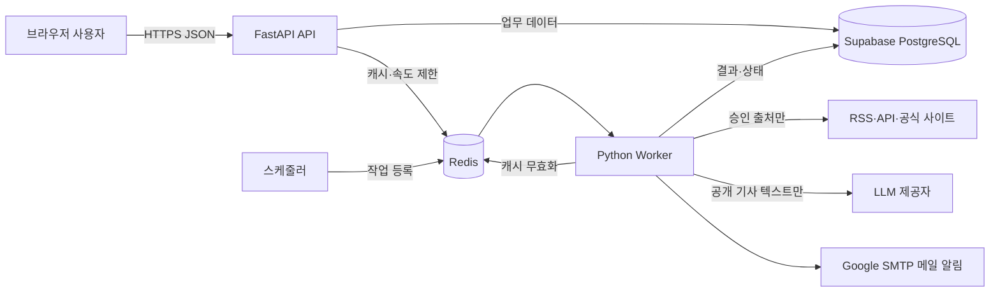
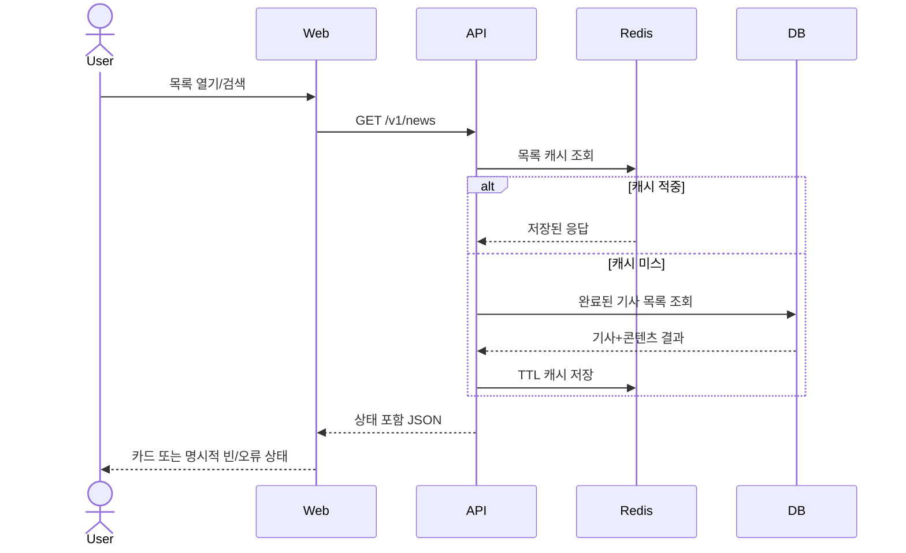
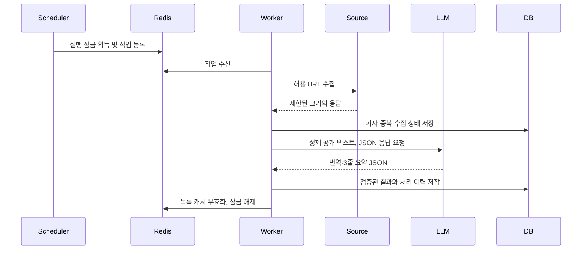
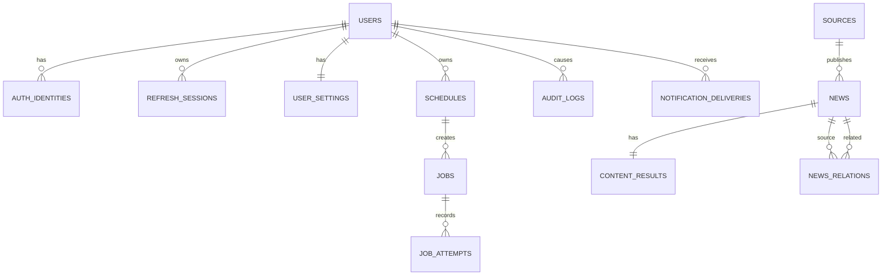

# DAIT 상세 설계서

| 항목 | 값 |
|---|---|
| 문서 버전 | 1.0.1 |
| 기준일 | 2026-11-06 |
| 대상 범위 | MVP와 후속 단계의 목표 구조 |
| 구현 기준 | `docs/AI-config/AGENTS.md` |


## 0.1 v1.0.1 화면 기준 변경

- UI 기준은 `DAIT_화면설계서_v1.0.1.pptx`와 정적 목업의 메인·상세보기·설정 구조를 따른다.
- 메인 화면은 통합 검색, `전체`/`AI·기술` 필터, `랭킹순`/`최신순` 정렬, 뉴스 랭킹 카드로 구성한다.
- 상세 화면은 기사 헤더 + 원문 동작, 본문 열의 3줄 요약·한국어 번역·처리 정보, 보조 열의 원본 정보·관련 뉴스로 구성한다.
- 설정 화면은 단계 1 MVP 구현 화면이며 예약 수집, 관심 설정, 노출·알림, 계정·정책을 실제 API와 연결해 저장·조회·복원한다.
- 정적 목업의 3개 뉴스 카드는 화면 검증 샘플이며 API 계약의 최대 10건과 충돌하지 않는다.

## 1. 설계 목표

- 교과과정 수준으로 읽기 쉬운 계층 구조를 유지한다.
- HTTP, 크롤링, LLM, Redis, DB 경계의 입력을 Pydantic v2로 검증한다.
- 화면 요청과 느린 수집·LLM 처리를 분리하고 저장 결과를 우선 제공한다.
- 외부 서비스 장애가 저장된 뉴스 열람을 중단시키지 않게 한다.
- release 모드의 비밀·개인정보·내부 오류 노출을 구조적으로 막는다.
- 필요한 기능만 구현하며 새 프레임워크와 추상화는 승인 없이 추가하지 않는다.

## 2. 기술 기준선

| 계층 | 기술 | 용도 |
|---|---|---|
| 브라우저 | JavaScript 반응형 웹 | 목록, 검색, 상세, 계정, 설정 |
| API | Python 3.12+, FastAPI | `/v1` JSON API, 인증·인가, 작업 제어 |
| 검증·설정 | Pydantic v2, pydantic-settings | 경계 모델, 환경변수 설정, 비밀값 마스킹 |
| 운영 DB | Supabase PostgreSQL | 영속 업무 데이터와 감사 기록 |
| 로컬·테스트 DB | SQLite | 네트워크 없는 개발·테스트 |
| 마이그레이션 | Alembic | 두 DB가 공유하는 스키마 변경 이력 |
| 임시 인프라 | Redis | 캐시, 큐, 속도 제한, 잠금, 인증코드 TTL |
| 이메일 | Google SMTP | 단계 1 메일 알림, 단계 2 인증 코드에도 재사용; 환경변수로만 자격 증명 주입 |
| 실행 | Docker, Docker Compose | release 기본의 동일 실행 환경 |
| 품질 | ruff, pyright, pytest, pip-audit, pre-commit, gitleaks | 정적·동적·보안 검사 |

의존성은 uv 또는 pip-tools 중 프로젝트가 선택한 하나의 lock 방식으로 고정한다. Celery처럼
현재 범위를 넘는 작업 프레임워크는 추가하지 않고 Redis 큐를 읽는 작은 Python worker로 시작한다.

## 3. 시스템 구조



### 3.1 실행 단위

| 단위 | 책임 | 금지 |
|---|---|---|
| web | 정적 자산과 반응형 화면 | 비밀값 보유, LLM 직접 호출 |
| api | 인증, 권한, 조회·설정 API, 작업 등록 | 긴 크롤링·LLM 처리 |
| worker | 수집, 정제, 번역, 요약, 관계·랭킹 계산 | 사용자 세션 처리 |
| scheduler | 예약 시각 평가와 중복 없는 작업 등록 | 기사 처리 자체 |
| db | 영속 데이터와 관계·감사 | 작업 큐 역할 |
| redis | 만료 가능한 상태·캐시·잠금·큐 | 원문·사용자 핵심 데이터 영구 저장 |

### 3.2 화면 구성 계약

| 화면 | 데스크톱 기준 | 모바일 기준 | 단계 |
|---|---|---|---|
| 메인 | 좌측 탐색 + 검색·필터·정렬 + 랭킹 카드 | 좌측 탐색 숨김, 하단 탭, 카드 단일 열 | MVP |
| 상세보기 | 기사 헤더, 2열 콘텐츠(`요약·번역·처리 정보` / `원본 정보·관련 뉴스`) | 모든 패널 한 열 적층 | MVP |
| 설정 | 설정 구역 메뉴 + 예약·관심·노출/알림·계정 카드 | 설정 메뉴 가로 스크롤, 입력 한 열 | MVP |

메인 카드의 UI 필드는 `rank`, `title`, `source_name`, `published_at`, `category`, `summary_lines`, `processing_status`, `original_url`에 매핑한다. `상세 보기`와 `원문 열기`는 서로 다른 행동으로 유지한다.

## 4. 백엔드 코드 구조

```text
src/
  api/             # FastAPI 라우터와 의존성
  services/        # 인증·뉴스·설정·파이프라인 비즈니스 규칙
  repositories/    # PostgreSQL/SQLite와 Redis 접근
  schemas/         # Pydantic 요청·응답·외부 경계 모델
  core/            # 설정, 로깅, 보안, 예외, 앱 생성
  workers/         # 큐 소비와 단계 실행
  collectors/      # 승인 출처별 수집 어댑터
tests/
  unit/
  integration/
  contract/
```

의존 방향은 `api → services → repositories`다. 외부 의존성은 작은 Protocol 뒤에 두고 테스트는
가짜 구현을 사용한다. 비동기 I/O에는 `async`를 쓰며 CPU 작업과 동기 라이브러리를 이벤트 루프에서
직접 실행하지 않는다.

## 5. 주요 처리 흐름

### 5.1 뉴스 조회



### 5.2 예약 수집과 AI 처리



실패는 단계별로 기록한다. 최대 재시도 후 dead-letter 상태로 이동하며 무한 재시도하지 않는다.

## 6. API 설계

### 6.1 공통 규칙

- 모든 업무 API는 `/v1` 아래에 둔다.
- 요청·응답 모델은 `ConfigDict(extra="forbid")`를 사용한다.
- 이메일은 `EmailStr`, URL은 `HttpUrl`, 시각은 UTC timezone-aware `datetime`이다.
- 목록은 cursor 기반 페이지네이션을 사용하고 기본·최대 크기를 제한한다.
- 오류 응답은 `code`, 일반화된 `message`, `request_id`, 선택적 `fields`만 제공한다.
- 내부 예외는 도메인 예외로 변환하고 스택트레이스는 release 응답에 넣지 않는다.

### 6.2 MVP 엔드포인트

| 메서드 | 경로 | 인증 | 기능 |
|---|---|---|---|
| POST | `/v1/auth/signup` | 아니요 | 이메일 회원가입 |
| POST | `/v1/auth/login` | 아니요 | 이메일 로그인 |
| POST | `/v1/auth/refresh` | 리프레시 | 토큰 회전 |
| POST | `/v1/auth/logout` | 예 | 현재 세션 무효화 |
| DELETE | `/v1/me` | 예 | 재확인 후 회원탈퇴 |
| GET | `/v1/news` | 제품 결정 | 목록·검색·정렬·cursor |
| GET | `/v1/news/{news_id}` | 제품 결정 | 상세·번역·요약·관련 뉴스 |
| GET/PATCH | `/v1/me/settings` | 예 | 노출 수, 관심 조건, 알림 설정 조회·저장 |
| GET/POST | `/v1/me/schedules` | 예 | 예약 목록·생성 |
| PATCH/DELETE | `/v1/me/schedules/{id}` | 예 | 소유 예약 수정·삭제 |
| GET | `/healthz` | 아니요 | 프로세스 생존 확인 |
| GET | `/readyz` | 아니요 | DB·Redis 준비 상태 |

목록 질의는 `category=AI`, `q`, `sort=rank|latest`, `page_size<=50`, `cursor`만 허용한다. 화면의 `전체`/`AI·기술` 필터는 MVP 단일 AI 카테고리에서 UI 탐색 상태를 표현하며, 서버에 미지원 카테고리를 전송하지 않는다. 정적 화면의 기사 3건은 샘플이며 실제 응답 수는 계약에 따른다.
`news_id`는 불투명 ID로 받고 저장소 계층에서 파라미터 바인딩한다.

### 6.3 단계 2 인증 확장 엔드포인트

| 메서드 | 경로 | 기능 |
|---|---|---|
| GET | `/v1/auth/oauth/{provider}/start` | PKCE 로그인 시작 |
| GET | `/v1/auth/oauth/{provider}/callback` | state·nonce 검증 콜백 |
| POST | `/v1/auth/mfa/send` | 인증 코드 발송 |
| POST | `/v1/auth/mfa/verify` | 인증 코드 검증·즉시 폐기 |

## 7. 데이터 설계

### 7.1 핵심 관계



### 7.2 테이블 요약

| 테이블 | 핵심 필드·제약 |
|---|---|
| users | id, email 정규화 unique, password_hash, status, created_at, deleted_at |
| auth_identities | user_id, provider, provider_subject, `(provider, subject)` unique |
| refresh_sessions | user_id, token_hash, family_id, expires_at, revoked_at |
| user_settings | user_id unique, default_count, categories, web_notice, email_notice |
| schedules | user_id, local_time, timezone, enabled, criteria_json, next_run_at |
| sources | name, kind, base_url, priority, enabled, robots_checked_at |
| news | source_id, title, canonical_url unique, published_at, collected_at, category |
| content_results | news_id unique, extracted_text, translated_text, summary_lines, status, error_code |
| news_relations | news_id, related_news_id, reason, score, pair unique |
| jobs | kind, dedupe_key unique, status, scheduled_at, started_at, finished_at |
| job_attempts | job_id, step, attempt_no, error_code, created_at |
| notification_deliveries | user_id, schedule_id, channel, dedupe_key unique, status, sent_at |
| audit_logs | actor_user_id nullable, event, target_type, target_id, request_id, created_at |

PostgreSQL과 SQLite에서 공통으로 쓸 수 있는 타입을 우선한다. PostgreSQL RLS는 사용자 소유 테이블의
추가 방어선이며, 앱은 RLS에 의존하지 않고 항상 인증 사용자 ID로 범위를 제한한다. 앱 런타임 계정에는
DDL·슈퍼유저 권한을 주지 않는다.

### 7.3 상태 값

- 사용자: `ACTIVE`, `LOCKED`, `DELETION_PENDING`, `DELETED`
- 콘텐츠: `PENDING`, `COLLECTED`, `TRANSLATED`, `SUMMARIZED`, `READY`, `FAILED`, `INSUFFICIENT`
- 작업: `QUEUED`, `RUNNING`, `SUCCEEDED`, `FAILED`, `DEAD_LETTER`
- 알림: `PENDING`, `SENT`, `FAILED`, `SKIPPED`

Enum은 저장·API에서 동일한 문자열을 사용하며 알 수 없는 값은 거부한다.

## 8. Redis 설계

| 키 패턴 | 목적 | 기본 TTL |
|---|---|---|
| `cache:news:list:{query_hash}` | 목록 응답 캐시 | 5분 |
| `cache:news:detail:{news_id}` | 상세 응답 캐시 | 30분 |
| `lock:collect:{source_id}:{window}` | 중복 수집 방지 | 최대 작업시간+여유 |
| `lock:job:{dedupe_key}` | 동일 작업 중복 방지 | 최대 작업시간+여유 |
| `rate:{scope}:{identity}` | 계정·IP 속도 제한 | 제한 창 |
| `auth:code:{purpose}:{subject}` | 단계 2 코드 해시 | 5분 |
| `auth:cooldown:{purpose}:{subject}` | 재발송 제한 | 정책 시간 |
| `queue:jobs` | 작업 큐 | 소비 시 제거, DB 상태 병행 |

키에는 원문·비밀번호·토큰·이메일을 그대로 넣지 않고 안정적인 해시나 내부 ID를 사용한다. DB 저장 성공
후 관련 캐시만 무효화한다.

## 9. 수집 안전 설계

1. 관리자 승인 출처만 활성화한다.
2. HTTPS만 허용하고 URL을 정규화한다.
3. DNS 결과의 사설, 루프백, 링크로컬, 멀티캐스트, 메타데이터 IP를 차단한다.
4. 리다이렉트마다 scheme·호스트·DNS를 재검증하고 횟수를 제한한다.
5. robots.txt, 이용약관, User-Agent, 요청 간격을 준수한다.
6. 연결·읽기 타임아웃, 응답 크기, Content-Type, 재시도 횟수를 제한한다.
7. HTML은 실행하지 않고 안전한 텍스트로 정제한다.
8. 사용자 입력 URL을 수집기로 직접 전달하지 않는다.

## 10. LLM 처리 설계

- 입력은 공개 기사에서 정제한 텍스트와 최소 메타데이터뿐이다.
- 시스템 요청은 한국어 번역, 정확히 3개의 요약 문장, 고유명사·수치 보존을 요구한다.
- 응답은 Pydantic JSON 모델로 검증하며 자유 형식 실패를 정상 결과로 저장하지 않는다.
- 본문이 임계치보다 짧으면 LLM을 호출하지 않고 `INSUFFICIENT`로 기록한다.
- 프롬프트 버전, 모델 식별자, 처리 시각과 기사 내용 해시를 결과에 기록한다.
- 같은 내용 해시와 처리 버전이면 기존 결과를 재사용한다.
- 개인정보, 세션, 사용자 설정은 LLM 입력에 포함하지 않는다.

## 11. 인증·인가 설계

- 비밀번호는 Argon2id 우선, 불가 시 bcrypt로 해시한다.
- 액세스 토큰은 짧게, 리프레시 토큰은 회전하며 DB에는 해시만 저장한다.
- 재사용이 감지된 토큰 family는 전체 폐기한다.
- 로그아웃, 비밀번호 변경, 탈퇴 시 관련 세션을 무효화한다.
- 쿠키 기반이면 `HttpOnly; Secure; SameSite=Lax` 이상과 CSRF 토큰을 적용한다.
- 로그인·가입·재설정 응답 시간과 문구로 계정 존재 여부를 노출하지 않는다.
- 역할은 `USER`, `ADMIN`이며 FastAPI 의존성에서 권한을 검사한다.
- 사용자 소유 데이터 ID는 클라이언트 값만 믿지 않고 인증 사용자 ID와 함께 조회한다.

단계 2 인증 코드는 `secrets`로 6자리를 만들고 Redis에 해시로 저장한다. TTL 5분, 시도 횟수와
재발송 간격을 제한하고 `hmac.compare_digest`로 비교한 뒤 성공 즉시 삭제한다. OAuth/OIDC는
Authorization Code + PKCE, state, nonce, 고정 redirect URI를 사용한다.

## 12. 모드·설정·로깅

### 12.1 설정

- `BaseSettings` 한 곳에서 환경변수를 읽고 `APP_ENV`를 `debug|test|release`로 제한한다.
- DB URL, SMTP, JWT, OAuth, LLM 비밀값은 `SecretStr`로 선언한다.
- `.env`는 커밋하지 않고 이름만 있는 `.env.example`을 제공한다.
- 설정 누락은 시작 시 실패시키되 실제 비밀값을 오류에 출력하지 않는다.

### 12.2 release 모드

- docs, redoc, OpenAPI URL 비활성화
- WARNING 이상의 구조화 JSON 로그
- 이메일·토큰·인증코드와 개인정보 마스킹
- SQL echo, debug 로그, 응답 스택트레이스 비활성화
- non-root 컨테이너와 HTTPS 전제

### 12.3 debug·test 모드

- 상세 로그와 로컬 docs 허용
- 테스트 우회는 test에서만 도달 가능
- release 경로에 고정 인증코드나 인증 생략 분기를 두지 않음

## 13. 오류 모델

```json
{
  "code": "NEWS_NOT_FOUND",
  "message": "요청한 뉴스를 찾을 수 없습니다.",
  "request_id": "opaque-id",
  "fields": null
}
```

예상 오류는 도메인 예외로 정의해 4xx로 변환한다. 예상하지 못한 오류는 request ID와 함께 500으로
응답하고 내부 원인은 마스킹 로그에만 기록한다. 빈 `except`와 예외 무시는 금지한다.

## 14. 성능·안정성

- 목록과 상세 DB 쿼리는 필요한 관계만 묶어 조회해 N+1을 피한다.
- 페이지 크기와 외부 응답 크기에 상한을 둔다.
- API는 화면 요청에서 LLM·SMTP를 기다리지 않는다.
- SIGTERM 수신 시 새 요청·작업 수신을 중지하고 진행 중 작업의 상태를 보존한다.
- DB·Redis 연결이 필요한 `/readyz`와 단순 생존 `/healthz`를 분리한다.
- LLM·SMTP 장애는 준비 상태 실패가 아니라 기능 저하로 기록하고 저장 결과를 계속 제공한다.
- DB 백업과 복구 절차를 문서화하고 복원 시험 결과를 남긴다.

## 15. 배포 구조

```text
docker compose
  web        정적 프론트엔드
  api        FastAPI release 이미지
  worker     같은 이미지의 worker 명령
  scheduler  같은 이미지의 scheduler 명령
  redis      로컬·개발용
  db         로컬은 SQLite 볼륨, 운영은 Supabase PostgreSQL
```

하나의 애플리케이션 이미지에 명령만 달리해 API, worker, scheduler를 실행한다. 특정 배포 플랫폼의
전용 SDK는 도입하지 않는다.

## 16. 테스트 전략

| 계층 | 범위 |
|---|---|
| 단위 | 중복 제거, 랭킹, 인증코드, 권한, SSRF, 속도 제한, 요약 검증 |
| 저장소 | PostgreSQL/SQLite 공통 CRUD, 트랜잭션, 소유자 범위 |
| 계약 | API Pydantic 스키마, 외부 수집·LLM 가짜 응답 |
| 통합 | 가입→로그인→목록→상세, 큐→worker→DB→캐시 무효화 |
| 보안 | 차단 URL, 토큰 재사용, IDOR, 입력 초과, 비밀 로그 방지 |
| UI | v1.0.1 메인·상세·설정 3개 MVP 화면, 데스크톱·모바일, 키보드, 설정 저장·복원, 로딩·빈·부분·오류, 긴 텍스트 |

외부 SMTP, LLM, 수집 사이트는 테스트에서 가짜로 대체해 네트워크 없이 실행한다.

## 17. 품질 게이트

```bash
ruff check .
ruff format --check .
pyright
pytest -q
pip-audit
```

pre-commit과 CI에서 동일 규칙을 실행하고 gitleaks를 포함한다. 실패를 제외 경로나 strict 완화로
해결하지 않는다.

## 18. 추적성

| 요구 영역 | 상세 설계 | 핵심 데이터 | 핵심 검증 |
|---|---|---|---|
| 인증·계정 | FR-AUTH-01~04 | users, auth_identities, refresh_sessions | AC-AUTH-01~05 |
| 홈·검색 | FR-HOME-01~02, FR-SEARCH-01 | news, content_results | AC-HOME-01~02, AC-SEARCH-01~02 |
| 상세 | FR-DETAIL-01~02 | news, content_results, news_relations | AC-DETAIL-01~03 |
| 설정 | FR-SET-01~03 | user_settings, schedules | AC-SET-01~02, AC-NOTI-01 |
| 파이프라인 | FR-PIPE-01~04 | sources, news, jobs, job_attempts | AC-PIPE-01~03, AC-STATE-01 |
