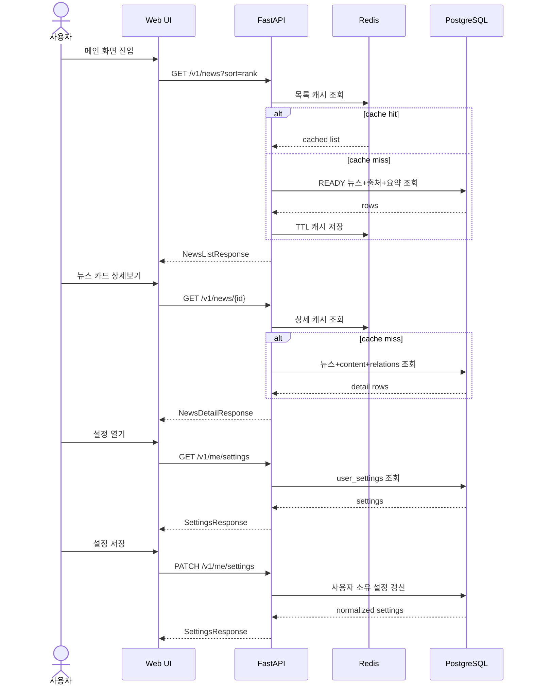

# DAIT API 설계서

| 항목 | 값 |
|---|---|
| 문서 버전 | 1.0.2 |
| 기준일 | 2026-11-06 |
| 제품명 | DAIT |
| API 기준 | `/v1`, JSON, FastAPI, Pydantic v2 `extra="forbid"` |
| 기준 문서 | 기본기획서 / 전체설계서 / 개별기능별 상세설계서 / 기능별 상세기획서 / 화면설계서 v1.0.1 |

## 문서 이력

| 버전 | 작성자 | 기준일 | 수정 내용 |
|---|---|---|---|
| 1.0.0 | seonghoon.yang | 2026-11-03 | 최초 작성 |
| 1.0.1 | seonghoon.yang | 2026-11-06 | 화면설계서 v1.0.1 반영 및 문서 세트 정합성 보강 |
| 1.0.2 | seonghoon.yang | 2026-11-10 | 7.3절 내부 스케줄러 tick API(POST /v1/internal/scheduler/tick) 추가 |

## 1. 문서 목적

이 문서는 DAIT 단계 1(MVP)의 메인, 상세보기, 설정 화면과 연결되는 API 계약을 상세히 정의한다.
기존 문서에서 확정된 기능 ID와 엔드포인트를 기준으로 하며, 기존 문서에 명시되지 않은 세부 request/response 필드는
구현 가능하도록 구체화한 **v1.0.2 설계 제안**이다.

## 2. 공통 API 규칙

### 2.1 기본 규칙

- 모든 업무 API는 `/v1` 하위에 둔다.
- Content-Type은 `application/json; charset=utf-8`를 사용한다.
- 모든 request/response 모델은 Pydantic v2 `ConfigDict(extra="forbid")`를 적용한다.
- 날짜/시각은 API 내부 표준으로 UTC ISO 8601 timezone-aware 문자열을 사용한다.
- 화면 표시는 사용자의 IANA timezone(`Asia/Seoul`)으로 변환한다.
- 외부 노출 ID는 순차 정수 대신 불투명 문자열을 사용한다.
- URL은 HTTPS만 허용한다.
- 페이지네이션은 cursor 기반을 기본으로 한다.

### 2.2 공통 오류 응답

```json
{
  "code": "VALIDATION_ERROR",
  "message": "입력값을 확인해 주세요.",
  "request_id": "req_01JXYZ...",
  "fields": {
    "q": "검색어는 100자 이하여야 합니다."
  }
}
```

| 필드 | 타입 | 필수 | 설명 |
|---|---|---:|---|
| `code` | string | Y | 시스템 정의 오류 코드 |
| `message` | string | Y | 사용자에게 표시 가능한 일반화 메시지 |
| `request_id` | string | Y | 서버 로그와 추적할 수 있는 불투명 ID |
| `fields` | object\|null | N | 필드별 검증 오류. 내부 예외 내용은 포함 금지 |

### 2.3 주요 오류 코드

| 코드 | HTTP | 의미 |
|---|---:|---|
| `VALIDATION_ERROR` | 422 | 요청 형식/허용값 오류 |
| `AUTHENTICATION_FAILED` | 401 | 로그인 필요 또는 인증 실패 |
| `AUTHORIZATION_FAILED` | 403/404 | 권한 없음. 리소스 은닉 시 404 사용 |
| `RATE_LIMITED` | 429 | 요청 빈도 제한 |
| `NEWS_NOT_FOUND` | 404 | 뉴스가 없거나 공개 불가 |
| `SOURCE_UNAVAILABLE` | 200 partial / 작업 실패 | 일부 출처 장애 |
| `CONTENT_INSUFFICIENT` | 200 | 본문 부족 |
| `DEPENDENCY_UNAVAILABLE` | 503 | DB/Redis 등 필수 의존성 장애 |
| `SCHEDULE_NOT_FOUND` | 404 | 요청한 스케줄이 존재하지 않을 때 사용 |
| `INTERNAL_ERROR` | 500 | 내부 오류 일반화 응답 |

---

# 3. 인증 API

## 3.1 POST `/v1/auth/signup`

### 목적
이메일/비밀번호 회원가입 후 최초 세션을 생성한다.

### Request Body

| 필드 | 타입 | 필수 | 제약/설명 |
|---|---|---:|---|
| `email` | string(email) | Y | 최대 254자, 비교용 정규화 적용 |
| `password` | string | Y | 최소 길이 정책 적용, 과도한 길이 제한 |
| `password_confirm` | string | Y | `password`와 동일해야 함 |
| `terms_accepted` | boolean | Y | 반드시 `true` |

```json
{
  "email": "user@example.com",
  "password": "Example!Password2026",
  "password_confirm": "Example!Password2026",
  "terms_accepted": true
}
```

### Response 201

| 필드 | 타입 | 설명 |
|---|---|---|
| `user.id` | string | 사용자 불투명 ID |
| `user.email` | string | 로그인 이메일 |
| `user.status` | string enum | `ACTIVE` 등 |
| `user.created_at` | datetime | 계정 생성 시각 |

```json
{
  "user": {
    "id": "usr_01JXYZ123",
    "email": "user@example.com",
    "status": "ACTIVE",
    "created_at": "2026-11-06T00:12:30Z"
  }
}
```

> 세션 토큰을 쿠키로 운용하는 경우 refresh/access 원문은 JSON 응답에 포함하지 않는다.

## 3.2 POST `/v1/auth/login`

### Request

| 필드 | 타입 | 필수 | 설명 |
|---|---|---:|---|
| `email` | string(email) | Y | 로그인 이메일 |
| `password` | string | Y | 비밀번호 |

```json
{
  "email": "user@example.com",
  "password": "Example!Password2026"
}
```

### Response 200

```json
{
  "user": {
    "id": "usr_01JXYZ123",
    "email": "user@example.com",
    "status": "ACTIVE"
  }
}
```

## 3.3 POST `/v1/auth/refresh`

- refresh cookie/token을 회전한다.
- 이전 refresh는 즉시 폐기한다.
- 응답 body는 최소화하며 성공 시 204 또는 세션 만료 정보만 반환한다.

```json
{
  "expires_at": "2026-11-06T01:10:00Z"
}
```

## 3.4 POST `/v1/auth/logout`

### Response 204
현재 세션과 브라우저 쿠키를 폐기한다.

## 3.5 DELETE `/v1/me`

### Request

| 필드 | 타입 | 필수 | 설명 |
|---|---|---:|---|
| `password` | string\|null | 조건부 | 비밀번호 계정 재인증 시 사용 |
| `confirm` | boolean | Y | 반드시 `true` |

```json
{
  "password": "Example!Password2026",
  "confirm": true
}
```

### Response 200

```json
{
  "status": "DELETION_COMPLETED",
  "deleted_at": "2026-11-06T00:20:00Z"
}
```

---

# 4. 메인 화면 API

## 4.1 GET `/v1/news`

### 연결 화면
- 메인 > 오늘의 AI 뉴스
- 통합 검색
- 전체 / AI·기술 필터
- 랭킹순 / 최신순
- 뉴스 카드 목록

### Query Parameters

| 파라미터 | 타입 | 필수 | 기본값 | 허용/설명 |
|---|---|---:|---|---|
| `category` | string enum | N | `AI` | 현재 MVP는 `AI`만 허용 |
| `q` | string | N | null | 제목 + 검증된 요약 검색, trim 후 1~100자 권장 |
| `sort` | string enum | N | `rank` | `rank`, `latest` |
| `page_size` | integer | N | `10` | 1~50, 화면 기본은 10 |
| `cursor` | string | N | null | 다음 페이지 불투명 cursor |

### 실제 요청 예시

```http
GET /v1/news?category=AI&q=multimodal&sort=rank&page_size=10
```

### Response 200

| 필드 | 타입 | 설명 |
|---|---|---|
| `items` | array<NewsListItem> | 뉴스 목록 |
| `page.next_cursor` | string\|null | 다음 페이지 cursor |
| `page.has_more` | boolean | 다음 페이지 존재 여부 |
| `meta.total_visible` | integer | 현재 조건에서 화면에 표시 가능한 항목 수 |
| `meta.partial` | boolean | 일부 출처 실패 여부 |
| `meta.message` | string\|null | 비차단 상태 안내 |
| `meta.rank_basis` | array<string> | 랭킹 기준 설명 |

### NewsListItem

| 필드 | 타입 | 필수 | 설명 |
|---|---|---:|---|
| `id` | string | Y | 뉴스 ID |
| `rank` | integer | Y | 현재 목록 내 순위 |
| `title` | string | Y | 뉴스 제목 |
| `source_name` | string | Y | 출처명 |
| `published_at` | datetime | Y | 발행 시각 |
| `category` | string enum | Y | 현재 `AI` |
| `summary_lines` | array<string> | Y | 정확히 3개 요약 문장 |
| `processing_status` | string enum | Y | `READY`, `INSUFFICIENT`, `FAILED` 등 |
| `original_url` | string(uri) | Y | 검증된 HTTPS 원문 URL |
| `is_partial` | boolean | Y | 해당 카드의 부분 상태 여부 |

### Response 예시

```json
{
  "items": [
    {
      "id": "news_01JXYZ001",
      "rank": 1,
      "title": "OpenAI, 차세대 멀티모달 모델 공개…추론과 도구 사용 정확도 향상",
      "source_name": "OpenAI Newsroom",
      "published_at": "2026-11-04T00:30:00Z",
      "category": "AI",
      "summary_lines": [
        "새 모델은 장문 추론과 복합 도구 사용 정확도를 높였다.",
        "텍스트·이미지·음성을 하나의 대화 흐름에서 처리한다.",
        "개발자 API는 단계적으로 제공될 예정이다."
      ],
      "processing_status": "READY",
      "original_url": "https://openai.com/news/example-multimodal-model",
      "is_partial": false
    }
  ],
  "page": {
    "next_cursor": null,
    "has_more": false
  },
  "meta": {
    "total_visible": 3,
    "partial": true,
    "message": "일부 출처의 수집이 지연되고 있습니다.",
    "rank_basis": ["quality", "published_at", "source_priority"]
  }
}
```

### 화면 상태 매핑

| API 결과 | 화면 상태 |
|---|---|
| 정상 `items.length > 0`, partial=false | READY |
| 정상 `items.length > 0`, partial=true | PARTIAL |
| `items=[]`, `q` 있음 | 검색 결과 없음 |
| `items=[]`, `q` 없음 | 아직 수집된 기사 없음 |
| 500/503 | 오류 + 재시도 + request ID |
| 네트워크 실패 | OFFLINE, 기존 화면 유지 |

---

# 5. 상세보기 API

## 5.1 GET `/v1/news/{news_id}`

### Path Parameter

| 파라미터 | 타입 | 필수 | 설명 |
|---|---|---:|---|
| `news_id` | string | Y | 불투명 뉴스 ID |

### 실제 요청 예시

```http
GET /v1/news/news_01JXYZ001
```

### Response 200 구조

| 상위 필드 | 타입 | 설명 |
|---|---|---|
| `article` | object | 제목/출처/발행시각/언어/읽기시간 등 |
| `content` | object | 3줄 요약, 번역, 상태 |
| `source` | object | 원본 URL과 검증 정보 |
| `related_news` | array | 관련 뉴스 |
| `processing` | object | 수집/번역/요약 상태 |

### `article`

| 필드 | 타입 | 설명 |
|---|---|---|
| `id` | string | 뉴스 ID |
| `title` | string | 제목 |
| `source_name` | string | 출처 |
| `published_at` | datetime | 발행 시각 |
| `original_language` | string | 원문 언어 코드 (`en`, `ko`) |
| `category` | string enum | `AI` |
| `estimated_read_minutes` | integer\|null | 표시용 읽기 시간(실제 계산값이 있을 때만) |

### `content`

| 필드 | 타입 | 설명 |
|---|---|---|
| `summary_lines` | array<string> | 정확히 3개 |
| `translated_text` | string\|null | 한국어 번역 |
| `processed_at` | datetime\|null | 처리 완료 시각 |
| `content_status` | string enum | `READY`, `INSUFFICIENT`, `FAILED` |
| `summary_model_version` | string\|null | 내부/표시 정책에 따라 노출 가능한 모델 버전 |

### `source`

| 필드 | 타입 | 설명 |
|---|---|---|
| `original_url` | string(uri) | 검증 완료 HTTPS URL |
| `url_verified` | boolean | 서버 검증 통과 여부 |
| `source_type` | string | RSS/API/OFFICIAL_HTML 등 |

### `related_news[]`

| 필드 | 타입 | 설명 |
|---|---|---|
| `id` | string | 관련 뉴스 ID |
| `title` | string | 제목 |
| `source_name` | string | 출처 |
| `published_at` | datetime | 발행 시각 |
| `reason` | string | 관련 근거 |
| `score` | number | 관련도 점수(내부 규칙 기준) |

### Response 예시

```json
{
  "article": {
    "id": "news_01JXYZ001",
    "title": "OpenAI, 차세대 멀티모달 모델 공개…추론과 도구 사용 정확도 향상",
    "source_name": "OpenAI Newsroom",
    "published_at": "2026-11-04T00:30:00Z",
    "original_language": "en",
    "category": "AI",
    "estimated_read_minutes": 6
  },
  "content": {
    "summary_lines": [
      "OpenAI는 장문 추론과 복합 도구 호출 정확도를 개선한 차세대 멀티모달 모델을 발표했다.",
      "텍스트·이미지·음성을 하나의 대화 흐름에서 처리한다.",
      "개발자 API와 기업용 기능은 단계적으로 제공될 예정이다."
    ],
    "translated_text": "OpenAI는 오늘 텍스트, 이미지, 음성을 하나의 대화 흐름에서 이해하고 생성하는 새로운 멀티모달 모델을 발표했습니다...",
    "processed_at": "2026-11-04T00:35:14Z",
    "content_status": "READY",
    "summary_model_version": "summary-v1"
  },
  "source": {
    "original_url": "https://openai.com/news/example-multimodal-model",
    "url_verified": true,
    "source_type": "OFFICIAL_HTML"
  },
  "related_news": [
    {
      "id": "news_01JXYZ020",
      "title": "멀티모달 에이전트의 도구 사용 평가 기준 공개",
      "source_name": "AI Safety Blog",
      "published_at": "2026-11-03T23:00:00Z",
      "reason": "multimodal, tool-use 키워드 일치",
      "score": 0.82
    }
  ],
  "processing": {
    "collection_status": "SUCCEEDED",
    "translation_status": "SUCCEEDED",
    "summary_status": "SUCCEEDED"
  }
}
```

### 404 예시

```json
{
  "code": "NEWS_NOT_FOUND",
  "message": "요청한 뉴스를 찾을 수 없습니다.",
  "request_id": "req_01JXYZ404",
  "fields": null
}
```

---

# 6. 설정 화면 API

> v1.0.2 기준 메인/상세/설정은 모두 1단계(MVP) 구현 대상이다.

## 6.1 GET `/v1/me/settings`

### 목적
현재 사용자의 관심 조건, 목록 노출 수, 알림 채널을 조회한다.

### Response 200

```json
{
  "default_count": 10,
  "keywords": ["멀티모달", "AI 에이전트", "오픈소스 LLM"],
  "source_ids": ["src_openai", "src_anthropic"],
  "categories": ["AI"],
  "in_app_notice": true,
  "email_notice": false,
  "updated_at": "2026-11-06T00:40:00Z"
}
```

| 필드 | 타입 | 제약/설명 |
|---|---|---|
| `default_count` | integer enum | `5` 또는 `10` |
| `keywords` | array<string> | 중복 제거, 항목 길이 제한 |
| `source_ids` | array<string> | 승인된 출처 ID만 허용 |
| `categories` | array<string enum> | 현재 `AI`만 허용 |
| `in_app_notice` | boolean | 인앱 알림 |
| `email_notice` | boolean | 메일 알림 |
| `updated_at` | datetime | 마지막 변경 시각 |

## 6.2 PATCH `/v1/me/settings`

### Request
부분 수정 PATCH. 전달하지 않은 값은 유지한다.

```json
{
  "default_count": 10,
  "keywords": ["멀티모달", "AI 에이전트", "오픈소스 LLM"],
  "source_ids": ["src_openai", "src_anthropic"],
  "categories": ["AI"],
  "in_app_notice": true,
  "email_notice": false
}
```

### Request Field 정의

| 필드 | 타입 | 필수 | 제약 |
|---|---|---:|---|
| `default_count` | integer | N | 5 또는 10 |
| `keywords` | array<string> | N | 빈 배열 허용, 중복/제어문자 제거 |
| `source_ids` | array<string> | N | 활성 승인 출처만 |
| `categories` | array<string> | N | 활성 Enum만 |
| `in_app_notice` | boolean | N |  |
| `email_notice` | boolean | N |  |

### Response 200
서버가 정규화해 실제 저장한 값을 그대로 반환한다.

```json
{
  "default_count": 10,
  "keywords": ["멀티모달", "AI 에이전트", "오픈소스 LLM"],
  "source_ids": ["src_openai", "src_anthropic"],
  "categories": ["AI"],
  "in_app_notice": true,
  "email_notice": false,
  "updated_at": "2026-11-06T00:42:30Z"
}
```

## 6.3 GET `/v1/me/schedules`

### Response 200

```json
{
  "items": [
    {
      "id": "sch_01JXYZ900",
      "local_time": "08:30",
      "timezone": "Asia/Seoul",
      "enabled": true,
      "criteria": {
        "keywords": ["멀티모달", "AI 에이전트"],
        "source_ids": ["src_openai", "src_anthropic"],
        "categories": ["AI"]
      },
      "next_run_at": "2026-11-06T23:30:00Z",
      "created_at": "2026-11-05T10:00:00Z",
      "updated_at": "2026-11-05T10:00:00Z"
    }
  ]
}
```

## 6.4 POST `/v1/me/schedules`

### Request

| 필드 | 타입 | 필수 | 설명 |
|---|---|---:|---|
| `local_time` | string(HH:mm) | Y | 사용자 로컬 시각 |
| `timezone` | string | Y | IANA timezone |
| `enabled` | boolean | N | 기본 true |
| `criteria` | object | Y | 저장된 검색/관심 조건 |
| `criteria.keywords` | array<string> | N | 관심 키워드 |
| `criteria.source_ids` | array<string> | N | 승인 출처 ID |
| `criteria.categories` | array<string> | Y | `AI` |

```json
{
  "local_time": "08:30",
  "timezone": "Asia/Seoul",
  "enabled": true,
  "criteria": {
    "keywords": ["멀티모달", "AI 에이전트"],
    "source_ids": ["src_openai", "src_anthropic"],
    "categories": ["AI"]
  }
}
```

### Response 201

```json
{
  "id": "sch_01JXYZ900",
  "local_time": "08:30",
  "timezone": "Asia/Seoul",
  "enabled": true,
  "criteria": {
    "keywords": ["멀티모달", "AI 에이전트"],
    "source_ids": ["src_openai", "src_anthropic"],
    "categories": ["AI"]
  },
  "next_run_at": "2026-11-06T23:30:00Z",
  "created_at": "2026-11-06T00:50:00Z",
  "updated_at": "2026-11-06T00:50:00Z"
}
```

## 6.5 PATCH `/v1/me/schedules/{schedule_id}`

부분 수정. 소유권은 `schedule_id + authenticated_user_id`로 검사한다.

```json
{
  "local_time": "09:00",
  "enabled": true
}
```

### Response 200
변경된 전체 예약 객체 반환.

## 6.6 DELETE `/v1/me/schedules/{schedule_id}`

### Response 204
예약을 삭제하거나 정책에 따라 비활성화하고 감사 로그를 남긴다.

---

# 7. 운영/상태 API

## 7.1 GET `/healthz`

```json
{
  "status": "ok"
}
```

## 7.2 GET `/readyz`

```json
{
  "status": "ready",
  "dependencies": {
    "database": "ok",
    "redis": "ok"
  }
}
```

LLM/SMTP 장애는 앱 자체 readiness 실패로 처리하지 않고 기능 저하로 기록한다.


## 7.3 POST `/v1/internal/scheduler/tick`

### 목적
외부 cron 서비스(cron-job.org 등)가 주기적으로 호출하는 내부 스케줄러 트리거다.
브라우저 세션이 아닌 서버 간 호출이므로 사용자 토큰이 아니라 전용 비밀값으로 인증한다.

### 인증

```http
POST /v1/internal/scheduler/tick HTTP/1.1
Authorization: Bearer <SCHEDULER_TICK_SECRET>
```

- `SCHEDULER_TICK_SECRET`은 환경변수로만 주입하며 JWT와 별개의 값을 사용한다.
- 비밀값이 없거나 불일치하면 `401` `AUTHENTICATION_FAILED`를 반환한다.
- 이 엔드포인트는 `/v1/me/*` 사용자 API와 달리 rate limit의 사용자 축을 적용하지 않고, 호출 자체를 감사 로그에 남긴다.

### Request Body

없음. 선택적으로 아래를 허용한다(기본은 서버 시각 사용).

```json
{
  "now": "2026-11-10T00:00:00Z"
}
```

### 처리 절차 (서버 내부)

1. **실행 시각 확정**: 요청 `now` 또는 서버 UTC 시각을 기준 시각으로 사용한다.
2. **기한 도래 예약 조회**: `schedules`에서 `enabled = true`이고 `next_run_at <= now`인 행을 `next_run_at` 오름차순으로 조회한다. `FOR UPDATE SKIP LOCKED`로 동시 tick 중복 처리를 방지한다.
3. **예약별 작업 등록**: 각 예약에 대해 `dedupe_key = hash(schedule_id + 실행 창)`로 `jobs(kind=COLLECT_SCHEDULED)`를 `INSERT ... ON CONFLICT DO NOTHING`으로 등록한다. 이미 존재하면 해당 예약은 건너뛴다.
4. **실행 창 기록**: 등록된 `jobs`에 `scheduled_at`을 기록하고 `job_attempts(step=schedule)`를 남긴다.
5. **다음 실행 시각 갱신**: `local_time` + `timezone` 기준으로 `next_run_at`을 다음 발생 시각(UTC)으로 재계산한다. 비활성 예약은 갱신하지 않는다.
6. **후속 파이프라인 트리거**: 등록된 작업을 Redis 큐에 넣거나(큐 사용 시) worker가 `jobs.status=QUEUED`를 폴링해 소비한다. 수집→정제→번역→요약→검증은 FR-PIPE-01~04 절차를 그대로 따른다.
7. **예약 검색 결과 알림**: 처리된 신규 기사가 있고 사용자 설정(`user_settings.web_notice`/`email_notice`)이 켜져 있으면 `(user_id, schedule_id, news_id, channel)` dedupe key로 `notification_deliveries`를 `PENDING`으로 생성한다. IN_APP은 즉시 `SENT`, EMAIL은 SMTP 발송 후 결과를 갱신한다. SMTP 실패는 `FAILED`로 기록하되 뉴스 처리를 되돌리지 않는다.
8. **응답**: 처리 요약만 반환한다. 기사 본문·사용자 정보는 포함하지 않는다.

### Response 200

```json
{
  "status": "ok",
  "tick_at": "2026-11-10T00:00:00Z",
  "due_schedules": 3,
  "jobs_created": 3,
  "jobs_skipped": 1,
  "notifications_created": 12
}
```

| 필드 | 설명 |
|---|---|
| `due_schedules` | 기한이 도래해 조회된 활성 예약 수 |
| `jobs_created` | 새로 등록된 `jobs` 수 |
| `jobs_skipped` | dedupe/잠금으로 건너뛴 예약 수 |
| `notifications_created` | `notification_deliveries`에 새로 만든 건수 |

### 실패 규칙

- 개별 예약 처리 실패는 `job_attempts.error_code`에 기록하고 나머지 예약을 계속 처리한다.
- DB/Redis 전체 장애 시 `503` `DEPENDENCY_UNAVAILABLE`을 반환하고 다음 tick이 재시도한다. 작업은 멱등(dedupe key)이므로 중복 실행되지 않는다.
- tick이 길게 지연되어도 `next_run_at` 재계산은 예약별로 독립적으로 수행한다.

### cron-job.org 등록 예시

| 항목 | 값 |
|---|---|
| URL | `https://<도메인>/v1/internal/scheduler/tick` |
| Method | `POST` |
| Header | `Authorization: Bearer <SCHEDULER_TICK_SECRET>` |
| 주기 | 5~15분 (운영 트래픽에 맞게 조정) |

---

# 8. 화면-API 연결표

| 화면 | 사용자 동작 | API | 기능 ID |
|---|---|---|---|
| 메인 | 첫 목록 조회 | `GET /v1/news` | FR-HOME-01 |
| 메인 | 통합 검색 | `GET /v1/news?q=` | FR-SEARCH-01 |
| 메인 | 랭킹/최신 정렬 | `GET /v1/news?sort=` | FR-HOME-01 |
| 메인 | 카드 상세 진입 | `GET /v1/news/{id}` | FR-DETAIL-01 |
| 상세 | 원문 새 탭 | API가 준 `original_url` 사용 | FR-DETAIL-02 |
| 상세 | 링크 복사 | API가 준 `original_url` 사용 | FR-DETAIL-02 |
| 설정 | 현재 설정 조회 | `GET /v1/me/settings` | FR-SET-02/03 |
| 설정 | 설정 저장 | `PATCH /v1/me/settings` | FR-SET-02/03 |
| 설정 | 예약 조회 | `GET /v1/me/schedules` | FR-SET-01 |
| 설정 | 예약 생성 | `POST /v1/me/schedules` | FR-SET-01 |
| 설정 | 예약 수정 | `PATCH /v1/me/schedules/{id}` | FR-SET-01 |
| 설정 | 예약 삭제 | `DELETE /v1/me/schedules/{id}` | FR-SET-01 |
| 설정 | 회원탈퇴 | `DELETE /v1/me` | FR-AUTH-04 |

---

# 9. 메인→상세→설정 API Flow



---

# 10. API 검수 체크리스트

- [ ] request의 추가 필드는 422로 거부한다.
- [ ] 검색어/키워드/URL/ID 길이 상한을 적용한다.
- [ ] 모든 사용자 소유 리소스는 인증 사용자 ID로 범위를 제한한다.
- [ ] 목록과 상세는 저장 결과를 반환하며 조회 시 LLM을 직접 호출하지 않는다.
- [ ] `summary_lines`는 READY일 때 정확히 3개다.
- [ ] 원문 URL은 검증 완료 HTTPS만 반환한다.
- [ ] 설정 `default_count`는 5 또는 10만 허용한다.
- [ ] 예약 timezone은 IANA 이름만 허용한다.
- [ ] 오류 응답에 스택트레이스·SQL·비밀값을 포함하지 않는다.
- [ ] 메인·상세·설정 화면의 모든 주요 동작이 본 API 문서와 추적 가능하다.
