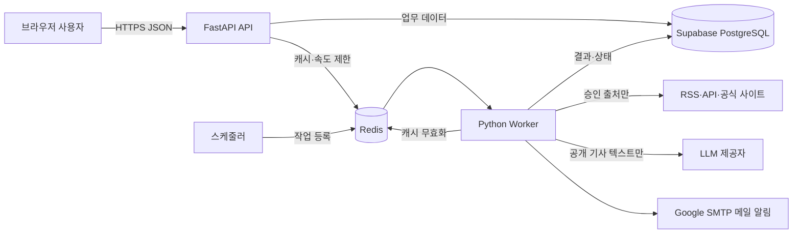
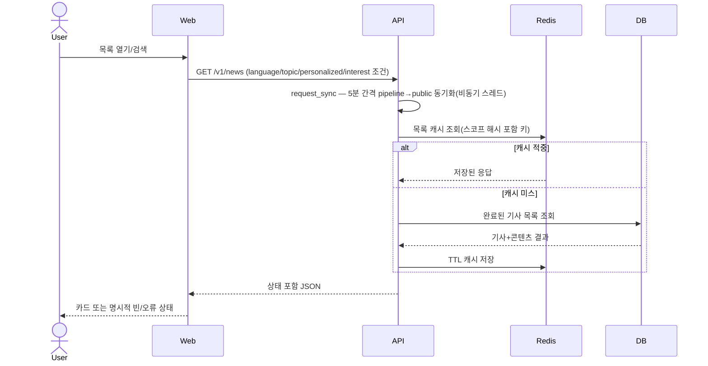
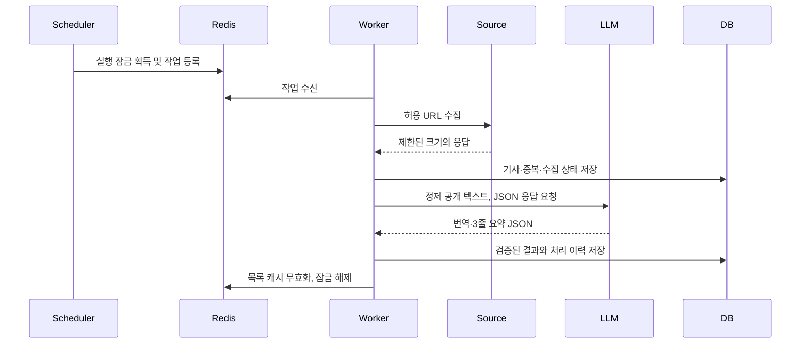
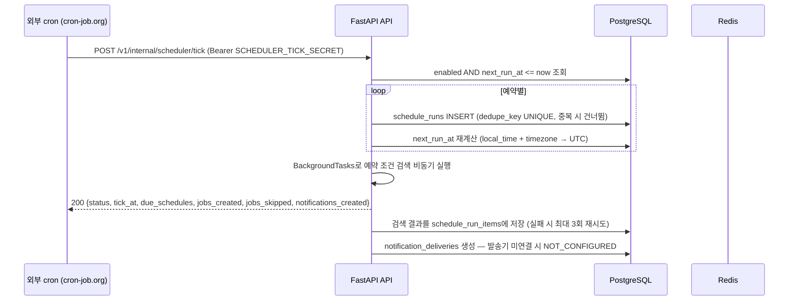
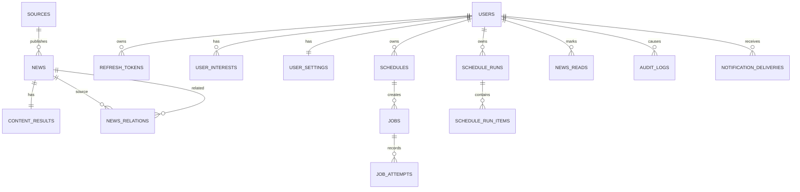

# DAIT 상세 설계서

## English Metadata

| 항목 | 값 |
|---|---|
| English Title | DAIT System Detailed Design Document |
| Search Keywords | DAIT, system architecture, detailed design, FastAPI, Pydantic v2, layered architecture, Redis cache, distributed lock, login throttle, external cron tick, Render, Supabase, dual backend |
| English Summary | System-level design for DAIT covering layered architecture goals, technology baseline, and the implemented structure: a contract-first `dait` backend plus a separate `app` collection/AI pipeline, external cron scheduler tick, Redis cache/locks/login throttling, and Render + Supabase deployment. |

| 항목 | 값 |
|---|---|
| 문서 버전 | 1.0.4 |
| 기준일 | 2026-11-13 |
| 대상 범위 | MVP와 후속 단계의 목표 구조 |
| 구현 기준 | `docs/AI-config/AGENTS.md` |


## 문서 이력

| 버전 | 작성자 | 기준일 | 수정 내용 |
|---|---|---|---|
| 1.0.0 | seonghoon.yang | 2026-11-03 | 최초 작성 |
| 1.0.1 | seonghoon.yang | 2026-11-06 | 화면설계서 v1.0.1 반영 및 문서 세트 정합성 보강 |
| 1.0.2 | seonghoon.yang | 2026-11-10 | 외부 cron tick 처리 흐름(5.3절) 추가, 배포 구조에 외부 cron 대체 방식 명시 |
| 1.0.2 | seonghoon.yang | 2026-11-10 | repositories 계층을 DB 이중 백엔드(db_sqlite/db_postgres) 구조로 갱신 |
| 1.0.3 | seonghoon.yang | 2026-11-12 | 실제 구현 구조 반영 — dait 계약 백엔드 + app 파이프라인 이원 구성, 외부 cron tick, Redis 분산 락·캐시·로그인 스로틀, Render/Supabase 배포 |
| 1.0.4 | seonghoon.yang | 2026-11-13 | v1.0.4 구현 반영 — pipeline→public 자동 동기화, 뉴스 language/topic/personalized/interest 필터와 interest_counts, 로그인 잠금 3단계, keepalive 엔드포인트, fetch IP 고정(DNS rebinding 방지) |
| 1.0.4.1 | seonghoon.yang | 2026-11-13 | 상세보기 화면(메인 내 상세 패널 포함)과 설정 `노출·알림` 메뉴 UI 제거 반영 — 기사 카드는 원문 직결, 상세 API·설정 필드·DB는 유지 |

## 0.1 v1.0.1 화면 기준 변경

- UI 기준은 `DAIT_화면설계서_v1.0.4.pptx`와 정적 목업의 메인·설정 구조를 따른다. 별도 상세보기 화면은 포함하지 않는다.
- 메인 화면은 통합 검색, `전체`/`AI·기술` 필터, `랭킹순`/`최신순` 정렬, 뉴스 랭킹 카드로 구성한다.
- 뉴스 상세 정보는 화면으로 제공하지 않는다(1.0.4.1). `GET /v1/news/{news_id}` 상세 API는 유지하되 UI는 기사 카드를 원문 새 탭·링크 복사로만 연결한다.
- 설정 화면은 단계 1 MVP 구현 화면이며 예약 수집, 관심 설정, 닉네임 변경, 계정·정책을 실제 API와 연결해 저장·조회·복원한다. `노출·알림`(기본 노출 수·관심 키워드·인앱/메일 알림) 설정 섹션과 알림 설정은 화면에서 제공하지 않는다(관련 API 필드·DB는 유지).
- 정적 목업의 3개 뉴스 카드는 화면 검증 샘플이며 API 계약의 최대 10건과 충돌하지 않는다.

## 0.2 v1.0.4 구현 반영 사항

- `pipeline_sync_service`가 `GET /v1/news` 요청 시 daemon 스레드로 5분 간격
  `pipeline`→`public` 동기화를 실행한다(PostgreSQL 전용, 실패는 로그만).
- 뉴스 목록·활성 카운트에 `language`(ko|en), `topic`, `personalized`, `interest` 조건이
  추가됐고 `NewsActivity`는 `interest_counts`를 반환한다. `/v1/news/read-state`가
  읽음 ID만 별도 조회한다.
- 관심사 코드는 한국어 15개 + `en.*` 15개(총 30개)이며 `interest_matching.KEYWORDS`의
  명시적 키워드 규칙으로 기사 매칭한다.
- 로그인·탈퇴 잠금이 계정+IP(5회)·계정 전체(50회)·IP(20회) 3단계로 바뀌었다.
- `GET /v1/internal/keepalive`가 무의존 200 응답(`no-store`)을 제공한다.
- URL 안전성 계층이 검증한 공인 IP로 연결을 고정하고, charset 디코딩·Trafilatura
  타임아웃 가드·LLM 제목 번역 백업이 파이프라인에 추가됐다.

## 1. 설계 목표

- 교과과정 수준으로 읽기 쉬운 계층 구조를 유지한다.
- HTTP, 크롤링, LLM, Redis, DB 경계의 입력을 Pydantic v2로 검증한다.
- 화면 요청과 느린 수집·LLM 처리를 분리하고 저장 결과를 우선 제공한다.
- 외부 서비스 장애가 저장된 뉴스 열람을 중단시키지 않게 한다.
- release 모드의 비밀·개인정보·내부 오류 노출을 구조적으로 막는다.
- 필요한 기능만 구현하며 새 프레임워크와 추상화는 승인 없이 추가하지 않는다.

## 2. 기술 기준선

| 계층 | 기술 | 용도 |
|---|---|---|
| 브라우저 | JavaScript 반응형 웹 | 목록, 검색, 원문 이동, 계정, 설정 |
| API | Python 3.12+, FastAPI | `/v1` JSON API, 인증·인가, 작업 제어 |
| 검증·설정 | Pydantic v2, pydantic-settings | 경계 모델, 환경변수 설정, 비밀값 마스킹 |
| 운영 DB | Supabase PostgreSQL | 영속 업무 데이터와 감사 기록 |
| 로컬·테스트 DB | SQLite | 네트워크 없는 개발·테스트 |
| 마이그레이션 | Alembic | 두 DB가 공유하는 스키마 변경 이력 |
| 임시 인프라 | Redis | 캐시, 큐, 속도 제한, 잠금, 인증코드 TTL |
| 이메일 | Google SMTP | 단계 1 메일 알림, 단계 2 인증 코드에도 재사용; 환경변수로만 자격 증명 주입 |
| 실행 | Docker, Docker Compose | release 기본의 동일 실행 환경 |
| 품질 | ruff, pyright, pytest, pip-audit, pre-commit, gitleaks | 정적·동적·보안 검사 |

의존성은 uv 또는 pip-tools 중 프로젝트가 선택한 하나의 lock 방식으로 고정한다. Celery처럼
현재 범위를 넘는 작업 프레임워크는 추가하지 않고 Redis 큐를 읽는 작은 Python worker로 시작한다.

## 3. 시스템 구조



### 3.1 실행 단위

| 단위 | 책임 | 금지 |
|---|---|---|
| web+api (통합) | 정적 자산, 화면, 인증, 권한, 조회·설정 API — `src/server.py`가 프론트엔드와 `dait` API를 한 프로세스로 서빙 | 비밀값 보유, LLM 직접 호출, 긴 크롤링 |
| pipeline | RSS 수집→정제→번역·요약→READY — `src/backend/app` 독립 서비스(`dait-pipeline`) | 사용자 세션 처리 |
| scheduler | 외부 cron → `POST /v1/internal/scheduler/tick` → `schedule_runs` 생성 + `BackgroundTasks` 검색 | 상시 프로세스 없이 cron으로 대체(5.3절) |
| db | 영속 데이터와 관계·감사 | 작업 큐 역할 |
| redis | 만료 가능한 캐시·잠금·로그인 스로틀 | 원문·사용자 핵심 데이터 영구 저장 |

> v1.0.3 구현 기준: Render 무료 티어 제약으로 상시 scheduler/worker 프로세스 대신
> **외부 cron + tick 엔드포인트 + FastAPI BackgroundTasks** 구조를 사용한다.
> 수집 파이프라인은 `src/backend/app`을 별도 Render 서비스로 배포하고 Supabase의
> `pipeline` 스키마를 사용해 계약 스키마와 분리한다.

### 3.2 화면 구성 계약

| 화면 | 데스크톱 기준 | 모바일 기준 | 단계 |
|---|---|---|---|
| 메인 | 좌측 탐색 + 검색·필터·정렬 + 랭킹 카드 | 좌측 탐색 숨김, 하단 탭, 카드 단일 열 | MVP |
| 상세보기 | ~~기사 헤더, 2열 콘텐츠~~ **제거(1.0.4.1)** — 상세 API만 유지, 카드는 원문 직결 | — | API만 |
| 설정 | 설정 구역 메뉴 + 예약·관심·닉네임·계정 카드 | 설정 메뉴 가로 스크롤, 입력 한 열 | MVP |

메인 카드의 UI 필드는 `rank`, `title`, `source_name`, `published_at`, `category`, `summary_lines`, `processing_status`, `original_url`에 매핑한다. 카드의 제목·`원문 열기`는 검증된 HTTPS 원문을 새 탭으로 열고, `링크 복사`는 URL 복사 피드백을 제공한다. 원문 이동 시 읽음이 기록된다.

## 4. 백엔드 코드 구조

```text
src/
  server.py         # 통합 엔트리포인트: 정적 프론트엔드 + dait API를 한 앱으로 서빙
  backend/
    src/dait/       # 계약 우선 백엔드 (현재 운영 API)
      api/v1/       #   auth, me, interests, news, settings, scheduler, health 라우터
      services/     #   인증·뉴스·설정·스케줄 실행·캐시/재시도 비즈니스 규칙
      repositories/ #   DB 접근(sqlite/postgres 공통 SQL) + redis_repository
      schemas/      #   Pydantic 요청·응답·외부 경계 모델
      core/         #   설정, 로깅, 보안, 예외, URL 안전성, 앱 생성
      workers/      #   ai_processor 등 dait 측 처리기
      collectors/   #   승인 출처 수집 안전장치
    app/            # 파이프라인 앱(수집·AI 처리) — 별도 Render 서비스
      api/ services/ repositories/ workers/ collectors/ schemas/ core/
    migrations/     # Alembic — 0001~0007, head=0007_merge_schedule_onboarding
  frontend/public/  # 정적 SPA 자산 (index.html, app.js, news-ui.js, settings-ui.js 등)
tests/backend/      # pytest 단위·통합 (현재 608건)
```

의존 방향은 `api → services → repositories`다. 외부 의존성은 작은 Protocol 뒤에 두고 테스트는
가짜 구현을 사용한다. 비동기 I/O에는 `async`를 쓰며 CPU 작업과 동기 라이브러리를 이벤트 루프에서
직접 실행하지 않는다.

## 5. 주요 처리 흐름

### 5.1 뉴스 조회



### 5.2 예약 수집과 AI 처리



실패는 단계별로 기록한다. 최대 재시도 후 dead-letter 상태로 이동하며 무한 재시도하지 않는다.

### 5.3 외부 cron tick 처리 흐름

운영 환경에서는 상시 스케줄러 프로세스 대신 외부 cron 서비스(cron-job.org)가 `POST /v1/internal/scheduler/tick`을 주기적으로 호출한다. tick 수신 시 API 프로세스가 아래를 순서대로 수행한다.



- tick 자체는 기한 조회·`schedule_runs` 생성·`next_run_at` 갱신만 수행하고, 실제 검색은
  `BackgroundTasks`로 같은 프로세스에서 비동기 실행한다(별도 worker 없음).
- 같은 실행 창의 중복 tick은 `schedule_runs.dedupe_key` UNIQUE 제약과 조건부 갱신으로 한 번만
  회차를 만든다. `lease_until`로 처리 중 회차의 중복 소비도 방지한다.
- `next_run_at`은 tick 처리 시점에 다음 발생 시각으로 즉시 재계산해 다음 tick이 같은 예약을 다시 집지 않게 한다.
- 알림은 `notification_deliveries`에 기록하며, 카카오 발송기 미연결 상태에서는
  `notify_status=NOT_CONFIGURED`로 남는다.
- 사용자 결과 조회는 `GET /v1/me/schedule-runs`, 확인 표시는 `POST /v1/me/schedule-runs/seen`.
- 상세 계약은 API 설계서 7.5절, 데이터 모델은 DB 설계서 §3A를 따른다.

## 6. API 설계

### 6.1 공통 규칙

- 모든 업무 API는 `/v1` 아래에 둔다.
- 요청·응답 모델은 `ConfigDict(extra="forbid")`를 사용한다.
- 이메일은 `EmailStr`, URL은 `HttpUrl`, 시각은 UTC timezone-aware `datetime`이다.
- 목록은 cursor 기반 페이지네이션을 사용하고 기본·최대 크기를 제한한다.
- 오류 응답은 `code`, 일반화된 `message`, `request_id`, 선택적 `fields`만 제공한다.
- 내부 예외는 도메인 예외로 변환하고 스택트레이스는 release 응답에 넣지 않는다.

### 6.2 MVP 엔드포인트

| 메서드 | 경로 | 인증 | 기능 |
|---|---|---|---|
| POST | `/v1/auth/signup` | 아니요 | 이메일 회원가입(Bearer 토큰 발급, 선택 닉네임·관심사) |
| POST | `/v1/auth/login` | 아니요 | 이메일 로그인(Bearer 토큰 발급) |
| POST | `/v1/auth/refresh` | 리프레시 토큰 | 토큰 회전 |
| POST | `/v1/auth/logout` | 예 | 현재 세션 무효화 |
| GET | `/v1/auth/nickname-availability` | 아니요 | 닉네임 중복 확인 |
| GET | `/v1/me/session` | 선택 | 세션 상태 확인(`authenticated`+`user`) |
| PATCH | `/v1/me/nickname` | 예 | 닉네임 변경·제거 |
| DELETE | `/v1/me` | 예 | 비밀번호 재확인 후 회원탈퇴 |
| GET | `/v1/interests/catalog` | 아니요 | 관심사 카탈로그(대주제별) |
| GET/PUT | `/v1/me/interests` | 예 | 내 관심사 조회·전체 교체 |
| GET | `/v1/news` | 선택 | 목록·검색·정렬·cursor + `language`/`topic`/`personalized`/`interest` (비로그인 제한 목록) |
| GET | `/v1/news/activity` | 예 | 필터별·관심사별 건수·읽음 ID(no-store, `personalized`/`language` 조건) |
| GET | `/v1/news/read-state` | 예 | 요청 ID의 읽음 상태만 조회(no-store) |
| PUT | `/v1/news/{news_id}/read` | 예 | 읽음 기록(멱등, 204) |
| GET | `/v1/news/{news_id}` | 아니요 | 상세·번역·요약·관련 뉴스 (API 유지, 화면 미제공) |
| GET/PATCH | `/v1/me/settings` | 예 | 노출 수, 관심 조건 조회·저장 (`노출·알림` UI 제거, API 필드 유지) |
| GET/POST | `/v1/me/schedules` | 예 | 예약 목록·생성 |
| PATCH/DELETE | `/v1/me/schedules/{id}` | 예 | 소유 예약 수정·삭제 |
| GET | `/v1/me/schedule-runs` | 예 | 예약 검색 실행 이력·결과 |
| POST | `/v1/me/schedule-runs/seen` | 예 | 예약 결과 확인 표시(204) |
| POST | `/v1/internal/scheduler/tick` | 서버 시크릿 | 외부 cron 트리거(Bearer `SCHEDULER_TICK_SECRET`) |
| GET | `/v1/internal/keepalive` | 아니요 | 스핀다운 방지 ping(무의존 200, `no-store`) |
| GET | `/healthz` | 아니요 | 프로세스 생존 확인 |
| GET | `/readyz` | 아니요 | DB·Redis 준비 상태 |

목록 질의는 `category`(AI/ECONOMY/POLITICS), `q`(최대 100자), `sort=rank|latest`,
`page_size<=50`, `cursor`를 허용한다. 로그인 사용자는 추가로 `language=ko|en`,
`topic`(관심사 키워드 코드), `personalized=true`(저장 관심사 집계),
`interest`(단일 관심사 코드, 저장 목록에 있어야 함)를 사용할 수 있다.
비로그인 사용자는 최신순·`page_size<=10`·cursor 불가의 제한 목록만 받는다.
`news_id`는 불투명 ID로 받고 저장소 계층에서 파라미터 바인딩한다.
화면의 `전체`/카테고리 필터는 활성 카테고리(AI·경제·정치)만 서버에 전송한다.

### 6.3 단계 2 인증 확장 엔드포인트 (미구현)

> v1.0.3 현재 OAuth·MFA 엔드포인트는 구현되지 않았다. `auth_identities` 테이블도
> DB 설계서 §3A.2와 같이 미구현 상태다.

| 메서드 | 경로 | 기능 |
|---|---|---|
| GET | `/v1/auth/oauth/{provider}/start` | PKCE 로그인 시작 |
| GET | `/v1/auth/oauth/{provider}/callback` | state·nonce 검증 콜백 |
| POST | `/v1/auth/mfa/send` | 인증 코드 발송 |
| POST | `/v1/auth/mfa/verify` | 인증 코드 검증·즉시 폐기 |

## 7. 데이터 설계

### 7.1 핵심 관계



> v1.0.3 구현 기준 ERD다. `auth_identities`는 미구현(이메일 단일 제공자),
> `refresh_sessions`는 `refresh_tokens`로 구현됐다. 전체 컬럼은 DB 설계서 §3A를 따른다.

### 7.2 테이블 요약

| 테이블 | 핵심 필드·제약 |
|---|---|
| users | id, email 정규화 unique, password_hash, status, created_at, deleted_at |
| auth_identities | user_id, provider, provider_subject, `(provider, subject)` unique |
| refresh_sessions | user_id, token_hash, family_id, expires_at, revoked_at |
| user_settings | user_id unique, default_count, categories, web_notice, email_notice (내부 전달 정책 값, 설정 UI 미노출) |
| schedules | user_id, local_time, timezone, enabled, criteria_json, next_run_at |
| sources | name, kind, base_url, priority, enabled, robots_checked_at |
| news | source_id, title, canonical_url unique, published_at, collected_at, category |
| content_results | news_id unique, extracted_text, translated_text, summary_lines, status, error_code |
| news_relations | news_id, related_news_id, reason, score, pair unique |
| jobs | kind, dedupe_key unique, status, scheduled_at, started_at, finished_at |
| job_attempts | job_id, step, attempt_no, error_code, created_at |
| notification_deliveries | user_id, schedule_id, channel, dedupe_key unique, status, sent_at |
| audit_logs | actor_user_id nullable, event, target_type, target_id, request_id, created_at |

PostgreSQL과 SQLite에서 공통으로 쓸 수 있는 타입을 우선한다. JSON 배열 필드는 TEXT에
JSON 문자열로 저장해 두 DB에서 동일하게 동작하게 한다. 앱은 항상 인증 사용자 ID로
범위를 제한한다(2단계 RLS 도입 시 추가 방어선).

### 7.3 상태 값

- 사용자: `ACTIVE`, `LOCKED`, `DELETION_PENDING`, `DELETED`
- 콘텐츠: `PENDING`, `COLLECTED`, `TRANSLATED`, `SUMMARIZED`, `READY`, `FAILED`, `INSUFFICIENT`
- 작업: `QUEUED`, `RUNNING`, `SUCCEEDED`, `FAILED`, `DEAD_LETTER`
- 알림: `PENDING`, `SENT`, `FAILED`, `SKIPPED`

Enum은 저장·API에서 동일한 문자열을 사용하며 알 수 없는 값은 거부한다.

## 8. Redis 설계

| 키 패턴 | 목적 | 기본 TTL | 구현 상태 |
|---|---|---|---|
| `cache:news:list:{query_hash}` | 목록 응답 캐시(5분+jitter) | 300s±10% | ✅ 구현 |
| `cache:news:detail:{news_id}` | 상세 응답 캐시(30분+jitter) | 1800s±10% | ✅ 구현 |
| `lock:news:*` | 목록/상세 캐시 미스 시 중복 조회 방지(SET NX PX + Lua 해제) | 작업시간+여유 | ✅ 구현 |
| `rate:login:{account_ip|account|ip}:{sha256}` | 로그인 실패 스로틀 3단계(계정+IP 5회·계정 50회·IP 20회, Redis 분산, 메모리 fallback) | 제한 창 | ✅ 구현 |
| `lock:collect:{source_id}:{window}` | 중복 수집 방지 | 최대 작업시간+여유 | 🔜 파이프라인 적용 예정 |
| `lock:job:{dedupe_key}` | 동일 작업 중복 방지 | 최대 작업시간+여유 | 🔜 파이프라인 적용 예정 |
| `rate:{scope}:{identity}` | 계정·IP 속도 제한(일반 API) | 제한 창 | 🔜 확장 예정 |
| `auth:code:{purpose}:{subject}` | 단계 2 코드 해시 | 5분 | ⬜ 미구현(MFA 미도입) |
| `auth:cooldown:{purpose}:{subject}` | 재발송 제한 | 정책 시간 | ⬜ 미구현 |
| `queue:jobs` | 작업 큐 | 소비 시 제거, DB 상태 병행 | ⬜ 미구현(BackgroundTasks 사용) |

구현 세부: 목록·상세 캐시는 `news_feed_service`/`news_detail_service`가 cache→lock→recheck→DB→write
패턴으로 사용하고, 쿼리/사용자 식별자는 해시해 키에 원문을 남기지 않는다. 손상된 캐시 값은
미스로 처리하고 키를 삭제한다. Redis 미설정 시 인메모리 fallback, 설정됐는데 연결 실패 시
`/readyz`가 503을 반환한다.

키에는 원문·비밀번호·토큰·이메일을 그대로 넣지 않고 안정적인 해시나 내부 ID를 사용한다. DB 저장 성공
후 관련 캐시만 무효화한다.

## 9. 수집 안전 설계

1. 관리자 승인 출처만 활성화한다.
2. HTTPS만 허용하고 URL을 정규화한다.
3. DNS 결과의 사설, 루프백, 링크로컬, 멀티캐스트, 메타데이터 IP를 차단한다.
4. 리다이렉트마다 scheme·호스트·DNS를 재검증하고 횟수를 제한한다.
5. 연결은 검증한 공인 IP로 고정해 연결 시점 DNS 재조회(rebinding)를 차단하고,
   Host·SNI·인증서 검증은 원래 호스트명으로 유지한다.
6. robots.txt, 이용약관, User-Agent, 요청 간격을 준수한다.
7. 연결·읽기 타임아웃, 응답 크기, Content-Type, 재시도 횟수를 제한한다.
8. HTML은 실행하지 않고 안전한 텍스트로 정제한다(선언된 charset으로 디코딩).
9. 사용자 입력 URL을 수집기로 직접 전달하지 않는다.

## 10. LLM 처리 설계

- 입력은 공개 기사에서 정제한 텍스트와 최소 메타데이터뿐이다.
- 시스템 요청은 한국어 번역, 정확히 3개의 요약 문장, 고유명사·수치 보존을 요구한다.
- 응답은 Pydantic JSON 모델로 검증하며 자유 형식 실패를 정상 결과로 저장하지 않는다.
- 본문이 임계치보다 짧으면 LLM을 호출하지 않고 `INSUFFICIENT`로 기록한다.
- 프롬프트 버전, 모델 식별자, 처리 시각과 기사 내용 해시를 결과에 기록한다.
- 같은 내용 해시와 처리 버전이면 기존 결과를 재사용한다.
- 개인정보, 세션, 사용자 설정은 LLM 입력에 포함하지 않는다.

## 11. 인증·인가 설계

- 비밀번호는 Argon2id 우선, 불가 시 bcrypt로 해시한다.
- 액세스 토큰은 짧게, 리프레시 토큰은 회전하며 DB에는 해시만 저장한다.
- 재사용이 감지된 토큰 family는 전체 폐기한다.
- 로그아웃, 비밀번호 변경, 탈퇴 시 관련 세션을 무효화한다.
- v1.0.3 구현은 쿠키가 아닌 Bearer 토큰 방식이다(`Authorization: Bearer <access_token>`). 토큰은 JSON 응답으로만 전달하고 저장소에는 해시만 둔다.
- 로그인·가입·재설정 응답 시간과 문구로 계정 존재 여부를 노출하지 않는다.
- v1.0.4 로그인·탈퇴 잠금은 세 장치다: 계정+접속 IP(5회 실패 시 잠금), 계정 전체
  (50회 — 분산 대입 완화), IP(20회). 성공 시 계정 계열 기록만 지우고 IP 기록은 남긴다.
- 역할은 `USER`, `ADMIN`이며 FastAPI 의존성에서 권한을 검사한다.
- 사용자 소유 데이터 ID는 클라이언트 값만 믿지 않고 인증 사용자 ID와 함께 조회한다.

단계 2 인증 코드는 `secrets`로 6자리를 만들고 Redis에 해시로 저장한다. TTL 5분, 시도 횟수와
재발송 간격을 제한하고 `hmac.compare_digest`로 비교한 뒤 성공 즉시 삭제한다. OAuth/OIDC는
Authorization Code + PKCE, state, nonce, 고정 redirect URI를 사용한다.

## 12. 모드·설정·로깅

### 12.1 설정

- `BaseSettings` 한 곳에서 환경변수를 읽고 `APP_ENV`를 `debug|test|release`로 제한한다.
- DB URL, SMTP, JWT, OAuth, LLM 비밀값은 `SecretStr`로 선언한다.
- `.env`는 커밋하지 않고 이름만 있는 `.env.example`을 제공한다.
- 설정 누락은 시작 시 실패시키되 실제 비밀값을 오류에 출력하지 않는다.

### 12.2 release 모드

- docs, redoc, OpenAPI URL 비활성화
- WARNING 이상의 구조화 JSON 로그
- 이메일·토큰·인증코드와 개인정보 마스킹
- SQL echo, debug 로그, 응답 스택트레이스 비활성화
- non-root 컨테이너와 HTTPS 전제

### 12.3 debug·test 모드

- 상세 로그와 로컬 docs 허용
- 테스트 우회는 test에서만 도달 가능
- release 경로에 고정 인증코드나 인증 생략 분기를 두지 않음

## 13. 오류 모델

```json
{
  "code": "NEWS_NOT_FOUND",
  "message": "요청한 뉴스를 찾을 수 없습니다.",
  "request_id": "opaque-id",
  "fields": null
}
```

예상 오류는 도메인 예외로 정의해 4xx로 변환한다. 예상하지 못한 오류는 request ID와 함께 500으로
응답하고 내부 원인은 마스킹 로그에만 기록한다. 빈 `except`와 예외 무시는 금지한다.

## 14. 성능·안정성

- 목록과 상세 DB 쿼리는 필요한 관계만 묶어 조회해 N+1을 피한다.
- 페이지 크기와 외부 응답 크기에 상한을 둔다.
- API는 화면 요청에서 LLM·SMTP를 기다리지 않는다.
- SIGTERM 수신 시 새 요청·작업 수신을 중지하고 진행 중 작업의 상태를 보존한다.
- DB·Redis 연결이 필요한 `/readyz`와 단순 생존 `/healthz`를 분리한다.
- LLM·SMTP 장애는 준비 상태 실패가 아니라 기능 저하로 기록하고 저장 결과를 계속 제공한다.
- DB 백업과 복구 절차를 문서화하고 복원 시험 결과를 남긴다.

## 15. 배포 구조

### 15.1 목표 구조 (설계)

```text
docker compose
  web        정적 프론트엔드
  api        FastAPI release 이미지
  worker     같은 이미지의 worker 명령
  scheduler  같은 이미지의 scheduler 명령
  redis      로컬·개발용
  db         로컬은 SQLite 볼륨, 운영은 Supabase PostgreSQL
```

### 15.2 v1.0.4 실제 배포 (Render + Supabase)

| 서비스 | Render 리소스 | 역할 | DB |
|---|---|---|---|
| `dait` (web+api) | Web Service `srv-dbq2lmjl550s739com30` | 통합 엔트리 `PYTHONPATH=src uvicorn --factory dait.main:create_app` | Supabase pooler `DATABASE_URL` |
| `dait-pipeline` | Web Service `srv-dbq4l4jrjlhs73b81q0g` | `src/backend/app` 파이프라인(수집·Groq/Grok 요약·번역) | Supabase `pipeline` 스키마(`DAIT_DATABASE_URL` + `search_path`) |
| `dait-redis` | Key Value `red-dbqi48on74is73c916ng` (free, allkeys_lru) | 목록/상세 캐시, `lock:news:*`, `rate:login:*` | — |
| 외부 cron | cron-job.org 등 | `POST /v1/internal/scheduler/tick` + `SCHEDULER_TICK_SECRET`, keep-alive는 `GET /v1/internal/keepalive` | — |

- 수집 파이프라인은 시작 시 DB가 비어 있으면 RSS 수집→AI 처리를 자동 수행한다
  (1회성 bootstrap; 주기 수집은 tick/스케줄 경로 또는 재시작으로 트리거).
- `pipeline` 스키마의 SUCCESS 기사는 공개 API의 목록 요청을 계기로 5분 간격
  `pipeline_sync_service`가 `public` 스키마에 자동 복사한다(canonical_url 중복 제외).
- LLM은 Groq API 우선, 없으면 xAI(Grok)→Google Translate→regex 폴백 순으로 동작한다.
  영문 기사 제목 번역이 실패하면 LLM 제목 번역 백업 경로를 사용한다.
- keepalive 잡은 `GET /v1/internal/keepalive`를 10분 간격으로 호출해
  Render Free 스핀다운(15분 무요청)을 막는다. DB·Redis 장애와 무관하게 200을 반환한다.
- 접속 시 24시간 이내 수집·요약·번역 데이터는 재처리하지 않고 재사용한다(Conversion 반영).
- 검색은 제목+내용(원문 텍스트)까지 대상에 포함한다.

## 16. 테스트 전략

| 계층 | 범위 |
|---|---|
| 단위 | 중복 제거, 랭킹, 인증코드, 권한, SSRF, 속도 제한, 요약 검증 |
| 저장소 | PostgreSQL/SQLite 공통 CRUD, 트랜잭션, 소유자 범위 |
| 계약 | API Pydantic 스키마, 외부 수집·LLM 가짜 응답 |
| 통합 | 가입→로그인→목록→상세 API, 큐→worker→DB→캐시 무효화 |
| 보안 | 차단 URL, 토큰 재사용, IDOR, 입력 초과, 비밀 로그 방지 |
| UI | v1.0.4 메인·설정 2개 MVP 화면(상세보기·노출·알림 메뉴 미제공), 데스크톱·모바일, 키보드, 설정 저장·복원, 로딩·빈·부분·오류, 긴 텍스트 |

외부 SMTP, LLM, 수집 사이트는 테스트에서 가짜로 대체해 네트워크 없이 실행한다.

## 17. 품질 게이트

```bash
ruff check .
ruff format --check .
pyright
pytest -q
pip-audit
```

pre-commit과 CI에서 동일 규칙을 실행하고 gitleaks를 포함한다. 실패를 제외 경로나 strict 완화로
해결하지 않는다.

## 18. 추적성

| 요구 영역 | 상세 설계 | 핵심 데이터 | 핵심 검증 |
|---|---|---|---|
| 인증·계정 | FR-AUTH-01~04 | users, refresh_tokens, user_interests | AC-AUTH-01~05 |
| 홈·검색 | FR-HOME-01~02, FR-SEARCH-01 | news, content_results, news_reads | AC-HOME-01~02, AC-SEARCH-01~02 |
| 상세 API | FR-DETAIL-01~02 (화면 미제공) | news, content_results, news_relations | AC-DETAIL-01~03 |
| 설정·관심사 | FR-SET-01~03 | user_settings, schedules, schedule_runs | AC-SET-01~02, AC-NOTI-01 |
| 파이프라인 | FR-PIPE-01~04 | sources, news, jobs, job_attempts (pipeline 스키마) | AC-PIPE-01~03, AC-STATE-01 |
