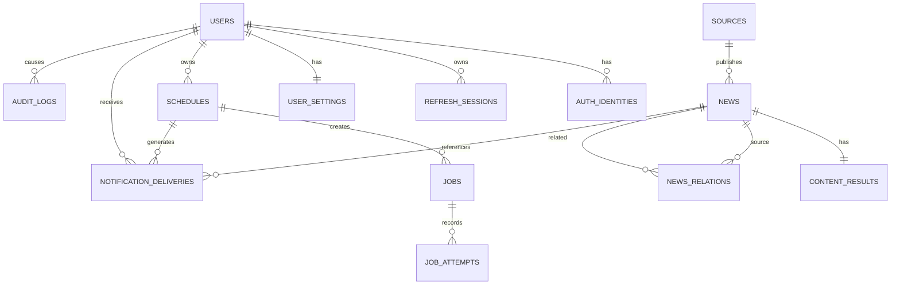
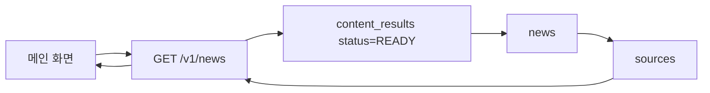
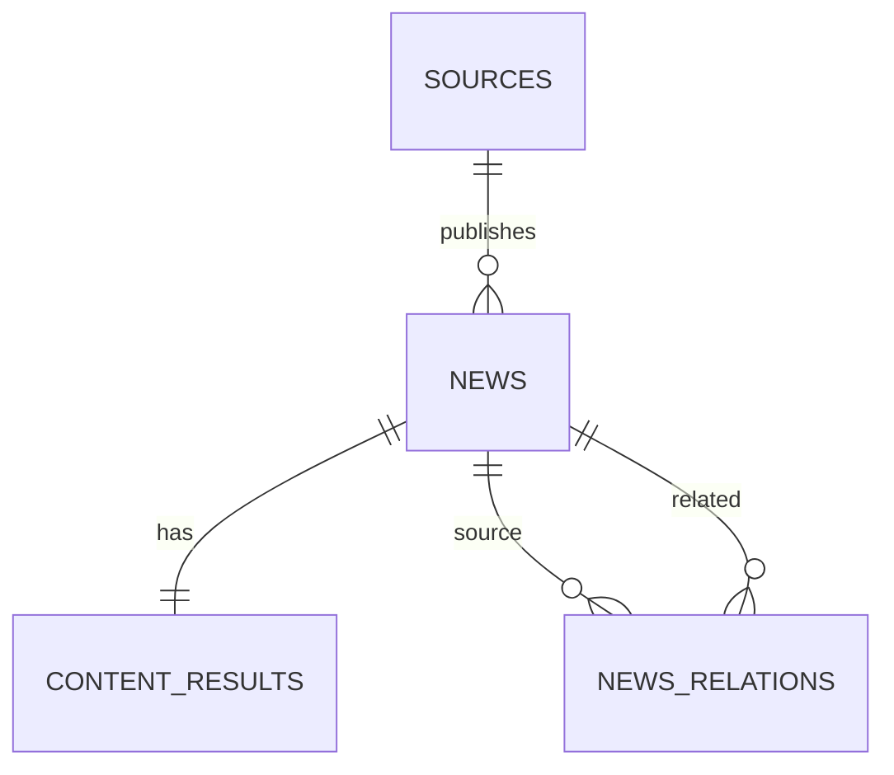
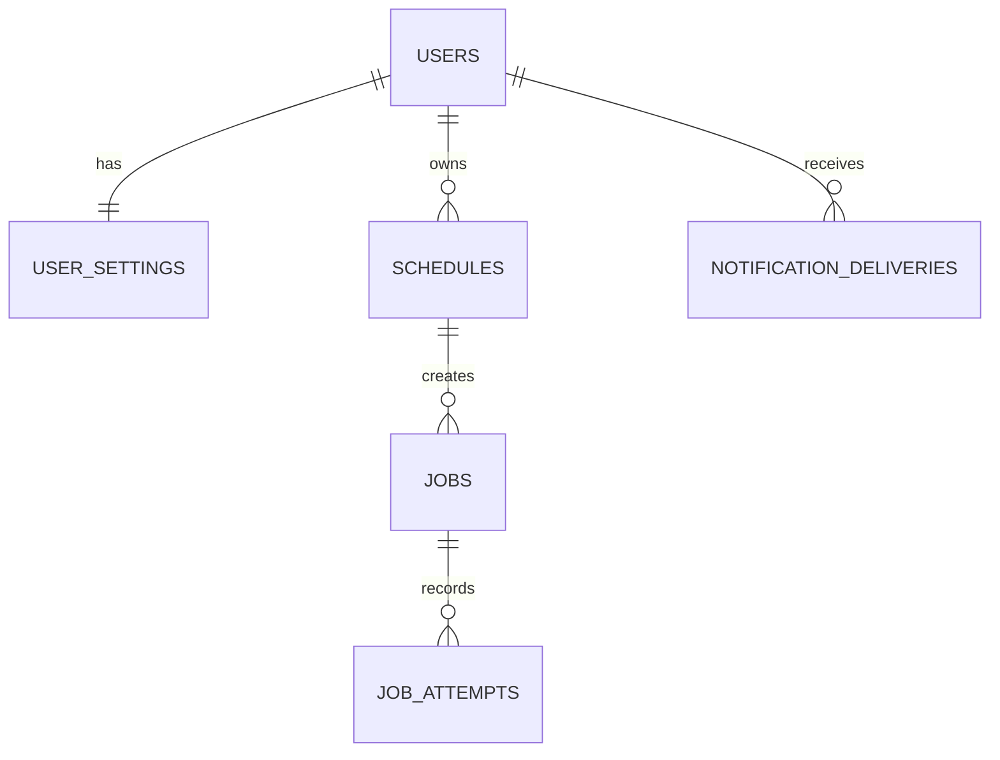
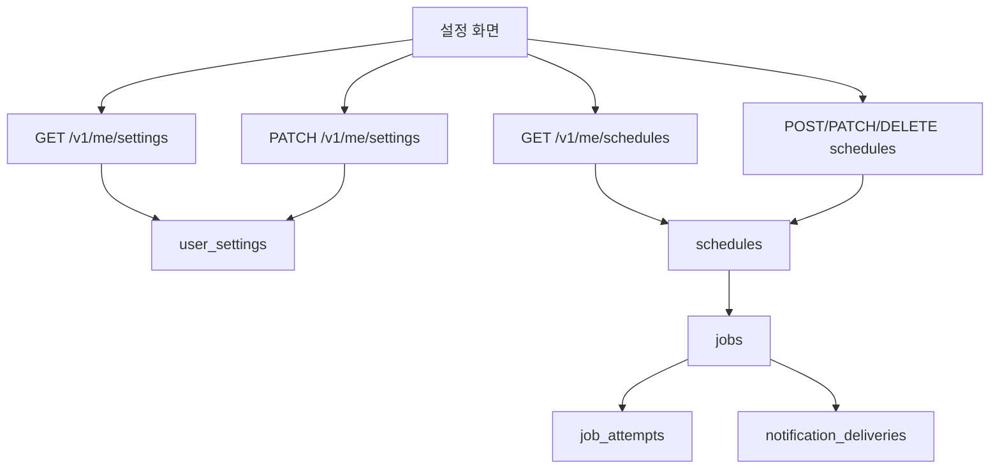

# DAIT DB 설계서

## English Metadata

| 항목 | 값 |
|---|---|
| English Title | DAIT Database Design Document |
| Search Keywords | DAIT, database design, PostgreSQL, SQLite, Supabase, Alembic migrations, schema, tables, foreign keys, user_id scoping, JSON fields, Redis cache, dual backend repositories |
| English Summary | Database design for DAIT targeting Supabase PostgreSQL in production and SQLite locally. Documents design principles, Alembic migrations 0001-0008 (head `0008_news_topics`), 20 tables including users, news, settings, interests, schedules, schedule_runs, news_topics, and notification deliveries, plus dual-backend repository guidance. |

| 항목 | 값 |
|---|---|
| 문서 버전 | 1.0.4 |
| 기준일 | 2026-11-13 |
| 운영 DB | Supabase PostgreSQL |
| 로컬/테스트 DB | SQLite |
| 마이그레이션 | Alembic |
| 기준 문서 | 기본기획서 / 전체설계서 / 상세설계서 / 상세기획서 / 화면설계서 v1.0.1 |

## 문서 이력

| 버전 | 작성자 | 기준일 | 수정 내용 |
|---|---|---|---|
| 1.0.0 | seonghoon.yang | 2026-11-03 | 최초 작성 |
| 1.0.1 | seonghoon.yang | 2026-11-06 | 화면설계서 v1.0.1 반영 및 문서 세트 정합성 보강 |
| 1.0.2 | seonghoon.yang | 2026-11-10 | 문서 세트 버전 1.0.2로 갱신 |
| 1.0.2 | seonghoon.yang | 2026-11-10 | 8절 DDL 예시의 JSONB/TEXT 차이를 구현 현황(TEXT 저장)에 맞게 보강 |
| 1.0.3 | seonghoon.yang | 2026-11-12 | Alembic 마이그레이션 0001~0007(헤드 0007_merge_schedule_onboarding) 및 18개 테이블 기준으로 스키마 갱신 |
| 1.0.4 | seonghoon.yang | 2026-11-13 | 스키마 변경 없음 확인 — 관심사 코드 30개(en.* 포함)·pipeline→public 동기화·언어 판별 규칙은 애플리케이션 계층 사항으로 명시 |
| 1.0.4 | seonghoon.yang | 2026-11-13 | `0008_news_topics` 추가 — 기사 주제 사전 분류 테이블(news_topics·news_classified) 반영, 테이블 수 19개·head 0008로 갱신 |

## 1. 설계 원칙

- PostgreSQL과 SQLite에서 공통 운용 가능한 타입을 우선한다.
- PK는 외부 예측이 어려운 불투명 문자열 또는 UUID 계열을 사용한다.
- 모든 FK는 실제 참조 관계를 가진다.
- 사용자 소유 데이터는 항상 `user_id`를 기준으로 조회한다.
- 뉴스 원문 전체 재배포를 피하고 필요한 메타데이터/정제 텍스트/번역/요약 중심으로 저장한다.
- Redis는 캐시/잠금/큐 용도이며 영구 데이터 원본으로 사용하지 않는다.

---

# 2. 전체 ERD



---

# 3. 테이블 상세

## 3.1 `users`

### 역할
사용자 계정의 기준 테이블.

| 컬럼 | 타입 | 키 | Null | 설명 |
|---|---|---|---:|---|
| `id` | varchar/uuid | PK | N | 사용자 내부 ID |
| `email` | varchar(254) | UNIQUE | N | 정규화된 이메일 |
| `password_hash` | text |  | Y | 이메일 계정 비밀번호 해시. 소셜-only 계정은 null 가능 |
| `status` | varchar |  | N | `ACTIVE`, `LOCKED`, `DELETION_PENDING`, `DELETED` |
| `created_at` | timestamptz |  | N | 생성 시각 |
| `updated_at` | timestamptz |  | N | 수정 시각 |
| `deleted_at` | timestamptz |  | Y | 삭제/비활성 시각 |

### 주요 키 설명
- **PK `id`**: 모든 사용자 소유 데이터가 참조하는 기준 키.
- **UNIQUE `email`**: 동일 정규화 이메일 중복 가입 방지.

### 연결 화면/기능
- 로그인/회원가입
- 설정 > 계정·정책
- 회원탈퇴

---

## 3.2 `auth_identities`

### 역할
Google/Kakao/Apple 등 외부 인증 제공자 계정 연결.

| 컬럼 | 타입 | 키 | Null | 설명 |
|---|---|---|---:|---|
| `id` | varchar/uuid | PK | N | identity ID |
| `user_id` | varchar/uuid | FK→users.id | N | 소유 사용자 |
| `provider` | varchar | UNIQUE 복합 | N | `GOOGLE`, `KAKAO`, `APPLE` |
| `provider_subject` | varchar | UNIQUE 복합 | N | 제공자 고유 subject |
| `created_at` | timestamptz |  | N | 연결 시각 |

### 제약
`UNIQUE(provider, provider_subject)`

---

## 3.3 `refresh_sessions`

### 역할
리프레시 토큰의 회전/폐기/재사용 탐지.

| 컬럼 | 타입 | 키 | Null | 설명 |
|---|---|---|---:|---|
| `id` | varchar/uuid | PK | N | 세션 ID |
| `user_id` | varchar/uuid | FK→users.id | N | 사용자 |
| `token_hash` | text | UNIQUE | N | refresh 원문이 아닌 해시 |
| `family_id` | varchar | INDEX | N | 회전 계열 ID |
| `expires_at` | timestamptz |  | N | 만료 시각 |
| `revoked_at` | timestamptz |  | Y | 폐기 시각 |
| `created_at` | timestamptz |  | N | 생성 시각 |

---

## 3.4 `user_settings`

### 역할
설정 화면에서 관리하는 사용자 개인화 값을 저장한다.

| 컬럼 | 타입 | 키 | Null | 설명 |
|---|---|---|---:|---|
| `user_id` | varchar/uuid | PK/FK→users.id | N | 1사용자 1설정 |
| `default_count` | smallint | CHECK | N | 5 또는 10 |
| `categories` | json/text |  | N | 활성 카테고리 배열, MVP는 `["AI"]` |
| `keywords` | json/text |  | N | 관심 키워드 배열 |
| `source_ids` | json/text |  | N | 승인 출처 ID 배열 |
| `in_app_notice` | boolean |  | N | 내부 알림 전달 정책 값. 설정 UI에서 변경할 수 없음 |
| `email_notice` | boolean |  | N | 내부 메일 전달 정책 값. 설정 UI에서 변경할 수 없음 |
| `created_at` | timestamptz |  | N | 생성 시각 |
| `updated_at` | timestamptz |  | N | 수정 시각 |

### 주요 키/제약
- **PK/FK `user_id`**: users와 1:1 관계.
- `CHECK(default_count IN (5,10))`.

### 연결 화면/기능
- 설정 > 검색·관심 설정
- 설정 > 목록 표시
- 메인 기본 노출 개수
- 예약 생성 시 기본 criteria 구성

---

## 3.5 `schedules`

### 역할
설정 화면의 예약 수집 정보를 저장한다.

| 컬럼 | 타입 | 키 | Null | 설명 |
|---|---|---|---:|---|
| `id` | varchar/uuid | PK | N | 예약 ID |
| `user_id` | varchar/uuid | FK→users.id | N | 예약 소유자 |
| `local_time` | time |  | N | 사용자 입력 로컬 시각 |
| `timezone` | varchar |  | N | IANA timezone, 예: `Asia/Seoul` |
| `enabled` | boolean |  | N | 예약 활성 여부 |
| `criteria_json` | json/text |  | N | 키워드/출처/카테고리 조건 |
| `next_run_at` | timestamptz | INDEX | Y | 다음 실행 UTC 시각 |
| `created_at` | timestamptz |  | N | 생성 시각 |
| `updated_at` | timestamptz |  | N | 수정 시각 |

### 주요 키 설명
- **PK `id`**: 설정 화면에서 예약 수정/삭제 시 사용.
- **FK `user_id`**: 사용자별 소유권 검사.
- **INDEX `next_run_at`**: scheduler가 실행 예정 예약을 빠르게 찾기 위함.

### 연결 화면
설정 > 예약 수집 (`08:30`, `Asia/Seoul`, 활성/다음 실행 시각)

---

## 3.6 `sources`

### 역할
뉴스를 가져올 승인 출처 목록.

| 컬럼 | 타입 | 키 | Null | 설명 |
|---|---|---|---:|---|
| `id` | varchar/uuid | PK | N | 출처 ID |
| `name` | varchar |  | N | `OpenAI Newsroom`, `Anthropic` 등 |
| `kind` | varchar |  | N | RSS/API/OFFICIAL_HTML |
| `base_url` | text | UNIQUE | N | 승인 기본 URL |
| `priority` | integer | INDEX | N | 랭킹 동률 시 출처 우선순위 |
| `enabled` | boolean | INDEX | N | 수집 활성 여부 |
| `robots_checked_at` | timestamptz |  | Y | robots 확인 시각 |
| `created_at` | timestamptz |  | N | 생성 시각 |
| `updated_at` | timestamptz |  | N | 수정 시각 |

### 연결 기능
- 수집 worker
- 메인 카드의 출처명
- 설정의 승인 출처 선택
- 랭킹 출처 우선순위

---

## 3.7 `news`

### 역할
뉴스 기사 자체의 기준 메타데이터.

| 컬럼 | 타입 | 키 | Null | 설명 |
|---|---|---|---:|---|
| `id` | varchar/uuid | PK | N | 뉴스 ID |
| `source_id` | varchar/uuid | FK→sources.id | N | 발행 출처 |
| `title` | text | INDEX | N | 기사 제목 |
| `canonical_url` | text | UNIQUE | N | 정규화된 원문 URL |
| `published_at` | timestamptz | INDEX | N | 발행 시각 |
| `collected_at` | timestamptz |  | N | 수집 시각 |
| `category` | varchar | INDEX | N | MVP `AI` |
| `original_language` | varchar(8) |  | N | `en`, `ko` 등 |
| `content_hash` | varchar | INDEX | Y | 중복/재처리 판단 해시 |
| `created_at` | timestamptz |  | N | 생성 시각 |

### 주요 키
- **UNIQUE `canonical_url`**: 동일 기사 중복 저장 1차 방지.
- `content_hash`: URL이 달라도 동일/유사 본문 재처리 판단에 활용.

### 화면 연결
- 메인: 제목, 출처, 발행 시각, 카테고리, ID
- 상세: 기사 헤더와 원본 정보

---

## 3.8 `content_results`

### 역할
뉴스별 AI 처리 결과 1개를 저장한다.

| 컬럼 | 타입 | 키 | Null | 설명 |
|---|---|---|---:|---|
| `news_id` | varchar/uuid | PK/FK→news.id | N | 1뉴스 1결과 |
| `extracted_text` | text |  | Y | 정제된 공개 기사 텍스트 |
| `translated_text` | text |  | Y | 한국어 번역 |
| `summary_lines` | json/text |  | Y | 정확히 3줄 요약 |
| `status` | varchar | INDEX | N | `PENDING`, `READY`, `FAILED`, `INSUFFICIENT` 등 |
| `error_code` | varchar |  | Y | 공개 가능한 내부 분류 코드 |
| `prompt_version` | varchar |  | Y | 프롬프트 버전 |
| `model_id` | varchar |  | Y | 처리 모델 식별자 |
| `processed_at` | timestamptz |  | Y | 처리 완료 시각 |
| `updated_at` | timestamptz |  | N | 수정 시각 |

### 주요 키
- **PK/FK `news_id`**: news와 1:1.
- **INDEX `status`**: READY 기사 목록 조회 최적화.

### 화면 연결
- 메인: 3줄 요약, 처리 상태
- 상세: 3줄 요약, 한국어 번역, 처리 정보

---

## 3.9 `news_relations`

### 역할
상세 화면의 관련 뉴스 관계 저장.

| 컬럼 | 타입 | 키 | Null | 설명 |
|---|---|---|---:|---|
| `id` | varchar/uuid | PK | N | 관계 ID |
| `news_id` | varchar/uuid | FK→news.id | N | 기준 뉴스 |
| `related_news_id` | varchar/uuid | FK→news.id | N | 관련 뉴스 |
| `reason` | text |  | N | 관련 근거 |
| `score` | numeric |  | N | 관련도 점수 |
| `created_at` | timestamptz |  | N | 생성 시각 |

### 제약
- `UNIQUE(news_id, related_news_id)`
- `CHECK(news_id <> related_news_id)`

### 화면 연결
상세 > 관련 뉴스 카드/목록.

---

## 3.10 `jobs`

### 역할
수집/번역/요약 등 비동기 작업의 기준 상태.

| 컬럼 | 타입 | 키 | Null | 설명 |
|---|---|---|---:|---|
| `id` | varchar/uuid | PK | N | 작업 ID |
| `schedule_id` | varchar/uuid | FK→schedules.id | Y | 예약으로 생성된 경우 |
| `kind` | varchar |  | N | COLLECT/PROCESS 등 |
| `dedupe_key` | varchar | UNIQUE | N | 중복 작업 방지 키 |
| `status` | varchar | INDEX | N | QUEUED/RUNNING/SUCCEEDED/FAILED/DEAD_LETTER |
| `scheduled_at` | timestamptz | INDEX | N | 예정 시각 |
| `started_at` | timestamptz |  | Y | 시작 시각 |
| `finished_at` | timestamptz |  | Y | 종료 시각 |
| `created_at` | timestamptz |  | N | 생성 시각 |

---

## 3.11 `job_attempts`

### 역할
작업 단계별 재시도와 실패 기록.

| 컬럼 | 타입 | 키 | Null | 설명 |
|---|---|---|---:|---|
| `id` | varchar/uuid | PK | N | 시도 ID |
| `job_id` | varchar/uuid | FK→jobs.id | N | 상위 작업 |
| `step` | varchar |  | N | collect/extract/translate/summarize/validate |
| `attempt_no` | integer |  | N | 시도 번호 |
| `error_code` | varchar |  | Y | 오류 코드 |
| `created_at` | timestamptz |  | N | 기록 시각 |

### 제약 제안
`UNIQUE(job_id, step, attempt_no)`

---

## 3.12 `notification_deliveries`

### 역할
인앱/메일 알림의 중복 방지와 전달 이력.

| 컬럼 | 타입 | 키 | Null | 설명 |
|---|---|---|---:|---|
| `id` | varchar/uuid | PK | N | 전달 ID |
| `user_id` | varchar/uuid | FK→users.id | N | 수신 사용자 |
| `schedule_id` | varchar/uuid | FK→schedules.id | Y | 관련 예약 |
| `news_id` | varchar/uuid | FK→news.id | Y | 관련 뉴스 |
| `channel` | varchar |  | N | IN_APP/EMAIL |
| `dedupe_key` | varchar | UNIQUE | N | 중복 전달 방지 |
| `status` | varchar | INDEX | N | PENDING/SENT/FAILED/SKIPPED |
| `sent_at` | timestamptz |  | Y | 전송 시각 |
| `created_at` | timestamptz |  | N | 생성 시각 |

### dedupe 예시
`hash(user_id + schedule_id + news_id + channel)`

---

## 3.13 `audit_logs`

### 역할
계정/설정/예약/보안 관련 주요 변경 추적.

| 컬럼 | 타입 | 키 | Null | 설명 |
|---|---|---|---:|---|
| `id` | varchar/uuid | PK | N | 로그 ID |
| `actor_user_id` | varchar/uuid | FK→users.id | Y | 수행자, 시스템 작업은 null 가능 |
| `event` | varchar | INDEX | N | SETTINGS_UPDATED 등 |
| `target_type` | varchar |  | N | USER/SCHEDULE/SETTINGS |
| `target_id` | varchar |  | Y | 대상 ID |
| `request_id` | varchar | INDEX | N | API 요청 추적 ID |
| `created_at` | timestamptz | INDEX | N | 발생 시각 |

### 주의
비밀번호/토큰/인증코드/검색어 원문 등 민감정보를 기록하지 않는다.

---

# 3A. v1.0.3 구현 스키마 (Alembic 마이그레이션 기준)

> v1.0.3부터 본 문서의 설계안은 **실제 구현된 스키마** 기준으로 읽는다.
> Alembic 리비전 체인: `0001_users` → `0002_interests` → `0003_news_settings` →
> `0004_schedule_runs` ∥ `0004_user_nickname` → `0005_news_reads` →
> `0006_interest_onboarding` → `0007_merge_schedule_onboarding` →
> `0008_news_topics` (head).
> 프로덕션(Supabase PostgreSQL)과 로컬(SQLite)이 동일 마이그레이션을 공유한다.

## 3A.1 구현 테이블 목록 (20개, `alembic_version` 포함 19개 업무 테이블)

| 테이블 | 역할 | 비고 |
|---|---|---|
| `users` | 계정 기준 | `email` UNIQUE, `password_hash`, `status`, `role`, `nickname`(0004_user_nickname), `nickname_key`(정규화 검색용) |
| `refresh_tokens` | 세션 토큰 | `token_hash` UNIQUE, `family_id`(회전 계열), `expires_at`, `revoked_at` — 설계의 `refresh_sessions`에 해당 |
| `user_interests` | 관심사 | `(user_id, interest_code)` 복합 PK, CASCADE |
| `pending_interest_onboarding` | 관심사 온보딩 대기 | `user_id` PK — 가입 후 관심사 미설정 사용자 추적 |
| `user_settings` | 사용자 설정 | `default_count`, `categories`/`keywords`/`source_ids`는 TEXT에 JSON 배열 저장. `in_app_notice`, `email_notice`는 내부 알림 전달 정책용으로 UI에서 변경 불가 |
| `schedules` | 예약 수집 조건 | `local_time`, `timezone`, `enabled`, `criteria_json`(TEXT), `next_run_at` |
| `schedule_runs` | 예약 검색 실행 이력 | `dedupe_key` UNIQUE, `search_status`/`search_attempts`/`search_error`, `notify_status`/`notify_attempts`, `lease_until`(리스), `seen_at` |
| `schedule_run_items` | 회차별 결과 뉴스 | `schedule_run_id`+`position`, `news_id`, `title`, `source_name`, `url`, `published_at`, `summary_lines` |
| `news_reads` | 읽음 기록 | `(user_id, news_id)` 복합 PK, 양쪽 CASCADE |
| `sources` | 승인 출처 | `name`, `kind`, `base_url` UNIQUE, `priority`, `enabled`, `robots_checked_at` |
| `news` | 수집 기사 | `title`, `canonical_url` UNIQUE, `published_at`, `collected_at`, `category`, `original_language`, `content_hash` |
| `content_results` | AI 처리 결과 | `news_id` FK, `extracted_text`, `translated_text`, `summary_lines`(TEXT JSON), `status`, `error_code`, `prompt_version`, `model_id`, `processed_at` |
| `news_relations` | 관련 뉴스 | `news_id`/`related_news_id`, `reason`, `score` |
| `news_topics` | 기사 주제 분류 결과 | `(news_id, topic_code)` 복합 PK, `topic_code` 인덱스 — 관심사·주제 조회가 읽는 사전 계산 결과 |
| `news_classified` | 분류 기준 시각 | `news_id` PK, `content_updated_at`(분류 기준)·`classified_at` — 변경분 재분류 판별용 |
| `jobs` | 백그라운드 작업 | `dedupe_key`, `status`, `scheduled_at` 등 — `ix_jobs_status_scheduled` 인덱스 |
| `job_attempts` | 작업 시도 이력 | `(job_id, step, attempt_no)` UNIQUE |
| `notification_deliveries` | 알림 발송 | 채널·상태·dedupe, `ix_notification_deliveries_status` |
| `audit_logs` | 감사 로그 | `event`, `request_id` 인덱스 |

## 3A.2 설계안 → 구현 매핑

| 설계 테이블(§3) | 구현 | 차이 |
|---|---|---|
| `users` | `users` | `nickname`/`nickname_key` 컬럼 추가(0004). Supabase Auth 스키마 컬럼과 공존 |
| `auth_identities` | **미구현** | 이메일+비밀번호 단일 제공자만 구현. 소셜 로그인 추가 시 재검토 |
| `refresh_sessions` | `refresh_tokens` | 이름 변경 + `family_id` 회전 계열, `token_hash` 저장(원문 미저장) |
| `user_settings` | `user_settings` | 배열 필드를 JSONB 대신 TEXT(JSON 문자열)로 저장(SQLite 호환) |
| `schedules` | `schedules` | `criteria_json` TEXT 저장 |
| (없음) | `schedule_runs`, `schedule_run_items` | **신규** — 예약 검색 실행 이력·결과 스냅샷 |
| (없음) | `news_reads` | **신규** — 로그인 사용자 읽음 기록 |
| (없음) | `user_interests`, `pending_interest_onboarding` | **신규** — 관심사 코드·온보딩 상태 |
| (없음) | `news_topics`, `news_classified` | **신규** — 기사 주제 사전 분류 저장소(0008). 요청 경로의 키워드 LIKE 검색을 제거하기 위한 구현 추가분 |
| `sources`~`audit_logs` | 동일 이름 | 컬럼 세부는 마이그레이션 DDL이 정본 |

## 3A.3 운영 참고

- JSON 배열/객체 필드(`categories`, `keywords`, `source_ids`, `criteria_json`,
  `summary_lines`)는 PostgreSQL/SQLite 공통을 위해 TEXT에 JSON 문자열로 저장한다.
- `schedule_runs.dedupe_key` UNIQUE와 `lease_until`로 외부 cron 중복 실행·동시 tick을 방지한다.
- 파이프라인 앱(`src/backend/app`)은 별도 `pipeline` 스키마의 동명 테이블을 사용해
  계약 스키마와 분리한다(프로덕션 Supabase `search_path=pipeline`).
- v1.0.4: `pipeline_sync_service`가 `pipeline.news`+`pipeline.content_results`의
  SUCCESS 기사를 `public` 스키마 `news`/`content_results`로 5분 간격 복사한다
  (`canonical_url` 중복 제외, `original_language`는 출처명으로 추정).
  언어 판별(`NEWS_LANGUAGE_SQL`)·관심사 키워드 매칭(`interest_matching`)·
  기자명 추출은 애플리케이션 계층 규칙이며 스키마 변경이 없다.
  `user_interests.interest_code`는 `en.*` 접두사 코드를 포함한 최대 30개를 허용한다.

---

# 4. 화면 기준 데이터 관계 ERD

## 4.1 메인 화면

```mermaid
erDiagram
    SOURCES ||--o{ NEWS : publishes
    NEWS ||--|| CONTENT_RESULTS : has

    SOURCES {
      string id PK
      string name
      int priority
    }
    NEWS {
      string id PK
      string source_id FK
      string title
      datetime published_at
      string category
      string canonical_url
    }
    CONTENT_RESULTS {
      string news_id PK_FK
      json summary_lines
      string status
    }
```

### 화면 데이터 매핑

| 메인 UI | DB |
|---|---|
| 순위 | 조회 시 랭킹 규칙으로 계산/저장된 정렬 결과 |
| 제목 | `news.title` |
| 출처 | `sources.name` |
| 발행 시각 | `news.published_at` |
| AI·기술 | `news.category` |
| AI 3줄 요약 | `content_results.summary_lines` |
| 처리 완료/부분 상태 | `content_results.status` + 출처 작업 상태 |
| 원문 열기 | `news.canonical_url` |
| 국내/해외 태그 | `news.original_language` + `sources.name`(언어 판별 SQL) |
| 기자명 | `content_results.extracted_text`/`translated_text`의 명시적 바이라인 파싱 |

### Flow



---

## 4.2 뉴스 상세 조회



| 상세 UI | DB |
|---|---|
| 기사 제목 | `news.title` |
| 출처 | `sources.name` |
| 원문 URL | `news.canonical_url` |
| 발행일 | `news.published_at` |
| AI 3줄 요약 | `content_results.summary_lines` |
| 한국어 번역 | `content_results.translated_text` |
| 처리 정보 | `content_results.status`, `processed_at`, `model_id` |
| 관련 뉴스 | `news_relations` → 관련 `news` + `sources` |

```mermaid
flowchart LR
    UI[메인 내 상세 패널] --> API[GET /v1/news/{id}]
    API --> N[news]
    N --> S[sources]
    N --> C[content_results]
    N --> R[news_relations]
    R --> RN[related news]
    RN --> RS[related source]
    API --> UI
```

---

## 4.3 설정 화면



| 설정 UI | DB |
|---|---|
| 예약 시각 | `schedules.local_time` |
| 시간대 | `schedules.timezone` |
| 활성 상태 | `schedules.enabled` |
| 다음 실행 | `schedules.next_run_at` |
| 관심 키워드 | `user_settings.keywords` |
| 승인 출처 | `user_settings.source_ids` |
| 카테고리 | `user_settings.categories` |
| 기본 노출 수 | `user_settings.default_count` |
| 내부 인앱 전달 정책 | `user_settings.in_app_notice` (설정 UI에서 변경 불가) |
| 내부 메일 전달 정책 | `user_settings.email_notice` (설정 UI에서 변경 불가) |
| 회원탈퇴 | `users` + 관련 사용자 데이터 정리 |



---

# 5. 서비스 전체 데이터 Flow

```mermaid
flowchart TD
    SRC[승인 출처] --> W[Collector Worker]
    W --> S[SOURCES]
    W --> N[NEWS]
    N --> AI[Translation/Summary Worker]
    AI --> C[CONTENT_RESULTS]
    C --> REL[NEWS_RELATIONS]

    U[사용자] --> HOME[메인 화면]
    HOME --> API1[GET /v1/news]
    API1 --> N
    API1 --> C
    API1 --> S

    U --> DETAIL[상세보기]
    DETAIL --> API2[GET /v1/news/{id}]
    API2 --> N
    API2 --> C
    API2 --> REL

    U --> SETTINGS[설정]
    SETTINGS --> API3[settings/schedules API]
    API3 --> US[USER_SETTINGS]
    API3 --> SCH[SCHEDULES]
    SCH --> JOB[JOBS]
    JOB --> W
    JOB --> NOTI[NOTIFICATION_DELIVERIES]
```

---

# 6. 주요 인덱스 권장안

| 테이블 | 인덱스 | 목적 |
|---|---|---|
| `users` | UNIQUE(email) | 로그인/중복 |
| `sources` | INDEX(enabled, priority) | 활성 출처/랭킹 |
| `news` | UNIQUE(canonical_url) | 중복 방지 |
| `news` | INDEX(category, published_at DESC) | 메인 최신순 |
| `content_results` | INDEX(status) | READY 기사 필터 |
| `news_relations` | INDEX(news_id, score DESC) | 관련 뉴스 |
| `news_topics` | INDEX(topic_code) | 주제별 기사 조회(EXISTS) |
| `schedules` | INDEX(user_id) | 사용자 예약 |
| `schedules` | INDEX(enabled, next_run_at) | scheduler 실행 대상 |
| `jobs` | UNIQUE(dedupe_key) | 중복 작업 방지 |
| `jobs` | INDEX(status, scheduled_at) | worker 큐 상태 |
| `notification_deliveries` | UNIQUE(dedupe_key) | 중복 알림 방지 |
| `audit_logs` | INDEX(request_id) | API 추적 |

---

# 7. 삭제/무결성 정책 권장안

| 부모 | 자식 | 권장 정책 |
|---|---|---|
| users | refresh_sessions | CASCADE |
| users | user_settings | CASCADE |
| users | schedules | CASCADE |
| users | notification_deliveries | 정책에 따라 삭제/비식별 |
| users | audit_logs | 사용자 식별자 비식별화 권장 |
| sources | news | RESTRICT |
| news | content_results | CASCADE |
| news | news_relations | CASCADE |
| schedules | jobs | RESTRICT 또는 기록 보존 |
| jobs | job_attempts | CASCADE |

공유 뉴스 데이터(`sources`, `news`, `content_results`)는 사용자 탈퇴와 무관하게 유지한다.

---

# 8. 예시 SQL DDL (PostgreSQL 기준 개념 예시)

```sql
CREATE TABLE user_settings (
    user_id TEXT PRIMARY KEY REFERENCES users(id) ON DELETE CASCADE,
    default_count SMALLINT NOT NULL CHECK (default_count IN (5, 10)),
    categories JSONB NOT NULL DEFAULT '["AI"]'::jsonb,
    keywords JSONB NOT NULL DEFAULT '[]'::jsonb,
    source_ids JSONB NOT NULL DEFAULT '[]'::jsonb,
    in_app_notice BOOLEAN NOT NULL DEFAULT TRUE,
    email_notice BOOLEAN NOT NULL DEFAULT FALSE,
    created_at TIMESTAMPTZ NOT NULL DEFAULT now(),
    updated_at TIMESTAMPTZ NOT NULL DEFAULT now()
);

CREATE TABLE schedules (
    id TEXT PRIMARY KEY,
    user_id TEXT NOT NULL REFERENCES users(id) ON DELETE CASCADE,
    local_time TIME NOT NULL,
    timezone TEXT NOT NULL,
    enabled BOOLEAN NOT NULL DEFAULT TRUE,
    criteria_json JSONB NOT NULL,
    next_run_at TIMESTAMPTZ,
    created_at TIMESTAMPTZ NOT NULL DEFAULT now(),
    updated_at TIMESTAMPTZ NOT NULL DEFAULT now()
);

CREATE INDEX idx_schedules_due
ON schedules(enabled, next_run_at);
```

> 구현 참고: 현재 Alembic 마이그레이션은 `categories`/`keywords`/`source_ids`/`criteria_json`/`summary_lines`를
> 양쪽 DB 모두 `TEXT`(JSON 문자열)로 저장한다. 위 DDL의 JSONB는 PostgreSQL 최적화 예시이며,
> JSONB 도입 시 `db_dialect()` 분기와 인덱스 전략을 함께 검토한다(15_PostgreSQL_SQLite_전환_가이드.md).

---

# 9. 화면별 데이터 검수 체크리스트

## 메인
- [ ] READY 뉴스만 기본 목록에 노출된다.
- [ ] 카드의 출처/발행 시각/3줄 요약이 DB 값과 일치한다.
- [ ] 일부 출처 실패가 정상 카드를 지우지 않는다.
- [ ] 원문 URL은 HTTPS 검증된 값만 제공한다.

## 상세
- [ ] `news.id` 1건에 `content_results`가 1:1로 연결된다.
- [ ] `summary_lines`는 READY일 때 3개다.
- [ ] 관련 뉴스에서 자기 자신/중복/FAILED가 제외된다.
- [ ] 번역이 없는 한국어 원문은 nullable 정책이 일관된다.

## 설정
- [ ] user_settings는 사용자당 1건이다.
- [ ] schedule은 반드시 소유 user_id로 조회된다.
- [ ] `default_count`는 5 또는 10만 저장된다.
- [ ] `timezone`은 유효한 IANA 값이다.
- [ ] 알림 전달은 dedupe_key로 중복 차단된다.

---

# 10. 구현 우선순위

1. `users`, `refresh_sessions`
2. `sources`, `news`, `content_results`
3. 메인/상세 API 연결
4. `user_settings`, `schedules`
5. 설정 API 연결
6. `jobs`, `job_attempts`
7. `news_relations`
8. `notification_deliveries`, `audit_logs`
9. 인덱스/성능/삭제 정책 검증
