# DAIT ERD (구현 스키마)

## English Metadata

| 항목 | 값 |
|---|---|
| English Title | DAIT Entity-Relationship Diagram (Implemented Schema) |
| Search Keywords | DAIT, ERD, entity relationship diagram, database schema, Alembic, PostgreSQL, SQLite, users, refresh_tokens, news, content_results, schedules, schedule_runs, pipeline schema |
| English Summary | ERD document for the DAIT database as actually implemented on the develop branch. Generated from Alembic migrations 0001~0008 (head `0008_news_topics`), covering 19 tables in the `public` contract schema with keys, foreign keys, constraints, and indexes, plus notes on the separate `pipeline` schema used by the collection/AI backend. |

| 항목 | 값 |
|---|---|
| 문서 버전 | 1.0.4 |
| 기준일 | 2026-11-13 |
| 작성자 | seonghoon.yang |
| 생성일 | 2026-11-13 |
| 대상 | `src/backend/migrations/versions/` Alembic 마이그레이션 0001~0008 (head: `0008_news_topics`) |
| 스키마 | `public`(계약 스키마, 19개 테이블) + `pipeline`(수집·AI 파이프라인 전용, 별도 스키마) |
| 관련 문서 | 07_DB_설계서_v1.0.4.md (3A절 구현 스키마), 15_PostgreSQL_SQLite_전환_가이드.md |

## 문서 이력

| 버전 | 작성자 | 기준일 | 수정 내용 |
|---|---|---|---|
| 1.0.4 | seonghoon.yang | 2026-11-13 | 최초 작성 — develop 브랜치 Alembic 마이그레이션 기준 구현 ERD |
| 1.0.4 | seonghoon.yang | 2026-11-13 | `0008_news_topics` 반영 — news_topics·news_classified 추가(기사 주제 분류 저장소), head를 0008로 갱신 |

## 1. 목적

본 문서는 develop 브랜치에 **실제 구현된** 데이터베이스 스키마를 ERD로 정리한다.
설계안(07_DB_설계서의 개념 스키마)과 구현 스키마의 차이는 다음과 같다.

- `refresh_sessions`(설계안) → `refresh_tokens`(구현)
- `auth_identities`는 미구현 — 이메일 단일 제공자, OAuth/MFA는 단계 2
- JSON 계열 필드(`categories`, `keywords`, `source_ids`, `criteria_json`,
  `summary_lines` 등)는 SQLite 호환을 위해 `TEXT`에 JSON 문자열로 저장
- 모든 시각은 UTC timezone-aware(`TIMESTAMP WITH TIME ZONE` / SQLite는 naive 저장 후 UTC 처리)

## 2. 전체 ERD

```mermaid
erDiagram
    users ||--o{ refresh_tokens : "user_id CASCADE"
    users ||--o{ user_interests : "user_id CASCADE"
    users ||--o| pending_interest_onboarding : "user_id CASCADE"
    users ||--o{ news_reads : "user_id CASCADE"
    users ||--o| user_settings : "user_id CASCADE"
    users ||--o{ schedules : "user_id CASCADE"
    users ||--o{ schedule_runs : "user_id CASCADE"
    users ||--o{ notification_deliveries : "user_id CASCADE"
    users |o--o{ audit_logs : "actor_user_id SET NULL"
    schedules ||--o{ jobs : "schedule_id RESTRICT"
    schedules |o--o{ schedule_runs : "schedule_id SET NULL"
    schedules |o--o{ notification_deliveries : "schedule_id SET NULL"
    schedule_runs ||--o{ schedule_run_items : "run_id CASCADE"
    jobs ||--o{ job_attempts : "job_id CASCADE"
    sources ||--o{ news : "source_id RESTRICT"
    news ||--o| content_results : "news_id CASCADE"
    news ||--o{ news_relations : "news_id CASCADE"
    news ||--o{ news_relations : "related_news_id CASCADE"
    news |o--o{ notification_deliveries : "news_id SET NULL"
    news ||--o{ news_reads : "news_id CASCADE"
    news ||--o{ news_topics : "news_id CASCADE"
    news ||--o| news_classified : "news_id CASCADE"

    users {
        varchar_36 id PK
        varchar_254 email UK
        varchar_255 password_hash
        varchar_16 status
        varchar_16 role
        varchar_30 nickname
        varchar_90 nickname_key UK
        timestamp created_at
    }
    refresh_tokens {
        varchar_36 id PK
        varchar_36 user_id FK
        varchar_36 family_id
        varchar_64 token_hash UK
        timestamp expires_at
        timestamp revoked_at
        timestamp created_at
    }
    user_interests {
        varchar_36 user_id PK,FK
        varchar_32 interest_code PK
    }
    pending_interest_onboarding {
        varchar_36 user_id PK,FK
    }
    news_reads {
        varchar_64 user_id PK,FK
        varchar_64 news_id PK,FK
    }
    user_settings {
        varchar_36 user_id PK,FK
        smallint default_count
        text categories
        text keywords
        text source_ids
        boolean in_app_notice
        boolean email_notice
        timestamp created_at
        timestamp updated_at
    }
    schedules {
        varchar_36 id PK
        varchar_36 user_id FK
        varchar_8 local_time
        varchar_64 timezone
        boolean enabled
        text criteria_json
        timestamp next_run_at
        timestamp created_at
        timestamp updated_at
    }
    schedule_runs {
        varchar_36 id PK
        varchar_36 schedule_id FK
        varchar_36 user_id FK
        varchar_200 dedupe_key UK
        timestamp scheduled_for
        text criteria_json
        varchar_20 search_status
        integer search_attempts
        varchar_200 search_error
        integer result_count
        timestamp started_at
        timestamp finished_at
        varchar_20 notify_status
        integer notify_attempts
        varchar_200 notify_error
        timestamp notify_next_at
        timestamp notified_at
        timestamp lease_until
        timestamp seen_at
        timestamp created_at
        timestamp updated_at
    }
    schedule_run_items {
        varchar_36 run_id PK,FK
        integer position PK
        varchar_36 news_id
        text title
        varchar_200 source_name
        text url
        timestamp published_at
        text summary_lines
    }
    sources {
        varchar_36 id PK
        varchar_200 name
        varchar_20 kind
        text base_url UK
        integer priority
        boolean enabled
        timestamp robots_checked_at
        timestamp created_at
        timestamp updated_at
    }
    news {
        varchar_36 id PK
        varchar_36 source_id FK
        text title
        text canonical_url UK
        timestamp published_at
        timestamp collected_at
        varchar_20 category
        varchar_8 original_language
        varchar_64 content_hash
        timestamp created_at
    }
    content_results {
        varchar_36 news_id PK,FK
        text extracted_text
        text translated_text
        text summary_lines
        varchar_20 status
        varchar_64 error_code
        varchar_40 prompt_version
        varchar_80 model_id
        timestamp processed_at
        timestamp updated_at
    }
    news_relations {
        varchar_36 id PK
        varchar_36 news_id FK
        varchar_36 related_news_id FK
        text reason
        float score
        timestamp created_at
    }
    news_topics {
        varchar_36 news_id PK,FK
        varchar_32 topic_code PK
    }
    news_classified {
        varchar_36 news_id PK,FK
        varchar_64 content_updated_at
        varchar_64 classified_at
    }
    jobs {
        varchar_36 id PK
        varchar_36 schedule_id FK
        varchar_20 kind
        varchar_200 dedupe_key UK
        varchar_20 status
        timestamp scheduled_at
        timestamp started_at
        timestamp finished_at
        timestamp created_at
    }
    job_attempts {
        varchar_36 id PK
        varchar_36 job_id FK
        varchar_20 step
        integer attempt_no
        varchar_64 error_code
        timestamp created_at
    }
    notification_deliveries {
        varchar_36 id PK
        varchar_36 user_id FK
        varchar_36 schedule_id FK
        varchar_36 news_id FK
        varchar_10 channel
        varchar_200 dedupe_key UK
        varchar_10 status
        timestamp sent_at
        timestamp created_at
    }
    audit_logs {
        varchar_36 id PK
        varchar_36 actor_user_id FK
        varchar_40 event
        varchar_20 target_type
        varchar_64 target_id
        varchar_64 request_id
        timestamp created_at
    }
```



## 3. 테이블 그룹 설명

### 3.1 인증·계정 (users 중심)

| 테이블 | 역할 | 주요 제약 |
|---|---|---|
| `users` | 회원 계정. email 유니크, Argon2 `password_hash`, `role`(USER/ADMIN)·`status`(ACTIVE) CHECK | `nickname_key` 유니크 인덱스(대소문자·공백 정규화 키) |
| `refresh_tokens` | 로그인 세션의 refresh 토큰. 원문 대신 `token_hash`만 저장, `family_id`로 회전·탈취 탐지 | `token_hash` 유니크, user 삭제 시 CASCADE |
| `user_interests` | 저장 관심사 코드(국문·`en.*` 영문 카탈로그). 복합 PK `(user_id, interest_code)` | 값 검증은 Pydantic Enum이 담당 |
| `pending_interest_onboarding` | 신규 가입자 1회 관심사 온보딩 대기 표시 | user_id PK, CASCADE |
| `news_reads` | 계정별 기사 읽음 기록(페이지 이동 후에도 유지) | 복합 PK `(user_id, news_id)`, CASCADE |
| `user_settings` | 사용자 설정 1:1 — 기본 노출 수(5/10 CHECK), 카테고리·키워드·출처(JSON TEXT). 알림 전달 값은 내부 정책용이며 설정 UI에서 변경할 수 없음 | user_id PK |

### 3.2 뉴스·콘텐츠 (sources → news → content_results)

| 테이블 | 역할 | 주요 제약 |
|---|---|---|
| `sources` | 승인 수집 출처 | `base_url` 유니크, `enabled`+`priority` 인덱스 |
| `news` | 수집된 기사 원문 메타. `original_language`(ko/en 등), `canonical_url` 유니크로 중복 수집 방지 | `content_hash` 인덱스, category+published_at 인덱스 |
| `content_results` | 기사별 AI 처리 결과 — 추출 본문, 번역, 3줄 요약(JSON TEXT), 상태(READY/INSUFFICIENT/FAILED), 모델·프롬프트 버전 | news_id PK로 news와 1:1 |
| `news_relations` | 관련 뉴스 점수·사유 | `(news_id, related_news_id)` 유니크, 자기 참조 CHECK 금지 |
| `news_topics` | 기사-주제 분류 결과. `feed_index_service`가 기사 1회 분류 시 계산해 저장하고, 관심사·주제 조회는 요청마다 키워드 LIKE 대신 이 결과를 읽는다 | 복합 PK `(news_id, topic_code)`, `topic_code` 인덱스 |
| `news_classified` | 기사별 마지막 분류 기준 `content_updated_at`·분류 시각. 콘텐츠 갱신 감지와 재분류 대상 선정에 사용 | news_id PK, CASCADE |

### 3.3 예약 수집·스케줄러

| 테이블 | 역할 | 주요 제약 |
|---|---|---|
| `schedules` | 사용자 예약 수집 조건(시각·타임존·criteria_json)과 `next_run_at` | `enabled`+`next_run_at` 인덱스로 due 조회 |
| `schedule_runs` | 예약 1회 실행 이력 — 검색 상태/시도/오류와 알림 상태/시도/`seen_at`(확인 표시)을 분리 기록 | `dedupe_key` 유니크로 중복 tick 방지, user+created_at 인덱스 |
| `schedule_run_items` | 실행 회차의 검색 결과 스냅샷(제목·출처·URL·요약) | 복합 PK `(run_id, position)` |
| `jobs` | 수집·처리 작업 큐 레코드 | `dedupe_key` 유니크, status+scheduled_at 인덱스 |
| `job_attempts` | 작업 단계별 시도 기록(재시도 이력) | `(job_id, step, attempt_no)` 유니크 |

### 3.4 알림·감사

| 테이블 | 역할 | 주요 제약 |
|---|---|---|
| `notification_deliveries` | 채널별(IN_APP/EMAIL/KAKAO) 알림 전달 결과. 카카오 미연결 시 `NOT_CONFIGURED` | `dedupe_key` 유니크로 중복 발송 방지 |
| `audit_logs` | 인증·설정 변경 등 감사 이벤트 | event·request_id·created_at 인덱스 |

## 4. 관계 요약

- **users가 허브**: refresh_tokens, user_interests, pending_interest_onboarding,
  news_reads, user_settings, schedules, schedule_runs, notification_deliveries가
  모두 `users.id`를 참조하며 대부분 `ON DELETE CASCADE`다. 탈퇴 시 계정 데이터가
  함께 정리된다.
- **SET NULL 예외**: `schedule_runs.schedule_id`, `notification_deliveries.schedule_id`·`news_id`,
  `audit_logs.actor_user_id`는 부모 삭제 후에도 결과·이력을 보존하기 위해 SET NULL이다.
- **RESTRICT**: `news.source_id`(출처 삭제 전 기사 처리 정책), `jobs.schedule_id`
  (예약 삭제 전 실행 중 작업 보호).
- **news 1:1 content_results**: `content_results.news_id`가 PK이자 FK라 기사당 AI 결과는
  최대 1건이다.
- **news_relations 자기 참조**: `news_id <> related_news_id` CHECK로 자기 관련 기사를
  차단하고 `(news_id, related_news_id)` 유니크로 중복을 막는다.
- **news_topics/news_classified**: `news` 삭제 시 CASCADE로 분류 결과도 함께 제거된다.
  `topic_code`는 `ai.*`/`economy.*`/`society.*` 기본 코드만 저장하고, `en.*` 영문
  코드는 조회 시점에 `original_language`/출처 기반 언어 판정과 조합해 해석한다.

## 5. `pipeline` 스키마 (별도)

수집·AI 파이프라인 백엔드(`src/backend/app`)는 운영 DB의 `pipeline` 스키마를 사용한다.
`public` 계약 스키마와 테이블명이 충돌하지 않도록 분리하며, Supabase에서는
`search_path`로 구분한다. 파이프라인이 처리한 SUCCESS 기사는
`pipeline_sync_service`가 5분 간격 규칙으로 `public.news`/`public.content_results`에
동기화한다(v1.0.4, `canonical_url` 중복 제외, SQLite 환경에서는 건너뜀).
파이프라인 테이블의 상세 구조는 `src/backend/app` 마이그레이션을 따른다.

## 6. 마이그레이션 이력

| 리비전 | 내용 |
|---|---|
| `0001_users` | users, refresh_tokens 생성 |
| `0002_interests` | user_interests 생성 |
| `0003_news_settings` | sources, news, content_results, news_relations, user_settings, schedules, jobs, job_attempts, notification_deliveries, audit_logs 생성 |
| `0004_user_nickname` | users에 nickname/nickname_key + 유니크 인덱스 추가 |
| `0004_schedule_runs` | schedule_runs, schedule_run_items 생성 (0003과 병렬 브랜치) |
| `0005_news_reads` | news_reads 생성 |
| `0006_interest_onboarding` | pending_interest_onboarding 생성 (0004_schedule_runs와 병렬 브랜치) |
| `0007_merge_schedule_onboarding` | 두 브랜치 병합 |
| `0008_news_topics` | news_topics, news_classified 생성 (head) — 기사 주제 분류 저장소 |

## 7. 검증 방법

```bash
# 로컬 SQLite에 스키마 생성 후 테이블 목록 확인
cd src/backend && alembic upgrade head
sqlite3 <db파일> ".tables"

# Supabase PostgreSQL 운영 스키마 확인
psql "$DATABASE_URL" -c "\dt public.*"
```
