# DAIT 기능별 상세기획서

## English Metadata

| 항목 | 값 |
|---|---|
| English Title | DAIT Detailed Feature Planning Document |
| Search Keywords | DAIT, feature planning, user flows, implementation logic, exceptions, acceptance criteria, static SPA, frontend structure, 24-hour reuse, title and content search, notification status |
| English Summary | Detailed per-feature planning for DAIT covering user flows, implementation logic, exceptions, and review criteria for planning/frontend/backend/AI/crawler/QA roles. v1.0.3 records confirmed implementation details: static SPA frontend, dual backend packages, title+content search, 24-hour data reuse, and Kakao notification status. |

| 항목 | 값 |
|---|---|
| 문서 버전 | 1.0.5 |
| 기준일 | 2026-11-13 |
| 대상 | 기획, 프론트엔드, 백엔드, AI, 크롤러, QA |
| 구성 | 기능 설명, 사용자 흐름, 구현 로직 flow, 예외, 검수 기준 |


## 문서 이력

| 버전 | 작성자 | 기준일 | 수정 내용 |
|---|---|---|---|
| 1.0.0 | seonghoon.yang | 2026-11-03 | 최초 작성 |
| 1.0.1 | seonghoon.yang | 2026-11-06 | 화면설계서 v1.0.1 반영 및 문서 세트 정합성 보강 |
| 1.0.2 | seonghoon.yang | 2026-11-10 | 문서 세트 버전 1.0.2로 갱신 |
| 1.0.3 | seonghoon.yang | 2026-11-12 | 상세기획서의 구현 확정 사항 반영 — 실제 API·DB·프론트엔드 구조와 1.0.3 변경(24시간 갱신, 제목·내용 검색) 명시 |
| 1.0.4 | seonghoon.yang | 2026-11-13 | v1.0.4 구현 반영 — 국내·해외 탐색, 관심사 집계·30개 코드, 최신순 정렬 통일, pipeline 동기화, 로그인 잠금 3단계, keepalive |
| 1.0.4.1 | seonghoon.yang | 2026-11-13 | 상세보기 화면(FR-DETAIL-01 화면 부분)과 설정 `노출·알림` 메뉴(FR-SET-03 화면 부분) UI 제거 반영 — 상세 API·설정 필드·DB는 유지 |
| 1.0.5 | seonghoon.yang | 2026-11-13 | 영문 기사 기능 전면 중단 — 해외 수집·번역·`language` 필터·`en.*` 관심사·해외 UI 제거, 한국어 기사만 수집·탐색 |

## 0.1 v1.0.1 변경 요약

- `DAIT_화면설계서_v1.0.5.pptx`의 메인·설정 화면을 기능 기획의 UI 기준으로 반영한다. 상세보기 전용 화면은 제공하지 않는다.
- 메인은 검색·필터·정렬·랭킹 카드, 설정은 예약·관심 카테고리·닉네임·계정/정책 카드 구조로 구체화하며 단계 1에서 구현한다. 상세보기 화면과 설정 내 알림·노출 메뉴는 제공하지 않는다(1.0.4.1).
- 정적 목업의 3건 기사와 비동작 버튼·입력은 화면 검토 예시이며 실제 기능 수량·동작 계약은 FR/API 기준을 따른다.

## 0.2 v1.0.3 구현 기준 변경

- 프론트엔드 구조: `src/frontend/public/`의 정적 SPA — `index.html`(메인 목록),
  `app.js`(인증·목록·검색), `news-ui.js`, `settings.html`+`settings-ui.js`(설정).
  (1.0.4.1: 상세 다이얼로그/상세보기 화면과 `노출·알림` 설정 섹션은 UI에서 제거 — `#display`는 `hidden`, `#display` 해시는 `#schedule`로 리다이렉트)
  로그인·가입 제출 즉시 진행 팝업이 표시되고 응답 완료 시 자동으로 닫힌다.
- 백엔드 구조: 계약 우선 `dait` 패키지(`src/backend/src/dait`) + 파이프라인 `app`
  패키지(`src/backend/app`)의 이원 구성. 통합 서빙은 `src/server.py`.
- 검색: 제목+내용(원문 추출 텍스트)까지 검색 대상이다(Conversion 반영).
- 수집·AI 처리: 접속/수집 시 24시간 이내 데이터는 재처리하지 않고 재사용한다.
- 알림: 카카오 발송기는 미연결 — `notification_deliveries.notify_status=NOT_CONFIGURED`로 기록.
- DB: Alembic 마이그레이션 0001~0007(head `0007_merge_schedule_onboarding`),
  Supabase PostgreSQL 운영 + 로컬 SQLite.

## 0.3 v1.0.4 구현 기준 변경

- 뉴스 탐색: 메인에 `국내`/`해외` 지역 칩과 로그인 사용자 전용 관심사 칩을 둔다.
  `GET /v1/news`의 `language`/`topic`/`personalized`/`interest` 질의와
  `GET /v1/news/activity`의 `interest_counts`, `GET /v1/news/read-state`가 이를 지원한다.
- 관심사: 카탈로그가 한국어 15개 + `en.*` 15개(최대 30개)로 확장됐다.
- 정렬: `rank`·`latest`·관련 뉴스 모두 `published_at DESC` 최우선(품질·출처는 동률 보조).
- 수집 파이프라인: `pipeline_sync_service`가 5분 간격으로 `pipeline`→`public` 기사를
  동기화하고, fetch는 검증 IP 고정·charset 디코딩·Trafilatura 가드를 적용한다.
  영문 제목 번역 실패 시 LLM 백업 경로를 사용한다.
- 보안: 로그인·탈퇴 잠금이 계정+IP(5)·계정(50)·IP(20) 3단계다.
- 운영: `GET /v1/internal/keepalive`가 Render 스핀다운 방지 ping을 제공한다.

## 0.4 v1.0.5 구현 기준 변경 (영문 기사 기능 중단)

- 뉴스 탐색: `해외` 지역 칩·`English News` 사이드바를 제거하고 `국내` 탐색으로 고정한다.
  `GET /v1/news`·`GET /v1/news/activity`에서 `language` 파라미터와 `en.*` 관심사 코드를
  제거하고 한국어 기사만 반환한다.
- 관심사: 카탈로그는 한국어 15개(최대 15개)만 제공하고 기존 `en.*` 저장값은 제거된다.
- 파이프라인: 영문 피드 수집과 외국어 제목 번역 단계를 제거하고 한국어 기사만
  수집→정제→요약→READY로 처리한다. `translated_text` 등 영문 응답 필드는 API에서 제외한다.
- 예약 검색: 저장 관심사 상속 시 `en.*` 코드를 제외해 결과도 한국어 기사만 포함한다.

## 1. 문서 사용법

각 기능은 동일한 ID로 기획·설계·개발·테스트를 추적한다. 메인·설정과 `FR-SET-01~03`은 모두 `MVP` 기능으로 먼저 완성한다. 설정 화면에서 알림 채널을 변경할 수 없다. `단계 2` 인증 확장 기능은 MVP 품질 게이트 통과 후 착수한다. flow의 처리 단계는 구현 순서를 설명하지만 특정 함수나
클래스 이름을 미리 강제하지 않는다.

## 2. 공통 화면·처리 원칙

- 사용자는 현재 상태, 가능한 다음 행동, 실패 시 복구 방법을 항상 알 수 있어야 한다.
- 저장 성공 전 성공 메시지를 표시하지 않는다.
- 실제 기능이 연결되지 않은 메뉴와 버튼은 제품 실행 화면에 동작 기능처럼 노출하지 않는다. 메인·설정은 단계 1 화면이며 뉴스 상세 정보는 화면으로 제공하지 않는다(1.0.4.1 — 기사 카드는 원문 직결). 후속 인증 확장 기능만 단계 2로 구분한다.
- 모든 외부 입력은 서버 경계에서 Pydantic으로 검증한다.
- 느린 수집·LLM·메일 처리는 화면 요청과 분리한다.
- 오류는 일반화된 메시지와 request ID만 표시하고 내부 원인은 마스킹 로그에 남긴다.
- 기능별 보안·차단 사례를 정상 사례와 함께 검수한다.

---

## 3. FR-AUTH-01 이메일 회원가입

### 기능 설명

사용자가 이메일과 비밀번호로 계정을 만들고 별도 로그인 반복 없이 첫 화면에 진입하는 기능이다.
계정 중복과 약한 비밀번호를 막고 평문 비밀번호를 저장하거나 기록하지 않는다.

### 화면 요소

- 이메일, 비밀번호, 비밀번호 확인
- 필수 약관 동의
- 회원가입 버튼, 로그인 이동 링크
- 필드별 검증 문구와 전체 실패 안내

### 사용자 flow

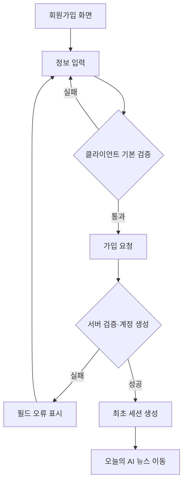

### 구현 로직

1. 이메일 형식·길이, 비밀번호 최소·최대 길이, 확인 일치, 약관 동의를 검증한다.
2. 이메일 비교용 정규화 값을 만들고 유출 비밀번호 정책을 확인한다.
3. Argon2id 우선 또는 bcrypt로 비밀번호를 해시한다.
4. 사용자와 최초 refresh session을 하나의 트랜잭션으로 생성한다.
5. DB unique 제약으로 동시 중복 가입을 최종 차단한다.
6. 성공 시 Bearer 토큰 쌍(access/refresh)을 발급하고 공개 사용자 정보만 반환한다.

### 예외·검수

- 중복·계정 없음 여부를 공격자가 구분할 수 없게 응답 문구와 시간을 통제한다.
- 제출 중 중복 클릭을 막되 서버도 멱등성과 unique 제약으로 방어한다.
- 검수: 정상 가입, 형식 오류, 불일치, 약한·긴 비밀번호, 중복, 동시 요청, 속도 제한.

---

## 4. FR-AUTH-02 소셜 회원가입·로그인

### 기능 설명

Google·Kakao·Apple 계정을 통해 가입하거나 로그인한다. 제공자 고유 식별자로 계정을 연결하며
동일 이메일만으로 서로 다른 제공자 계정을 자동 병합하지 않는다.

### 단계

단계 2. 제공자 앱 등록, redirect URI와 개인정보 정책이 확정된 뒤 구현한다.

### 사용자 flow

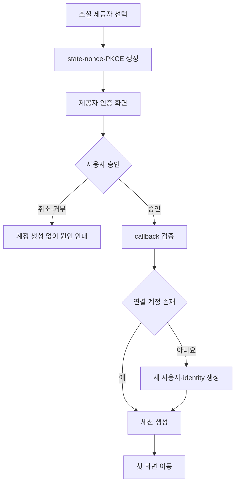

### 구현 로직

1. 허용 제공자만 받고 state, nonce, PKCE verifier를 TTL 저장한다.
2. callback에서 state, nonce, issuer, audience, 서명, 만료를 검증한다.
3. `(provider, provider_subject)`로 identity를 찾는다.
4. 없으면 사용자의 명시적 동의 후 계정과 identity를 트랜잭션으로 생성한다.
5. 이메일이 기존 계정과 같아도 자동 병합하지 않고 별도 연결 절차를 안내한다.

### 예외·검수

- 취소, 접근 거부, 만료 code, state 불일치, 네트워크 실패를 구분한다.
- 제공자 토큰과 원문 오류를 화면·로그에 노출하지 않는다.
- 검수: 제공자별 성공, 취소, 거부, 위조 state, 중복 subject, 동일 이메일 타 제공자.

---

## 5. FR-AUTH-03 로그인·로그아웃

### 기능 설명

등록 사용자가 세션을 시작·갱신·종료한다. 화면은 로그인 상태에 따라 로그인과 로그아웃 중 하나만
표시하며 로그아웃 후 보호된 정보에 다시 접근할 수 없어야 한다.

### 사용자 flow

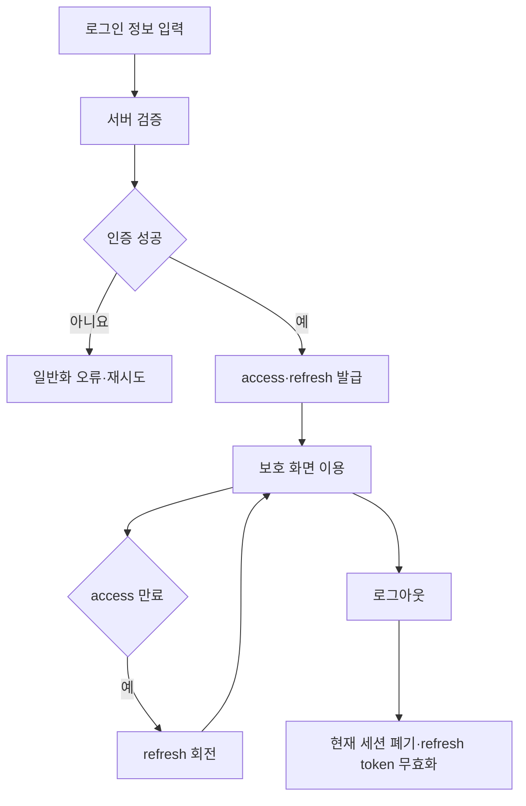

### 구현 로직

1. 이메일·비밀번호와 계정 상태를 검증한다.
2. 짧은 access token과 회전 가능한 refresh token을 발급한다.
3. refresh 원문 대신 해시, family ID, 만료, 폐기 시각을 저장한다.
4. refresh 사용 시 이전 값을 폐기하고 새 값을 발급한다.
5. 폐기 토큰 재사용이 감지되면 family 전체를 폐기한다.
6. 로그아웃은 현재 세션을 폐기하고 브라우저 자격 증명을 제거한다.

### 예외·검수

- 계정 없음, 비밀번호 오류, 잠김을 외부 응답에서 구분하지 않는다.
- v1.0.3 구현은 쿠키가 아닌 Bearer 토큰 방식이며, 토큰은 해시만 DB에 저장한다.
- v1.0.4 로그인 잠금은 계정+접속 IP 5회·계정 전체 50회·IP 20회의 3단계다.
  탈퇴도 같은 잠금 장치를 공유한다.
- 검수: 성공, 실패, 만료·회전, 재사용 탐지, 로그아웃 후 접근, 상태별 버튼.

---

## 6. FR-AUTH-04 회원탈퇴

### 기능 설명

사용자가 개인정보 처리 내용을 확인하고 재인증한 뒤 계정을 탈퇴한다. 탈퇴 후 모든 세션과 개인
설정·예약을 더 이상 사용할 수 없어야 한다.

### 사용자 flow

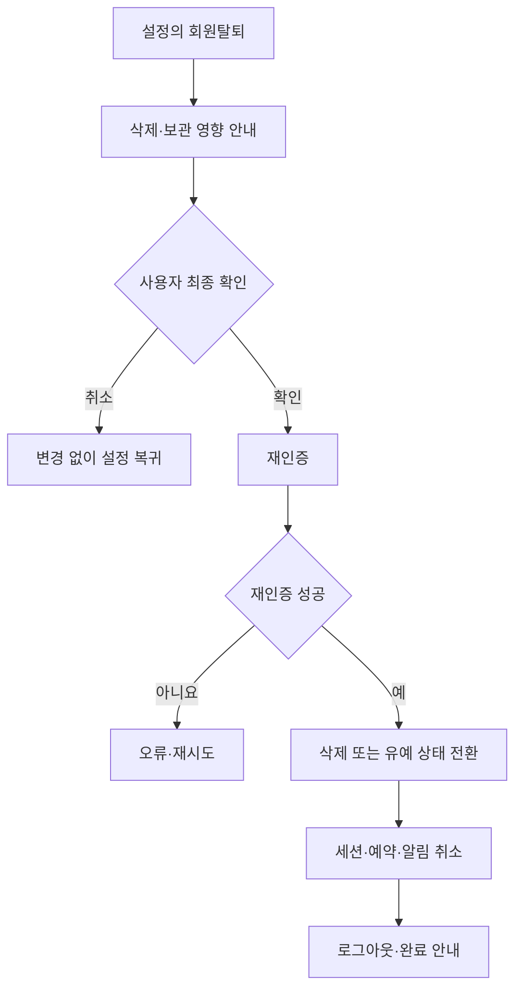

### 구현 로직

1. 승인된 개인정보 보관 정책을 화면에 제공한다.
2. 비밀번호 또는 최근 소셜 재인증으로 본인 여부를 확인한다.
3. 사용자 상태 전환과 소유 데이터 처리를 트랜잭션으로 실행한다.
4. 공유 뉴스는 유지하고 개인 연결 데이터만 삭제·비식별화한다.
5. refresh family 전체를 폐기하고 진행 예약·알림을 취소한다.

### 예외·검수

- 최종 확인 전에는 데이터를 변경하지 않는다.
- 같은 요청 반복은 같은 최종 상태를 반환하도록 멱등 처리한다.
- 검수: 취소, 재인증 실패, 성공, 중복 요청, 탈퇴 후 보호 API, 데이터·세션 정리.

---

## 7. FR-HOME-01 랭킹 카드

### 기능 설명

검증 완료된 AI 뉴스 중 최대 10개를 랭킹순 카드로 보여준다. 데이터가 부족하면 가짜 항목을 채우지
않고 실제 개수만 표시한다.

### 화면 요소

- 상단: `Daily Intelligence`, 화면 제목·설명, 업데이트 시각
- 통합 검색 입력과 검색 실행, `전체`/`AI·기술` 필터, `랭킹순`/`최신순` 정렬
- 로그인 사용자: `국내` 지역 칩, 저장 관심사 집계 칩(최대 5개 + `더 보기`)
- 카드: 순위, 제목, 출처, 발행 시각, AI 카테고리
- 카드: 핵심 3줄 요약, 처리 상태(`처리 완료`, 부분 상태 등), 기자명(있을 때)
- 카드 행동: `원문 열기`, `링크 복사` (1.0.4.1: `상세 보기` 제거)

### 처리 flow

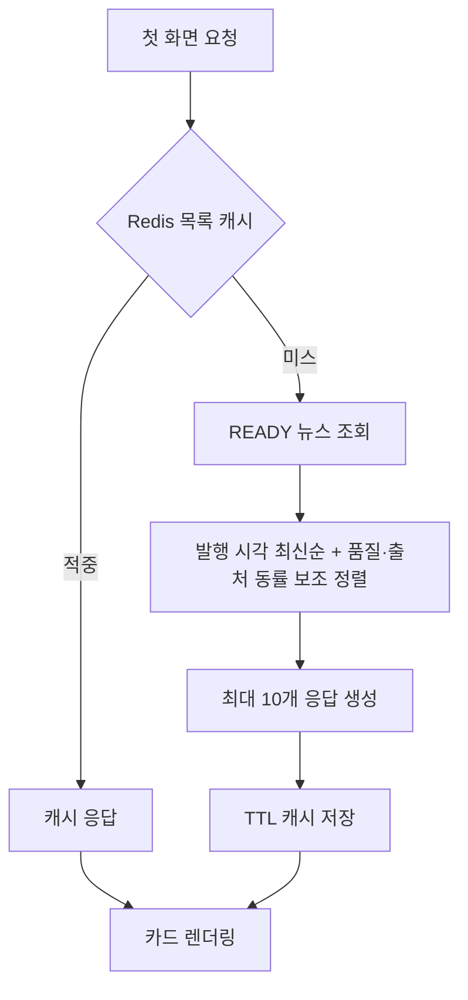

### 구현 로직

1. `category=AI`, `sort=rank`, `page_size=10`을 기본 질의로 사용한다.
2. `READY`와 공개 가능한 기사만 조회하고 출처·요약을 한 번에 가져온다.
3. v1.0.4 기준 `published_at` 최신→과거를 최우선으로 하고, `rank`는 품질(READY 우선)
   →출처 우선순위→ID, `latest`는 ID를 동률 보조로 사용한다.
4. 목록 query hash(스코프·interests 포함)로 5분 캐시하고 새 결과 저장 후 관련 캐시를 무효화한다.
5. 모바일에서는 좌측 탐색을 하단 탭으로 전환하고, 기사 정보·요약·행동을 한 열로 배치한다. 별도 검색 버튼과 정렬은 화면 폭에 따라 축약할 수 있다.

### 예외·검수

- 0건은 빈 상태, 일부 출처 실패는 정상 카드와 비차단 안내를 함께 표시한다.
- 검수: 10건 순서, 7건만 표시, 긴 제목, 시각, cache hit/miss, 실패 상태 제외.

---

## 8. FR-SEARCH-01 검색·초기화

### 기능 설명

제목과 검증된 요약에서 키워드를 검색하고 일치 부분을 시각적으로 강조한다. 메인 화면에서는 검색과 함께 `전체`/`AI·기술` 필터, `랭킹순`/`최신순` 정렬을 제공한다. 로그인 사용자에게는 `국내` 지역과 저장 관심사(`personalized`/`interest`) 필터가 추가된다. 초기화하면 입력, 강조와 결과가 한 번에 전체 목록으로 복원된다.

### 사용자 flow

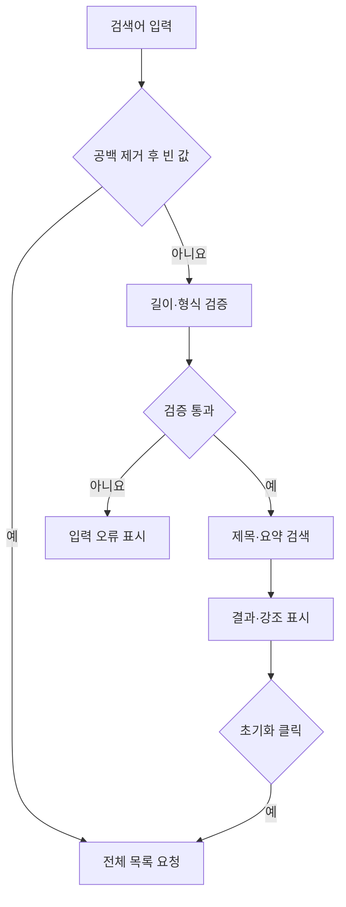

### 구현 로직

1. 입력 앞뒤 공백을 제거하고 빈 값은 전체 목록과 동일하게 처리한다.
2. 길이 상한과 허용 문자 정책을 적용한다.
3. MVP는 DB 파라미터 바인딩을 사용한 대소문자 비구분 검색으로 시작한다.
   v1.0.5 필터: `topic`(관심사 키워드 코드), `personalized`(저장 관심사 집계),
   `interest`(단일 관심사 코드)는 로그인 사용자만 사용할 수 있고 잘못된 코드는 422로
   거부한다. 모든 목록·집계는 한국어 기사로 고정되고 `language` 파라미터는 없다.
4. 서버는 데이터만 반환하고 안전한 강조 렌더링은 프론트엔드가 텍스트 노드로 처리한다.
5. 초기화는 URL 질의, 입력 상태, 결과와 강조를 동시에 제거하고 필터·정렬은 제품 기본값으로 복원한다.

### 예외·검수

- HTML을 검색 결과에 삽입해 강조하지 않아 XSS를 막는다.
- 검수: 제목·요약 일치, 불일치, 빈 값, 공백, 긴 입력, 특수문자, 키보드 초기화.

---

## 9. FR-HOME-02 로딩·빈·오류 상태

### 기능 설명

사용자가 기다리는 이유와 복구 방법을 알 수 있도록 목록·상세 API의 비정상 상태를 구분해 표시한다.

### 상태 flow

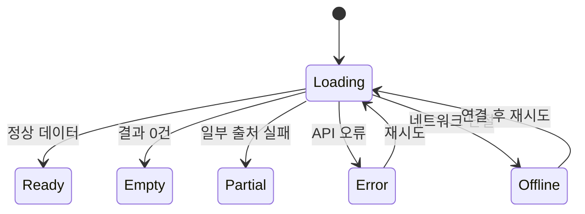

### 구현 로직

- Loading: 스켈레톤과 명시적 진행 문구
- Empty: 검색 결과 없음과 아직 수집 데이터 없음 구분
- Partial: 정상 결과 유지, 실패 출처는 비차단 안내
- Error: 일반화 메시지, request ID, 재시도 버튼
- Offline: 연결 확인 안내와 저장 화면 유지
- 계산할 수 없는 진행률은 백분율로 만들지 않는다.

### 예외·검수

- 재시도 중 버튼을 잠가 중복 요청을 막는다.
- 검수: 느린 응답, 0건, 부분 성공, 401, 500, 단절, 재시도 성공, 스크린리더 알림.

---

## 10. FR-DETAIL-01 뉴스 상세 콘텐츠

> **1.0.4.1**: 상세보기 화면은 제거됐다. 본 절은 `GET /v1/news/{news_id}` API 계약으로만 유지되며 화면 요구사항은 적용하지 않는다. 카드의 제목·`원문 열기`가 원문을 새 탭으로 열고 `링크 복사`가 URL을 복사한다.

### 기능 설명

선택한 뉴스의 기사 헤더, 원본 메타데이터, 핵심 3줄 요약, 처리 정보와 관련 뉴스를 분명히 구분해 제공한다(API 응답 기준).

### 사용자 flow

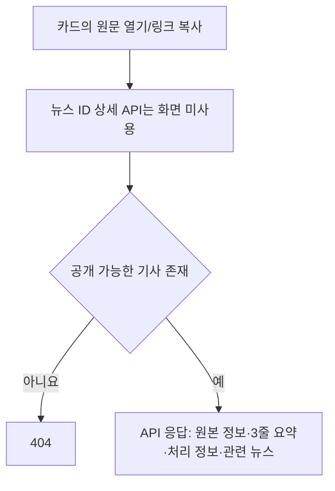

### 구현 로직

1. 뉴스, 출처, 콘텐츠 결과, 관련 뉴스를 N+1 없이 조회한다(API 수준).
2. 기사 헤더 정보(카테고리·처리 상태·발행 시각·제목·출처)는 메인 카드가 표시한다.
3. ~~데스크톱 2열/모바일 1열 상세 패널~~ — 화면 미제공(1.0.4.1).
4. ~~긴 내용 `더 보기`~~ — 화면 미제공.
5. 관련 뉴스에는 관계 이유를 포함하고 실패·중복·자기 자신을 제외한다(API 수준).
6. 원문 전체는 화면에 재배포하지 않는다.

### 예외·검수

- 없는 ID와 비공개 ID는 정보 노출 없는 404로 처리한다.
- 검수: 한국어 기사, 긴·짧은 내용, 관련 0건, 내용 부족, 실패, 존재하지 않는 ID (API 수준).

---

## 11. FR-DETAIL-02 원문 열기·링크 복사

### 기능 설명

사용자가 원 사이트에서 기사를 확인하거나 원문 URL을 복사해 공유할 수 있게 한다.

### 동작 flow

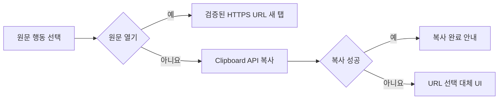

### 구현 로직

- DB에 저장된 검증 완료 HTTPS URL만 사용한다.
- 새 탭 링크에 `noopener noreferrer`를 적용한다.
- Clipboard API 성공·거부를 텍스트 상태로 안내한다.
- Clipboard를 사용할 수 없으면 읽기 전용 URL 선택 UI를 제공한다.
- 원문 URL에 사용자 ID나 세션 식별자를 붙이지 않는다.

### 검수

정상 URL, 위험 scheme 제외, 키보드 실행, 새 탭, 복사 성공·거부, 대체 UI를 확인한다.

---

## 12. FR-SET-01 예약

### 기능 설명

사용자가 원하는 로컬 시각에 저장된 검색 조건으로 수집 작업을 예약한다. 단계 1 설정 화면의 `예약 수집` 카드에서 예약 시각, 시간대, 다음 실행과 활성 상태를 실제 조회·저장한다.

### 사용자·처리 flow

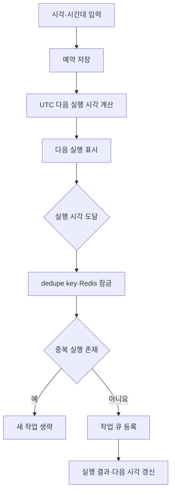

### 구현 로직

1. 로컬 시각, IANA 시간대, 활성 여부, 검색 조건 참조를 저장한다.
2. DST 중복·누락 시각 정책에 따라 다음 실행 UTC를 계산한다.
3. 사용자·예약·실행 창으로 dedupe key를 만든다.
4. 스케줄러는 작업만 등록하고 실제 수집은 worker가 수행한다.
5. 생성·변경·삭제는 사용자 ID로 소유권을 검사하고 감사 기록을 남긴다.

### 예외·검수

- 예약 상한과 예약별 출처 정책은 단계 1 개발 착수 전 결정 게이트에서 고정한다.
- 검수: 생성·변경·삭제, DST, 타 사용자 ID, 비활성화, 중복 실행, 다음 실행 표시.

---

## 13. FR-SET-02 검색·관심 설정

### 기능 설명

사용자가 관심 키워드, 승인 출처와 활성 카테고리를 저장해 단계 1 예약·목록에 적용한다. 화면은 태그형 관심 키워드와 출처·카테고리 선택 컨트롤을 `검색·관심 설정` 카드에 배치한다.

### 사용자 flow

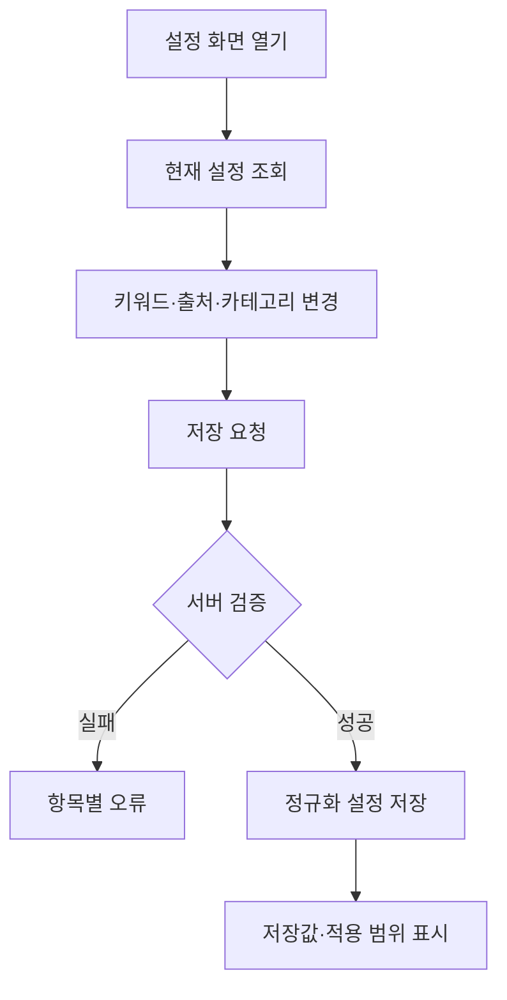

### 구현 로직

- 키워드, 관심사, 승인 출처 ID, 활성 카테고리를 구조화 배열로 검증한다.
- 관심사는 `GET /v1/interests/catalog`(한국어 15개, 최대 15개)와
  `PUT /v1/me/interests`로 관리한다. `en.*` 코드는 v1.0.5에서 폐기됐다.
  목록의 `personalized`/`interest` 필터와 `interest_counts` 집계가 이 저장값을 사용한다.
- 목록·항목 길이와 중복·제어문자를 제한한다.
- 사용자가 임의 사이트 URL을 입력해 서버가 수집하게 하지 않는다.
- 설정과 예약 관계는 `공통 설정` 또는 `예약별 설정` 중 하나를 결정해 구현한다.
- 저장 후 서버가 정규화한 값을 반환해 화면 상태와 DB를 일치시킨다.

### 검수

정상 저장·복원, 중복 정규화, 한도 초과, 비승인 출처, 미지원 카테고리, 타 사용자 접근을 확인한다.

---

## 14. FR-SET-03 목록 표시·계정 정책

> **1.0.4.1**: `노출·알림` 설정 섹션(기본 노출 수·관심 키워드·인앱/메일 알림 토글)은 UI에서 제거됐다. `default_count`·`keywords`·`in_app_notice`·`email_notice`는 `PATCH /v1/me/settings` API 필드와 DB로만 유지한다. 화면의 설정 메뉴는 `예약 수집`, `관심 설정`, `닉네임 변경`, `계정 정보`만 제공한다.

### 기능 설명

개인정보 안내·회원탈퇴로 이동한다. `닉네임·계정` 카드에서 닉네임과 계정 이메일을 확인하거나 회원탈퇴로 이동한다. 알림·노출 설정은 화면에서 제공하지 않는다.

### 처리 flow

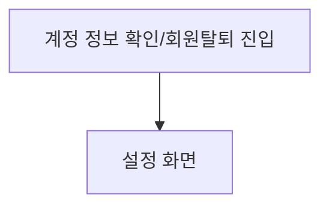

### 구현 로직

- ~~기본 노출 수는 5 또는 10만 허용한다~~ — API 검증만 유지(`PATCH /v1/me/settings`의 `default_count`).
- 알림 전달은 별도 백엔드 기능이며 설정 화면에서 사용자 채널을 조정하지 않는다.
- 사용자·예약·뉴스·채널 조합으로 중복 발송을 막는다.
- 메일 주소는 계정에서 가져오고 임의 수신자 입력을 받지 않는다.
- SMTP 실패는 전달 실패만 기록하고 뉴스 처리 성공을 되돌리지 않는다.

### 검수

5/10, 잘못된 값, 저장·재로그인 복원, 계정 정보, 회원탈퇴 진입을 확인한다.

---

## 15. FR-PIPE-01 뉴스 수집

### 기능 설명

승인된 출처에서 기사 메타데이터와 필요한 최소 본문을 안전하게 수집하고 공통 형식으로 정규화한다.

### 처리 flow

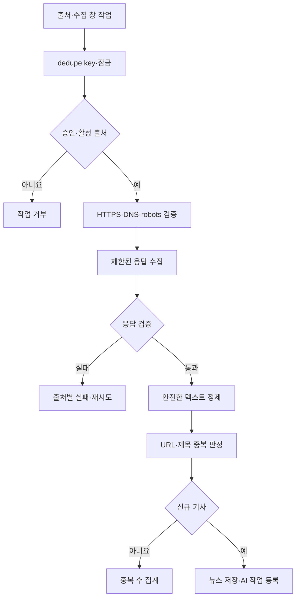

### 구현 로직

1. 관리자 승인 출처만 활성화하고 HTTPS만 허용한다.
2. DNS·redirect마다 사설, 루프백, 링크로컬, 메타데이터 IP를 차단한다.
   v1.0.4부터는 검증한 공인 IP로 연결을 고정해 DNS rebinding을 막고,
   HTML은 선언된 charset으로 디코딩한다.
3. robots.txt, User-Agent, 요청 간격, 타임아웃, 크기·MIME 상한을 적용한다.
4. 제목, canonical URL, 발행 시각, 안전한 텍스트를 Pydantic 모델로 변환한다.
5. canonical URL unique와 정규화 제목으로 중복을 처리한다.
6. 한 출처 실패가 다른 결과를 지우지 않게 출처별 상태를 기록한다.

### 예외·검수

최대 재시도 후 dead-letter로 이동한다. 신규·중복·부분 실패, SSRF, redirect, 큰 응답,
잘못된 MIME, DNS 재검증을 테스트한다.

---

## 16. FR-PIPE-02 3줄 요약

### 기능 설명

수집된 공개 기사 텍스트를 원문에 근거한 정확히 3개의 핵심 문장으로 요약한다. v1.0.5부터
한국어 기사만 처리하므로 번역 단계는 없다.

### 처리 flow

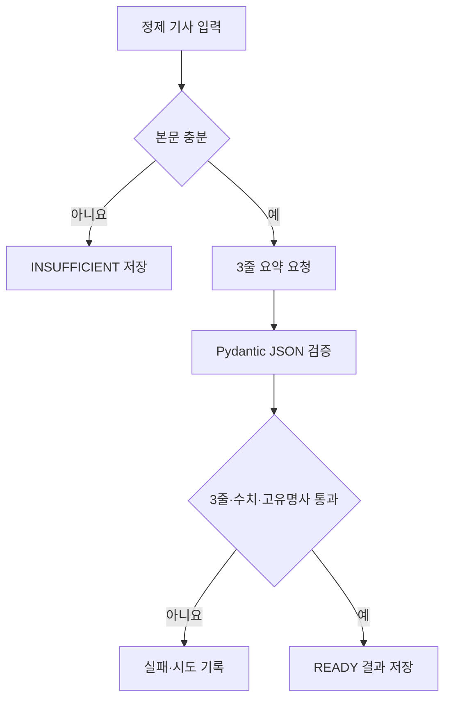

### 구현 로직

- 공개 기사 정제 텍스트와 최소 메타데이터만 LLM에 전달한다.
- 응답은 3개 요약 문장과 보존 항목을 가진 JSON으로 제한한다.
- Pydantic이 추가 필드·잘못된 개수·형식을 거부한다.
- 수치, 날짜, 모델명, 기관명을 원문과 대조한다.
- 내용 해시·프롬프트 버전·모델 ID가 같으면 결과를 재사용한다.
- v1.0.5: 영문 피드 수집·외국어 제목 번역 단계·LLM 번역 백업 경로를 제거했다.
  Trafilatura 본문 추출은 타임아웃·오류 가드 안에서 수행한다.

### 예외·검수

개인정보와 사용자 설정을 LLM에 보내지 않는다. 한국어·본문 부족·JSON 오류·3줄 위반·수치
변형·타임아웃·재사용을 검수하고 발표 10건을 사람이 원문 대조한다.

---

## 17. FR-PIPE-03 랭킹·관련 뉴스

### 기능 설명

실제로 보유한 데이터로 뉴스 노출 순서를 결정하고 같은 주제의 검증된 기사를 관련 뉴스로 연결한다.

### 처리 flow

```mermaid
flowchart TD
    A[READY 기사 집합] --> B[발행 시각 최신순 최우선]
    B --> C[rank: 품질(READY)·출처 우선순위 동률 보조]
    C --> D[안정적인 ID 동률 처리]
    D --> E[랭킹 저장·응답]
    A --> G[정규화 핵심 키워드]
    G --> H[같은 카테고리 후보 비교]
    H --> I[자기·중복·실패 제외]
    I --> J[관련 근거·점수 저장]
```

### 구현 로직

- MVP 순서(v1.0.4): 발행 시각 최신→과거 최우선 > `rank`는 품질(READY)·출처 우선순위,
  `latest`는 ID를 동률 보조로 사용. 관련 뉴스도 발행 시각 DESC 우선.
- 조회수·언급량·급등률처럼 없는 값을 생성하지 않는다.
- 관련 뉴스는 같은 AI 카테고리의 정규화 키워드와 제목 유사성으로 시작한다.
- 관계에 이유와 점수를 저장해 화면에서 설명 가능하게 한다.
- 같은 입력은 같은 순서를 내도록 결정적으로 구현한다.

### 검수

동률, 누락 지표, 실패 기사, 자기 관계, 중복 pair와 무관 기사 제외를 확인하고 화면에 랭킹 기준을
설명한다.

---

## 18. FR-PIPE-04 캐시·재처리

### 기능 설명

검증된 처리 결과를 저장·캐시해 화면을 열 때마다 AI를 다시 호출하지 않고, 실패한 작업은 실패
단계부터 제한적으로 재처리한다.

### 처리 flow

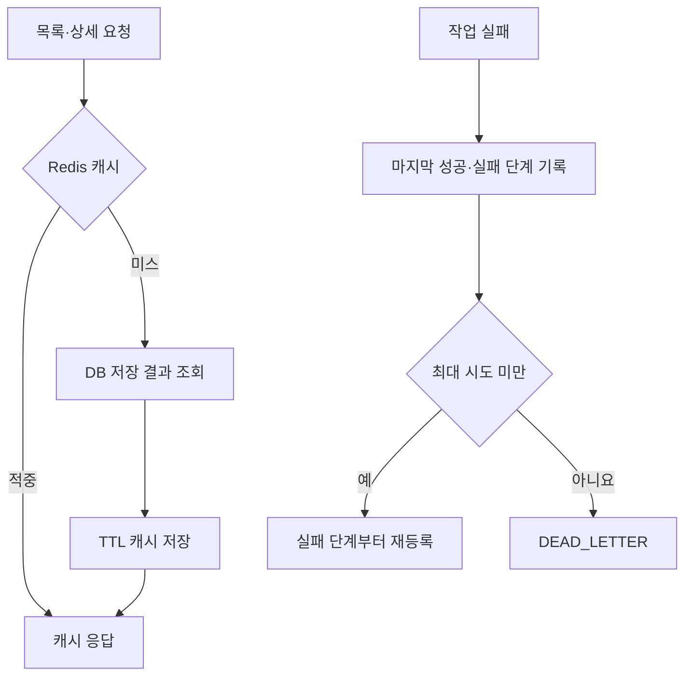

### 구현 로직

- DB의 검증 결과를 원본으로, Redis를 만료 가능한 조회 캐시로 사용한다.
- 목록 5분, 상세 30분을 기본 TTL로 하고 결과 변경 후 관련 키만 무효화한다.
- 화면 조회는 수집·AI 작업을 생성하지 않는다(단, 목록 요청은 pipeline→public
  동기화 트리거 `request_sync`를 비동기로 호출할 수 있다 — 5분 간격, PostgreSQL 전용).
- 캐시 장애 시 DB로 내려가고 사용자 요청 전체를 실패시키지 않는다.
- 수집·정제·요약·검증별 상태와 시도 횟수를 기록한다.
- 같은 dedupe key는 Redis 잠금과 DB unique 제약으로 중복 실행을 막는다.

### 예외·검수

cache hit/miss, 선택 무효화, Redis 단절, 실패 단계 재개, 동시 실행, 잠금 만료, 최대 시도와
dead-letter를 검수한다.

---

## 19. 전체 기능 연결 flow

```mermaid
flowchart LR
    A[FR-AUTH 계정·세션] --> B[FR-HOME 목록·상태]
    B --> C[FR-SEARCH 검색]
    B --> D[FR-DETAIL 상세 API(화면 미제공)·원문]
    E[FR-PIPE 수집] --> F[AI 요약]
    F --> G[랭킹·관련 뉴스]
    G --> H[캐시·재처리]
    H --> B
    I[FR-SET 예약·관심] --> E
    I --> B
```

## 20. 기능별 개발 착수 조건

| 기능군 | 착수 조건 |
|---|---|
| 인증 | 개인정보 보관·탈퇴 정책과 세션 방식 확정 |
| 목록·검색·상세 API | API 응답 모델, 랭킹 기준, 공개 범위 확정 |
| 수집 | 승인 출처, 대체 출처, 약관·robots 검토 완료 |
| AI | 입력 범위, 모델·프롬프트 버전, 10건 검증셋 준비 |
| 예약·알림 | MVP 통과, 시간대·출처 관계·Web Push 범위 결정 |

## 21. 기능별 완료 조건

각 기능은 다음을 모두 만족해야 완료다.

1. 정상 사용자 flow가 실제 UI 또는 API에서 동작한다.
2. 빈 값·경계값·실패·권한 없음 상태가 명시적으로 처리된다.
3. 입력·출력·데이터 변경이 상세 설계서의 계약과 일치한다.
4. 차단되어야 하는 보안 사례가 자동 테스트로 증명된다.
5. 외부 서비스는 가짜 구현으로 바꿔 네트워크 없이 테스트할 수 있다.
6. 기능 ID와 합격 기준이 테스트·변경 기록에 연결된다.
7. release 모드에서 내부 오류와 민감정보가 노출되지 않는다.
8. 화면 기능은 화면설계서 v1.0.5의 메인·설정 화면(상세보기·노출·알림 메뉴 미제공)을 데스크톱·모바일·키보드 흐름으로 수동 확인하고 설정 저장·복원까지 검수한다.
