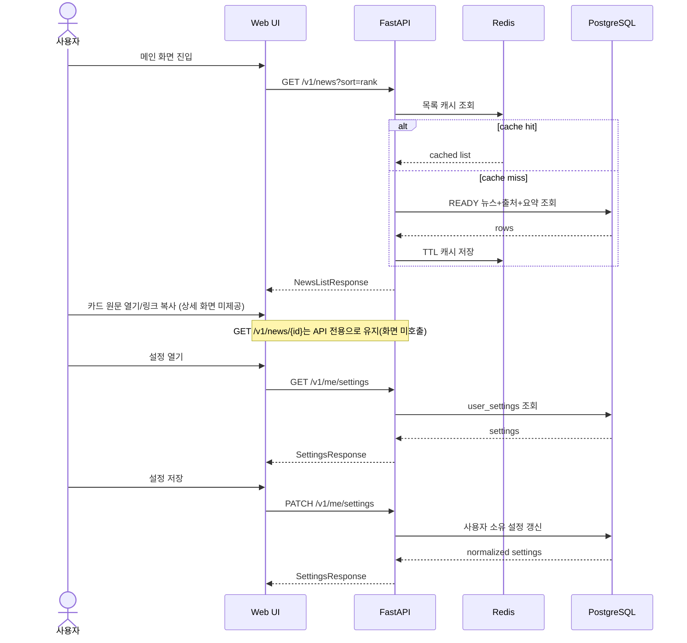

# DAIT API 설계서

## English Metadata

| 항목 | 값 |
|---|---|
| English Title | DAIT API Design Document |
| Search Keywords | DAIT, API design, REST, /v1, FastAPI, Pydantic v2, extra forbid, Bearer auth, auth endpoints, me endpoints, news endpoints, settings, interests, scheduler tick, error contract |
| English Summary | Complete API contract for DAIT stage-1 MVP covering main, detail, and settings screens. Defines common rules under `/v1` (JSON, FastAPI, Pydantic v2 `extra="forbid"`) and the implemented auth/me/news/settings/scheduler endpoints including `POST /v1/internal/scheduler/tick`. |

| 항목 | 값 |
|---|---|
| 문서 버전 | 1.0.5 |
| 기준일 | 2026-11-13 |
| 제품명 | DAIT |
| API 기준 | `/v1`, JSON, FastAPI, Pydantic v2 `extra="forbid"` |
| 기준 문서 | 기본기획서 / 전체설계서 / 개별기능별 상세설계서 / 기능별 상세기획서 / 화면설계서 v1.0.5 |

## 문서 이력

| 버전 | 작성자 | 기준일 | 수정 내용 |
|---|---|---|---|
| 1.0.0 | seonghoon.yang | 2026-11-03 | 최초 작성 |
| 1.0.1 | seonghoon.yang | 2026-11-06 | 화면설계서 v1.0.1 반영 및 문서 세트 정합성 보강 |
| 1.0.2 | seonghoon.yang | 2026-11-10 | 7.3절 내부 스케줄러 tick API(POST /v1/internal/scheduler/tick) 추가 |
| 1.0.3 | seonghoon.yang | 2026-11-12 | 실제 구현 엔드포인트 기준으로 갱신 — auth/me/news/settings/scheduler 전체 경로·스키마·오류 계약 반영 |
| 1.0.4 | seonghoon.yang | 2026-11-13 | v1.0.4 구현 반영 — 뉴스 language/topic/personalized/interest·interest_counts·read-state·keepalive, 관심사 30개(en.* 포함), 로그인 잠금 3단계 명세 |
| 1.0.4.1 | seonghoon.yang | 2026-11-13 | 상세보기 화면·설정 `노출·알림` 메뉴 UI 제거 반영 — 상세 API(`/v1/news/{id}`)·설정 필드(`default_count`/`keywords`/`in_app_notice`/`email_notice`)는 유지, 화면 매핑만 제거 |
| 1.0.5 | seonghoon.yang | 2026-11-13 | 영문 기사 기능 전면 중단 — `language` 파라미터·`en.*` 관심사·영문 응답 필드 제거, 한국어 기사만 반환 |

## 1. 문서 목적

이 문서는 DAIT 단계 1(MVP)의 메인, 뉴스 상세 API, 설정 화면과 연결되는 API 계약을 상세히 정의한다.
(1.0.4.1: 상세보기 화면과 설정 `노출·알림` 메뉴는 UI에서 제거됐으나 본 문서의 API 계약은 모두 유지한다.)
기존 문서에서 확정된 기능 ID와 엔드포인트를 기준으로 하며, v1.0.3부터는 **develop 브랜치에 구현된
실제 계약**(Bearer 토큰 인증, 관심사/세션/닉네임/뉴스 읽음/예약 실행 이력 API 포함)을 기준으로 갱신한다.
v1.0.4에서는 뉴스 탐색 필터(language/topic/personalized/interest), 관심사 집계
(interest_counts)·읽음 상태 분리 조회(read-state), keepalive 엔드포인트, 관심사 30개
코드(한국어 15 + `en.*` 15)를 반영한다.
v1.0.5에서는 영문 기사 기능을 범위에서 제외(보류)한다 — `language` 파라미터, `en.*` 관심사 코드,
`original_language`/`translated_text`/`translation_required` 응답 필드를 제거하고
모든 뉴스 API는 한국어 기사만 반환한다. 영문 기사 기능은 추후 버전에서 재개 개발 예정이며,
관련 DB 컬럼·코드 체계는 레거시로 보존해 복원 비용을 낮춘다.

## 2. 공통 API 규칙

### 2.1 기본 규칙

- 모든 업무 API는 `/v1` 하위에 둔다.
- Content-Type은 `application/json; charset=utf-8`를 사용한다.
- 모든 request/response 모델은 Pydantic v2 `ConfigDict(extra="forbid")`를 적용한다.
- 날짜/시각은 API 내부 표준으로 UTC ISO 8601 timezone-aware 문자열을 사용한다.
- 화면 표시는 사용자의 IANA timezone(`Asia/Seoul`)으로 변환한다.
- 외부 노출 ID는 순차 정수 대신 불투명 문자열을 사용한다.
- URL은 HTTPS만 허용한다.
- 페이지네이션은 cursor 기반을 기본으로 한다.

### 2.2 공통 오류 응답

```json
{
  "code": "VALIDATION_ERROR",
  "message": "입력값을 확인해 주세요.",
  "request_id": "req_01JXYZ...",
  "fields": {
    "q": "검색어는 100자 이하여야 합니다."
  }
}
```

| 필드 | 타입 | 필수 | 설명 |
|---|---|---:|---|
| `code` | string | Y | 시스템 정의 오류 코드 |
| `message` | string | Y | 사용자에게 표시 가능한 일반화 메시지 |
| `request_id` | string | Y | 서버 로그와 추적할 수 있는 불투명 ID |
| `fields` | object\|null | N | 필드별 검증 오류. 내부 예외 내용은 포함 금지 |

### 2.3 주요 오류 코드

| 코드 | HTTP | 의미 |
|---|---:|---|
| `VALIDATION_ERROR` | 422 | 요청 형식/허용값 오류 |
| `AUTHENTICATION_FAILED` | 401 | 로그인 필요 또는 인증 실패 |
| `AUTHORIZATION_FAILED` | 403/404 | 권한 없음. 리소스 은닉 시 404 사용 |
| `RATE_LIMITED` | 429 | 요청 빈도 제한 |
| `NEWS_NOT_FOUND` | 404 | 뉴스가 없거나 공개 불가 |
| `SOURCE_UNAVAILABLE` | 200 partial / 작업 실패 | 일부 출처 장애 |
| `CONTENT_INSUFFICIENT` | 200 | 본문 부족 |
| `DEPENDENCY_UNAVAILABLE` | 503 | DB/Redis 등 필수 의존성 장애 |
| `SCHEDULE_NOT_FOUND` | 404 | 요청한 스케줄이 존재하지 않을 때 사용 |
| `INTERNAL_ERROR` | 500 | 내부 오류 일반화 응답 |

---

# 3. 인증 API

> v1.0.3 구현 기준: 인증은 **쿠키가 아닌 Bearer 토큰** 방식이다. 가입·로그인 응답의 `tokens`에
> `access_token`/`refresh_token`이 포함되고, 클라이언트는 `Authorization: Bearer <access_token>`으로 호출한다.
> 토큰 원문은 JSON 응답에 포함되며, 갱신은 refresh token을 body로 보내 회전한다.

## 3.1 POST `/v1/auth/signup`

### 목적
이메일/비밀번호 회원가입 후 최초 세션 토큰을 발급한다.

### Request Body

| 필드 | 타입 | 필수 | 제약/설명 |
|---|---|---:|---|
| `email` | string(email) | Y | 최대 254자, 형식 검증 후 길이 검증 |
| `nickname` | string\|null | N | 선택 닉네임. 없으면 자동 생성 흐름 적용 |
| `password` | string | Y | 8~128자 (`SecretStr`, 로그 마스킹) |
| `password_confirm` | string | Y | `password`와 상수 시간 비교로 동일해야 함 |
| `terms_accepted` | boolean\|null | N | 선택 동의 필드 |
| `interests` | array<string> | N | 관심사 코드 목록. 생략 시 빈 목록으로 가입(온보딩 대상) |

```json
{
  "email": "user@example.com",
  "nickname": "news_lover",
  "password": "Example!Password2026",
  "password_confirm": "Example!Password2026",
  "terms_accepted": true,
  "interests": []
}
```

### Response 201 (`AuthResponse`)

| 필드 | 타입 | 설명 |
|---|---|---|
| `user` | object | `id`, `email`, `status`, `role`, `nickname` (`UserPublic`) |
| `tokens.access_token` | string | Bearer 액세스 토큰 |
| `tokens.refresh_token` | string | 갱신용 리프레시 토큰 |
| `tokens.token_type` | string | `"bearer"` 고정 |
| `onboarding_required` | boolean | 관심사 미설정 등 추가 설정이 필요하면 `true` |
| `interests` | array | 저장된 관심사 항목 |

```json
{
  "user": {
    "id": "usr_01JXYZ123",
    "email": "user@example.com",
    "status": "ACTIVE",
    "role": "USER",
    "nickname": "news_lover"
  },
  "tokens": {
    "access_token": "eyJ...",
    "refresh_token": "rt_...",
    "token_type": "bearer"
  },
  "onboarding_required": true,
  "interests": []
}
```

## 3.2 POST `/v1/auth/login`

### Request

| 필드 | 타입 | 필수 | 설명 |
|---|---|---:|---|
| `email` | string(email) | Y | 로그인 이메일 |
| `password` | string | Y | 비밀번호 (1~128자) |

```json
{
  "email": "user@example.com",
  "password": "Example!Password2026"
}
```

### Response 200
가입과 동일한 `AuthResponse`(user + tokens + onboarding_required + interests)를 반환한다.

> 로그인 실패는 3단계 잠금이 적용된다(v1.0.4): 계정+접속 IP(`rate:login:account_ip:*`, 5회),
> 계정 전체(`rate:login:account:*`, 50회 — 분산 대입 완화), IP(`rate:login:ip:*`, 20회).
> Redis 분산 스로틀이며 임계 초과 시 `429 RATE_LIMITED`를 반환한다. Redis 장애 시
> 인메모리 fallback으로 동작한다. 탈퇴(`DELETE /v1/me`)도 같은 잠금 장치를 공유한다.

## 3.3 POST `/v1/auth/refresh`

### Request

| 필드 | 타입 | 필수 | 설명 |
|---|---|---:|---|
| `refresh_token` | string | Y | 20~256자, 가입/로그인 응답의 refresh token |

```json
{ "refresh_token": "rt_..." }
```

### Response 200 (`TokenPair`)

```json
{
  "access_token": "eyJ...",
  "refresh_token": "rt_new...",
  "token_type": "bearer"
}
```

- 이전 refresh token은 즉시 폐기(회전)한다.

## 3.4 POST `/v1/auth/logout`

### Response 200 (`ResultResponse`)

```json
{ "result": "done" }
```

현재 세션의 refresh token을 폐기한다.

## 3.5 DELETE `/v1/me` (회원탈퇴)

### Request (`WithdrawRequest`)

| 필드 | 타입 | 필수 | 설명 |
|---|---|---:|---|
| `password` | string | Y | 비밀번호 재인증 |

```json
{ "password": "Example!Password2026" }
```

### Response 200 (`ResultResponse`)

```json
{ "result": "done" }
```

## 3.6 GET `/v1/me/session`

### 목적
현재 Bearer 토큰의 세션 상태를 확인한다. 프론트엔드 초기 렌더링 시 인증 여부 판단에 사용한다.

### Response 200 (`SessionResponse`)

```json
{
  "authenticated": true,
  "user": {
    "id": "usr_01JXYZ123",
    "email": "user@example.com",
    "status": "ACTIVE",
    "role": "USER",
    "nickname": "news_lover"
  }
}
```

미인증 시 `authenticated: false`, `user: null`을 반환한다(에러가 아님).

## 3.7 PATCH `/v1/me/nickname`

### 목적
사용자 닉네임을 변경한다. 빈 문자열은 닉네임 제거로 처리한다.

### Request (`NicknameUpdate`)

| 필드 | 타입 | 필수 | 설명 |
|---|---|---:|---|
| `nickname` | string\|null | Y | 2~30자. 제어문자 제거 정규화 후 검증 |

```json
{ "nickname": "news_lover" }
```

### Response 200 (`NicknameResult`)

```json
{ "nickname": "news_lover" }
```

중복·규칙 위반 시 `422 VALIDATION_ERROR`.

## 3.8 GET `/v1/auth/nickname-availability?nickname=...`

### 목적
닉네임 사용 가능 여부를 가입/변경 전에 확인한다. 로그인 없이 호출 가능하다.

### Response 200 (`NicknameAvailability`)

```json
{ "nickname": "news_lover", "available": true }
```

---

# 3A. 관심사 API

## 3A.1 GET `/v1/interests/catalog`

### 목적
선택 가능한 관심사 15개를 대주제별로 조회한다(v1.0.5, 온보딩·관심사 설정 화면용).
그룹은 `ai`(AI•인공지능), `economy`(경제·비즈니스), `society`(사회·문화)의 3개다.
코드는 `ai.models` 같은 `대주제.소주제` 형식이다. v1.0.4의 영문 주제
(`en_ai`/`en_economy`/`en_society`, `en.*` 코드)는 폐기됐다.
로그인 없이 호출 가능하며 개인 데이터는 없다.

### Response 200 (`CatalogResponse`)

```json
{
  "groups": [
    {
      "group": "ai",
      "group_name": "AI•인공지능",
      "interests": [
        { "code": "ai.models", "name": "모델·연구", "group": "ai" }
      ]
    }
  ]
}
```

## 3A.2 GET `/v1/me/interests`

### Response 200 (`MyInterestsResponse`)

```json
{ "interests": [{ "code": "ai.models", "name": "모델·연구", "group": "ai" }] }
```

카탈로그 순서로 정렬되어 반환된다.

## 3A.3 PUT `/v1/me/interests`

### 목적
내 관심사를 전체 교체한다. 빈 목록은 선택 해제다.

### Request (`InterestsUpdateRequest`)

```json
{ "interests": ["ai.models", "ai.agents"] }
```

중복 코드는 `422`로 거부한다. 카탈로그에 없는 코드는 `422`다. 최대 15개까지 선택할 수 있다.
`en.*` 코드는 v1.0.5에서 폐기되어 `422`로 거부된다.

### Response 200
`MyInterestsResponse`와 동일.

---

# 4. 메인 화면 API

## 4.1 GET `/v1/news`

### 연결 화면
- 메인 > 오늘의 AI 뉴스
- 통합 검색
- 전체 / AI·기술 필터
- 랭킹순 / 최신순
- 뉴스 카드 목록

### Query Parameters

| 파라미터 | 타입 | 필수 | 기본값 | 허용/설명 |
|---|---|---:|---|---|
| `category` | string enum | N | 전체 | `AI`, `ECONOMY`, `POLITICS` (WEATHER는 Enum에 있으나 미활성) |
| `q` | string | N | `""` | 제목+검증된 요약 검색, 최대 100자 |
| `sort` | string enum | N | `rank` | `rank`, `latest` — 둘 다 `published_at` 최신→과거 우선, `rank`는 품질(READY)·출처 우선순위를 보조 정렬로 사용 |
| `page_size` | integer | N | `10` | 1~50 |
| `cursor` | string | N | null | 다음 페이지 불투명 cursor (최대 500자) |
| `topic` | string | N | null | 관심사 키워드 코드(최대 50자). 카탈로그에 없으면 422 |
| `personalized` | boolean | N | `false` | 로그인 사용자의 저장 관심사 전체로 집계. `interest`와 함께 쓸 수 있음 |
| `interest` | string | N | null | 단일 관심사 코드(최대 50자). 저장 목록에 있고 카탈로그에 있어야 함 — 아니면 422 |

> v1.0.5: `language` 파라미터는 폐기됐다. 모든 목록·집계는 한국어 기사로 고정된다.
> `personalized`/`interest`/`topic`은 로그인 사용자 전용이다. `personalized=true`이면
> 저장 관심사 전체를 OR 집계하고, `interest`는 그중 하나만 선택한다.
> 목록 캐시 키는 DB URL·interests 스코프 해시를 포함해 조건별로 분리된다.

> v1.0.3 구현 노트: 비로그인 사용자는 최신순·`page_size` 최대 10·cursor 불가의 제한 목록을
> 받는다(`Cache-Control`은 목록 캐시 정책을 따른다). 로그인 사용자는 전체 정렬·페이지네이션이
> 가능하다. 화면은 `page_size=4`로 커서 페이지를 비동기 조회해 목록 뒤에 순차적으로 이어 붙인다.
> 목록/상세 조회는 저장 결과만 읽으며 LLM을 호출하지 않는다.

### 실제 요청 예시

```http
GET /v1/news?category=ECONOMY&q=multimodal&sort=rank&page_size=10
```

### Response 200

| 필드 | 타입 | 설명 |
|---|---|---|
| `items` | array<NewsListItem> | 뉴스 목록 |
| `page.next_cursor` | string\|null | 다음 페이지 cursor |
| `page.has_more` | boolean | 다음 페이지 존재 여부 |
| `meta.total_visible` | integer | 현재 조건에서 화면에 표시 가능한 항목 수 |
| `meta.partial` | boolean | 일부 출처 실패 여부 |
| `meta.message` | string\|null | 비차단 상태 안내 |
| `meta.rank_basis` | array<string> | 랭킹 기준 설명 |

### NewsListItem

| 필드 | 타입 | 필수 | 설명 |
|---|---|---:|---|
| `id` | string | Y | 뉴스 ID |
| `rank` | integer | Y | 현재 목록 내 순위 |
| `title` | string | Y | 뉴스 제목 |
| `source_name` | string | Y | 출처명 |
| `published_at` | datetime | Y | 발행 시각 |
| `category` | string enum | Y | `AI`/`ECONOMY`/`POLITICS` 중 하나 |
| `summary_lines` | array<string> | Y | 최대 3개 요약 문장 |
| `processing_status` | string enum | Y | `READY`, `INSUFFICIENT`, `FAILED`, `PENDING` |
| `original_url` | string(uri) | Y | 검증된 HTTPS 원문 URL |
| `is_partial` | boolean | Y | 해당 카드의 부분 상태 여부 |
| `author_name` | string\|null | N | 명시적 바이라인에서 추출한 기자명(예: `홍길동 기자`). 없으면 null (v1.0.4) |

> v1.0.5: `original_language` 필드는 응답에서 제외됐다(모든 기사는 한국어 기사).

### Response 예시

```json
{
  "items": [
    {
      "id": "news_01JXYZ001",
      "rank": 1,
      "title": "OpenAI, 차세대 멀티모달 모델 공개…추론과 도구 사용 정확도 향상",
      "source_name": "OpenAI Newsroom",
      "published_at": "2026-11-04T00:30:00Z",
      "category": "AI",
      "summary_lines": [
        "새 모델은 장문 추론과 복합 도구 사용 정확도를 높였다.",
        "텍스트·이미지·음성을 하나의 대화 흐름에서 처리한다.",
        "개발자 API는 단계적으로 제공될 예정이다."
      ],
      "processing_status": "READY",
      "original_url": "https://openai.com/news/example-multimodal-model",
      "is_partial": false,
      "author_name": null
    }
  ],
  "page": {
    "next_cursor": null,
    "has_more": false
  },
  "meta": {
    "total_visible": 3,
    "partial": true,
    "message": "일부 출처의 수집이 지연되고 있습니다.",
    "rank_basis": ["published_at", "quality", "source_priority", "id"]
  }
}
```

### 화면 상태 매핑

| API 결과 | 화면 상태 |
|---|---|
| 정상 `items.length > 0`, partial=false | READY |
| 정상 `items.length > 0`, partial=true | PARTIAL |
| `items=[]`, `q` 있음 | 검색 결과 없음 |
| `items=[]`, `q` 없음 | 아직 수집된 기사 없음 |
| 500/503 | 오류 + 재시도 + request ID |
| 네트워크 실패 | OFFLINE, 기존 화면 유지 |

## 4.2 GET `/v1/news/activity`

### 목적
현재 필터 조건의 총 건수·카테고리별 건수·본인 읽음 ID 목록을 반환한다.
개인화 정보이므로 `Cache-Control: no-store`가 붙고 공개 목록 캐시를 사용하지 않는다.

### Query Parameters

| 파라미터 | 타입 | 필수 | 설명 |
|---|---|---:|---|
| `q` | string | N | 검색어 (최대 100자) |
| `ids` | array<string> | N | 확인할 뉴스 ID 목록 (각 64자 이하, 최대 50개) |
| `personalized` | boolean | N | `true`이면 저장 관심사로 카운트를 집계 (v1.0.4) |

### Response 200 (`NewsActivity`)

```json
{
  "total": 42,
  "counts": { "AI": 20, "ECONOMY": 15, "POLITICS": 7, "WEATHER": 0 },
  "read_ids": ["news_01JXYZ001"],
  "interest_counts": { "ai.models": 5, "ai.agents": 3 }
}
```

- `interest_counts`(v1.0.4): `personalized` 조건에 맞는 저장 관심사 코드별
  기사 수. 같은 기사가 여러 관심사에 포함될 수 있어 합계가 `total`과 다를 수 있다.

## 4.3 PUT `/v1/news/{news_id}/read`

### 목적
로그인 사용자가 기사를 읽었다는 영수증을 멱등으로 기록한다.

### Response 204
본문 없음. 뉴스 ID는 64자 이하, 존재하지 않아도 성공(존재 여부 비노출).

## 4.4 GET `/v1/news/read-state` (v1.0.4)

### 목적
공개 주제 건수 계산 없이 본인 읽음 영수증만 조회한다. 목록 화면이 페이지 단위로
호출해 카드의 읽음 표시를 갱신한다.

### Query Parameters

| 파라미터 | 타입 | 필수 | 설명 |
|---|---|---:|---|
| `ids` | array<string> | N | 확인할 뉴스 ID 목록 (각 64자 이하, 최대 50개) |

### Response 200
읽은 뉴스 ID의 문자열 배열.

```json
["news_01JXYZ001", "news_01JXYZ007"]
```

인증 필요, `Cache-Control: no-store`.

---

# 5. 상세보기 API

> **1.0.4.1**: 상세보기 화면은 제거됐다. 본 API는 UI 미사용 상태로 유지되며, 메인 카드는 원문 새 탭·링크 복사만 제공한다.

## 5.1 GET `/v1/news/{news_id}`

### Path Parameter

| 파라미터 | 타입 | 필수 | 설명 |
|---|---|---:|---|
| `news_id` | string | Y | 불투명 뉴스 ID |

### 실제 요청 예시

```http
GET /v1/news/news_01JXYZ001
```

### Response 200 구조

| 상위 필드 | 타입 | 설명 |
|---|---|---|
| `article` | object | 제목/출처/발행시각/카테고리 등 |
| `content` | object | 3줄 요약, 상태 |
| `source` | object | 원본 URL과 검증 정보 |
| `related_news` | array | 관련 뉴스 |
| `processing` | object | 수집/요약 상태 |

### `article`

| 필드 | 타입 | 설명 |
|---|---|---|
| `id` | string | 뉴스 ID |
| `title` | string | 제목 |
| `source_name` | string | 출처 |
| `published_at` | datetime | 발행 시각 |
| `category` | string enum | `AI`/`ECONOMY`/`POLITICS` |
| `estimated_read_minutes` | integer\|null | 표시용 읽기 시간(실제 계산값이 있을 때만) |

### `content`

| 필드 | 타입 | 설명 |
|---|---|---|
| `summary_lines` | array<string> | 정확히 3개 |
| `processed_at` | datetime\|null | 처리 완료 시각 |
| `content_status` | string enum | `READY`, `INSUFFICIENT`, `FAILED` |
| `summary_model_version` | string\|null | 내부/표시 정책에 따라 노출 가능한 모델 버전 |

### `source`

| 필드 | 타입 | 설명 |
|---|---|---|
| `original_url` | string(uri) | 검증 완료 HTTPS URL |
| `url_verified` | boolean | 서버 검증 통과 여부 |
| `source_type` | string | RSS/API/OFFICIAL_HTML 등 |

### `related_news[]`

| 필드 | 타입 | 설명 |
|---|---|---|
| `id` | string | 관련 뉴스 ID |
| `title` | string | 제목 |
| `source_name` | string | 출처 |
| `published_at` | datetime | 발행 시각 |
| `reason` | string | 관련 근거 |
| `score` | number | 관련도 점수(내부 규칙 기준) |

### Response 예시

```json
{
  "article": {
    "id": "news_01JXYZ001",
    "title": "OpenAI, 차세대 멀티모달 모델 공개…추론과 도구 사용 정확도 향상",
    "source_name": "OpenAI Newsroom",
    "published_at": "2026-11-04T00:30:00Z",
    "category": "AI",
    "estimated_read_minutes": 6
  },
  "content": {
    "summary_lines": [
      "OpenAI는 장문 추론과 복합 도구 호출 정확도를 개선한 차세대 멀티모달 모델을 발표했다.",
      "텍스트·이미지·음성을 하나의 대화 흐름에서 처리한다.",
      "개발자 API와 기업용 기능은 단계적으로 제공될 예정이다."
    ],
    "processed_at": "2026-11-04T00:35:14Z",
    "content_status": "READY",
    "summary_model_version": "summary-v1"
  },
  "source": {
    "original_url": "https://openai.com/news/example-multimodal-model",
    "url_verified": true,
    "source_type": "OFFICIAL_HTML"
  },
  "related_news": [
    {
      "id": "news_01JXYZ020",
      "title": "멀티모달 에이전트의 도구 사용 평가 기준 공개",
      "source_name": "AI Safety Blog",
      "published_at": "2026-11-03T23:00:00Z",
      "reason": "multimodal, tool-use 키워드 일치",
      "score": 0.82
    }
  ],
  "processing": {
    "collection_status": "SUCCEEDED",
    "summary_status": "SUCCEEDED"
  }
}
```

### 404 예시

```json
{
  "code": "NEWS_NOT_FOUND",
  "message": "요청한 뉴스를 찾을 수 없습니다.",
  "request_id": "req_01JXYZ404",
  "fields": null
}
```

---

# 6. 설정 화면 API

> v1.0.3 기준 메인/상세/설정은 모두 1단계(MVP) 구현 대상이다.

## 6.1 GET `/v1/me/settings`

### 목적
현재 사용자의 관심 조건, 목록 노출 수, 알림 채널을 조회한다. (`노출·알림` 설정 UI는 1.0.4.1에서 제거 — 필드는 API로만 유지)

### Response 200

```json
{
  "default_count": 10,
  "keywords": ["멀티모달", "AI 에이전트", "오픈소스 LLM"],
  "source_ids": ["src_openai", "src_anthropic"],
  "categories": ["AI"],
  "updated_at": "2026-11-06T00:40:00Z"
}
```

| 필드 | 타입 | 제약/설명 |
|---|---|---|
| `default_count` | integer enum | `5` 또는 `10` |
| `keywords` | array<string> | 중복 제거, 항목 길이 제한 |
| `source_ids` | array<string> | 승인된 출처 ID만 허용 |
| `categories` | array<string enum> | `AI`/`ECONOMY`/`POLITICS` (WEATHER 미활성) |
| `updated_at` | datetime | 마지막 변경 시각 |

## 6.2 PATCH `/v1/me/settings`

### Request
부분 수정 PATCH. 전달하지 않은 값은 유지한다.

```json
{
  "default_count": 10,
  "keywords": ["멀티모달", "AI 에이전트", "오픈소스 LLM"],
  "source_ids": ["src_openai", "src_anthropic"],
  "categories": ["AI"],
}
```

### Request Field 정의

| 필드 | 타입 | 필수 | 제약 |
|---|---|---:|---|
| `default_count` | integer | N | 5 또는 10 |
| `keywords` | array<string> | N | 빈 배열 허용, 중복/제어문자 제거 |
| `source_ids` | array<string> | N | 활성 승인 출처만 |
| `categories` | array<string> | N | `AI`/`ECONOMY`/`POLITICS` |

### Response 200
서버가 정규화해 실제 저장한 값을 그대로 반환한다.

```json
{
  "default_count": 10,
  "keywords": ["멀티모달", "AI 에이전트", "오픈소스 LLM"],
  "source_ids": ["src_openai", "src_anthropic"],
  "categories": ["AI"],
  "updated_at": "2026-11-06T00:42:30Z"
}
```

## 6.3 GET `/v1/me/schedules`

### Response 200

```json
{
  "items": [
    {
      "id": "sch_01JXYZ900",
      "local_time": "08:30",
      "timezone": "Asia/Seoul",
      "enabled": true,
      "criteria": {
        "keywords": ["멀티모달", "AI 에이전트"],
        "source_ids": ["src_openai", "src_anthropic"],
        "categories": ["AI"]
      },
      "next_run_at": "2026-11-06T23:30:00Z",
      "created_at": "2026-11-05T10:00:00Z",
      "updated_at": "2026-11-05T10:00:00Z"
    }
  ]
}
```

## 6.4 POST `/v1/me/schedules`

### Request

| 필드 | 타입 | 필수 | 설명 |
|---|---|---:|---|
| `local_time` | string(HH:mm) | Y | 사용자 로컬 시각 |
| `timezone` | string | Y | IANA timezone |
| `enabled` | boolean | N | 기본 true |
| `criteria` | object | Y | 저장된 검색/관심 조건 |
| `criteria.keywords` | array<string> | N | 관심 키워드 |
| `criteria.source_ids` | array<string> | N | 승인 출처 ID |
| `criteria.categories` | array<string> | Y | `AI`/`ECONOMY`/`POLITICS` (최소 1개) |

```json
{
  "local_time": "08:30",
  "timezone": "Asia/Seoul",
  "enabled": true,
  "criteria": {
    "keywords": ["멀티모달", "AI 에이전트"],
    "source_ids": ["src_openai", "src_anthropic"],
    "categories": ["AI"]
  }
}
```

### Response 201

```json
{
  "id": "sch_01JXYZ900",
  "local_time": "08:30",
  "timezone": "Asia/Seoul",
  "enabled": true,
  "criteria": {
    "keywords": ["멀티모달", "AI 에이전트"],
    "source_ids": ["src_openai", "src_anthropic"],
    "categories": ["AI"]
  },
  "next_run_at": "2026-11-06T23:30:00Z",
  "created_at": "2026-11-06T00:50:00Z",
  "updated_at": "2026-11-06T00:50:00Z"
}
```

## 6.5 PATCH `/v1/me/schedules/{schedule_id}`

부분 수정. 소유권은 `schedule_id + authenticated_user_id`로 검사한다.

```json
{
  "local_time": "09:00",
  "enabled": true
}
```

### Response 200
변경된 전체 예약 객체 반환.

## 6.6 DELETE `/v1/me/schedules/{schedule_id}`

### Response 204
예약을 삭제하거나 정책에 따라 비활성화하고 감사 로그를 남긴다.

---

# 7. 운영/상태 API

## 7.1 GET `/healthz`

```json
{
  "status": "ok"
}
```

## 7.2 GET `/readyz`

성공 시:

```json
{
  "status": "ready"
}
```

v1.0.3 구현 기준: DB 연결과 Redis 준비 상태를 함께 검사한다.
- `DATABASE_URL`이 설정돼 있으면 DB 연결을 확인한다.
- `REDIS_URL`이 **설정된 경우에만** Redis 연결을 확인하고, 미설정이면 인메모리 fallback을
  허용해 ready로 판정한다. 설정됐는데 연결 실패 시 `503 NOT_READY` 오류 형식으로 응답한다.
- LLM/SMTP 장애는 앱 자체 readiness 실패로 처리하지 않고 기능 저하로 기록한다.

## 7.3 GET `/v1/me/schedule-runs`

### 목적
로그인 사용자의 예약 검색 실행 이력과 결과를 조회한다. `unseen` 카운트로 미확인 결과를 표시한다.

### Response 200 (`ScheduleRunListResponse`)

```json
{
  "unseen": 1,
  "has_more": false,
  "items": [
    {
      "id": "run_...",
      "schedule_id": "sch_...",
      "scheduled_for": "2026-11-12T14:59:00Z",
      "search_status": "SUCCEEDED",
      "search_error": null,
      "result_count": 10,
      "started_at": "2026-11-12T15:00:01Z",
      "finished_at": "2026-11-12T15:00:20Z",
      "notify_status": "NOT_CONFIGURED",
      "notify_error": null,
      "seen": false,
      "items": [
        {
          "news_id": "...",
          "title": "...",
          "source_name": "...",
          "url": "https://...",
          "published_at": "2026-11-12T01:00:00Z",
          "summary_lines": "..."
        }
      ]
    }
  ]
}
```

- `search_status`: `SUCCEEDED`/`FAILED`/`PENDING` (`SearchStatus`)
- `notify_status`: `SENT`/`FAILED`/`PENDING`/`NOT_CONFIGURED` (`NotifyStatus`)
  — 카카오 발송기는 현재 미연결이므로 `NOT_CONFIGURED`로 기록된다.
- 검색 실패는 최대 3회 재시도 후 `FAILED`로 기록된다.

## 7.4 POST `/v1/me/schedule-runs/seen`

### 목적
사용자가 예약 검색 결과를 확인했다고 표시한다(`seen` 처리, `unseen` 감소).

### Response 204
본문 없음.


## 7.5 POST `/v1/internal/scheduler/tick`

### 목적
외부 cron 서비스(cron-job.org 등)가 주기적으로 호출하는 내부 스케줄러 트리거다.
브라우저 세션이 아닌 서버 간 호출이므로 사용자 토큰이 아니라 전용 비밀값으로 인증한다.

### 인증

```http
POST /v1/internal/scheduler/tick HTTP/1.1
Authorization: Bearer <SCHEDULER_TICK_SECRET>
```

- `SCHEDULER_TICK_SECRET`은 환경변수로만 주입하며 JWT와 별개의 값을 사용한다.
- 비밀값이 없거나 불일치하면 `401` `AUTHENTICATION_FAILED`를 반환한다.
- 이 엔드포인트는 `/v1/me/*` 사용자 API와 달리 rate limit의 사용자 축을 적용하지 않고, 호출 자체를 감사 로그에 남긴다.

### Request Body

없음. 선택적으로 아래를 허용한다(기본은 서버 시각 사용).

```json
{
  "now": "2026-11-10T00:00:00Z"
}
```

### 처리 절차 (서버 내부, v1.0.3 구현 기준)

1. **실행 시각 확정**: 요청 `now` 또는 서버 UTC 시각을 기준 시각으로 사용한다.
2. **기한 도래 예약 조회**: `schedules`에서 `enabled = true`이고 `next_run_at <= now`인 행을 조회한다.
   DB 유니크 제약과 조건부 갱신으로 동시 tick의 중복 실행을 방지한다.
3. **회차 생성**: 예약별로 `schedule_runs` 행을 중복 없이 생성한다(실행 이력 테이블).
4. **다음 실행 시각 갱신**: `local_time` + `timezone` 기준으로 `next_run_at`을 다음 발생 시각(UTC)으로 재계산한다.
5. **검색 실행**: FastAPI `BackgroundTasks`로 예약 조건 검색을 비동기로 수행하고, 결과를
   `schedule_run_items`에 저장한다. 검색 실패는 최대 3회 재시도 후 `search_status=FAILED`로 기록한다.
6. **알림 기록**: 처리 결과에 대해 `notification_deliveries`를 생성한다. 카카오 발송기가
   미연결인 현재는 `notify_status=NOT_CONFIGURED`로 기록된다.
7. **감사 로그**: tick 호출과 회차 생성을 감사 로그에 남긴다.
8. **응답**: 처리 요약만 반환한다. 기사 본문·사용자 정보는 포함하지 않는다.

### Response 200

```json
{
  "status": "ok",
  "tick_at": "2026-11-10T00:00:00Z",
  "due_schedules": 3,
  "jobs_created": 3,
  "jobs_skipped": 1,
  "notifications_created": 12
}
```

| 필드 | 설명 |
|---|---|
| `due_schedules` | 기한이 도래해 조회된 활성 예약 수 |
| `jobs_created` | 새로 등록된 `jobs` 수 |
| `jobs_skipped` | dedupe/잠금으로 건너뛴 예약 수 |
| `notifications_created` | `notification_deliveries`에 새로 만든 건수 |

### 실패 규칙

- 개별 예약 처리 실패는 `job_attempts.error_code`에 기록하고 나머지 예약을 계속 처리한다.
- DB/Redis 전체 장애 시 `503` `DEPENDENCY_UNAVAILABLE`을 반환하고 다음 tick이 재시도한다. 작업은 멱등(dedupe key)이므로 중복 실행되지 않는다.
- tick이 길게 지연되어도 `next_run_at` 재계산은 예약별로 독립적으로 수행한다.

### cron-job.org 등록 예시

| 항목 | 값 |
|---|---|
| URL | `https://<도메인>/v1/internal/scheduler/tick` |
| Method | `POST` |
| Header | `Authorization: Bearer <SCHEDULER_TICK_SECRET>` |
| 주기 | 5~15분 (운영 트래픽에 맞게 조정) |

## 7.6 GET `/v1/internal/keepalive` (v1.0.4)

### 목적
외부 cron이 Render Free 스핀다운(15분 무요청)을 막기 위해 주기적으로 호출하는
keep-alive ping이다. DB·Redis· readiness 검사를 거치지 않고 즉시 200을 반환한다.

### 인증
없음. 공개 정보만 반환한다.

### Response 200 (`KeepAliveResponse`)

```json
{
  "status": "ok",
  "service": "dait",
  "time": "2026-11-13T00:00:00+00:00"
}
```

- 응답에 `Cache-Control: no-store`가 붙어 매 호출이 새 서버 시각을 반환한다.
- 어떤 의존성 장애가 있어도 서버를 깨우는 역할은 유지해야 하므로 `/readyz`와 달리
  준비 상태를 검사하지 않는다. OpenAPI 스키마(`include_in_schema=False`)에는 노출하지 않는다.

### cron-job.org 등록 예시

| 항목 | 값 |
|---|---|
| URL | `https://<도메인>/v1/internal/keepalive` |
| Method | `GET` |
| 주기 | 10분 (스핀다운 임계 15분보다 짧게) |

---

# 8. 화면-API 연결표

| 화면 | 사용자 동작 | API | 기능 ID |
|---|---|---|---|
| 메인 | 첫 목록 조회 | `GET /v1/news` | FR-HOME-01 |
| 메인 | 통합 검색 | `GET /v1/news?q=` | FR-SEARCH-01 |
| 메인 | 랭킹/최신 정렬 | `GET /v1/news?sort=` | FR-HOME-01 |
| 메인 | 국내·관심사 필터 | `GET /v1/news?topic=&personalized=&interest=` | FR-SEARCH-01 |
| 메인 | 관심사별 건수 | `GET /v1/news/activity?personalized=` | FR-HOME-01 |
| 메인 | 읽음 상태 조회 | `GET /v1/news/read-state?ids=` | FR-HOME-01 |
| 메인 | 카드 원문 열기 (상세 화면 미제공) | API가 준 `original_url` 사용 | FR-DETAIL-02 |
| 메인 | 링크 복사 | API가 준 `original_url` 사용 | FR-DETAIL-02 |
| (API 전용) | 뉴스 상세 조회 | `GET /v1/news/{id}` | FR-DETAIL-01 |
| 설정 | 현재 설정 조회 | `GET /v1/me/settings` | FR-SET-02/03 |
| 설정 | 설정 저장 | `PATCH /v1/me/settings` | FR-SET-02/03 |
| 설정 | 예약 조회 | `GET /v1/me/schedules` | FR-SET-01 |
| 설정 | 예약 생성 | `POST /v1/me/schedules` | FR-SET-01 |
| 설정 | 예약 수정 | `PATCH /v1/me/schedules/{id}` | FR-SET-01 |
| 설정 | 예약 삭제 | `DELETE /v1/me/schedules/{id}` | FR-SET-01 |
| 설정 | 예약 실행 결과 조회 | `GET /v1/me/schedule-runs` | FR-SET-01 |
| 설정 | 예약 결과 확인 표시 | `POST /v1/me/schedule-runs/seen` | FR-SET-01 |
| 메인 | 카테고리별 건수·읽음 상태 | `GET /v1/news/activity` | FR-HOME-01 |
| 메인 | 읽음 표시 | `PUT /v1/news/{id}/read` | FR-HOME-01 |
| 인증 | 세션 확인 | `GET /v1/me/session` | FR-AUTH-01 |
| 인증 | 닉네임 변경/중복확인 | `PATCH /v1/me/nickname`, `GET /v1/auth/nickname-availability` | FR-AUTH-01 |
| 관심사 | 카탈로그/내 관심사 | `GET /v1/interests/catalog`, `GET`/`PUT /v1/me/interests` | FR-INT-01 |
| 설정 | 회원탈퇴 | `DELETE /v1/me` | FR-AUTH-04 |

---

# 9. 메인→설정 API Flow (상세 API는 화면 미사용, 1.0.4.1)



---

# 10. API 검수 체크리스트

- [ ] request의 추가 필드는 422로 거부한다.
- [ ] 검색어/키워드/URL/ID 길이 상한을 적용한다.
- [ ] 모든 사용자 소유 리소스는 인증 사용자 ID로 범위를 제한한다.
- [ ] 목록과 상세는 저장 결과를 반환하며 조회 시 LLM을 직접 호출하지 않는다.
- [ ] `summary_lines`는 READY일 때 정확히 3개다.
- [ ] 원문 URL은 검증 완료 HTTPS만 반환한다.
- [ ] 설정 `default_count`는 5 또는 10만 허용한다.
- [ ] 예약 timezone은 IANA 이름만 허용한다.
- [ ] 오류 응답에 스택트레이스·SQL·비밀값을 포함하지 않는다.
- [ ] 메인·상세 API·설정의 모든 주요 동작이 본 API 문서와 추적 가능하다(상세 API는 화면 미사용).
