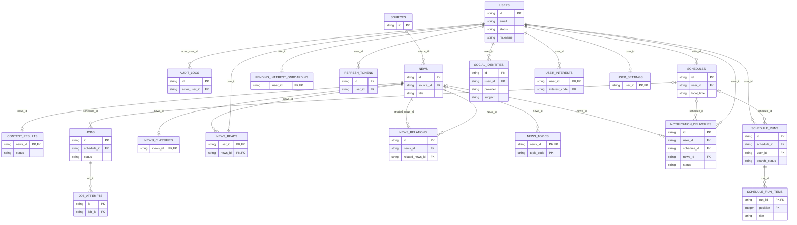

# DAIT DB 설계서 v1.0.5

| 항목 | 기준 |
|---|---|
| 검토일 | 2026-11-16 (Asia/Seoul) |
| 정본 | src/backend/migrations/versions 및 repositories |
| 적용 head | 0010_schedule_cron_job |
| 테이블 수 | 업무 20개 + alembic_version 1개 = 21개 |
| DB | 운영 PostgreSQL / 로컬·테스트 SQLite |
| 추출 방식 | 임시 SQLite 신규 DB에 head까지 마이그레이션 후 스키마 검사; 운영 DB 접속 없음 |
| 가이드 | [교과목 프로젝트 가이드](https://playdatacademy.notion.site/AI-4-3e4d943bcac28072a65ad03b00ab9f8a) 산출물 3 |


## 1. 범위·명명·타입 기준

본 문서는 실제 구현 물리 스키마를 기준으로 다시 작성했다. 과거 개념 테이블 `auth_identities`·`refresh_sessions` 대신 실제 `social_identities`·`refresh_tokens`를 사용한다. `users.password_hash`는 Google 전용 계정을 위해 nullable이며 `schedules.cron_job_id`가 구현돼 있다. 언어·번역 컬럼과 `en.*` 관심사 코드는 현재 소스에 남아 있으므로 미사용·삭제된 것으로 단정하지 않는다.

- PK는 VARCHAR 식별자이며 UUID 네이티브 타입이라고 표기하지 않는다. 길이는 컬럼 사전의 실제 값이다.
- JSON 배열·객체는 실제 TEXT 저장이다. JSONB는 현재 물리 타입이 아니므로 대체 DDL을 정본으로 제시하지 않는다.
- 아래 `기본값 없음`은 DB server_default가 없음을 뜻한다. ID·현재 시각·기본 설정은 애플리케이션이 주입할 수 있으므로 NULL 허용과 혼동하지 않는다.
- 코멘트는 문서 데이터 사전의 설명이며 SQL COMMENT가 DB에 구현됐다는 뜻은 아니다.
- PostgreSQL 타입은 Alembic의 오프라인 DDL, SQLite 타입·키·제약·인덱스는 신규 마이그레이션 DB 검사 결과를 기준으로 한다. PostgreSQL에 실제 적용해 검증한 결과는 아니다.
- pipeline 수집 앱의 별도 스키마와 본 계약 public 스키마를 구분한다. 아래 20개는 dait API의 Alembic 업무 테이블이며 별도 pipeline 저장소 전체를 뜻하지 않는다.


## 2. 정규화 기준과 예외

핵심 관계형 데이터는 3NF 기준으로 분리한다. 모든 컬럼이 자동으로 엄격한 3NF를 만족한다고 주장하지 않으며, JSON 조건·결과 스냅샷·검색 인덱스는 의도적인 비정규화다.

| 단계 | 적용 근거 | 해결하는 문제 |
|---|---|---|
| 1NF | 관심사·읽음·주제를 user_interests/news_reads/news_topics의 행 단위로 저장 | 다중 관심사를 사용자 컬럼에 반복 나열하지 않음 |
| 2NF | (user_id, interest_code), (user_id, news_id), (news_id, topic_code), (run_id, position) 복합키 사용 | 사용자 이름·기사 속성을 교차 테이블에 중복 저장하지 않음; 결과 스냅샷은 예외 |
| 3NF | 사용자 속성은 users, 출처 속성은 sources, 뉴스 메타는 news, AI 결과는 content_results에 분리 | 출처명·계정 속성 변경 시 모든 기사·관심사 행을 수정하는 갱신 이상 방지 |

### 2.1 주요 함수 종속
| 관계 | 결정자 → 종속 속성 | 설계 근거 |
|---|---|---|
| users | id → email, password_hash, role, status, nickname | email·정규화 nickname_key는 고유 후보키; 사용자 기준 데이터 |
| sources | id → name, base_url, priority | news.source_id로 출처 속성 분리 |
| news | id → source_id, title, canonical_url, published_at | canonical_url 고유값으로 중복 기사 방지 |
| content_results | news_id → summary_lines, status, model_id | 기사당 최대 하나의 처리 결과 |
| user_interests | (user_id, interest_code) → 관계 존재 | 관심사 이름·그룹은 코드 카탈로그에서 계산 |
| schedule_runs | id → schedule_id, scheduled_for, search_status, notify_status | 회차 상태는 예약의 반복 속성으로 합치지 않음 |

### 2.2 의도적인 비정규화와 통제
| 영역 | 이유 | 통제 |
|---|---|---|
| user_settings·schedules의 TEXT JSON | 필터·예약 조건의 원자적 문서 저장, SQLite/PostgreSQL 호환 | Pydantic·서비스 검증, JSON 객체의 내부 FK는 DB가 강제하지 않음 |
| content_results.summary_lines | AI 요약 묶음을 하나의 결과로 보존 | API 경계에서 리스트 길이·상태 검증 |
| schedule_run_items | 기사 제목·출처·URL·요약을 실행 당시 상태로 보존 | 원문이 변경돼도 과거 결과가 바뀌지 않음; 라이브 news FK를 강제하지 않는 스냅샷 |
| news_topics·news_classified | 조회 시 분류 계산을 피하는 파생 인덱스 | 콘텐츠 갱신 기준 시각을 함께 저장해 재분류 판단 |
| users.nickname_key | 정규화 닉네임의 고유 검색 | 서비스에서 nickname과 함께 갱신; unique index로 충돌 방지 |

문서 JSON 컬럼을 여러 값으로 분해해 엄격한 관계 모델로 바꾸는 것은 구현 변경 범위다. 이번 산출물에서는 현 구조의 예외와 검증 책임을 명시한다.


## 3. 논리 ERD

엔티티·핵심 속성·실제 FK 관계를 함께 표시한다. 이름 대응은 4절과 동일하며 한국어 의미는 4절 표를 따른다. 부모 쪽 `|o`는 자식 FK가 nullable임을 뜻한다. 부모마다 자식은 기본 0개 이상이며, 자식 FK가 PK/UNIQUE이면 최대 1개다.




## 4. 논리·물리 엔티티 대응
| 논리 엔티티 | 물리 테이블 | 기본키 | 컬럼 수 |
|---|---|---|---|
| 계정·설정·예약 변경 감사 | audit_logs | id | 7 |
| 기사별 AI 처리 결과 | content_results | news_id | 10 |
| 작업 단계별 시도 이력 | job_attempts | id | 6 |
| 백그라운드 작업 상태 | jobs | id | 9 |
| 수집 기사 메타데이터 | news | id | 10 |
| 기사 분류 기준 시각 | news_classified | news_id | 3 |
| 사용자 기사 읽음 기록 | news_reads | user_id, news_id | 2 |
| 관련 기사 관계 | news_relations | id | 6 |
| 기사별 주제 사전 분류 | news_topics | news_id, topic_code | 2 |
| 알림 전달·중복 방지 | notification_deliveries | id | 9 |
| 관심사 온보딩 대기 | pending_interest_onboarding | user_id | 1 |
| 리프레시 토큰 회전·폐기 | refresh_tokens | id | 7 |
| 회차별 결과 뉴스 스냅샷 | schedule_run_items | run_id, position | 8 |
| 예약 실행 회차·검색·알림 상태 | schedule_runs | id | 21 |
| 예약 수집 및 외부 cron 연결 | schedules | id | 10 |
| Google 계정 연결 | social_identities | id | 5 |
| 승인 출처 | sources | id | 9 |
| 사용자별 관심사 코드 | user_interests | user_id, interest_code | 2 |
| 개인 설정·내부 전달 정책 | user_settings | user_id | 9 |
| 사용자 계정 | users | id | 8 |


## 5. 물리 ERD

실제 20개 업무 테이블의 전체 컬럼·길이·PK·FK를 표시한다. 인덱스·UNIQUE·CHECK·삭제 동작은 6절에 빠짐없이 나열한다. 시스템 테이블 alembic_version은 업무 관계와 분리한다.

```mermaid
erDiagram
    AUDIT_LOGS {
        VARCHAR_36 id PK
        VARCHAR_36 actor_user_id FK
        VARCHAR_40 event
        VARCHAR_20 target_type
        VARCHAR_64 target_id
        VARCHAR_64 request_id
        TIMESTAMP_WITH_TIME_ZONE created_at
    }
    CONTENT_RESULTS {
        VARCHAR_36 news_id PK, FK
        TEXT extracted_text
        TEXT translated_text
        TEXT summary_lines
        VARCHAR_20 status
        VARCHAR_64 error_code
        VARCHAR_40 prompt_version
        VARCHAR_80 model_id
        TIMESTAMP_WITH_TIME_ZONE processed_at
        TIMESTAMP_WITH_TIME_ZONE updated_at
    }
    JOB_ATTEMPTS {
        VARCHAR_36 id PK
        VARCHAR_36 job_id FK
        VARCHAR_20 step
        INTEGER attempt_no
        VARCHAR_64 error_code
        TIMESTAMP_WITH_TIME_ZONE created_at
    }
    JOBS {
        VARCHAR_36 id PK
        VARCHAR_36 schedule_id FK
        VARCHAR_20 kind
        VARCHAR_200 dedupe_key
        VARCHAR_20 status
        TIMESTAMP_WITH_TIME_ZONE scheduled_at
        TIMESTAMP_WITH_TIME_ZONE started_at
        TIMESTAMP_WITH_TIME_ZONE finished_at
        TIMESTAMP_WITH_TIME_ZONE created_at
    }
    NEWS {
        VARCHAR_36 id PK
        VARCHAR_36 source_id FK
        TEXT title
        TEXT canonical_url
        TIMESTAMP_WITH_TIME_ZONE published_at
        TIMESTAMP_WITH_TIME_ZONE collected_at
        VARCHAR_20 category
        VARCHAR_8 original_language
        VARCHAR_64 content_hash
        TIMESTAMP_WITH_TIME_ZONE created_at
    }
    NEWS_CLASSIFIED {
        VARCHAR_36 news_id PK, FK
        VARCHAR_64 content_updated_at
        VARCHAR_64 classified_at
    }
    NEWS_READS {
        VARCHAR_64 user_id PK, FK
        VARCHAR_64 news_id PK, FK
    }
    NEWS_RELATIONS {
        VARCHAR_36 id PK
        VARCHAR_36 news_id FK
        VARCHAR_36 related_news_id FK
        TEXT reason
        FLOAT score
        TIMESTAMP_WITH_TIME_ZONE created_at
    }
    NEWS_TOPICS {
        VARCHAR_36 news_id PK, FK
        VARCHAR_32 topic_code PK
    }
    NOTIFICATION_DELIVERIES {
        VARCHAR_36 id PK
        VARCHAR_36 user_id FK
        VARCHAR_36 schedule_id FK
        VARCHAR_36 news_id FK
        VARCHAR_10 channel
        VARCHAR_200 dedupe_key
        VARCHAR_10 status
        TIMESTAMP_WITH_TIME_ZONE sent_at
        TIMESTAMP_WITH_TIME_ZONE created_at
    }
    PENDING_INTEREST_ONBOARDING {
        VARCHAR_36 user_id PK, FK
    }
    REFRESH_TOKENS {
        VARCHAR_36 id PK
        VARCHAR_36 user_id FK
        VARCHAR_36 family_id
        VARCHAR_64 token_hash
        TIMESTAMP_WITH_TIME_ZONE expires_at
        TIMESTAMP_WITH_TIME_ZONE revoked_at
        TIMESTAMP_WITH_TIME_ZONE created_at
    }
    SCHEDULE_RUN_ITEMS {
        VARCHAR_36 run_id PK, FK
        INTEGER position PK
        VARCHAR_36 news_id
        TEXT title
        VARCHAR_200 source_name
        TEXT url
        TIMESTAMP_WITH_TIME_ZONE published_at
        TEXT summary_lines
    }
    SCHEDULE_RUNS {
        VARCHAR_36 id PK
        VARCHAR_36 schedule_id FK
        VARCHAR_36 user_id FK
        VARCHAR_200 dedupe_key
        TIMESTAMP_WITH_TIME_ZONE scheduled_for
        TEXT criteria_json
        VARCHAR_20 search_status
        INTEGER search_attempts
        VARCHAR_200 search_error
        INTEGER result_count
        TIMESTAMP_WITH_TIME_ZONE started_at
        TIMESTAMP_WITH_TIME_ZONE finished_at
        VARCHAR_20 notify_status
        INTEGER notify_attempts
        VARCHAR_200 notify_error
        TIMESTAMP_WITH_TIME_ZONE notify_next_at
        TIMESTAMP_WITH_TIME_ZONE notified_at
        TIMESTAMP_WITH_TIME_ZONE lease_until
        TIMESTAMP_WITH_TIME_ZONE seen_at
        TIMESTAMP_WITH_TIME_ZONE created_at
        TIMESTAMP_WITH_TIME_ZONE updated_at
    }
    SCHEDULES {
        VARCHAR_36 id PK
        VARCHAR_36 user_id FK
        VARCHAR_8 local_time
        VARCHAR_64 timezone
        BOOLEAN enabled
        TEXT criteria_json
        TIMESTAMP_WITH_TIME_ZONE next_run_at
        TIMESTAMP_WITH_TIME_ZONE created_at
        TIMESTAMP_WITH_TIME_ZONE updated_at
        VARCHAR_64 cron_job_id
    }
    SOCIAL_IDENTITIES {
        VARCHAR_36 id PK
        VARCHAR_36 user_id FK
        VARCHAR_16 provider
        VARCHAR_255 subject
        TIMESTAMP_WITH_TIME_ZONE created_at
    }
    SOURCES {
        VARCHAR_36 id PK
        VARCHAR_200 name
        VARCHAR_20 kind
        TEXT base_url
        INTEGER priority
        BOOLEAN enabled
        TIMESTAMP_WITH_TIME_ZONE robots_checked_at
        TIMESTAMP_WITH_TIME_ZONE created_at
        TIMESTAMP_WITH_TIME_ZONE updated_at
    }
    USER_INTERESTS {
        VARCHAR_36 user_id PK, FK
        VARCHAR_32 interest_code PK
    }
    USER_SETTINGS {
        VARCHAR_36 user_id PK, FK
        SMALLINT default_count
        TEXT categories
        TEXT keywords
        TEXT source_ids
        BOOLEAN in_app_notice
        BOOLEAN email_notice
        TIMESTAMP_WITH_TIME_ZONE created_at
        TIMESTAMP_WITH_TIME_ZONE updated_at
    }
    USERS {
        VARCHAR_36 id PK
        VARCHAR_254 email
        VARCHAR_255 password_hash
        VARCHAR_16 status
        VARCHAR_16 role
        TIMESTAMP_WITH_TIME_ZONE created_at
        VARCHAR_30 nickname
        VARCHAR_90 nickname_key
    }
    USERS |o--o{ AUDIT_LOGS : actor_user_id
    NEWS ||--o| CONTENT_RESULTS : news_id
    JOBS ||--o{ JOB_ATTEMPTS : job_id
    SCHEDULES |o--o{ JOBS : schedule_id
    SOURCES ||--o{ NEWS : source_id
    NEWS ||--o| NEWS_CLASSIFIED : news_id
    USERS ||--o{ NEWS_READS : user_id
    NEWS ||--o{ NEWS_READS : news_id
    NEWS ||--o{ NEWS_RELATIONS : news_id
    NEWS ||--o{ NEWS_RELATIONS : related_news_id
    NEWS ||--o{ NEWS_TOPICS : news_id
    USERS ||--o{ NOTIFICATION_DELIVERIES : user_id
    SCHEDULES |o--o{ NOTIFICATION_DELIVERIES : schedule_id
    NEWS |o--o{ NOTIFICATION_DELIVERIES : news_id
    USERS ||--o| PENDING_INTEREST_ONBOARDING : user_id
    USERS ||--o{ REFRESH_TOKENS : user_id
    SCHEDULE_RUNS ||--o{ SCHEDULE_RUN_ITEMS : run_id
    SCHEDULES |o--o{ SCHEDULE_RUNS : schedule_id
    USERS ||--o{ SCHEDULE_RUNS : user_id
    USERS ||--o{ SCHEDULES : user_id
    USERS ||--o{ SOCIAL_IDENTITIES : user_id
    USERS ||--o{ USER_INTERESTS : user_id
    USERS ||--o| USER_SETTINGS : user_id
```




## 6. 전체 물리 컬럼 사전·키·제약·인덱스

표의 Null Y/N은 실제 마이그레이션 nullability다. 기본값은 DB server_default 기준이다. FK의 NO ACTION은 별도 ondelete 옵션 미설정이며 자동 CASCADE로 해석하지 않는다.


### alembic_version

마이그레이션 버전 관리

| 컬럼 | PostgreSQL 타입·길이 | SQLite 선언 타입 | Null | DB 기본값 | 키 | 코멘트 |
|---|---|---|---|---|---|---|
| version_num | VARCHAR(32) | VARCHAR(32) | N | 없음 | PK | Alembic 적용 리비전 |


기본키: `version_num`


FK 없음.


별도 UNIQUE 제약 없음(PK·unique index는 별도).


DB CHECK 없음; 허용값 검증이 있으면 API·서비스 계층 책임이다.


별도 명시 인덱스 없음. PK·UNIQUE 자동 인덱스와 구분한다.


### audit_logs

계정·설정·예약 변경 감사

| 컬럼 | PostgreSQL 타입·길이 | SQLite 선언 타입 | Null | DB 기본값 | 키 | 코멘트 |
|---|---|---|---|---|---|---|
| id | VARCHAR(36) | VARCHAR(36) | N | 없음 | PK | 불투명 행 식별자 |
| actor_user_id | VARCHAR(36) | VARCHAR(36) | Y | 없음 | FK | 행위자 계정; 삭제 시 비식별 |
| event | VARCHAR(40) | VARCHAR(40) | N | 없음 | - | 감사 이벤트 종류 |
| target_type | VARCHAR(20) | VARCHAR(20) | N | 없음 | - | 감사 대상 종류 |
| target_id | VARCHAR(64) | VARCHAR(64) | Y | 없음 | - | 감사 대상 식별자 |
| request_id | VARCHAR(64) | VARCHAR(64) | Y | 없음 | - | HTTP 요청·로그 연계 식별자 |
| created_at | TIMESTAMP WITH TIME ZONE | DATETIME | N | 없음 | - | 행 생성 시각 |


기본키: `id`


| FK 컬럼 | 참조 | ON DELETE |
|---|---|---|
| actor_user_id | users(id) | SET NULL |


별도 UNIQUE 제약 없음(PK·unique index는 별도).


DB CHECK 없음; 허용값 검증이 있으면 API·서비스 계층 책임이다.


| 인덱스 | 컬럼 순서 | 고유 | 조회 목적 |
|---|---|---|---|
| ix_audit_logs_created_at | created_at | N | 주요 접근 조건 created_at; 계정·설정·예약 변경 감사 조회/고유성 지원 |
| ix_audit_logs_event | event | N | 주요 접근 조건 event; 계정·설정·예약 변경 감사 조회/고유성 지원 |
| ix_audit_logs_request_id | request_id | N | 주요 접근 조건 request_id; 계정·설정·예약 변경 감사 조회/고유성 지원 |


### content_results

기사별 AI 처리 결과

| 컬럼 | PostgreSQL 타입·길이 | SQLite 선언 타입 | Null | DB 기본값 | 키 | 코멘트 |
|---|---|---|---|---|---|---|
| news_id | VARCHAR(36) | VARCHAR(36) | N | 없음 | PK,FK | 뉴스 식별자 |
| extracted_text | TEXT | TEXT | Y | 없음 | - | 정제 본문; 요약·기자명 추출 근거 |
| translated_text | TEXT | TEXT | Y | 없음 | - | 번역 본문; 현재 모델에 존재 |
| summary_lines | TEXT | TEXT | Y | 없음 | - | AI 요약 JSON 문자열; schedule_run_items는 TEXT 스냅샷 |
| status | VARCHAR(20) | VARCHAR(20) | N | 없음 | - | 해당 처리·전달·계정의 상태 코드 |
| error_code | VARCHAR(64) | VARCHAR(64) | Y | 없음 | - | 처리 실패 분류 코드 |
| prompt_version | VARCHAR(40) | VARCHAR(40) | Y | 없음 | - | AI 프롬프트 버전 |
| model_id | VARCHAR(80) | VARCHAR(80) | Y | 없음 | - | AI 모델 식별자 |
| processed_at | TIMESTAMP WITH TIME ZONE | DATETIME | Y | 없음 | - | AI 처리 완료 시각 |
| updated_at | TIMESTAMP WITH TIME ZONE | DATETIME | N | 없음 | - | 행 갱신 시각 |


기본키: `news_id`


| FK 컬럼 | 참조 | ON DELETE |
|---|---|---|
| news_id | news(id) | CASCADE |


별도 UNIQUE 제약 없음(PK·unique index는 별도).


DB CHECK 없음; 허용값 검증이 있으면 API·서비스 계층 책임이다.


| 인덱스 | 컬럼 순서 | 고유 | 조회 목적 |
|---|---|---|---|
| ix_content_results_status | status | N | 주요 접근 조건 status; 기사별 AI 처리 결과 조회/고유성 지원 |


### job_attempts

작업 단계별 시도 이력

| 컬럼 | PostgreSQL 타입·길이 | SQLite 선언 타입 | Null | DB 기본값 | 키 | 코멘트 |
|---|---|---|---|---|---|---|
| id | VARCHAR(36) | VARCHAR(36) | N | 없음 | PK | 불투명 행 식별자 |
| job_id | VARCHAR(36) | VARCHAR(36) | N | 없음 | FK,UNIQUE(아래 복합 제약 참조) | 상위 작업 식별자 |
| step | VARCHAR(20) | VARCHAR(20) | N | 없음 | UNIQUE(아래 복합 제약 참조) | 작업 단계 |
| attempt_no | INTEGER | INTEGER | N | 없음 | UNIQUE(아래 복합 제약 참조) | 해당 단계 시도 순번 |
| error_code | VARCHAR(64) | VARCHAR(64) | Y | 없음 | - | 처리 실패 분류 코드 |
| created_at | TIMESTAMP WITH TIME ZONE | DATETIME | N | 없음 | - | 행 생성 시각 |


기본키: `id`


| FK 컬럼 | 참조 | ON DELETE |
|---|---|---|
| job_id | jobs(id) | CASCADE |


| UNIQUE 제약 | 컬럼 |
|---|---|
| uq_job_attempts_step | job_id, step, attempt_no |


DB CHECK 없음; 허용값 검증이 있으면 API·서비스 계층 책임이다.


별도 명시 인덱스 없음. PK·UNIQUE 자동 인덱스와 구분한다.


### jobs

백그라운드 작업 상태

| 컬럼 | PostgreSQL 타입·길이 | SQLite 선언 타입 | Null | DB 기본값 | 키 | 코멘트 |
|---|---|---|---|---|---|---|
| id | VARCHAR(36) | VARCHAR(36) | N | 없음 | PK | 불투명 행 식별자 |
| schedule_id | VARCHAR(36) | VARCHAR(36) | Y | 없음 | FK | 예약 식별자; 삭제 후 이력 보존 시 NULL 가능 |
| kind | VARCHAR(20) | VARCHAR(20) | N | 없음 | - | 출처 유형 또는 작업 종류 |
| dedupe_key | VARCHAR(200) | VARCHAR(200) | N | 없음 | UNIQUE(아래 복합 제약 참조) | 동일 작업·회차·전달 중복 방지 키 |
| status | VARCHAR(20) | VARCHAR(20) | N | 없음 | - | 해당 처리·전달·계정의 상태 코드 |
| scheduled_at | TIMESTAMP WITH TIME ZONE | DATETIME | N | 없음 | - | 작업 예정 시각 |
| started_at | TIMESTAMP WITH TIME ZONE | DATETIME | Y | 없음 | - | 작업 시작 시각 |
| finished_at | TIMESTAMP WITH TIME ZONE | DATETIME | Y | 없음 | - | 작업 종료 시각 |
| created_at | TIMESTAMP WITH TIME ZONE | DATETIME | N | 없음 | - | 행 생성 시각 |


기본키: `id`


| FK 컬럼 | 참조 | ON DELETE |
|---|---|---|
| schedule_id | schedules(id) | RESTRICT |


| UNIQUE 제약 | 컬럼 |
|---|---|
| 자동명 | dedupe_key |


DB CHECK 없음; 허용값 검증이 있으면 API·서비스 계층 책임이다.


| 인덱스 | 컬럼 순서 | 고유 | 조회 목적 |
|---|---|---|---|
| ix_jobs_status_scheduled | status, scheduled_at | N | 주요 접근 조건 status, scheduled_at; 백그라운드 작업 상태 조회/고유성 지원 |


### news

수집 기사 메타데이터

| 컬럼 | PostgreSQL 타입·길이 | SQLite 선언 타입 | Null | DB 기본값 | 키 | 코멘트 |
|---|---|---|---|---|---|---|
| id | VARCHAR(36) | VARCHAR(36) | N | 없음 | PK | 불투명 행 식별자 |
| source_id | VARCHAR(36) | VARCHAR(36) | N | 없음 | FK | 승인 출처 식별자 |
| title | TEXT | TEXT | N | 없음 | - | 기사 제목; 이력 테이블은 당시 스냅샷 |
| canonical_url | TEXT | TEXT | N | 없음 | UNIQUE(아래 복합 제약 참조) | 정규화 원문 URL; 중복 방지 |
| published_at | TIMESTAMP WITH TIME ZONE | DATETIME | N | 없음 | - | 기사 발행 시각 |
| collected_at | TIMESTAMP WITH TIME ZONE | DATETIME | N | 없음 | - | 기사 수집 시각 |
| category | VARCHAR(20) | VARCHAR(20) | N | 없음 | - | 기사 분류 코드 |
| original_language | VARCHAR(8) | VARCHAR(8) | N | 없음 | - | 기사 원문 언어; 현재 API에도 사용 |
| content_hash | VARCHAR(64) | VARCHAR(64) | Y | 없음 | - | 본문 변경·중복 판단 해시 |
| created_at | TIMESTAMP WITH TIME ZONE | DATETIME | N | 없음 | - | 행 생성 시각 |


기본키: `id`


| FK 컬럼 | 참조 | ON DELETE |
|---|---|---|
| source_id | sources(id) | RESTRICT |


| UNIQUE 제약 | 컬럼 |
|---|---|
| 자동명 | canonical_url |


DB CHECK 없음; 허용값 검증이 있으면 API·서비스 계층 책임이다.


| 인덱스 | 컬럼 순서 | 고유 | 조회 목적 |
|---|---|---|---|
| ix_news_category_published | category, published_at | N | 주요 접근 조건 category, published_at; 수집 기사 메타데이터 조회/고유성 지원 |
| ix_news_content_hash | content_hash | N | 주요 접근 조건 content_hash; 수집 기사 메타데이터 조회/고유성 지원 |
| ix_news_published_at | published_at | N | 주요 접근 조건 published_at; 수집 기사 메타데이터 조회/고유성 지원 |
| ix_news_title | title | N | 주요 접근 조건 title; 수집 기사 메타데이터 조회/고유성 지원 |


### news_classified

기사 분류 기준 시각

| 컬럼 | PostgreSQL 타입·길이 | SQLite 선언 타입 | Null | DB 기본값 | 키 | 코멘트 |
|---|---|---|---|---|---|---|
| news_id | VARCHAR(36) | VARCHAR(36) | N | 없음 | PK,FK | 뉴스 식별자 |
| content_updated_at | VARCHAR(64) | VARCHAR(64) | N | 없음 | - | 주제 분류가 참조한 콘텐츠 갱신 시각 |
| classified_at | VARCHAR(64) | VARCHAR(64) | N | 없음 | - | 주제 분류 수행 시각 |


기본키: `news_id`


| FK 컬럼 | 참조 | ON DELETE |
|---|---|---|
| news_id | news(id) | CASCADE |


별도 UNIQUE 제약 없음(PK·unique index는 별도).


DB CHECK 없음; 허용값 검증이 있으면 API·서비스 계층 책임이다.


별도 명시 인덱스 없음. PK·UNIQUE 자동 인덱스와 구분한다.


### news_reads

사용자 기사 읽음 기록

| 컬럼 | PostgreSQL 타입·길이 | SQLite 선언 타입 | Null | DB 기본값 | 키 | 코멘트 |
|---|---|---|---|---|---|---|
| user_id | VARCHAR(64) | VARCHAR(64) | N | 없음 | PK,FK | 소유 사용자 식별자 |
| news_id | VARCHAR(64) | VARCHAR(64) | N | 없음 | PK,FK | 뉴스 식별자 |


기본키: `user_id, news_id`


| FK 컬럼 | 참조 | ON DELETE |
|---|---|---|
| user_id | users(id) | CASCADE |
| news_id | news(id) | CASCADE |


별도 UNIQUE 제약 없음(PK·unique index는 별도).


DB CHECK 없음; 허용값 검증이 있으면 API·서비스 계층 책임이다.


별도 명시 인덱스 없음. PK·UNIQUE 자동 인덱스와 구분한다.


### news_relations

관련 기사 관계

| 컬럼 | PostgreSQL 타입·길이 | SQLite 선언 타입 | Null | DB 기본값 | 키 | 코멘트 |
|---|---|---|---|---|---|---|
| id | VARCHAR(36) | VARCHAR(36) | N | 없음 | PK | 불투명 행 식별자 |
| news_id | VARCHAR(36) | VARCHAR(36) | N | 없음 | FK,UNIQUE(아래 복합 제약 참조) | 뉴스 식별자 |
| related_news_id | VARCHAR(36) | VARCHAR(36) | N | 없음 | FK,UNIQUE(아래 복합 제약 참조) | 관련 뉴스 식별자 |
| reason | TEXT | TEXT | N | 없음 | - | 관련 뉴스 연결 근거 |
| score | FLOAT | FLOAT | N | 없음 | - | 관련도 점수 |
| created_at | TIMESTAMP WITH TIME ZONE | DATETIME | N | 없음 | - | 행 생성 시각 |


기본키: `id`


| FK 컬럼 | 참조 | ON DELETE |
|---|---|---|
| news_id | news(id) | CASCADE |
| related_news_id | news(id) | CASCADE |


| UNIQUE 제약 | 컬럼 |
|---|---|
| uq_news_relations_pair | news_id, related_news_id |


| CHECK 이름 | 조건 |
|---|---|
| ck_news_relations_not_self | news_id <> related_news_id |


| 인덱스 | 컬럼 순서 | 고유 | 조회 목적 |
|---|---|---|---|
| ix_news_relations_news_score | news_id, score | N | 주요 접근 조건 news_id, score; 관련 기사 관계 조회/고유성 지원 |


### news_topics

기사별 주제 사전 분류

| 컬럼 | PostgreSQL 타입·길이 | SQLite 선언 타입 | Null | DB 기본값 | 키 | 코멘트 |
|---|---|---|---|---|---|---|
| news_id | VARCHAR(36) | VARCHAR(36) | N | 없음 | PK,FK | 뉴스 식별자 |
| topic_code | VARCHAR(32) | VARCHAR(32) | N | 없음 | PK | 기사에 부여된 주제 코드 |


기본키: `news_id, topic_code`


| FK 컬럼 | 참조 | ON DELETE |
|---|---|---|
| news_id | news(id) | CASCADE |


별도 UNIQUE 제약 없음(PK·unique index는 별도).


DB CHECK 없음; 허용값 검증이 있으면 API·서비스 계층 책임이다.


| 인덱스 | 컬럼 순서 | 고유 | 조회 목적 |
|---|---|---|---|
| ix_news_topics_code | topic_code | N | 주요 접근 조건 topic_code; 기사별 주제 사전 분류 조회/고유성 지원 |


### notification_deliveries

알림 전달·중복 방지

| 컬럼 | PostgreSQL 타입·길이 | SQLite 선언 타입 | Null | DB 기본값 | 키 | 코멘트 |
|---|---|---|---|---|---|---|
| id | VARCHAR(36) | VARCHAR(36) | N | 없음 | PK | 불투명 행 식별자 |
| user_id | VARCHAR(36) | VARCHAR(36) | N | 없음 | FK | 소유 사용자 식별자 |
| schedule_id | VARCHAR(36) | VARCHAR(36) | Y | 없음 | FK | 예약 식별자; 삭제 후 이력 보존 시 NULL 가능 |
| news_id | VARCHAR(36) | VARCHAR(36) | Y | 없음 | FK | 뉴스 식별자 |
| channel | VARCHAR(10) | VARCHAR(10) | N | 없음 | - | 알림 전달 채널 |
| dedupe_key | VARCHAR(200) | VARCHAR(200) | N | 없음 | UNIQUE(아래 복합 제약 참조) | 동일 작업·회차·전달 중복 방지 키 |
| status | VARCHAR(10) | VARCHAR(10) | N | 없음 | - | 해당 처리·전달·계정의 상태 코드 |
| sent_at | TIMESTAMP WITH TIME ZONE | DATETIME | Y | 없음 | - | 전달 완료 시각 |
| created_at | TIMESTAMP WITH TIME ZONE | DATETIME | N | 없음 | - | 행 생성 시각 |


기본키: `id`


| FK 컬럼 | 참조 | ON DELETE |
|---|---|---|
| user_id | users(id) | CASCADE |
| schedule_id | schedules(id) | SET NULL |
| news_id | news(id) | SET NULL |


| UNIQUE 제약 | 컬럼 |
|---|---|
| 자동명 | dedupe_key |


DB CHECK 없음; 허용값 검증이 있으면 API·서비스 계층 책임이다.


| 인덱스 | 컬럼 순서 | 고유 | 조회 목적 |
|---|---|---|---|
| ix_notification_deliveries_status | status | N | 주요 접근 조건 status; 알림 전달·중복 방지 조회/고유성 지원 |


### pending_interest_onboarding

관심사 온보딩 대기

| 컬럼 | PostgreSQL 타입·길이 | SQLite 선언 타입 | Null | DB 기본값 | 키 | 코멘트 |
|---|---|---|---|---|---|---|
| user_id | VARCHAR(36) | VARCHAR(36) | N | 없음 | PK,FK | 소유 사용자 식별자 |


기본키: `user_id`


| FK 컬럼 | 참조 | ON DELETE |
|---|---|---|
| user_id | users(id) | CASCADE |


별도 UNIQUE 제약 없음(PK·unique index는 별도).


DB CHECK 없음; 허용값 검증이 있으면 API·서비스 계층 책임이다.


별도 명시 인덱스 없음. PK·UNIQUE 자동 인덱스와 구분한다.


### refresh_tokens

리프레시 토큰 회전·폐기

| 컬럼 | PostgreSQL 타입·길이 | SQLite 선언 타입 | Null | DB 기본값 | 키 | 코멘트 |
|---|---|---|---|---|---|---|
| id | VARCHAR(36) | VARCHAR(36) | N | 없음 | PK | 불투명 행 식별자 |
| user_id | VARCHAR(36) | VARCHAR(36) | N | 없음 | FK | 소유 사용자 식별자 |
| family_id | VARCHAR(36) | VARCHAR(36) | N | 없음 | - | refresh 토큰 회전 계열 |
| token_hash | VARCHAR(64) | VARCHAR(64) | N | 없음 | UNIQUE(아래 복합 제약 참조) | 토큰 원문이 아닌 해시 |
| expires_at | TIMESTAMP WITH TIME ZONE | DATETIME | N | 없음 | - | 토큰 유효 종료 시각 |
| revoked_at | TIMESTAMP WITH TIME ZONE | DATETIME | Y | 없음 | - | 토큰 폐기 시각 |
| created_at | TIMESTAMP WITH TIME ZONE | DATETIME | N | 없음 | - | 행 생성 시각 |


기본키: `id`


| FK 컬럼 | 참조 | ON DELETE |
|---|---|---|
| user_id | users(id) | CASCADE |


| UNIQUE 제약 | 컬럼 |
|---|---|
| 자동명 | token_hash |


DB CHECK 없음; 허용값 검증이 있으면 API·서비스 계층 책임이다.


| 인덱스 | 컬럼 순서 | 고유 | 조회 목적 |
|---|---|---|---|
| ix_refresh_tokens_family_id | family_id | N | 주요 접근 조건 family_id; 리프레시 토큰 회전·폐기 조회/고유성 지원 |
| ix_refresh_tokens_user_id | user_id | N | 주요 접근 조건 user_id; 리프레시 토큰 회전·폐기 조회/고유성 지원 |


### schedule_run_items

회차별 결과 뉴스 스냅샷

| 컬럼 | PostgreSQL 타입·길이 | SQLite 선언 타입 | Null | DB 기본값 | 키 | 코멘트 |
|---|---|---|---|---|---|---|
| run_id | VARCHAR(36) | VARCHAR(36) | N | 없음 | PK,FK | 예약 실행 회차 식별자 |
| position | INTEGER | INTEGER | N | 없음 | PK | 실행 결과 내 위치 |
| news_id | VARCHAR(36) | VARCHAR(36) | N | 없음 | - | 뉴스 식별자 |
| title | TEXT | TEXT | N | 없음 | - | 기사 제목; 이력 테이블은 당시 스냅샷 |
| source_name | VARCHAR(200) | VARCHAR(200) | N | 없음 | - | 결과 생성 시점 출처명 스냅샷 |
| url | TEXT | TEXT | N | 없음 | - | 결과 생성 시점 원문 링크 |
| published_at | TIMESTAMP WITH TIME ZONE | DATETIME | N | 없음 | - | 기사 발행 시각 |
| summary_lines | TEXT | TEXT | Y | 없음 | - | AI 요약 JSON 문자열; schedule_run_items는 TEXT 스냅샷 |


기본키: `run_id, position`


| FK 컬럼 | 참조 | ON DELETE |
|---|---|---|
| run_id | schedule_runs(id) | CASCADE |


별도 UNIQUE 제약 없음(PK·unique index는 별도).


DB CHECK 없음; 허용값 검증이 있으면 API·서비스 계층 책임이다.


별도 명시 인덱스 없음. PK·UNIQUE 자동 인덱스와 구분한다.


### schedule_runs

예약 실행 회차·검색·알림 상태

| 컬럼 | PostgreSQL 타입·길이 | SQLite 선언 타입 | Null | DB 기본값 | 키 | 코멘트 |
|---|---|---|---|---|---|---|
| id | VARCHAR(36) | VARCHAR(36) | N | 없음 | PK | 불투명 행 식별자 |
| schedule_id | VARCHAR(36) | VARCHAR(36) | Y | 없음 | FK | 예약 식별자; 삭제 후 이력 보존 시 NULL 가능 |
| user_id | VARCHAR(36) | VARCHAR(36) | N | 없음 | FK | 소유 사용자 식별자 |
| dedupe_key | VARCHAR(200) | VARCHAR(200) | N | 없음 | UNIQUE(아래 복합 제약 참조) | 동일 작업·회차·전달 중복 방지 키 |
| scheduled_for | TIMESTAMP WITH TIME ZONE | DATETIME | N | 없음 | - | 회차의 예정 실행 시각 |
| criteria_json | TEXT | TEXT | N | 없음 | - | 예약 조건 객체의 JSON 문자열 |
| search_status | VARCHAR(20) | VARCHAR(20) | N | 없음 | - | 검색 단계 상태 |
| search_attempts | INTEGER | INTEGER | N | '0' | - | 검색 시도 횟수 |
| search_error | VARCHAR(200) | VARCHAR(200) | Y | 없음 | - | 검색 단계 오류 분류 |
| result_count | INTEGER | INTEGER | Y | 없음 | - | 검색 결과 건수 |
| started_at | TIMESTAMP WITH TIME ZONE | DATETIME | Y | 없음 | - | 작업 시작 시각 |
| finished_at | TIMESTAMP WITH TIME ZONE | DATETIME | Y | 없음 | - | 작업 종료 시각 |
| notify_status | VARCHAR(20) | VARCHAR(20) | N | 없음 | - | 알림 전송 단계 상태 |
| notify_attempts | INTEGER | INTEGER | N | '0' | - | 알림 시도 횟수 |
| notify_error | VARCHAR(200) | VARCHAR(200) | Y | 없음 | - | 알림 단계 오류 분류 |
| notify_next_at | TIMESTAMP WITH TIME ZONE | DATETIME | Y | 없음 | - | 예약 실행 회차·검색·알림 상태의 notify_next_at 저장값 |
| notified_at | TIMESTAMP WITH TIME ZONE | DATETIME | Y | 없음 | - | 예약 결과 알림 완료 시각 |
| lease_until | TIMESTAMP WITH TIME ZONE | DATETIME | Y | 없음 | - | 동시 처리 소유권 만료 시각 |
| seen_at | TIMESTAMP WITH TIME ZONE | DATETIME | Y | 없음 | - | 사용자가 실행 결과를 확인한 시각 |
| created_at | TIMESTAMP WITH TIME ZONE | DATETIME | N | 없음 | - | 행 생성 시각 |
| updated_at | TIMESTAMP WITH TIME ZONE | DATETIME | N | 없음 | - | 행 갱신 시각 |


기본키: `id`


| FK 컬럼 | 참조 | ON DELETE |
|---|---|---|
| schedule_id | schedules(id) | SET NULL |
| user_id | users(id) | CASCADE |


| UNIQUE 제약 | 컬럼 |
|---|---|
| 자동명 | dedupe_key |


DB CHECK 없음; 허용값 검증이 있으면 API·서비스 계층 책임이다.


| 인덱스 | 컬럼 순서 | 고유 | 조회 목적 |
|---|---|---|---|
| ix_schedule_runs_notify_status | notify_status | N | 주요 접근 조건 notify_status; 예약 실행 회차·검색·알림 상태 조회/고유성 지원 |
| ix_schedule_runs_search_status | search_status | N | 주요 접근 조건 search_status; 예약 실행 회차·검색·알림 상태 조회/고유성 지원 |
| ix_schedule_runs_user_created | user_id, created_at | N | 주요 접근 조건 user_id, created_at; 예약 실행 회차·검색·알림 상태 조회/고유성 지원 |


### schedules

예약 수집 및 외부 cron 연결

| 컬럼 | PostgreSQL 타입·길이 | SQLite 선언 타입 | Null | DB 기본값 | 키 | 코멘트 |
|---|---|---|---|---|---|---|
| id | VARCHAR(36) | VARCHAR(36) | N | 없음 | PK | 불투명 행 식별자 |
| user_id | VARCHAR(36) | VARCHAR(36) | N | 없음 | FK | 소유 사용자 식별자 |
| local_time | VARCHAR(8) | VARCHAR(8) | N | 없음 | - | 사용자 지역 예약 시각 HH:mm |
| timezone | VARCHAR(64) | VARCHAR(64) | N | 없음 | - | IANA 시간대 이름 |
| enabled | BOOLEAN | BOOLEAN | N | 1 | - | 사용 여부 |
| criteria_json | TEXT | TEXT | N | 없음 | - | 예약 조건 객체의 JSON 문자열 |
| next_run_at | TIMESTAMP WITH TIME ZONE | DATETIME | Y | 없음 | - | 다음 예약 실행 시각 |
| created_at | TIMESTAMP WITH TIME ZONE | DATETIME | N | 없음 | - | 행 생성 시각 |
| updated_at | TIMESTAMP WITH TIME ZONE | DATETIME | N | 없음 | - | 행 갱신 시각 |
| cron_job_id | VARCHAR(64) | VARCHAR(64) | Y | 없음 | - | cron-job.org 외부 job ID |


기본키: `id`


| FK 컬럼 | 참조 | ON DELETE |
|---|---|---|
| user_id | users(id) | CASCADE |


별도 UNIQUE 제약 없음(PK·unique index는 별도).


DB CHECK 없음; 허용값 검증이 있으면 API·서비스 계층 책임이다.


| 인덱스 | 컬럼 순서 | 고유 | 조회 목적 |
|---|---|---|---|
| ix_schedules_due | enabled, next_run_at | N | 주요 접근 조건 enabled, next_run_at; 예약 수집 및 외부 cron 연결 조회/고유성 지원 |
| ix_schedules_user_id | user_id | N | 주요 접근 조건 user_id; 예약 수집 및 외부 cron 연결 조회/고유성 지원 |


### social_identities

Google 계정 연결

| 컬럼 | PostgreSQL 타입·길이 | SQLite 선언 타입 | Null | DB 기본값 | 키 | 코멘트 |
|---|---|---|---|---|---|---|
| id | VARCHAR(36) | VARCHAR(36) | N | 없음 | PK | 불투명 행 식별자 |
| user_id | VARCHAR(36) | VARCHAR(36) | N | 없음 | FK,UNIQUE(아래 복합 제약 참조) | 소유 사용자 식별자 |
| provider | VARCHAR(16) | VARCHAR(16) | N | 없음 | UNIQUE(아래 복합 제약 참조) | 소셜 제공자 코드; GOOGLE |
| subject | VARCHAR(255) | VARCHAR(255) | N | 없음 | UNIQUE(아래 복합 제약 참조) | 제공자 고유 계정 식별자 |
| created_at | TIMESTAMP WITH TIME ZONE | DATETIME | N | 없음 | - | 행 생성 시각 |


기본키: `id`


| FK 컬럼 | 참조 | ON DELETE |
|---|---|---|
| user_id | users(id) | CASCADE |


| UNIQUE 제약 | 컬럼 |
|---|---|
| uq_social_identities_provider_subject | provider, subject |
| uq_social_identities_user_provider | user_id, provider |


| CHECK 이름 | 조건 |
|---|---|
| ck_social_identities_provider | provider IN ('GOOGLE') |


별도 명시 인덱스 없음. PK·UNIQUE 자동 인덱스와 구분한다.


### sources

승인 출처

| 컬럼 | PostgreSQL 타입·길이 | SQLite 선언 타입 | Null | DB 기본값 | 키 | 코멘트 |
|---|---|---|---|---|---|---|
| id | VARCHAR(36) | VARCHAR(36) | N | 없음 | PK | 불투명 행 식별자 |
| name | VARCHAR(200) | VARCHAR(200) | N | 없음 | - | 출처 표시 이름 |
| kind | VARCHAR(20) | VARCHAR(20) | N | 없음 | - | 출처 유형 또는 작업 종류 |
| base_url | TEXT | TEXT | N | 없음 | UNIQUE(아래 복합 제약 참조) | 승인 출처 기본 URL |
| priority | INTEGER | INTEGER | N | '100' | - | 출처 우선순위 |
| enabled | BOOLEAN | BOOLEAN | N | 1 | - | 사용 여부 |
| robots_checked_at | TIMESTAMP WITH TIME ZONE | DATETIME | Y | 없음 | - | robots 정책 확인 시각 |
| created_at | TIMESTAMP WITH TIME ZONE | DATETIME | N | 없음 | - | 행 생성 시각 |
| updated_at | TIMESTAMP WITH TIME ZONE | DATETIME | N | 없음 | - | 행 갱신 시각 |


기본키: `id`


FK 없음.


| UNIQUE 제약 | 컬럼 |
|---|---|
| 자동명 | base_url |


DB CHECK 없음; 허용값 검증이 있으면 API·서비스 계층 책임이다.


| 인덱스 | 컬럼 순서 | 고유 | 조회 목적 |
|---|---|---|---|
| ix_sources_enabled_priority | enabled, priority | N | 주요 접근 조건 enabled, priority; 승인 출처 조회/고유성 지원 |


### user_interests

사용자별 관심사 코드

| 컬럼 | PostgreSQL 타입·길이 | SQLite 선언 타입 | Null | DB 기본값 | 키 | 코멘트 |
|---|---|---|---|---|---|---|
| user_id | VARCHAR(36) | VARCHAR(36) | N | 없음 | PK,FK | 소유 사용자 식별자 |
| interest_code | VARCHAR(32) | VARCHAR(32) | N | 없음 | PK | 관심사 enum 코드; 애플리케이션 카탈로그 검증 |


기본키: `user_id, interest_code`


| FK 컬럼 | 참조 | ON DELETE |
|---|---|---|
| user_id | users(id) | CASCADE |


별도 UNIQUE 제약 없음(PK·unique index는 별도).


DB CHECK 없음; 허용값 검증이 있으면 API·서비스 계층 책임이다.


별도 명시 인덱스 없음. PK·UNIQUE 자동 인덱스와 구분한다.


### user_settings

개인 설정·내부 전달 정책

| 컬럼 | PostgreSQL 타입·길이 | SQLite 선언 타입 | Null | DB 기본값 | 키 | 코멘트 |
|---|---|---|---|---|---|---|
| user_id | VARCHAR(36) | VARCHAR(36) | N | 없음 | PK,FK | 소유 사용자 식별자 |
| default_count | SMALLINT | SMALLINT | N | '10' | - | 내부 목록 기본 개수; 5 또는 10 |
| categories | TEXT | TEXT | N | '["AI"]' | - | 카테고리 배열의 JSON 문자열 |
| keywords | TEXT | TEXT | N | '[]' | - | 검색 키워드 배열의 JSON 문자열 |
| source_ids | TEXT | TEXT | N | '[]' | - | 승인 출처 ID 배열의 JSON 문자열 |
| in_app_notice | BOOLEAN | BOOLEAN | N | 1 | - | 내부 인앱 전달 정책 |
| email_notice | BOOLEAN | BOOLEAN | N | 0 | - | 내부 이메일 전달 정책 |
| created_at | TIMESTAMP WITH TIME ZONE | DATETIME | N | 없음 | - | 행 생성 시각 |
| updated_at | TIMESTAMP WITH TIME ZONE | DATETIME | N | 없음 | - | 행 갱신 시각 |


기본키: `user_id`


| FK 컬럼 | 참조 | ON DELETE |
|---|---|---|
| user_id | users(id) | CASCADE |


별도 UNIQUE 제약 없음(PK·unique index는 별도).


| CHECK 이름 | 조건 |
|---|---|
| ck_user_settings_count | default_count IN (5, 10) |


별도 명시 인덱스 없음. PK·UNIQUE 자동 인덱스와 구분한다.


### users

사용자 계정

| 컬럼 | PostgreSQL 타입·길이 | SQLite 선언 타입 | Null | DB 기본값 | 키 | 코멘트 |
|---|---|---|---|---|---|---|
| id | VARCHAR(36) | VARCHAR(36) | N | 없음 | PK | 불투명 행 식별자 |
| email | VARCHAR(254) | VARCHAR(254) | N | 없음 | UNIQUE(아래 복합 제약 참조) | 정규화 이메일; 고유값 |
| password_hash | VARCHAR(255) | VARCHAR(255) | Y | 없음 | - | 비밀번호 해시; Google 전용 계정은 NULL |
| status | VARCHAR(16) | VARCHAR(16) | N | 없음 | - | 해당 처리·전달·계정의 상태 코드 |
| role | VARCHAR(16) | VARCHAR(16) | N | 없음 | - | 계정 권한 USER 또는 ADMIN |
| created_at | TIMESTAMP WITH TIME ZONE | DATETIME | N | 없음 | - | 행 생성 시각 |
| nickname | VARCHAR(30) | VARCHAR(30) | Y | 없음 | - | 화면 표시 닉네임 |
| nickname_key | VARCHAR(90) | VARCHAR(90) | Y | 없음 | - | 고유성 검사에 사용하는 정규화 닉네임 |


기본키: `id`


FK 없음.


| UNIQUE 제약 | 컬럼 |
|---|---|
| 자동명 | email |


| CHECK 이름 | 조건 |
|---|---|
| ck_users_role | role IN ('USER', 'ADMIN') |
| ck_users_status | status IN ('ACTIVE') |


| 인덱스 | 컬럼 순서 | 고유 | 조회 목적 |
|---|---|---|---|
| uq_users_nickname_key | nickname_key | Y | 주요 접근 조건 nickname_key; 사용자 계정 조회/고유성 지원 |


## 7. 관계·카디널리티·무결성 대응 검증
| 부모 | 자식(FK) | 참조 선택성 | 부모당 자식 수 | 삭제 동작 |
|---|---|---|---|---|
| users | audit_logs(actor_user_id) | 0..1 | 0..N | SET NULL |
| news | content_results(news_id) | 1 | 0..1 | CASCADE |
| jobs | job_attempts(job_id) | 1 | 0..N | CASCADE |
| schedules | jobs(schedule_id) | 0..1 | 0..N | RESTRICT |
| sources | news(source_id) | 1 | 0..N | RESTRICT |
| news | news_classified(news_id) | 1 | 0..1 | CASCADE |
| users | news_reads(user_id) | 1 | 0..N | CASCADE |
| news | news_reads(news_id) | 1 | 0..N | CASCADE |
| news | news_relations(news_id) | 1 | 0..N | CASCADE |
| news | news_relations(related_news_id) | 1 | 0..N | CASCADE |
| news | news_topics(news_id) | 1 | 0..N | CASCADE |
| users | notification_deliveries(user_id) | 1 | 0..N | CASCADE |
| schedules | notification_deliveries(schedule_id) | 0..1 | 0..N | SET NULL |
| news | notification_deliveries(news_id) | 0..1 | 0..N | SET NULL |
| users | pending_interest_onboarding(user_id) | 1 | 0..1 | CASCADE |
| users | refresh_tokens(user_id) | 1 | 0..N | CASCADE |
| schedule_runs | schedule_run_items(run_id) | 1 | 0..N | CASCADE |
| schedules | schedule_runs(schedule_id) | 0..1 | 0..N | SET NULL |
| users | schedule_runs(user_id) | 1 | 0..N | CASCADE |
| users | schedules(user_id) | 1 | 0..N | CASCADE |
| users | social_identities(user_id) | 1 | 0..N | CASCADE |
| users | user_interests(user_id) | 1 | 0..N | CASCADE |
| users | user_settings(user_id) | 1 | 0..1 | CASCADE |

논리 ERD·물리 ERD는 같은 FK 메타데이터에서 생성했다. 두 도표의 테이블 집합·관계 집합은 동일하며 물리 도표만 전체 컬럼으로 확장한다. `schedule_run_items.news_id`는 현재 DB FK가 아니므로 news와 강제 관계선을 그리지 않는다. 부모가 있다고 결과·설정 행이 반드시 존재한다는 애플리케이션 보장은 DB의 필수 1:1 제약과 구분한다.

### 7.1 스키마 계층과 데이터 삭제

사용자 데이터는 토큰의 user_id로 범위를 제한한다. DB FK에 명시된 CASCADE·SET NULL만 자동 동작으로 본다. 감사 로그는 actor_user_id SET NULL로 사용자 식별자를 분리하며 공유 뉴스는 탈퇴와 무관하게 유지한다. SQLite는 연결마다 PRAGMA foreign_keys=ON이다. 외부 cron job 삭제는 DB FK로 처리할 수 없어 schedule_service의 외부 연동·보상 로직이 담당한다.

### 7.2 마이그레이션 변경

0001_users → 0002_interests → 0003_news_settings 이후 닉네임·실행 이력 분기, 읽음·온보딩을 병합한 0007_merge_schedule_onboarding, 0008_social_identities와 0008_news_topics 분기를 0009_merge_social_topics에서 합친 뒤 0010_schedule_cron_job을 적용한다. 이전 head 0008 표기는 최신이 아니다.

## 8. 화면·API·DB 매핑
| 화면/행동 | API | 저장소·처리 |
|---|---|---|
| 메인 뉴스·검색 | GET /v1/news | news + sources + content_results; news_topics·news_classified는 사전 분류 |
| 관심사 칩·개수 | GET /v1/news/activity | user_interests + 주제 분류 + news_reads |
| 원문 링크·읽음 | PUT /v1/news/{id}/read | news.canonical_url; news_reads 멱등 기록 |
| 관심 카테고리 설정 | GET/PUT /v1/me/interests | user_interests; 코드 이름·그룹은 Python 카탈로그 |
| 닉네임 변경 | PATCH /v1/me/nickname | users.nickname·nickname_key |
| 예약 생성·삭제 | POST/DELETE /v1/me/schedules | schedules 및 cron_job_id 외부 job 연결 |
| 예약 검색·결과 | tick / GET /v1/me/schedule-runs | schedule_runs·schedule_run_items; lease·dedupe |
| Google 로그인·연결 | /v1/auth/google/* | social_identities + users + refresh_tokens |
| 설정 API 유지 필드 | GET/PATCH /v1/me/settings | user_settings; 목록 표시·노출/알림 UI는 미제공 |
| 내부 상세 API | GET /v1/news/{id} | news·content_results·sources·news_relations; 화면 미제공 |

수집·AI 처리 흐름은 승인 출처 → 기사 저장 → 추출·필요 시 번역·요약 → content_results → 주제 분류 → 목록 조회다. 현재 코드에 번역 필드·상태가 존재하므로 번역을 전면 제거했다는 과거 표현은 사용하지 않는다. API 조회 자체가 새 LLM 처리를 수행한다는 뜻은 아니다.

## 8.1 저장 스키마와 예약 검색 실행의 차이

- `schedules.criteria_json`에는 `source_ids`를 저장할 수 있지만 현재 `DbNewsSearcher.search()`는 출처 필터를 적용하지 않는다. 저장 가능한 필드가 모두 실행 필터로 작동하는 것은 아니다.
- `criteria.interests=null`이면 실행 시점의 `user_interests` 중 유효한 한국어 코드만 읽는다. `en.*`는 자동 반영에서 제외하며, 명시적으로 전달한 관심사 배열은 별도 스냅샷이다.
- 관심사별 결과를 먼저 채우고 한도가 남으면 `categories`·`keywords` 검색 결과로 보충한다. 따라서 실행 결과가 저장 관심사와 일치하는 기사만으로 구성된다고 보장하지 않는다. 명시적 빈 관심사 배열도 카테고리 검색은 계속한다.
- `news_reads` 저장은 공개 가능한 기사인지 서비스에서 먼저 확인한다. 없는 기사·비공개 기사는 404 `NEWS_NOT_FOUND`이며, 존재하지 않는 기사 ID를 FK 제약을 무시하고 성공 처리하지 않는다.
- 구현 근거: `services/news_activity_service.py:mark_read`, `services/schedule_run_service.py:DbNewsSearcher.search`, `_search_one`의 관심사 자동 반영 분기.

## 9. PostgreSQL 마이그레이션 DDL

다음 SQL은 실제 마이그레이션을 PostgreSQL dialect의 offline 모드로 출력한 전체 변경 이력이다. 운영 DB에 실행하지 않았다. CREATE와 후속 ALTER를 함께 적용해야 최종 스키마가 된다. 예시 JSONB 대체안이 아니라 현재 TEXT 저장 계약이다.

```sql
BEGIN;

CREATE TABLE alembic_version (
    version_num VARCHAR(32) NOT NULL,
    CONSTRAINT alembic_version_pkc PRIMARY KEY (version_num)
);

-- Running upgrade  -> 0001_users

CREATE TABLE users (
    id VARCHAR(36) NOT NULL,
    email VARCHAR(254) NOT NULL,
    password_hash VARCHAR(255) NOT NULL,
    status VARCHAR(16) NOT NULL,
    role VARCHAR(16) NOT NULL,
    created_at TIMESTAMP WITH TIME ZONE NOT NULL,
    PRIMARY KEY (id),
    CONSTRAINT ck_users_role CHECK (role IN ('USER', 'ADMIN')),
    CONSTRAINT ck_users_status CHECK (status IN ('ACTIVE')),
    UNIQUE (email)
);

CREATE TABLE refresh_tokens (
    id VARCHAR(36) NOT NULL,
    user_id VARCHAR(36) NOT NULL,
    family_id VARCHAR(36) NOT NULL,
    token_hash VARCHAR(64) NOT NULL,
    expires_at TIMESTAMP WITH TIME ZONE NOT NULL,
    revoked_at TIMESTAMP WITH TIME ZONE,
    created_at TIMESTAMP WITH TIME ZONE NOT NULL,
    PRIMARY KEY (id),
    FOREIGN KEY(user_id) REFERENCES users (id) ON DELETE CASCADE,
    UNIQUE (token_hash)
);

CREATE INDEX ix_refresh_tokens_user_id ON refresh_tokens (user_id);

CREATE INDEX ix_refresh_tokens_family_id ON refresh_tokens (family_id);

INSERT INTO alembic_version (version_num) VALUES ('0001_users') RETURNING alembic_version.version_num;

-- Running upgrade 0001_users -> 0002_interests

CREATE TABLE user_interests (
    user_id VARCHAR(36) NOT NULL,
    interest_code VARCHAR(32) NOT NULL,
    CONSTRAINT pk_user_interests PRIMARY KEY (user_id, interest_code),
    FOREIGN KEY(user_id) REFERENCES users (id) ON DELETE CASCADE
);

UPDATE alembic_version SET version_num='0002_interests' WHERE alembic_version.version_num = '0001_users';

-- Running upgrade 0002_interests -> 0003_news_settings

CREATE TABLE sources (
    id VARCHAR(36) NOT NULL,
    name VARCHAR(200) NOT NULL,
    kind VARCHAR(20) NOT NULL,
    base_url TEXT NOT NULL,
    priority INTEGER DEFAULT '100' NOT NULL,
    enabled BOOLEAN DEFAULT true NOT NULL,
    robots_checked_at TIMESTAMP WITH TIME ZONE,
    created_at TIMESTAMP WITH TIME ZONE NOT NULL,
    updated_at TIMESTAMP WITH TIME ZONE NOT NULL,
    PRIMARY KEY (id),
    UNIQUE (base_url)
);

CREATE INDEX ix_sources_enabled_priority ON sources (enabled, priority);

CREATE TABLE news (
    id VARCHAR(36) NOT NULL,
    source_id VARCHAR(36) NOT NULL,
    title TEXT NOT NULL,
    canonical_url TEXT NOT NULL,
    published_at TIMESTAMP WITH TIME ZONE NOT NULL,
    collected_at TIMESTAMP WITH TIME ZONE NOT NULL,
    category VARCHAR(20) NOT NULL,
    original_language VARCHAR(8) NOT NULL,
    content_hash VARCHAR(64),
    created_at TIMESTAMP WITH TIME ZONE NOT NULL,
    PRIMARY KEY (id),
    FOREIGN KEY(source_id) REFERENCES sources (id) ON DELETE RESTRICT,
    UNIQUE (canonical_url)
);

CREATE INDEX ix_news_title ON news (title);

CREATE INDEX ix_news_published_at ON news (published_at);

CREATE INDEX ix_news_category_published ON news (category, published_at);

CREATE INDEX ix_news_content_hash ON news (content_hash);

CREATE TABLE content_results (
    news_id VARCHAR(36) NOT NULL,
    extracted_text TEXT,
    translated_text TEXT,
    summary_lines TEXT,
    status VARCHAR(20) NOT NULL,
    error_code VARCHAR(64),
    prompt_version VARCHAR(40),
    model_id VARCHAR(80),
    processed_at TIMESTAMP WITH TIME ZONE,
    updated_at TIMESTAMP WITH TIME ZONE NOT NULL,
    PRIMARY KEY (news_id),
    FOREIGN KEY(news_id) REFERENCES news (id) ON DELETE CASCADE
);

CREATE INDEX ix_content_results_status ON content_results (status);

CREATE TABLE news_relations (
    id VARCHAR(36) NOT NULL,
    news_id VARCHAR(36) NOT NULL,
    related_news_id VARCHAR(36) NOT NULL,
    reason TEXT NOT NULL,
    score FLOAT NOT NULL,
    created_at TIMESTAMP WITH TIME ZONE NOT NULL,
    PRIMARY KEY (id),
    CONSTRAINT uq_news_relations_pair UNIQUE (news_id, related_news_id),
    CONSTRAINT ck_news_relations_not_self CHECK (news_id <> related_news_id),
    FOREIGN KEY(news_id) REFERENCES news (id) ON DELETE CASCADE,
    FOREIGN KEY(related_news_id) REFERENCES news (id) ON DELETE CASCADE
);

CREATE INDEX ix_news_relations_news_score ON news_relations (news_id, score);

CREATE TABLE user_settings (
    user_id VARCHAR(36) NOT NULL,
    default_count SMALLINT DEFAULT '10' NOT NULL,
    categories TEXT DEFAULT '["AI"]' NOT NULL,
    keywords TEXT DEFAULT '[]' NOT NULL,
    source_ids TEXT DEFAULT '[]' NOT NULL,
    in_app_notice BOOLEAN DEFAULT true NOT NULL,
    email_notice BOOLEAN DEFAULT false NOT NULL,
    created_at TIMESTAMP WITH TIME ZONE NOT NULL,
    updated_at TIMESTAMP WITH TIME ZONE NOT NULL,
    PRIMARY KEY (user_id),
    CONSTRAINT ck_user_settings_count CHECK (default_count IN (5, 10)),
    FOREIGN KEY(user_id) REFERENCES users (id) ON DELETE CASCADE
);

CREATE TABLE schedules (
    id VARCHAR(36) NOT NULL,
    user_id VARCHAR(36) NOT NULL,
    local_time VARCHAR(8) NOT NULL,
    timezone VARCHAR(64) NOT NULL,
    enabled BOOLEAN DEFAULT true NOT NULL,
    criteria_json TEXT NOT NULL,
    next_run_at TIMESTAMP WITH TIME ZONE,
    created_at TIMESTAMP WITH TIME ZONE NOT NULL,
    updated_at TIMESTAMP WITH TIME ZONE NOT NULL,
    PRIMARY KEY (id),
    FOREIGN KEY(user_id) REFERENCES users (id) ON DELETE CASCADE
);

CREATE INDEX ix_schedules_user_id ON schedules (user_id);

CREATE INDEX ix_schedules_due ON schedules (enabled, next_run_at);

CREATE TABLE jobs (
    id VARCHAR(36) NOT NULL,
    schedule_id VARCHAR(36),
    kind VARCHAR(20) NOT NULL,
    dedupe_key VARCHAR(200) NOT NULL,
    status VARCHAR(20) NOT NULL,
    scheduled_at TIMESTAMP WITH TIME ZONE NOT NULL,
    started_at TIMESTAMP WITH TIME ZONE,
    finished_at TIMESTAMP WITH TIME ZONE,
    created_at TIMESTAMP WITH TIME ZONE NOT NULL,
    PRIMARY KEY (id),
    FOREIGN KEY(schedule_id) REFERENCES schedules (id) ON DELETE RESTRICT,
    UNIQUE (dedupe_key)
);

CREATE INDEX ix_jobs_status_scheduled ON jobs (status, scheduled_at);

CREATE TABLE job_attempts (
    id VARCHAR(36) NOT NULL,
    job_id VARCHAR(36) NOT NULL,
    step VARCHAR(20) NOT NULL,
    attempt_no INTEGER NOT NULL,
    error_code VARCHAR(64),
    created_at TIMESTAMP WITH TIME ZONE NOT NULL,
    PRIMARY KEY (id),
    CONSTRAINT uq_job_attempts_step UNIQUE (job_id, step, attempt_no),
    FOREIGN KEY(job_id) REFERENCES jobs (id) ON DELETE CASCADE
);

CREATE TABLE notification_deliveries (
    id VARCHAR(36) NOT NULL,
    user_id VARCHAR(36) NOT NULL,
    schedule_id VARCHAR(36),
    news_id VARCHAR(36),
    channel VARCHAR(10) NOT NULL,
    dedupe_key VARCHAR(200) NOT NULL,
    status VARCHAR(10) NOT NULL,
    sent_at TIMESTAMP WITH TIME ZONE,
    created_at TIMESTAMP WITH TIME ZONE NOT NULL,
    PRIMARY KEY (id),
    FOREIGN KEY(user_id) REFERENCES users (id) ON DELETE CASCADE,
    FOREIGN KEY(schedule_id) REFERENCES schedules (id) ON DELETE SET NULL,
    FOREIGN KEY(news_id) REFERENCES news (id) ON DELETE SET NULL,
    UNIQUE (dedupe_key)
);

CREATE INDEX ix_notification_deliveries_status ON notification_deliveries (status);

CREATE TABLE audit_logs (
    id VARCHAR(36) NOT NULL,
    actor_user_id VARCHAR(36),
    event VARCHAR(40) NOT NULL,
    target_type VARCHAR(20) NOT NULL,
    target_id VARCHAR(64),
    request_id VARCHAR(64),
    created_at TIMESTAMP WITH TIME ZONE NOT NULL,
    PRIMARY KEY (id),
    FOREIGN KEY(actor_user_id) REFERENCES users (id) ON DELETE SET NULL
);

CREATE INDEX ix_audit_logs_event ON audit_logs (event);

CREATE INDEX ix_audit_logs_request_id ON audit_logs (request_id);

CREATE INDEX ix_audit_logs_created_at ON audit_logs (created_at);

UPDATE alembic_version SET version_num='0003_news_settings' WHERE alembic_version.version_num = '0002_interests';

-- Running upgrade 0003_news_settings -> 0004_user_nickname

ALTER TABLE users ADD COLUMN nickname VARCHAR(30);

ALTER TABLE users ADD COLUMN nickname_key VARCHAR(90);

CREATE UNIQUE INDEX uq_users_nickname_key ON users (nickname_key);

UPDATE alembic_version SET version_num='0004_user_nickname' WHERE alembic_version.version_num = '0003_news_settings';

-- Running upgrade 0004_user_nickname -> 0005_news_reads

CREATE TABLE news_reads (
    user_id VARCHAR(64) NOT NULL,
    news_id VARCHAR(64) NOT NULL,
    PRIMARY KEY (user_id, news_id),
    FOREIGN KEY(user_id) REFERENCES users (id) ON DELETE CASCADE,
    FOREIGN KEY(news_id) REFERENCES news (id) ON DELETE CASCADE
);

UPDATE alembic_version SET version_num='0005_news_reads' WHERE alembic_version.version_num = '0004_user_nickname';

-- Running upgrade 0005_news_reads -> 0006_interest_onboarding

CREATE TABLE pending_interest_onboarding (
    user_id VARCHAR(36) NOT NULL,
    PRIMARY KEY (user_id),
    FOREIGN KEY(user_id) REFERENCES users (id) ON DELETE CASCADE
);

UPDATE alembic_version SET version_num='0006_interest_onboarding' WHERE alembic_version.version_num = '0005_news_reads';

-- Running upgrade 0003_news_settings -> 0004_schedule_runs

CREATE TABLE schedule_runs (
    id VARCHAR(36) NOT NULL,
    schedule_id VARCHAR(36),
    user_id VARCHAR(36) NOT NULL,
    dedupe_key VARCHAR(200) NOT NULL,
    scheduled_for TIMESTAMP WITH TIME ZONE NOT NULL,
    criteria_json TEXT NOT NULL,
    search_status VARCHAR(20) NOT NULL,
    search_attempts INTEGER DEFAULT '0' NOT NULL,
    search_error VARCHAR(200),
    result_count INTEGER,
    started_at TIMESTAMP WITH TIME ZONE,
    finished_at TIMESTAMP WITH TIME ZONE,
    notify_status VARCHAR(20) NOT NULL,
    notify_attempts INTEGER DEFAULT '0' NOT NULL,
    notify_error VARCHAR(200),
    notify_next_at TIMESTAMP WITH TIME ZONE,
    notified_at TIMESTAMP WITH TIME ZONE,
    lease_until TIMESTAMP WITH TIME ZONE,
    seen_at TIMESTAMP WITH TIME ZONE,
    created_at TIMESTAMP WITH TIME ZONE NOT NULL,
    updated_at TIMESTAMP WITH TIME ZONE NOT NULL,
    PRIMARY KEY (id),
    FOREIGN KEY(schedule_id) REFERENCES schedules (id) ON DELETE SET NULL,
    FOREIGN KEY(user_id) REFERENCES users (id) ON DELETE CASCADE,
    UNIQUE (dedupe_key)
);

CREATE INDEX ix_schedule_runs_user_created ON schedule_runs (user_id, created_at);

CREATE INDEX ix_schedule_runs_search_status ON schedule_runs (search_status);

CREATE INDEX ix_schedule_runs_notify_status ON schedule_runs (notify_status);

CREATE TABLE schedule_run_items (
    run_id VARCHAR(36) NOT NULL,
    position INTEGER NOT NULL,
    news_id VARCHAR(36) NOT NULL,
    title TEXT NOT NULL,
    source_name VARCHAR(200) NOT NULL,
    url TEXT NOT NULL,
    published_at TIMESTAMP WITH TIME ZONE NOT NULL,
    summary_lines TEXT,
    CONSTRAINT pk_schedule_run_items PRIMARY KEY (run_id, position),
    FOREIGN KEY(run_id) REFERENCES schedule_runs (id) ON DELETE CASCADE
);

INSERT INTO alembic_version (version_num) VALUES ('0004_schedule_runs') RETURNING alembic_version.version_num;

-- Running upgrade 0004_schedule_runs, 0006_interest_onboarding -> 0007_merge_schedule_onboarding

DELETE FROM alembic_version WHERE alembic_version.version_num = '0004_schedule_runs';

UPDATE alembic_version SET version_num='0007_merge_schedule_onboarding' WHERE alembic_version.version_num = '0006_interest_onboarding';

-- Running upgrade 0007_merge_schedule_onboarding -> 0008_social_identities

CREATE TABLE social_identities (
    id VARCHAR(36) NOT NULL,
    user_id VARCHAR(36) NOT NULL,
    provider VARCHAR(16) NOT NULL,
    subject VARCHAR(255) NOT NULL,
    created_at TIMESTAMP WITH TIME ZONE NOT NULL,
    PRIMARY KEY (id),
    CONSTRAINT ck_social_identities_provider CHECK (provider IN ('GOOGLE')),
    CONSTRAINT uq_social_identities_provider_subject UNIQUE (provider, subject),
    CONSTRAINT uq_social_identities_user_provider UNIQUE (user_id, provider),
    FOREIGN KEY(user_id) REFERENCES users (id) ON DELETE CASCADE
);

ALTER TABLE users ALTER COLUMN password_hash DROP NOT NULL;

UPDATE alembic_version SET version_num='0008_social_identities' WHERE alembic_version.version_num = '0007_merge_schedule_onboarding';

-- Running upgrade 0007_merge_schedule_onboarding -> 0008_news_topics

CREATE TABLE news_classified (
    news_id VARCHAR(36) NOT NULL,
    content_updated_at VARCHAR(64) NOT NULL,
    classified_at VARCHAR(64) NOT NULL,
    PRIMARY KEY (news_id),
    FOREIGN KEY(news_id) REFERENCES news (id) ON DELETE CASCADE
);

CREATE TABLE news_topics (
    news_id VARCHAR(36) NOT NULL,
    topic_code VARCHAR(32) NOT NULL,
    CONSTRAINT pk_news_topics PRIMARY KEY (news_id, topic_code),
    FOREIGN KEY(news_id) REFERENCES news (id) ON DELETE CASCADE
);

CREATE INDEX ix_news_topics_code ON news_topics (topic_code);

INSERT INTO alembic_version (version_num) VALUES ('0008_news_topics') RETURNING alembic_version.version_num;

-- Running upgrade 0008_news_topics, 0008_social_identities -> 0009_merge_social_topics

DELETE FROM alembic_version WHERE alembic_version.version_num = '0008_news_topics';

UPDATE alembic_version SET version_num='0009_merge_social_topics' WHERE alembic_version.version_num = '0008_social_identities';

-- Running upgrade 0009_merge_social_topics -> 0010_schedule_cron_job

ALTER TABLE schedules ADD COLUMN cron_job_id VARCHAR(64);

UPDATE alembic_version SET version_num='0010_schedule_cron_job' WHERE alembic_version.version_num = '0009_merge_social_topics';

COMMIT;
```

## 10. 제출 기준 검토 결과
| 필수 항목 | 반영 위치 | 검토 결과 |
|---|---|---|
| 3NF와 정규화 근거 | 2절 | 핵심 함수 종속·갱신 이상 방지와 JSON/스냅샷 비정규화 예외 명시 |
| 논리 ERD | 3~4절 | 20개 엔티티·핵심 속성·FK·카디널리티 |
| 물리 ERD | 5~6절 | 전체 컬럼·실제 PK/FK·인덱스·제약 |
| 컬럼 타입·길이·제약·기본값·코멘트 | 6절 | 21개 테이블 전체 컬럼 사전, server_default와 문서 코멘트 구분 |
| 논리·물리 일치 | 7절 | 동일 관계 메타데이터 사용, 실제 없는 FK 제외 |
| DDL·인덱스 선정 근거 | 6·9절 | 실제 인덱스 컬럼 순서와 주요 조회 목적, PostgreSQL offline SQL |

검증 기록: 임시 신규 SQLite DB에 head 적용 성공, FK 대상 테이블·컬럼 존재 확인, ERD 집합과 컬럼 사전 일치 확인. PostgreSQL SQL은 offline 생성 성공이며 운영 DB 실제 적용·성능 측정은 검증 범위 밖이다. 애플리케이션 카탈로그·상한 검증은 DB CHECK가 없으면 DB 강제 제약으로 표기하지 않았다.
